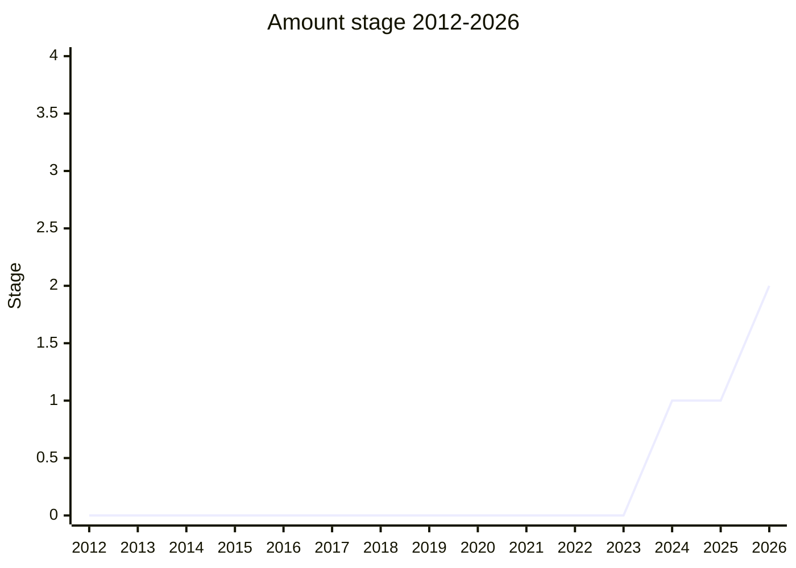

## Overview

Amount (called **Measure** until 2025-07; repository `tc39/proposal-measure`, now `tc39/proposal-amount`) is an **ECMA-262** proposal for an immutable built-in that pairs a numeric value with a unit identifier. It is not an Intl API, but it grew out of ECMA-402 needs and most of its design questions are Intl questions. Three problems motivated it. First, `Intl.NumberFormat` takes the unit or currency in the constructor and the number in `format()`, so the two live apart and are easy to mix up, which hurts `Intl.MessageFormat` in particular. Second, the value has to carry its precision (trailing zeros) so that NumberFormat and PluralRules agree. Third, TG2 holds that any unit conversion Intl performs, for example in Smart Unit Preferences, must also be available outside Intl, or developers will parse formatted output to get it.

The Stage 2 design (2026-05) is small. The constructor takes a Number, BigInt or numeric string plus an options bag with an optional `unit`, `fractionDigits` or `significantDigits` and a `roundingMode`. Rounding happens once, on construction. The input type is kept unless precision options are given; in that case the value becomes a numeric string in exponential notation, so its precision cannot be misread. There is no arithmetic. `convertTo()` converts between units using CLDR's `units.xml` (a new normative reference for ECMA-262), and ECMA-402 extends it with `locale` / `usage` conversions, the core of Smart Unit Preferences. Formatting goes through `toLocaleString()` or by passing the Amount to `Intl.NumberFormat`, which reads its public `value` and `unit` fields through the [Intl Unit Protocol](#how-intl-reads-an-amount-internal-slots-vs-a-public-protocol).

```js
// Sketch of the Stage 2 shape presented at the 2026-05 plenary (details are still moving)
const a = new Amount(80, { unit: "kilogram" });
a.value; // 80: a Number stays a Number (BigInt and numeric strings are kept as given)
a.unit;  // "kilogram"; no unit is represented by null (under discussion)
const b = a.convertTo({ unit: "pound", fractionDigits: 1 });
b.value; // a numeric string in exponential notation, e.g. "9.45e+1" for 94.5
a.convertTo({ locale: "en-US", usage: "person" }); // ECMA-402: locale/usage-driven target unit
new Intl.NumberFormat("en", { style: "unit" }).format(a); // unit read from the value, not the constructor
a.toString(); // bracketed "[<value> <unit>]" serialization, "~" for no unit (under discussion)
```

The canonical table lists Ben Allen ([BAN](../people/BAN.md)) as author and champion, with [WH](../people/WH.md) and [JHD](../people/JHD.md) as Stage 2.7 reviewers. [BAN](../people/BAN.md) presented it for Stage 1 and in 2025-09 to 2026-03. During [BAN](../people/BAN.md)'s medical leave (2024-12 to mid-2025) the work passed to a wider champion group: [EAO](../people/EAO.md) asked to be recognized as a champion in 2025-02 and presented the 2024-12, 2025-07 and 2026-05 slots (including the successful Stage 2 request); [JMN](../people/JMN.md) co-presented and, in [BAN](../people/BAN.md)'s words, did "most of the recent spec implementation"; and [SFC](../people/SFC.md) said in plenary "I’m champion of the amount proposal" (2025-09). [EAO](../people/EAO.md) and [SFC](../people/SFC.md) are listed as champions here on the basis of these statements in the notes, not the canonical table; [JMN](../people/JMN.md) is a contributor, not a declared champion. The scope went through three phases. It started as a Smart Units spin-off with unit conversion and mixed units. From 2025-02 to 2025-09 it shrank to an opaque value, unit and precision holder, and was renamed. From 2025-11 unit conversion came back, after the HTML `<amount>` element made in-browser conversion likely. Stage 1 came at the 2024-10 plenary and Stage 2 at 2026-05. The attempts in 2025-07, 2025-09 and 2026-03 did not advance.

## Stage history

| Meeting                                                                              | Venue   | Event                                                                                                                                                                                                                                                                                                                                                                                                                 | Stage |
| ------------------------------------------------------------------------------------ | ------- | --------------------------------------------------------------------------------------------------------------------------------------------------------------------------------------------------------------------------------------------------------------------------------------------------------------------------------------------------------------------------------------------------------------------- | ----- |
| [2024-06](https://github.com/tc39/notes/blob/main/meetings/2024-06/june-12.md)       | plenary | `Smart units progress update` ([BAN](../people/BAN.md)): [EAO](../people/EAO.md) insists that a unit conversion API that "is not an internationalization API" be part of the work "from the get-go"; [SFC](../people/SFC.md) later cites this Helsinki feedback as the origin of Measure                                                                                                                              | 0     |
| [2024-08-22](https://github.com/tc39/ecma402/blob/main/meetings/notes-2024-08-22.md) | TG2     | Smart Units update: [SFC](../people/SFC.md) proposes 'a type called “measure”' carrying units (including mixed units) for conversion and MessageFormat; [EAO](../people/EAO.md) offers to co-champion; Smart Units to be put "on the shelf for a year"                                                                                                                                                                | 0     |
| [2024-09-26](https://github.com/tc39/ecma402/blob/main/meetings/notes-2024-09-26.md) | TG2     | `Design for currency and unit inputs that carry their values` (ecma402#911): `new Measure(100, "centimeter")` with `convert()` / `localeConvert()`; the Decimal champions' `proposal-numerics-with-precision` idea (ecma402#926) is folded in ([NRO](../people/NRO.md): with a unitless Measure, no separate number-with-precision is needed)                                                                         | 0     |
| [2024-10](https://github.com/tc39/notes/blob/main/meetings/2024-10/october-10.md)    | plenary | Reached Stage 1. `Measure object stage 0` ([BAN](../people/BAN.md)): put on the agenda for Stage 0, but after [SFC](../people/SFC.md) and [YSV](../people/YSV.md) argued for Stage 1, [BAN](../people/BAN.md) asked for it; support from [RKG](../people/RKG.md), [JHD](../people/JHD.md), [YSV](../people/YSV.md), [PHE](../people/PHE.md). "Plenary has decided to approve the measure proposal for Stage 1."       | 0 → 1 |
| [2024-12](https://github.com/tc39/notes/blob/main/meetings/2024-12/december-05.md)   | plenary | `Measure Stage 1 update`, presented by [EAO](../people/EAO.md) with [BAN](../people/BAN.md) on medical leave; scope question (formatting and conversion only, or arithmetic too?); [WH](../people/WH.md) asks for a presentation on precision first                                                                                                                                                                   | 1     |
| [2025-01-16](https://github.com/tc39/ecma402/blob/main/meetings/notes-2025-01-16.md) | TG2     | `Decimal + Measure proposal`: [JMN](../people/JMN.md) proposes unifying the two; [SFC](../people/SFC.md) wants both at Stage 2 "in the same meeting"; [EAO](../people/EAO.md) wants them separate                                                                                                                                                                                                                     | 1     |
| [2025-02](https://github.com/tc39/notes/blob/main/meetings/2025-02/february-19.md)   | plenary | `A unified vision for measure and decimal` ([JMN](../people/JMN.md), [EAO](../people/EAO.md)); [EAO](../people/EAO.md) proposes an opaque class "called Amount". "There is little to no support for outright merging of the proposals"; unit conversion "regarded as a secondary/separate concern". Continuation next day ([SFC](../people/SFC.md)) uses the name Amount; delegates ask to explore a protocol instead | 1     |
| [2025-04](https://github.com/tc39/notes/blob/main/meetings/2025-04/april-16.md)      | plenary | Decimal update `Stage 1 update for decimal & measure: Amounts` ([JMN](../people/JMN.md)): a Decimal-backed `Decimal.Amount` / "`Decimal.Something`"; [WH](../people/WH.md) and [MM](../people/MM.md) object to tying precision to Decimal                                                                                                                                                                             | 1     |
| [2025-07-17](https://github.com/tc39/ecma402/blob/main/meetings/notes-2025-07-17.md) | TG2     | `Proposal Measure for Stage 2` ([EAO](../people/EAO.md)): reduced scope, rename to Amount planned; "Do we have agreement in TG2 for Amount going to Stage 2?" — support from [RGN](../people/RGN.md), [SFC](../people/SFC.md), [PFC](../people/PFC.md); [YSZ](../people/YSZ.md) "No strong opinion"                                                                                                                   | 1     |
| [2025-07](https://github.com/tc39/notes/blob/main/meetings/2025-07/july-29.md)       | plenary | `Measure→Amount for Stage 2` ([EAO](../people/EAO.md)): "The proposal was renamed, but did not advance to Stage 2." [WH](../people/WH.md) blocks over non-finite values; [KG](../people/KG.md) questions motivation                                                                                                                                                                                                   | 1     |
| [2025-07](https://github.com/tc39/notes/blob/main/meetings/2025-07/july-30.md)       | plenary | Continuation ([JMN](../people/JMN.md), [SFC](../people/SFC.md)): limits of `ToIntlMathematicalValue` and of Amount values; [WH](../people/WH.md) wants at least Decimal128 range and exponential output for huge values                                                                                                                                                                                               | 1     |
| [2025-08-14](https://github.com/tc39/ecma402/blob/main/meetings/notes-2025-08-14.md) | TG2     | [EAO](../people/EAO.md): Amount "got support from TG2 for proceeding to stage 2, but did not get that approval from TG1"; [SFC](../people/SFC.md) does not treat the new W3C i18n review requirement as binding on it                                                                                                                                                                                                 | 1     |
| [2025-09](https://github.com/tc39/notes/blob/main/meetings/2025-09/september-22.md)  | plenary | `Amount for Stage 2` ([BAN](../people/BAN.md)) turned into a Stage 1 update: arithmetic removed, rounding on the way in, `-0` / ±Infinity / NaN added; three continuations on 09-24 (V8 concerns, naming, `toNumber()`, significant digits via PR #66). "Continue to iterate offline and return in Tokyo"                                                                                                             | 1     |
| [2025-11](https://github.com/tc39/notes/blob/main/meetings/2025-11/november-18.md)   | plenary | `Intl Unit Protocol` ([SFC](../people/SFC.md)) reaches Stage 1, split out as "the unit protocol piece of the amount proposal"                                                                                                                                                                                                                                                                                         | 1     |
| [2025-11](https://github.com/tc39/notes/blob/main/meetings/2025-11/november-20.md)   | plenary | `Amount Stage 1 update` ([BAN](../people/BAN.md)): proposes bringing back unit conversion (`convertTo`) because of the HTML `<amount>` element; [KG](../people/KG.md): conversion "would be enough reason for it to exist as a first class type"                                                                                                                                                                      | 1     |
| [2026-02-19](https://github.com/tc39/ecma402/blob/main/meetings/notes-2026-02-19.md) | TG2     | `Amount update` (PR #81, [EAO](../people/EAO.md)): keep the input type, drop the digit accessors and `with()`, `convertTo` in 262 with `locale` / `usage` in 402; Intl Unit Protocol to read public `value` / `unit` fields                                                                                                                                                                                           | 1     |
| [2026-03](https://github.com/tc39/notes/blob/main/meetings/2026-03/march-10.md)      | plenary | `Amount for Stage 2` ([BAN](../people/BAN.md)), asked "with an asterisk": spec posted late; [WH](../people/WH.md) raises double rounding (7 ft → 83 in) and person height (79 in, not 6′7″). "Continue to work with [WH](../people/WH.md) on rounding issues" / "Return in May, seek stage 2 at that meeting"                                                                                                         | 1     |
| [2026-03](https://github.com/tc39/notes/blob/main/meetings/2026-03/march-11.md)      | plenary | `Intl Unit Protocol for Stage 2` ([SFC](../people/SFC.md)) approved; conflicting units throw a RangeError until Amount supplies a non-Intl conversion API                                                                                                                                                                                                                                                             | 1     |
| [2026-05](https://github.com/tc39/notes/blob/main/meetings/2026-05/may-20.md)        | plenary | Reached Stage 2. `Amount for Stage 2` ([EAO](../people/EAO.md)), right after Intl Sequence Units reached Stage 1 and 2; support from [WH](../people/WH.md) ("I fully support stage 2"), [RGN](../people/RGN.md), [JSH](../people/JSH.md). "The proposal was approved for Stage 2, with [WH](../people/WH.md) and [JHD](../people/JHD.md) as reviewers."                                                               | 1 → 2 |
| [2026-06-11](https://github.com/tc39/ecma402/blob/main/meetings/notes-2026-06-11.md) | TG2     | `Evaluation of time unit support`: [SFC](../people/SFC.md) does not want Amount to support time sequence units; [RGN](../people/RGN.md) and [EAO](../people/EAO.md) disagree                                                                                                                                                                                                                                          | 2     |
| [2026-07](https://github.com/tc39/notes/blob/main/meetings/2026-07/july-22.md)       | plenary | `Duration units in Amount and Intl Sequence Units` ([SFC](../people/SFC.md)): "Continue iterating on the proposal, taking the new perspectives into consideration." Same meeting: `Math.fma` (motivated by Amount's conversion math) reaches Stage 2, and the BigInt-from-exponential PR becomes a Stage 1 proposal (`july-20.md`)                                                                                    | 2     |
| [2026-08-06](https://github.com/tc39/ecma402/blob/main/meetings/notes-2026-08-06.md) | TG2     | proposal-amount#118: sequence-unit Amounts get an array-valued `.value` (e.g. `[10, 50]` with `meter-and-centimeter`), no `.values`; proposal-amount#23: rationals via units such as `quarter-mile`                                                                                                                                                                                                                   | 2     |
| [2026-09-17](https://github.com/tc39/ecma402/blob/main/meetings/notes-2026-09-17.md) | TG2     | Intl Sequence Units issue #16: "TG2 approves switching to an array", to align with Amount #118                                                                                                                                                                                                                                                                                                                        | 2     |



> How to read: Stage 1 came in 2024-10 (`october-10.md`), under the item title "Measure object stage 0". [BAN](../people/BAN.md) switched to a Stage 1 request during the slot. Stage 2 came in 2026-05 (`may-20.md`). 2025 stays at 1: TG2 supported Stage 2 in 2025-07-17, but the 2025-07 plenary only renamed the proposal. As TG2 noted on 2025-08-14, TG1 did not give Stage 2. The 2025-09 slot became a Stage 1 update. The 2026-03 slot ended with "Return in May". The rename to Amount took place at the 2025-07 plenary, where [EAO](../people/EAO.md) said "I think we do have implicit approval for renaming this as the Amount proposal". The name had been in use since 2025-02. In the 2025-11 update, [BAN](../people/BAN.md) misstated the history as "renamed from Amount to Measure". The canonical Meeting Notes column starts at 2025-09 and omits the Stage 1 meeting. Two TG2 files have wrong headers: `notes-2025-07-17.md` is headed "2024-07-17", and `notes-2024-11-25.md` is headed "2024-11-21". The x-axis starts at 2012, but the idea itself is from 2024: the Smart Units plenary of 2024-06, and a TG2 remark by [EAO](../people/EAO.md) on 2024-07-18 about a "common protocol" for values that carry units and fraction digits.

## Main issues

### Scope: from a Smart Units spin-off, to a bare container, and back to unit conversion

Measure began as a way to take unit conversion out of Smart Unit Preferences. When [BAN](../people/BAN.md) presented Smart Units in [2024-06](https://github.com/tc39/notes/blob/main/meetings/2024-06/june-12.md), the plan was to keep conversion inside ECMA-402 and "as useless as possible as a generalized unit converter". [EAO](../people/EAO.md) objected: "If you provide a tool that does unit conversion it’s used for unit conversion". [EAO](../people/EAO.md) wanted a real non-Intl API from the start, and [SFC](../people/SFC.md) agreed, citing the way developers abuse `Intl.DateTimeFormat` for time zone conversion. At TG2 [2024-08-22](https://github.com/tc39/ecma402/blob/main/meetings/notes-2024-08-22.md) [SFC](../people/SFC.md) turned this into a type that also solves MessageFormat's need for a value-with-unit and the problem of passing mixed units to a formatter: "a type called “measure” which is where the unit conversions could live, encoded in floating-point numbers, supporting mixed units, used in messageformat, used for conversion". The Stage 1 slot ([2024-10](https://github.com/tc39/notes/blob/main/meetings/2024-10/october-10.md)) showed `convert` and a `localeConvert` method. [SFC](../people/SFC.md) set out three use cases (conversion for Smart Units, MessageFormat, and a canonical Intl input type carrying value, precision and currency) and phrased the problem statement:

> [SFC](../people/SFC.md): we want to explore the space of having a type that is able to encapsulate both the numeric value as well as attributes of that numeric value, such as the currency, the unit, and/or the precision of that value, and then have that be fed into—and have that integrate with Intl formatting APIs

[WH](../people/WH.md) asked about binary fractions (a 7/32″ drill) and about who picks the CLDR thresholds for usages. [SFC](../people/SFC.md) treated fractions as a formatting-layer concern. At TG2 [2024-10-24](https://github.com/tc39/ecma402/blob/main/meetings/notes-2024-10-24.md) [ZB](../people/ZB.md) remarked "This is 262, not 402". [BAN](../people/BAN.md) answered that apart from `localeConvert` "it is entirely 262".

Then the scope was cut back. In [2025-02](https://github.com/tc39/notes/blob/main/meetings/2025-02/february-19.md) [EAO](../people/EAO.md) argued that the committee had never actually agreed that conversion belongs in ECMA-262: "we have kind of just asserted that unit conversions ought to be there". [DLM](../people/DLM.md) said Mozilla would be "very skeptical about unit conversions". The conclusion regarded conversion "as a secondary/separate concern". The 2025-07 Stage 2 request dropped compound units and conversion and left them to Smart Units: "The scope of the Measure proposal is reduced to leave out compound units and unit conversion."

The HTML `<amount>` element reversed this. At W3C TPAC, the week before the 2025-11 plenary, [EAO](../people/EAO.md) and Tantek co-chaired a breakout on the element. It was expected to offer converted values to users in the browser. The worry was that developers would then use the HTML element to do their conversions. At the [2025-11](https://github.com/tc39/notes/blob/main/meetings/2025-11/november-20.md) update [BAN](../people/BAN.md) proposed `convertTo`, and [EAO](../people/EAO.md) explained the reason: the HTML element sets "an effective minimum bar of what we ought to provide in JavaScript". [WH](../people/WH.md) was wary: "Unit conversions and unit display are very different things." [WH](../people/WH.md) would rather see mathematical unit conversion "used independently of specifying internationalized amounts and precisions". [EAO](../people/EAO.md) repeated the TPAC point at TG2 [2025-12-04](https://github.com/tc39/ecma402/blob/main/meetings/notes-2025-12-04.md). At TG2 [2026-02-19](https://github.com/tc39/ecma402/blob/main/meetings/notes-2026-02-19.md) the split between the specs was agreed: `convertTo` goes in ECMA-262 with a narrow normative reference to `units.xml` ([RGN](../people/RGN.md): "+1"), and the `locale` / `usage` options are an ECMA-402 override. So the Smart Units usage conversion now rides on Amount. [EAO](../people/EAO.md)'s roadmap at 2025-11 had no more steps beyond usage support. At TG2 2026-02-19 [EAO](../people/EAO.md) also noted that a unit-aware NumberFormat that converts with `usage` would be "majority of Smart Units".

### Why a built-in type and not just a protocol?

Motivation was the longest-running plenary objection. In [2025-02](https://github.com/tc39/notes/blob/main/meetings/2025-02/february-20.md) [KG](../people/KG.md) proposed a protocol-only approach instead: NumberFormat could accept "an object that has a type and amount property". [JHD](../people/JHD.md) was sharper:

> [JHD](../people/JHD.md): Waiting, it occurred to me that perhaps an alternative name for this that will simultaneously convey my skepticism and its semantics is Intl NumberFormat options bag factory.

[DLM](../people/DLM.md) agreed and asked for less heavy-handed options. [JSL](../people/JSL.md) found Amount "way more appropriate motivated for Intl". The speaker's summary listed "Some concerns about Amount being motivated if its only use case is Intl". [KG](../people/KG.md) came back to it at the Stage 2 request in [2025-07](https://github.com/tc39/notes/blob/main/meetings/2025-07/july-29.md):

> [KG](../people/KG.md): I’m still not totally clear on why it is a proposal for a language feature and not like a library on NPM.

[SFC](../people/SFC.md)'s answers over 2025-07 and [2025-09](https://github.com/tc39/notes/blob/main/meetings/2025-09/september-24.md) were: immutability; methods for converting between fraction and significant digits; library interoperability (a JSX widget and a formatter sharing one type); the HTML `<amount>` element; prior art such as F# units of measure and `CSSNumericValue`; discoverability; and a view of Intl history, "I would argue this is a type that should have been in intl 1.0". [EAO](../people/EAO.md) argued that a protocol would see less use than a type developers can find. From 2025-09 the interchange case gained weight. [WH](../people/WH.md) said "the main use case is interchange of numbers with trailing zeroes". [NRO](../people/NRO.md) pointed to Postgres `numeric`. [EAO](../people/EAO.md) added that an Amount also exposes Intl's rounding modes. [KG](../people/KG.md) was not persuaded that "a shape that shows up a lot" justifies a type, and asked the champions to write the case down. [SFC](../people/SFC.md) read the room as agreeing on the Intl and MessageFormat use case, with the non-Intl use cases "a point for which multiple delegates have strong opinions on one side or another".

Two things settled this. First, the protocol was split out into its own ECMA-402 proposal, Intl Unit Protocol (Stage 1 [2025-11](https://github.com/tc39/notes/blob/main/meetings/2025-11/november-18.md), Stage 2 [2026-03](https://github.com/tc39/notes/blob/main/meetings/2026-03/march-11.md)). [SFC](../people/SFC.md) described it as "the unit protocol piece of the amount proposal". Second, the return of unit conversion answered [KG](../people/KG.md) directly ([2025-11](https://github.com/tc39/notes/blob/main/meetings/2025-11/november-20.md)):

> [KG](../people/KG.md): I do think that adding unit conversion facilities to amount would be enough reason for it to exist as a first class type, yes.

[KG](../people/KG.md) still held that an Amount which is "just a unit carrier" should not exist. At the Intl Unit Protocol Stage 2 request, [KG](../people/KG.md) gave "+1 for stage 2" and said reading public properties, with Amount exposing them, "ends up being a good design".

### Relationship with Decimal, and where precision lives

Measure took over the precision question that Decimal dropped. At the [2024-10](https://github.com/tc39/notes/blob/main/meetings/2024-10/october-09.md) Decimal update the day before Measure's Stage 1, [JMN](../people/JMN.md) removed IEEE 754 quantum (trailing-zero) support from Decimal and said "Intl integration is largely off loaded. Stay tuned there, you’ll hear more about this in this plenary." The Decimal champions' proposed spin-off for a "numeric value with precision" had been introduced at TG2 [2024-09-26](https://github.com/tc39/ecma402/blob/main/meetings/notes-2024-09-26.md). It merged into Measure there after [NRO](../people/NRO.md) said that with a unitless Measure no separate number-with-precision type would be needed. At the 2024-10 plenary [SFC](../people/SFC.md) suggested that Measure could handle part of Decimal's money use case ("If you want to represent, you know, $100.50 exactly").

The two proposals then went through a year of being joined and pulled apart:

- **Merge or not.** At TG2 [2025-01-16](https://github.com/tc39/ecma402/blob/main/meetings/notes-2025-01-16.md) [JMN](../people/JMN.md) proposed unifying them. [SFC](../people/SFC.md) wanted them "to advance to stage 2 in the same meeting". [EAO](../people/EAO.md) found Measure well motivated but not Decimal in its current shape. [USA](../people/USA.md) warned that doing Measure first with several numeric types would lose "the train for unification". At the [2025-02](https://github.com/tc39/notes/blob/main/meetings/2025-02/february-19.md) plenary [WH](../people/WH.md), [DE](../people/DE.md), [MF](../people/MF.md) and [DLM](../people/DLM.md) all wanted separate proposals, and the conclusion recorded "little to no support for outright merging".
- **Decimal-backed or polymorphic.** [SFC](../people/SFC.md) favoured an Amount always backed by Decimal128, because it is cheaper to implement and its quantum stores precision for free. [EAO](../people/EAO.md) wanted to keep the original value ("If I constructed a value with the number 42, it’ll be awkward to get a decimal out of it"). The [2025-04](https://github.com/tc39/notes/blob/main/meetings/2025-04/april-16.md) Decimal update proposed a `Decimal.Amount` / "`Decimal.Something`" and banning bare Decimals from Intl. [MM](../people/MM.md) objected that "nothing about any of this machinery that should be specific to decimal". [WH](../people/WH.md) showed that storing precision in the IEEE quantum fails for large values. The polymorphic, type-preserving design won: in 2025-07 the value became a mathematical value, and in 2026-02 the original Number, BigInt or string. [EAO](../people/EAO.md) said that once Decimal exists, Amount would accept it and gain `toDecimal`.
- **How the two coexist now.** At the [2026-07](https://github.com/tc39/notes/blob/main/meetings/2026-07/july-22.md) Decimal update [CLA](../people/CLA.md) said "Amount is taking over one of the use cases of representing some numbers and the precision of those numbers and doing like some manipulations", while not offering arithmetic. [EAO](../people/EAO.md) noted that Decimal128 cannot hold every BigInt, so Amount cannot use Decimal as its only internal representation.

Trailing zeros for plain strings were split off into [Intl Keep Trailing Zeros](intl-keep-trailing-zeros.md), which [EAO](../people/EAO.md) described as coming out of "the discussions we have had between the Decimal and Amount/Measure folks". Amount now depends on it. [BAN](../people/BAN.md) said at [2025-11](https://github.com/tc39/notes/blob/main/meetings/2025-11/november-20.md) "we’re building on [EAO](../people/EAO.md)’s trailing zero proposal too with regards to precision", and at [2026-03](https://github.com/tc39/notes/blob/main/meetings/2026-03/march-10.md) that Amount is "going to be stacked on top of the keep-trailing-zeros proposal". The 2026-03 design also calls ECMA-402's `FormatNumericToString` instead of defining its own arithmetic. Should Amount reach Stage 4, those ECMA-402 algorithms would move into ECMA-262. That move had already been foreseen at TG2 [2025-09-11](https://github.com/tc39/ecma402/blob/main/meetings/notes-2025-09-11.md), where [EAO](../people/EAO.md) and [RGN](../people/RGN.md) wanted a single rounding-mode abstract operation shared by Amount and NumberFormat.

### Precision model: round on the way in, fraction vs. significant digits, and the value's representation

The first precision question came from [WH](../people/WH.md) at the [2024-12](https://github.com/tc39/notes/blob/main/meetings/2024-12/december-05.md) update, presented by [EAO](../people/EAO.md):

> [WH](../people/WH.md): So … the answer to the question you have posed all depends on handling of precision, which you didn’t cover in the presentation. Because I think that’s the long pole in the tent here.

At that update [MM](../people/MM.md) and [SFC](../people/SFC.md) also argued over whether trailing zeros and significant digits are the same model. [NRO](../people/NRO.md) settled it in 2025-02: the representations "are all equivalent" and can be converted into each other. The decisions after that:

- **When to round (proposal-amount#35).** TG2 [2025-07-17](https://github.com/tc39/ecma402/blob/main/meetings/notes-2025-07-17.md) favoured rounding in the constructor. [LAF](../people/LAF.md) called `1.2` widened to four digits "always a mistake". [SFC](../people/SFC.md) accepted some risk of double rounding with NumberFormat options. At plenary ([2025-07](https://github.com/tc39/notes/blob/main/meetings/2025-07/july-29.md)) [MM](../people/MM.md) "strongly" preferred keeping the exact value and rounding only for display. [WH](../people/WH.md) and [JHD](../people/JHD.md) argued for rounding on the way in, and [MM](../people/MM.md) gave way: "I think between all of these arguments, I think I’m persuaded. I retract my strong preference otherwise." [JRL](../people/JRL.md) suggested throwing when more significant digits are requested than the value has. [WH](../people/WH.md) disagreed ("If you give it the value 1 and ask it to print it with two decimal places it should print “1.00”—it should not throw"). The summary recorded "Rounding should happen during construction".
- **Significant digits and zero (proposal-amount#54).** At [2025-09](https://github.com/tc39/notes/blob/main/meetings/2025-09/september-22.md) [WH](../people/WH.md) showed that "0.00" with `significantDigits: 3` gave zero fraction digits, and that the spec "crashes when one provides zeroes". [EAO](../people/EAO.md) held to NumberFormat's existing meaning of significant digits ("0.03" with two significant digits is "0.0"). [WH](../people/WH.md) called that "broken". PR #66, which computes significant digits from fraction digits and gives zero at least one, closed the issue at the 2025-09 continuation.
- **Representation (PR #81).** At TG2 [2026-02-19](https://github.com/tc39/ecma402/blob/main/meetings/notes-2026-02-19.md) [EAO](../people/EAO.md) presented a redesign prompted by [OFR](../people/OFR.md) (V8), who worried that implementations would have to serialize and reparse values. The input type is kept. Precision options turn the value into a decimal string. The `fractionDigits` / `significantDigits` accessors and `with()` are dropped. [RGN](../people/RGN.md) asked "how many sig digits are in value 100?" and [SFC](../people/SFC.md) answered "I’d say we define it as 3". By [2026-03](https://github.com/tc39/notes/blob/main/meetings/2026-03/march-10.md) string values were exposed in exponential notation to remove that ambiguity. [JHD](../people/JHD.md) wanted the unrounded value and the options to stay inspectable, and was asked to file a use case. [OFR](../people/OFR.md) welcomed the change: "I think this is a better iteration." Exponential strings turned out not to parse with `BigInt()`. [RGN](../people/RGN.md)'s fix for that became the separate `bigint-from-exponential` proposal (Stage 1, [2026-07](https://github.com/tc39/notes/blob/main/meetings/2026-07/july-20.md)).

### Value domain and limits: infinities, NaN, and `ToIntlMathematicalValue`

The 2025-07 design allowed only finite mathematical values and threw on NaN and ±Infinity. [WH](../people/WH.md) blocked Stage 2 on this ([2025-07](https://github.com/tc39/notes/blob/main/meetings/2025-07/july-29.md)): users must be able to print any Number or BigInt, and rounding can turn finite input into infinity anyway. [WH](../people/WH.md) said "If we’re willing to have this pass infinities and NaN through without throwing then I’m fine it with being in stage 2". [EAO](../people/EAO.md) would not accept that on the spot, calling it "literally one of the cornerstones" of the design. By 2025-09 the domain covered everything a Number can hold (`-0`, ±Infinity, NaN), matching the Intl mathematical value.

The same discussion exposed an existing ECMA-402 bug. `ToIntlMathematicalValue` rounds a string through Number and clamps anything beyond about 1e308 to infinity, which also caps strings, BigInts and any future Decimal. [WH](../people/WH.md): "If you can pass a string with a finite value now which is within the Decimal range and have Intl silently turn it into an infinity, then we designed ourselves into a corner". In the [2025-07](https://github.com/tc39/notes/blob/main/meetings/2025-07/july-30.md) continuation, [WH](../people/WH.md) asked for exponential output for huge values, so that output length stays close to input length. [WH](../people/WH.md) also asked that implementation limits be no lower than Decimal128's range, with "something like 100 significant digits" as reasonable. [SFC](../people/SFC.md) preferred spec-defined limits, based on the 2022 limits discussion. [EAO](../people/EAO.md) preferred to follow BigInt's implementation-defined limits. [SFC](../people/SFC.md)'s fix is ecma402 PR #1022 (TG2 [2025-08-14](https://github.com/tc39/ecma402/blob/main/meetings/notes-2025-08-14.md)). There [SFC](../people/SFC.md) noted that "the bounds we choose here may be bounds for Amounts". The general question of spec-defined versus implementation-defined limits went to its own plenary item in [2025-11](https://github.com/tc39/notes/blob/main/meetings/2025-11/november-19.md). At TG2 2025-07-17, [FYT](../people/FYT.md) and [SFC](../people/SFC.md) had asked for Amount to be bounded like the Intl mathematical value. [EAO](../people/EAO.md) wanted the request to come from an implementer; [SFC](../people/SFC.md) replied: "I do carry a bit of weight as an implementer here."

### Unit conversion math: Number space, double rounding and exactness

When conversion came back, the 2026-02 plan was to cast to Number, multiply or divide by CLDR factors, and round with NumberFormat defaults. A mathematical-value approach had been rejected for fear of sneaking decimal arithmetic in. At the [2026-03](https://github.com/tc39/notes/blob/main/meetings/2026-03/march-10.md) Stage 2 request [WH](../people/WH.md) showed the cost:

> [WH](../people/WH.md): The other area is the combination of unit conversion and rounding. I just did some quick math, and, the way it's currently implemented, if you give it 7 feet and ask it to convert to inches with a rounding mode that truncates towards zero, the answer you will get is 83, even though converting 7 feet to inches should be an exact conversion.

[SFC](../people/SFC.md) blamed Number arithmetic and expected a future Decimal to fix it. [WH](../people/WH.md) answered that decimal would fail the same way: "The problem is not double versus decimal; the problem is multiple rounding." [OFR](../people/OFR.md) and [DLM](../people/DLM.md) (the V8 and SpiderMonkey positions) preferred Number arithmetic: "I think it's a better design to do it in number space and not to do it in some non-262 space." [WH](../people/WH.md) called this "a false dichotomy". The debate also covered what precision a converted value should have. [JRL](../people/JRL.md) wanted the output to carry forward the input's precision, since an exact factor does not add digits. [EAO](../people/EAO.md) and [WH](../people/WH.md) wanted conversion to be as exact as possible and the caller to state the output precision. [WH](../people/WH.md)'s examples were 0 °C → 273.15 K and 1 1/16 in, where the binary fraction implies micrometre precision in metric. Removing `truncate` / `expand` rounding modes was floated as a partial fix.

For [2026-05](https://github.com/tc39/notes/blob/main/meetings/2026-05/may-20.md) the math used a mathematical-value ratio `sourceFactor / targetFactor`. `convertTo()` options were aligned with the constructor (`fractionDigits` / `significantDigits` instead of minimum/maximum pairs). [WH](../people/WH.md) still found cases (5 g → t gives `0.0000049999999999999996`; 825 g → kg with `halfEven` gives 0.83) and a deeper one:

> [WH](../people/WH.md): The last case is more insidious. The outcome of the last case is you multiply 3\*3 in a String and get 8 instead of 9. This cannot be fixed by doing Number arithmetic no matter how precise you do it.

[WH](../people/WH.md) objected to implicit String↔Number coercion. The fix would be to limit conversion to Numbers, which would leave room for exact string conversion later. [WH](../people/WH.md) still agreed to resolve this "within stage 2", and noted that all CLDR factors are ratios of integers, so exact conversion needs only cross-multiplication. [BSH](../people/BSH.md) suggested a separate converter object instead of a `convertTo` method, and the question was left for Stage 2. The conclusion says "the accuracy of conversion math may need to be improved during Stage 2". [WH](../people/WH.md)'s follow-up work on correct conversion led to `Math.fma` ([2026-07](https://github.com/tc39/notes/blob/main/meetings/2026-07/july-22.md), Stage 2). [WH](../people/WH.md): "The thing that prompted me to propose FMA now is the Amount proposal presented at the last meeting." [WH](../people/WH.md) described computing x × p / q with a single rounding in proposal-amount#115.

### How Intl reads an Amount: internal slots vs. a public protocol

The first spec text had `Intl.NumberFormat` check Amount's internal slots. At [2025-07](https://github.com/tc39/notes/blob/main/meetings/2025-07/july-29.md) [KG](../people/KG.md) asked for properties to be read instead, citing the membrane-transparency outcome of the Set methods discussion. [MM](../people/MM.md) called slot access on a non-`this` argument "a trip wire for me". TG3 took the same view, as [JMN](../people/JMN.md) reported at 2025-09. [JHD](../people/JHD.md) and [WH](../people/WH.md) countered that an Amount keeps invariants that duck typing cannot guarantee. [JRL](../people/JRL.md) restated the Set-methods rule: slots on `this`, public API on arguments. This became Intl Unit Protocol. At TG2 [2026-02-19](https://github.com/tc39/ecma402/blob/main/meetings/notes-2026-02-19.md) the "object bag approach" (read `value` and `unit`) was preferred over Symbol-named functions. The ECMA-402 consequences that followed:

- **NumberFormat construction.** With `style: "currency"` or `"unit"`, NumberFormat would no longer throw at construction when no currency or unit is given. It would throw at format time instead (2025-07).
- **Currency is just a unit.** The champions dropped special currency handling (2025-07). [MM](../people/MM.md) noted TG3 had already agreed on that. Intl tells currencies apart by the three-uppercase-letter form. At TG2 [2026-04-16](https://github.com/tc39/ecma402/blob/main/meetings/notes-2026-04-16.md) [RGN](../people/RGN.md) pointed out the `cup` / `CUP` (Cuban peso) collision, so matching must be case-sensitive. [EAO](../people/EAO.md) took Amount's single `unit` field as a sign that `style: "currency"` should really be a kind of `style: "unit"`.
- **Conflicting units.** If the formatter says `meter` and the value says `kilometer`, TG2 decided the formatter should convert rather than throw. But it may only convert once a non-Intl conversion exists. [SFC](../people/SFC.md) at [2026-03](https://github.com/tc39/notes/blob/main/meetings/2026-03/march-11.md): "Which means that in order for Intl Unit Protocol to do the conversion, we must expose a programmatic conversion API which is the Amount proposal." [SFC](../people/SFC.md) therefore will not take Intl Unit Protocol past Stage 2 until this is settled. [NRO](../people/NRO.md) saw no reason to block on it.
- **No-unit value and serialization.** Protocol sniffing treats an argument as an amount when a plain `Get` of both `value` and `unit` returns non-undefined (no presence check) (TG2 [2026-03-19](https://github.com/tc39/ecma402/blob/main/meetings/notes-2026-03-19.md), 2026-04-16, [2026-08-06](https://github.com/tc39/ecma402/blob/main/meetings/notes-2026-08-06.md)). An Amount without a unit therefore needs `null` rather than `undefined`, and TG2 leans to `null`. Amount's `toString()` is meant to never parse as a number: first `<value>[<unit>]` with `[]` for no unit (2025-09, 2026-03), then the 2026-05 `[value unit]` form with `~` for no unit. [JSH](../people/JSH.md) objected that a tilde means "approximately". [EAO](../people/EAO.md) answered that string names like "null" would collide with arbitrary unit identifiers. At TG2 2026-08-06 [EAO](../people/EAO.md) said unit formatting requires a unit, so a no-unit Amount is rejected like any unsupported unit, and that the `~` serialization is "Not an Intl issue at all".

### Mixed (sequence) units and the shape of `.value`

Mixed units were in the original Measure (`foot-and-inch`, `splat()`), then dropped in 2025-07. They came back through [WH](../people/WH.md)'s person-height objection at [2026-03](https://github.com/tc39/notes/blob/main/meetings/2026-03/march-10.md): converting 2 m for US `person-height` gives 79 inches, and "from a localization point of view, that's an incorrect result". [WH](../people/WH.md) wanted this fixed before release, so that no later flag would be needed. At TG2 [2026-03-19](https://github.com/tc39/ecma402/blob/main/meetings/notes-2026-03-19.md) this revived ecma402#398 as a separate TG2 proposal, [Intl Sequence Units](intl-sequence-units.md). It reached Stage 1 and 2 at [2026-05](https://github.com/tc39/notes/blob/main/meetings/2026-05/may-20.md) just before Amount's Stage 2. [WH](../people/WH.md) accepted the arrangement "As long as this proposal is not released to the web before the sequence proposal gets there". [EAO](../people/EAO.md) set the division of labour:

> [EAO](../people/EAO.md): So that the results of all of these conversions and normalizations and whatnot are available in 262 rather than 402.

So balancing (e.g. `{ foot: 5, inch: 13 }` → 6 ft 1 in) and hiding zero-valued components belong in Amount, not NumberFormat. At TG2 [2026-07-09](https://github.com/tc39/ecma402/blob/main/meetings/notes-2026-07-09.md) [EAO](../people/EAO.md) said of "0 ft 6 in": "Display them, fix your data. This is an Amount question." [SFC](../people/SFC.md) preferred a `convertTo` option to a NumberFormat option. At TG2 [2026-04-16](https://github.com/tc39/ecma402/blob/main/meetings/notes-2026-04-16.md) [RGN](../people/RGN.md) required that `Amount.prototype.toLocaleString` be defined in terms of Intl formatters and not hold logic of its own. [EAO](../people/EAO.md) and [JMN](../people/JMN.md) agreed. The data shape was settled through proposal-amount#118 at TG2 [2026-08-06](https://github.com/tc39/ecma402/blob/main/meetings/notes-2026-08-06.md). [SFC](../people/SFC.md) reported the numerics call's takeaway as ".value returning a numeric primitive is not a good idea", and [EAO](../people/EAO.md) added that a single scalar cannot always be provided. `.value` becomes an array matching the `-and-` components, and there is no `.values` field. [EAO](../people/EAO.md)'s use case (a BigInt for the large parts, an exact string for the last) allowed mixed numeric types. [RGN](../people/RGN.md) found that "distasteful" but did not object. [RGN](../people/RGN.md) liked that `Number()` of such an array gives NaN. TG2 then switched Intl Sequence Units from an object to the same array ([2026-09-17](https://github.com/tc39/ecma402/blob/main/meetings/notes-2026-09-17.md), issue #16). At that meeting [SFC](../people/SFC.md) also recorded a split of concerns: requests for significant digits on sequence units should throw, as Amount already does.

### Time and duration units

Whether Amount (and Intl Sequence Units) should support time units like `hour-and-minute` has no answer yet. At TG2 [2026-06-11](https://github.com/tc39/ecma402/blob/main/meetings/notes-2026-06-11.md) [SFC](../people/SFC.md) argued that durations belong to `Temporal.Duration` and `Intl.DurationFormat` ("I don’t want Amount to support it"). [RGN](../people/RGN.md) and [EAO](../people/EAO.md) disagreed: CLDR's `units.xml` defines the units and conversions, and its usage preferences include `minute-and-second`. TG2 sent the question to plenary (TG2 [2026-07-09](https://github.com/tc39/ecma402/blob/main/meetings/notes-2026-07-09.md)). There ([2026-07](https://github.com/tc39/notes/blob/main/meetings/2026-07/july-22.md)) [SFC](../people/SFC.md) presented both positions without a recommendation. [PFC](../people/PFC.md) did not mind which way it went, but warned against a second set of conversion rules:

> [PFC](../people/PFC.md): I do have a strong position on not ending up with two things that make different choices about duration units.

[WH](../people/WH.md) found the case for inclusion "convincing": Amount never adds a duration to a time, so leap hours never arise. [RGN](../people/RGN.md) called an exception for time units "utterly bizarre" in an otherwise unopinionated API ("That you could have bushel-and-peck but not hour-and-minute, for instance."). [SFC](../people/SFC.md) suggested following Temporal's convertible units rather than CLDR, which sets a month to a twelfth of a year. [RGN](../people/RGN.md) would not deviate from CLDR, and [PFC](../people/PFC.md) and [SFC](../people/SFC.md) agreed to list the problematic conversions. A new idea also came up: `toLocaleString()` could pick `Intl.DurationFormat` for time-based Amounts. The conclusion was only to "continue iterating".

At TG2 [2026-10-08](https://github.com/tc39/ecma402/blob/main/meetings/notes-2026-10-08.md) (proposal-amount#139) the question had narrowed to formatting. [SFC](../people/SFC.md) opened by stating that Intl Sequence Units does not support time units, and that "This only impacts Intl.NumberFormat, not Amount", so Amount could still format time units through `Intl.DurationFormat`. [EAO](../people/EAO.md) wanted that ("Having these units not be localizable would be very, very weird") and named the cost: "If we can't make it work through Intl.NumberFormat, we should make it work through Intl.DurationFormat, and the cost of that is the UX of the options bag", which could then be either a NumberFormat or a DurationFormat options bag. [SFC](../people/SFC.md) asked whether it would be so bad for Amount to throw on a time sequence unit. [EAO](../people/EAO.md) pointed to a `MediaLength` value whose preferred output is minutes-and-seconds; [SFC](../people/SFC.md) asked why it does not use `Temporal.Duration`, and later did not find that use case compelling. [SFC](../people/SFC.md) suggested limiting the `Amount.prototype.toLocaleString` options to a small subset that both formatters support (`unitDisplay` plus standard options such as `localeMatcher`). [EAO](../people/EAO.md) preferred not to: "That's not how other toLocaleString methods work." [SFC](../people/SFC.md) did not want to blur the line between the two formatters:

> [SFC](../people/SFC.md): We spent a lot of time deciding that DurationFormat was really a different thing from NumberFormat, DateTimeFormat, and RelativeTimeFormat, and I don't want to undo that.

[EAO](../people/EAO.md) accepted leaving out month-and-day, which DurationFormat supports but CLDR's unit format does not, since those "already don't work for Amount conversions". [SFC](../people/SFC.md) also floated plumbing time units through NumberFormat on a code path reachable only from `toLocaleString()`. [SFC](../people/SFC.md) observed that only [SFC](../people/SFC.md), [EAO](../people/EAO.md) and [RGN](../people/RGN.md) had opinions on this, and [RGN](../people/RGN.md) confirmed "[EAO](../people/EAO.md) and I have the same opinion". [EAO](../people/EAO.md) still found it surprising "that sequence units are considered to be second-class in this space" and repeated a preference for NumberFormat supporting them. [SFC](../people/SFC.md) then suggested an `Amount.prototype.toDuration` that throws for non-duration units, [EAO](../people/EAO.md) the alternative of `Temporal.Duration.from` accepting an Amount, and [RGN](../people/RGN.md) found it "Not unreasonable" but wondered "how big the shape mismatch is". The conclusion was "[SFC](../people/SFC.md) to file an issue about conversion from Amount to Temporal.Duration." How Amount formats time units is still undecided.

### Naming, numeric conversion methods, and the "back door decimal" worry

At the [2025-09](https://github.com/tc39/notes/blob/main/meetings/2025-09/september-24.md) continuation [SFC](../people/SFC.md) relayed five V8 concerns. Amount could become a "back door decimal". It should lean into formatting. Significant digits are not a general precision model. Internal slots should not be read. It should align with HTML `<amount>`. Google supported Stage 2 on condition that these were addressed. The champions offered alternative names: LabelledNumber, PlainAmount, FixedAmount, AnnotatedNumeric and Dimension. [JHD](../people/JHD.md), [DLM](../people/DLM.md) and others preferred Amount, which [EAO](../people/EAO.md) said had been chosen to match the HTML proposal. [OFR](../people/OFR.md) saw `toNumber()` as a step towards arithmetic on the value. [JHD](../people/JHD.md) and [WH](../people/WH.md) wanted the number to be retrievable: "If an object is storing a number, you should be able to get the number value." Removing `toNumber()` / `toBigInt()` would "defeat the whole purpose" for interchange, [WH](../people/WH.md) said. [NRO](../people/NRO.md) showed that `Number.parseFloat(amount)` still works, because units sit in brackets. The Stage 2 design has a polymorphic `value` accessor and no conversion methods.

### Rationals

[KG](../people/KG.md) raised rationals at [2025-02](https://github.com/tc39/notes/blob/main/meetings/2025-02/february-19.md): recipes use "a third of a cup", not 0.33 cups. Others joined in. [JHD](../people/JHD.md) said US cookbooks use fractions "always". [DE](../people/DE.md) noted that CLDR lacks data for formatting fractions. The issue (proposal-amount#23) stayed open. At TG2 [2026-08-06](https://github.com/tc39/ecma402/blob/main/meetings/notes-2026-08-06.md) [SFC](../people/SFC.md) proposed modelling fractions as units (`quarter-mile`, `mile-and-quarter-mile`) so that nothing changes in the API. [HJS](../people/HJS.md) asked for evidence of real demand, and [EAO](../people/EAO.md) found the developer experience poor unless the fraction is known out of band. [LAF](../people/LAF.md) supported the idea, and [EAO](../people/EAO.md) saw it as "yet another proposal".

## Related proposals

- [Intl Keep Trailing Zeros](intl-keep-trailing-zeros.md) — the string-precision piece split out of the Decimal/Amount numerics discussions; Amount's precision handling is "stacked on top of" it.
- [Intl Sequence Units](intl-sequence-units.md) — mixed-unit formatting in `Intl.NumberFormat`; reached Stage 2 at the same plenary, and shares the array-valued `.value` and the time-units question.
- [Intl Unit Protocol](intl-unit-protocol.md) — the `{ value, unit }` input to `Intl.NumberFormat`, split out of Amount (Stage 1 2025-11, Stage 2 2026-03); converts conflicting units only once Amount provides conversion.
- `decimal` — the ECMA-262 Decimal proposal; dropped precision in 2024-10, discussed as a merge in 2025-02, kept separate.
- [Smart Unit Preferences in Intl.NumberFormat](smart-unit-preferences.md) — the Intl proposal Measure was split off from; its `usage` conversion now lives in Amount's ECMA-402 `convertTo` extension.
- `bigint-from-exponential` and `Math.fma` (Fused Multiply-Add) — ECMA-262 proposals prompted by Amount's canonical string form and conversion math (2026-07).
- [Intl.DurationFormat](intl-durationformat.md) — the existing answer for formatting durations, central to the time-units dispute.

## Sources

TG2:

- https://github.com/tc39/ecma402/blob/main/meetings/notes-2024-07-18.md
- https://github.com/tc39/ecma402/blob/main/meetings/notes-2024-08-22.md
- https://github.com/tc39/ecma402/blob/main/meetings/notes-2024-09-26.md
- https://github.com/tc39/ecma402/blob/main/meetings/notes-2024-10-24.md
- https://github.com/tc39/ecma402/blob/main/meetings/notes-2025-01-16.md
- https://github.com/tc39/ecma402/blob/main/meetings/notes-2025-07-17.md
- https://github.com/tc39/ecma402/blob/main/meetings/notes-2025-08-14.md
- https://github.com/tc39/ecma402/blob/main/meetings/notes-2025-09-11.md
- https://github.com/tc39/ecma402/blob/main/meetings/notes-2025-12-04.md
- https://github.com/tc39/ecma402/blob/main/meetings/notes-2026-02-19.md
- https://github.com/tc39/ecma402/blob/main/meetings/notes-2026-03-19.md
- https://github.com/tc39/ecma402/blob/main/meetings/notes-2026-04-16.md
- https://github.com/tc39/ecma402/blob/main/meetings/notes-2026-06-11.md
- https://github.com/tc39/ecma402/blob/main/meetings/notes-2026-07-09.md
- https://github.com/tc39/ecma402/blob/main/meetings/notes-2026-08-06.md
- https://github.com/tc39/ecma402/blob/main/meetings/notes-2026-09-17.md
- https://github.com/tc39/ecma402/blob/main/meetings/notes-2026-10-08.md

Plenary:

- https://github.com/tc39/notes/blob/main/meetings/2024-06/june-12.md
- https://github.com/tc39/notes/blob/main/meetings/2024-10/october-09.md
- https://github.com/tc39/notes/blob/main/meetings/2024-10/october-10.md
- https://github.com/tc39/notes/blob/main/meetings/2024-12/december-05.md
- https://github.com/tc39/notes/blob/main/meetings/2025-02/february-19.md
- https://github.com/tc39/notes/blob/main/meetings/2025-02/february-20.md
- https://github.com/tc39/notes/blob/main/meetings/2025-04/april-16.md
- https://github.com/tc39/notes/blob/main/meetings/2025-07/july-29.md
- https://github.com/tc39/notes/blob/main/meetings/2025-07/july-30.md
- https://github.com/tc39/notes/blob/main/meetings/2025-09/september-22.md
- https://github.com/tc39/notes/blob/main/meetings/2025-09/september-24.md
- https://github.com/tc39/notes/blob/main/meetings/2025-11/november-18.md
- https://github.com/tc39/notes/blob/main/meetings/2025-11/november-19.md
- https://github.com/tc39/notes/blob/main/meetings/2025-11/november-20.md
- https://github.com/tc39/notes/blob/main/meetings/2026-03/march-10.md
- https://github.com/tc39/notes/blob/main/meetings/2026-03/march-11.md
- https://github.com/tc39/notes/blob/main/meetings/2026-05/may-20.md
- https://github.com/tc39/notes/blob/main/meetings/2026-07/july-20.md
- https://github.com/tc39/notes/blob/main/meetings/2026-07/july-22.md
