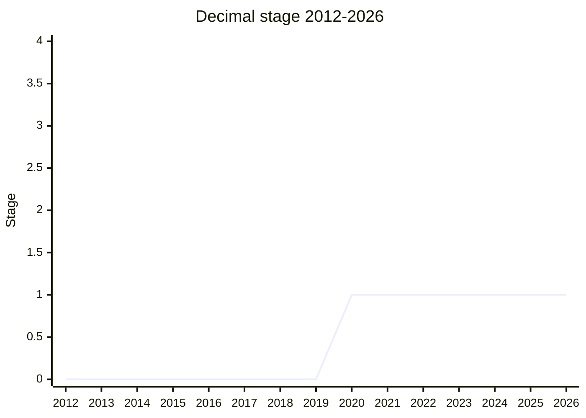

## Overview

Decimal is an **ECMA-262** proposal for exact base-10 numbers, so that `0.1 + 0.2` is exactly `0.3` and values such as prices, tax rates or database `DECIMAL` columns can be held and computed without binary floating-point rounding. It is not an Intl API, but ECMA-402 is one of its main points of contact with the rest of the language: whether `Intl.NumberFormat` and `Intl.PluralRules` should accept Decimal values, and whether a Decimal should carry its own precision (trailing zeros) for them, shaped the proposal for years. When Decimal dropped precision in 2024-10, that use case moved to [Amount](amount.md) (then Measure) and, for numeric strings, to [Intl Keep Trailing Zeros](intl-keep-trailing-zeros.md).

The design has settled on the IEEE 754 **Decimal128** format (34 significant digits, exponent range of about ±6000) rather than an arbitrary-precision BigDecimal. Since 2023-09 it is a plain class with methods for basic arithmetic and rounding, with no literal syntax, no operator overloading and no new primitive, after V8 and SpiderMonkey said they would not add another primitive. NaN, the infinities and `-0` are kept, as in IEEE 754. Since 2024-10 values are canonicalized: members of an IEEE cohort (`1.2` and `1.20`) cannot be told apart, and precision is left to other proposals.

```js
// Sketch of the object API (names as presented in 2024, still subject to change)
const total = new Decimal("0.1").add(new Decimal("0.2"));
total.toString(); // "0.3"
new Decimal("1.20").toString(); // "1.2": trailing zeros are not kept (since 2024-10)
```

The canonical table lists Daniel Ehrenberg ([DE](../people/DE.md)) and Andrew Paprocki (API) as authors and [PFC](../people/PFC.md), API and [JMN](../people/JMN.md) as champions; [DE](../people/DE.md) was listed as champion until the table was updated in 2023-03. API presented the proposal for Stage 0 in 2017-11, [DE](../people/DE.md) presented it for Stage 1 in 2020-02 (as "BigDecimal") and spoke "as a co-champion" in 2023-07, [SHO](../people/SHO.md) presented the 2021-12 update, and [JMN](../people/JMN.md) has presented it since 2023-03. In 2023-11 [JMN](../people/JMN.md) introduced "a new co-champion in the decimal proposal, [JMK](../people/JMK.md) from Oracle" and mentioned "another co-champion, Andreu" ([ABO](../people/ABO.md)); [JMK](../people/JMK.md) and [ABO](../people/ABO.md) are listed as champions here on the basis of that statement, not the canonical table. [WH](../people/WH.md), who reviewed the spec text in depth, is described in 2024-07 as "a co-author of this proposal"; [NRO](../people/NRO.md) co-presented in 2024-10; [CLA](../people/CLA.md) presented the 2026-07 update for [JMN](../people/JMN.md) and said "I'm not a champion of the proposal". Decimal reached Stage 0 in 2017-11 and Stage 1 in 2020-02. Three Stage 2 requests (2024-04, 2024-06, 2024-07) did not advance, and it is still at Stage 1.

## Stage history

| Meeting                                                                              | Venue   | Event                                                                                                                                                                                                                                                                                                                                                                | Stage |
| ------------------------------------------------------------------------------------ | ------- | -------------------------------------------------------------------------------------------------------------------------------------------------------------------------------------------------------------------------------------------------------------------------------------------------------------------------------------------------------------------- | ----- |
| [2017-11](https://github.com/tc39/notes/blob/main/meetings/2017-11/nov-29.md)        | plenary | `Decimal for Stage 0` (API): [MM](../people/MM.md) wants user-defined value types and operator overloading first; [DH](../people/DH.md) questions whether decimal floating point fixes "people doing fractional math"; API stresses "standardised interchange". Conclusion: "Stage 0"                                                                                | 0     |
| [2020-02](https://github.com/tc39/notes/blob/main/meetings/2020-02/february-4.md)    | plenary | Reached Stage 1. `BigDecimal for Stage 1` ([DE](../people/DE.md)): [WH](../people/WH.md) "strongly in the `Decimal128` camp"; [KM](../people/KM.md) and [MM](../people/MM.md) question why it should be a primitive. "Stage 1 reached"                                                                                                                               | 0 → 1 |
| [2020-03](https://github.com/tc39/notes/blob/main/meetings/2020-03/march-31.md)      | plenary | `Decimal update` ([DE](../people/DE.md)): [MM](../people/MM.md) does not want it to advance before operator overloading is understood; [GCL](../people/GCL.md) and [JHD](../people/JHD.md) disagree; [WH](../people/WH.md) wants a Decimal128 primitive                                                                                                              | 1     |
| [2021-12](https://github.com/tc39/notes/blob/main/meetings/2021-12/dec-15.md)        | plenary | `Decimals` ([SHO](../people/SHO.md)): [WH](../people/WH.md) asks for IEEE semantics and no exposed cohorts; [SYG](../people/SYG.md) cites BigInt's "spectacularly poor ROI"; [SFC](../people/SFC.md) lists number formatting and unit conversion as use cases; temperature check on a new primitive: 13 in favour, 0 blocking                                        | 1     |
| [2023-03](https://github.com/tc39/notes/blob/main/meetings/2023-03/mar-22.md)        | plenary | `Decimal Stage 1 Update` ([JMN](../people/JMN.md)): proposes a normalized Decimal128 class without operator overloading or a new primitive; [SFC](../people/SFC.md) objects to normalization ("1 star" vs. "1.0 stars"); [WH](../people/WH.md) prefers a precision argument                                                                                          | 1     |
| [2023-07](https://github.com/tc39/notes/blob/main/meetings/2023-07/july-12.md)       | plenary | `Decimal: Open-ended discussion` ([JMN](../people/JMN.md)): [WH](../people/WH.md) calls dropping NaN and the infinities "an enormous mistake"; [SYG](../people/SYG.md) leans against a literal syntax without operators. Conclusion: no consensus on normalization                                                                                                   | 1     |
| [2023-09](https://github.com/tc39/notes/blob/main/meetings/2023-09/september-27.md)  | plenary | `Decimal: Stage 1 update and discussion` ([JMN](../people/JMN.md)): operator overloading and literals dropped; V8 and SpiderMonkey reaffirm no new primitive; [SFC](../people/SFC.md) still wants trailing zeros. "Decimal remains at Stage 1"                                                                                                                       | 1     |
| [2023-11](https://github.com/tc39/notes/blob/main/meetings/2023-11/november-27.md)   | plenary | `Decimal Stage 1 Update & Request for feedback` ([JMN](../people/JMN.md)): survey of other languages, normalization reopened; [SYG](../people/SYG.md): "Chrome will not support a primitive"; [WH](../people/WH.md), [JHD](../people/JHD.md) and (in the 11-28 overflow) [CM](../people/CM.md) ask why it cannot stay a library                                      | 1     |
| [2024-02-22](https://github.com/tc39/ecma402/blob/main/meetings/notes-2024-02-22.md) | TG2     | `Decimal integration #856` ([JMN](../people/JMN.md)): "thin" vs. "thick" integration with ECMA-402; [SFC](../people/SFC.md): carry Decimal128 precision "through the whole pipeline"; [EAO](../people/EAO.md) adds PluralRules                                                                                                                                       | 1     |
| [2024-04](https://github.com/tc39/notes/blob/main/meetings/2024-04/april-11.md)      | plenary | `Decimal for stage 2` ([JMN](../people/JMN.md), [LIU](../people/LIU.md)): "normalize by default"; [WH](../people/WH.md) lists spec problems; [EAO](../people/EAO.md) worried how little NumberFormat/PluralRules integration is defined; [MM](../people/MM.md) and [JHD](../people/JHD.md) do not support Stage 2. "Decimal stays at stage 1"                        | 1     |
| [2024-06](https://github.com/tc39/notes/blob/main/meetings/2024-06/june-13.md)       | plenary | `Decimal for Stage 2` ([JMN](../people/JMN.md)), with quanta in the data model: [SFC](../people/SFC.md) supports Stage 2 conditional on trailing zeros in NumberFormat and PluralRules; [JHD](../people/JHD.md) blocks. Conclusion: "Deeper integration with Intl is needed, in particular, with Intl.PluralRules."                                                  | 1     |
| [2024-07-18](https://github.com/tc39/ecma402/blob/main/meetings/notes-2024-07-18.md) | TG2     | `Decimal & Intl topic` (ecma402#906): [SFC](../people/SFC.md) says the Intl PR #173 does not yet achieve the integration; [EAO](../people/EAO.md) suggests a shared input protocol for NumberFormat/PluralRules carrying fraction digits and units                                                                                                                   | 1     |
| [2024-07](https://github.com/tc39/notes/blob/main/meetings/2024-07/july-31.md)       | plenary | `Decimal for Stage 2` ([JMN](../people/JMN.md)), third request: [SFC](../people/SFC.md)'s written statement supports Stage 2 "from an Intl point of view"; [MM](../people/MM.md) reluctant but not blocking; [JHD](../people/JHD.md) blocks again. No recorded conclusion                                                                                            | 1     |
| [2024-09-26](https://github.com/tc39/ecma402/blob/main/meetings/notes-2024-09-26.md) | TG2     | `Announcing proposal-numerics-with-precision` (ecma402#926, [NRO](../people/NRO.md), [JMN](../people/JMN.md)): remove precision from Decimal and hold it in a separate object; [EAO](../people/EAO.md): "we should have just 1 solution instead of 2 solutions"                                                                                                      | 1     |
| [2024-10](https://github.com/tc39/notes/blob/main/meetings/2024-10/october-09.md)    | plenary | `Decimal: Stage 1 Update` ([JMN](../people/JMN.md), [NRO](../people/NRO.md)): IEEE quantum support removed; "Intl integration is largely off loaded" to a "numeric value with precision" spin-off (the day before Measure reached Stage 1); [SFC](../people/SFC.md) objects; [WH](../people/WH.md) finds it "so much simpler"                                        | 1     |
| [2024-12](https://github.com/tc39/notes/blob/main/meetings/2024-12/december-05.md)   | plenary | `Vision for numeric types in ECMAScript` ([SFC](../people/SFC.md)): a holistic view of numbers, precision and units, as a frame for Decimal and Measure                                                                                                                                                                                                              | 1     |
| [2025-01-16](https://github.com/tc39/ecma402/blob/main/meetings/notes-2025-01-16.md) | TG2     | `Decimal + Measure proposal` (ecma402#952, proposal-decimal#185): [JMN](../people/JMN.md) proposes unifying the two; [SFC](../people/SFC.md) wants both at Stage 2 "in the same meeting"; [EAO](../people/EAO.md): "I can’t see Decimal being as strongly motivated in the current shape"                                                                            | 1     |
| [2025-02](https://github.com/tc39/notes/blob/main/meetings/2025-02/february-19.md)   | plenary | `A unified vision for measure and decimal` ([JMN](../people/JMN.md), [EAO](../people/EAO.md)): "There is little to no support for outright merging of the proposals from outside of the champion group." Continuation on 02-20 ([SFC](../people/SFC.md)): "No delegate raised concerns about Decimal motivation"                                                     | 1     |
| [2025-04](https://github.com/tc39/notes/blob/main/meetings/2025-04/april-16.md)      | plenary | `Stage 1 update for decimal & measure: Amounts` ([JMN](../people/JMN.md)): a Decimal-backed `Decimal.Amount` ("`Decimal.Something`") and no bare Decimals in Intl; [WH](../people/WH.md), [MM](../people/MM.md) and [EAO](../people/EAO.md) object                                                                                                                   | 1     |
| [2025-05](https://github.com/tc39/notes/blob/main/meetings/2025-05/may-28.md)        | plenary | `Decimal` Stage 1 update ([JMN](../people/JMN.md)) and continuation (05-29); `JS Numerics breakout session` (05-30): temperature check 3 strong positive, 5 positive, 1 unconvinced. "There appears to be a good amount of support for the `Decimal` going to stage 2, though with uncertainty surrounding Amount."                                                  | 1     |
| [2025-09](https://github.com/tc39/notes/blob/main/meetings/2025-09/september-24.md)  | plenary | `Increase limits on Intl MV` ([SFC](../people/SFC.md), ecma402 PR #1022): raise the string-input limits of `Intl.NumberFormat` "in order to future proof for decimal128". "Both of those parts achieved consensus."                                                                                                                                                  | 1     |
| [2026-07](https://github.com/tc39/notes/blob/main/meetings/2026-07/july-22.md)       | plenary | `Decimal stage 1 update` ([CLA](../people/CLA.md) for [JMN](../people/JMN.md)): Amount and Keep Trailing Zeros now cover precision; [JHD](../people/JHD.md) still treats the object API as a Stage 2 blocker; [KM](../people/KM.md) and [DLM](../people/DLM.md) against a primitive. "There are major concerns with the current Object API and not being primitive." | 1     |



> How to read: Decimal was accepted as Stage 0 in 2017-11 (`nov-29.md`) and reached Stage 1 in 2020-02 (`february-4.md`), under the title "BigDecimal for Stage 1". It has been at Stage 1 since then. The three Stage 2 requests in 2024 (`april-11.md`, `june-13.md`, `july-31.md`) did not advance: in 2024-04 because the spec text was not ready and [MM](../people/MM.md) and [JHD](../people/JHD.md) did not support it, in 2024-06 and 2024-07 because [JHD](../people/JHD.md) blocked. TG2 never gave a Stage 2 recommendation of its own, but [SFC](../people/SFC.md) supported Stage 2 in plenary in 2024-06 (with conditions) and 2024-07. The 2025-05 temperature check was not a stage request. The idea of a decimal type predates the proposal: [MM](../people/MM.md) opened the 2017-11 discussion with "When we rejected Decimal previously", and decimal values came up as an example in the value types and BigInt discussions of 2016-11 and 2017-01. The canonical Meeting Notes column lists 2017-11 to 2025-05 but not the 2024-12 numerics vision, the 2025-05 continuation and breakout, or the 2026-07 update.

## Main issues

### Integration with Intl.NumberFormat and Intl.PluralRules

Before the proposal had any Intl text, ECMA-402 already had a way to format exact decimals: [Intl.NumberFormat V3](intl-numberformat-v3.md) accepts numeric strings as Intl mathematical values instead of converting them to Number. At TG2 [2020-03-26](https://github.com/tc39/ecma402/blob/main/meetings/notes-2020-03-26.md), when NumberFormat v3 was scoped for Stage 1, its "Decimal" part addressed the problem "that decimals lose precision where they shouldn’t", and [DE](../people/DE.md) welcomed it because it would fix many issues "without needing a top-level decimal type". [SFC](../people/SFC.md) pointed delegates to the same work at the [2023-03](https://github.com/tc39/notes/blob/main/meetings/2023-03/mar-22.md) Decimal update.

The integration question proper came to TG2 at [2024-02-22](https://github.com/tc39/ecma402/blob/main/meetings/notes-2024-02-22.md). [JMN](../people/JMN.md) asked whether ECMA-402 should take a "thin approach" (convert a Decimal to a string and reuse the string path) or a "thick approach" (a new kind of value handled throughout). [EAO](../people/EAO.md) added PluralRules, which already lagged NumberFormat by not accepting BigInt. [SFC](../people/SFC.md) asked for the thick approach, built on Decimal128's ability to store precision:

> [SFC](../people/SFC.md): Intl.NumberFormat should take the precision that comes from the decimal 128 and bring it through the whole pipeline, including the output.

Without explicit digit options, NumberFormat would take the precision from the input, "much like we infer the calendar numbering or system from the locale". [SFC](../people/SFC.md) tied this to the most common Intl bug: PluralRules must see the same precision as NumberFormat, or the plural category does not match the formatted number. The plan was an editorial refactor of the Intl mathematical value, followed by a small normative change. [USA](../people/USA.md): "I think we already have the structure we need to format decimals".

The plenary then treated Intl integration as a Stage 2 question. At [2024-04](https://github.com/tc39/notes/blob/main/meetings/2024-04/april-11.md) [EAO](../people/EAO.md) was "a bit worried how little of the integration with Intl.NumberFormat and Intl.PluralRules seems to be defined so far", and asked whether `-42.00` would format as `-42` or `-42,00`. At [2024-06](https://github.com/tc39/notes/blob/main/meetings/2024-06/june-13.md) [SFC](../people/SFC.md) said of the Intl spec PR: "I can’t verify what you are trying to do because I can’t read the spec because it doesn’t work." [EAO](../people/EAO.md) went further and said Intl integration is what makes Decimal more than a library:

> [EAO](../people/EAO.md): So now that we’re not doing decimal as primitive, when I look at what does decimal actually do beyond adding decimal itself as a class in the methods and so on, on it, the thing that it does, that I see at least, that goes beyond what a library can do, is the integration, but mostly number format.

[EAO](../people/EAO.md) also asked whether a richer NumberFormat input, perhaps from Smart Units, could solve the same problem. [DE](../people/DE.md) disagreed: "I want to disagree that Intl is the primary motivation for decimal". [SFC](../people/SFC.md) said delegates may support it for different reasons, and the conclusion said "Deeper integration with Intl is needed, in particular, with Intl.PluralRules." At TG2 [2024-07-18](https://github.com/tc39/ecma402/blob/main/meetings/notes-2024-07-18.md) [SFC](../people/SFC.md) reviewed the champions' Intl PR and found that "173 does not achieve what we wanted to achieve with Intl integration with Decimal", and asked for editorial refactors to come with the normative change they serve. [EAO](../people/EAO.md) proposed to "design a protocol for input into NumberFormat and PluralRules" carrying fraction digits, currency and unit, so that Decimal would not need its own path. [SFC](../people/SFC.md) kept the two apart: "Decimal is a type that should be formattable by Intl.NumberFormat". [EAO](../people/EAO.md)'s protocol idea later became part of Measure/Amount and [Intl Unit Protocol](intl-unit-protocol.md).

When precision moved out of Decimal (2024-10), the question changed to whether Intl should accept a bare Decimal at all. At [2025-04](https://github.com/tc39/notes/blob/main/meetings/2025-04/april-16.md) [JMN](../people/JMN.md) reported that "PluralRules shouldn’t handle bare Decimal values" and that banning bare Decimals from NumberFormat was also under discussion, so that callers would pass a `Decimal.Amount` with explicit precision. [WH](../people/WH.md) replied "It’s not clear to me that providing bare Numbers or bare Decimal is always a bug". [EAO](../people/EAO.md) agreed: values from external sources "really ought to be formattable without needing to be specially wrapped", and "I disagree with the reasons for not supporting bare Decimal". [SFC](../people/SFC.md) wanted the question decided in TG2. The conclusion recorded "some concerns about our proposed “banning” of bare decimal values in Intl". TG2 has not taken the question up since. The 2026-07 update did not cover Intl integration.

### Trailing zeros: from the IEEE quantum to canonicalized values

IEEE 754 Decimal128 keeps trailing zeros: `1.2` and `1.20` are equal members of one "cohort" but have different quanta. Whether JavaScript should expose this was the longest-running Decimal question, and the side that wanted trailing zeros argued from Intl. Before 2023 the answer was no. At [2021-12](https://github.com/tc39/notes/blob/main/meetings/2021-12/dec-15.md) [WH](../people/WH.md) agreed with "not exposing IEEE cohorts" ("We should not expose decimal cohorts, just like we don’t expose things like signaling NaN's") and said that precision belongs to formatting. [JMN](../people/JMN.md) started from normalized values in 2023-03. [SFC](../people/SFC.md) objected at that meeting:

> [SFC](../people/SFC.md): I just want to say I’m quite concerned about the assertion that normalization is something you want because one of the biggest problems with floating point and internationalization is that trailing 00s are quite important. "1 star" and "1.0 stars" produce different localized strings.

[WH](../people/WH.md) took the other side: "If you want to represent precision for internationalization then a precision argument is the way to go." [SFC](../people/SFC.md) repeated the point at [2023-07](https://github.com/tc39/notes/blob/main/meetings/2023-07/july-12.md) and [2023-09](https://github.com/tc39/notes/blob/main/meetings/2023-09/september-27.md) ("definitely one of things that motivates from the Intl side"). [WH](../people/WH.md) replied that "exposing cohort member choice would not give you trailing zeros the way you want". At [2023-11](https://github.com/tc39/notes/blob/main/meetings/2023-11/november-27.md) [WH](../people/WH.md) complained that "Lately at every meeting somebody wants to resurrect denormalization", and showed how IEEE string conversion of cohort members can produce forms such as `30e1` in the middle of a calculation. [SFC](../people/SFC.md) answered with five points: stringification can have modes; trailing zeros matter for i18n; Java, C#, Python and Postgres keep them; dropping them loses information; and the old decision predated the i18n argument ("The points that I raise, especially about the internationalization effects, were not well articulated at that time."). [WH](../people/WH.md) asked why the precision could not be passed to the formatter. [SFC](../people/SFC.md) said precision belongs in the data model, comparing it to the difference between formatting a Temporal date as month and day and holding a month-day value.

The champions then moved towards [SFC](../people/SFC.md)'s position. The 2024-04 design was "normalize by default": construction keeps all digits, while `toString` and comparisons normalize unless asked otherwise. The 2024-06 spec text put the quantum into the data model, and [WH](../people/WH.md)'s review dealt largely with "quantum handling". [SFC](../people/SFC.md)'s statement read out at [2024-07](https://github.com/tc39/notes/blob/main/meetings/2024-07/july-31.md):

> [CDA](../people/CDA.md): [SFC](../people/SFC.md) says I am happy with the champion's support for retaining trailing zeroes in the data model, which solves the long-standing i18n bug involving inconsistency between `Intl.PluralRules` and Intl.NumberFormat.

[MM](../people/MM.md), though, would accept a primitive only if it were normalized, and [JHD](../people/JHD.md) blocked partly because a quantum-carrying object would make a later primitive harder. At TG2 [2024-09-26](https://github.com/tc39/ecma402/blob/main/meetings/notes-2024-09-26.md) [NRO](../people/NRO.md) announced the reversal: "So we’re exploring removing tracking of precision from Decimal, since it’s not needed in most use cases." Precision would go into a separate object, `proposal-numerics-with-precision`, which Intl objects could read. At the [2024-10](https://github.com/tc39/notes/blob/main/meetings/2024-10/october-09.md) plenary [JMN](../people/JMN.md) removed quantum support and said the trailing-zeros idea "has kind of been off loaded and addressed". The argument was that IEEE propagation rules produce more trailing zeros than anyone wants (a sales-tax example), so the final precision has to be specified anyway. [SFC](../people/SFC.md) objected that the slide's claims about human-produced quantities and data exchange were "patently false" once precision was gone ("It does not round trip, that’s just objectively false."), and that the change left Decimal with only its weakest use case. [SFC](../people/SFC.md) also wanted Decimal and the precision type to advance together, so that the committee could not take one and drop the other. Others welcomed the split. [PFC](../people/PFC.md) said "A 'number' and a 'number with precision' are two different data models that serve two different purposes." [MM](../people/MM.md), speaking for [KKL](../people/KKL.md), said the proposal "rightly decouples value from display". [WH](../people/WH.md) said "this is now _so much simpler_ than the proposal was when it had support for quantums." [YSV](../people/YSV.md) saw the decoupling as a positive, given concerns about "how much display logic Intl has been taking on". The conclusion recorded that "it is unclear whether the current design, with canonicalized decimals, meets the stated needs of the proposal."

The precision use case then went to [Amount](amount.md) and, for numeric strings, to [Intl Keep Trailing Zeros](intl-keep-trailing-zeros.md). [JMN](../people/JMN.md) called the latter "essentially kind of a bugfix in Intl" at [2025-05](https://github.com/tc39/notes/blob/main/meetings/2025-05/may-28.md), and said that keeping trailing zeros "is something that we probably should have done from the beginning". At [2026-07](https://github.com/tc39/notes/blob/main/meetings/2026-07/july-22.md) [CLA](../people/CLA.md) said Amount and Keep Trailing Zeros "essentially solve the issue of canonicalization and keeping information on trailing zeros and precisions".

### Relationship with Measure/Amount

Once precision left Decimal, the question was where the precision-carrying type should live and how it relates to units. At TG2 2024-09-26 [EAO](../people/EAO.md) saw the same rationale as for a value that carries its unit or currency: "It seems like we should have just 1 solution instead of 2 solutions." [SFC](../people/SFC.md) suggested that a type with units, currencies and precision "is almost superior to Decimal128, given the use cases listed in the document", and asked again for performance numbers to justify Decimal128 over a userland library. [JMN](../people/JMN.md) said at the 2024-10 plenary that the two might "get fused together". [SFC](../people/SFC.md)'s [2024-12](https://github.com/tc39/notes/blob/main/meetings/2024-12/december-05.md) presentation asked for one architecture for numbers, precision and units.

At TG2 [2025-01-16](https://github.com/tc39/ecma402/blob/main/meetings/notes-2025-01-16.md) [JMN](../people/JMN.md) proposed unifying Decimal and Measure, with either two classes (a normalized Decimal and a Measure) or three (adding a full non-normalized Decimal128). [SFC](../people/SFC.md) wanted Measure always backed by Decimal and both proposals to "advance to stage 2 in the same meeting", arguing that "the motivation for the Decimal proposal is even stronger when it is considered in the Measure universe". [EAO](../people/EAO.md) wanted Measure to keep its input type and the proposals to stay separate, and doubted Decimal itself: "It can’t be a primitive so there’s suboptimal ergonomics. I can’t see Decimal being as strongly motivated in the current shape." [USA](../people/USA.md) warned that Measure going first with several numeric types would lose "the train for unification".

At the [2025-02](https://github.com/tc39/notes/blob/main/meetings/2025-02/february-19.md) plenary the merge found no support outside the champions. [WH](../people/WH.md): "If you want to do arithmetic on decimal numbers, you shouldn’t have to worry about unit conversions." [MF](../people/MF.md): "I don’t want a potentially strong part of that proposal to carry the weaker part." [DLM](../people/DLM.md) was "skeptical about having the decimal measure proposals merged", and [DE](../people/DE.md) preferred two classes. In the continuation the next day [SFC](../people/SFC.md) asked directly whether Decimal was ready for Stage 2. [MM](../people/MM.md) asked how a significant-digits precision could be stored in the IEEE quantum, whose meaning is "number of trailing zeros, only zeros", and the summary recorded "No delegate raised concerns about Decimal motivation".

The champions' next design attached the precision type to Decimal. At [2025-04](https://github.com/tc39/notes/blob/main/meetings/2025-04/april-16.md) [JMN](../people/JMN.md) presented `Decimal.Amount` (placeholder "`Decimal.Something`"): a canonical Decimal plus a separately stored precision, with Measure to add a unit later. [MM](../people/MM.md) objected that nothing about an amount is specific to Decimal and called storing precision in the quantum "a semantics violating pun". [WH](../people/WH.md) said the quantum cannot give a fixed number of fraction digits for large values ("Trying to fit it into an IEEE quantum is just premature optimization, which wouldn’t work anyway."), and that applying a unit and a precision should commute. At [2025-05](https://github.com/tc39/notes/blob/main/meetings/2025-05/may-28.md) [MM](../people/MM.md) still objected to the Decimal tie: "I don’t see this as a minor issue." [EAO](../people/EAO.md) pointed out that Decimal128 cannot hold every BigInt or every string `Intl.NumberFormat` accepts. [SFC](../people/SFC.md) answered that every known amount use case fits in Decimal128, and that, from talking to V8 engineers, one backing type is easier to implement than a polymorphic one. The breakout two days later ([2025-05](https://github.com/tc39/notes/blob/main/meetings/2025-05/may-30.md)) agreed that "rendering amounts is the main motivation" and committed to look at a String-backed Amount. [MM](../people/MM.md) drew the line clearly:

> [MM](../people/MM.md): So I would certainly, if amount were attached to decimal, special case for decimal as opposed to being neutral and numeric types, I would definitely not be comfortable with Stage 2. If amount were separated into a follow-on proposal, the decimal by itself, I am very happy to go to Stage 2.

That is what happened: Amount became a separate, type-preserving proposal (Stage 2 in 2026-05; see [Amount](amount.md#relationship-with-decimal-and-where-precision-lives)), and Decimal returned to being a plain number type. At [2026-07](https://github.com/tc39/notes/blob/main/meetings/2026-07/july-22.md) [EAO](../people/EAO.md) said that if Decimal is accepted, Amount would accept Decimal values next to Number, BigInt and decimal strings, but that Decimal128 could not be Amount's only internal representation. [EAO](../people/EAO.md) added that Amount's unit conversions would be "quite a bit more straightforward" with Decimal, and that it would be good to know whether Decimal is coming before Amount reaches its final stages. [WH](../people/WH.md) said Amount "solves a somewhat different problem": converting 0.1 yards to feet in Number space gives `0.30000000000000004`.

### IEEE 754 Decimal128 vs. BigDecimal, and conformance

The data model was settled early. [DE](../people/DE.md)'s 2020-02 Stage 1 proposal was titled "BigDecimal", and [WH](../people/WH.md) answered: "I'm strongly in the `Decimal128` camp". The reasons given were that unbounded precision "can get away from you", that division needs an explicit precision, and that transcendental functions are much harder to provide. [WH](../people/WH.md) repeated this in 2021-12. [JMN](../people/JMN.md)'s 2023-03 comparison settled on Decimal128 with 34 significant digits. [SFC](../people/SFC.md) raised a third model, rationals (BigInt over BigInt), as CLDR uses for unit conversion. The champions considered them and rejected them over normalization cost.

What "Decimal128" should mean took longer. In 2023 the champions proposed to throw on NaN and the infinities, since a receipt should never print "NaN". [WH](../people/WH.md) objected at [2023-07](https://github.com/tc39/notes/blob/main/meetings/2023-07/july-12.md):

> [WH](../people/WH.md): Yeah, this would be an enormous mistake. This is not cleaning up. This is introducing our own alternate standard for decimal which is different from what IEEE specified.

At 2023-09 API took the same position, arguing from interchange with C++ and other languages. By 2023-11 the proposal kept NaN, the infinities and `-0`. [WH](../people/WH.md) then reviewed the spec text in detail. In 2024-04 [WH](../people/WH.md) found that operations were defined by reference to IEEE terms that the standard does not define, and that remainder followed IEEE semantics that would surprise users. In 2024-06 [WH](../people/WH.md) found errors in quantum handling. In 2024-07 [WH](../people/WH.md) was a co-author. The 2024-06 text reduced rounding modes to the five IEEE ones rather than NumberFormat's larger set, in case an implementation's C library lacks the others. In 2024-10 [WH](../people/WH.md) said canonicalization was still IEEE 754, since "we don’t expose all of the IEEE methods, and we never did, not even for Numbers."

The 34-digit limit has an ECMA-402 side. In 2025-05 [EAO](../people/EAO.md) noted that `Intl.NumberFormat` accepts strings with up to about 400 digits, more than Decimal128 can hold. [SFC](../people/SFC.md) replied that the step from 15 to 34 digits covers far more use cases than the step from 34 to 400. In the other direction, `ToIntlMathematicalValue` used to clamp string input to the Number range, which would also have clamped a future Decimal. [SFC](../people/SFC.md)'s ecma402 PR #1022 raised the limits, presented at TG2 [2025-08-14](https://github.com/tc39/ecma402/blob/main/meetings/notes-2025-08-14.md) and at plenary [2025-09](https://github.com/tc39/notes/blob/main/meetings/2025-09/september-24.md), where [SFC](../people/SFC.md) asked for consensus that "the limit of Intl MV should be increased in order to future proof for decimal128". Both parts reached consensus. At TG2 [2026-02-19](https://github.com/tc39/ecma402/blob/main/meetings/notes-2026-02-19.md) [SFC](../people/SFC.md) explained that the first motive had been a future Decimal, and that [WH](../people/WH.md)'s view that raising the bounds later might not be web compatible made it urgent.

### Primitive or object, and whether it belongs in the language

This plenary-level dispute has kept Decimal at Stage 1, and it is not an Intl question. In 2017-11 and 2020-03 [MM](../people/MM.md) wanted Decimal to wait for a general operator overloading or value types mechanism, so that it would behave like user-defined numeric types. [KM](../people/KM.md) asked in 2020-02 why it had to be a primitive at all. At 2021-12 most delegates were happy with a primitive (13 to 0 in the temperature check), but [SYG](../people/SYG.md) doubted the return on investment after BigInt. In 2023 the implementers closed that path: [SYG](../people/SYG.md) ("V8 reaffirms the stance"), [MLS](../people/MLS.md) and [DLM](../people/DLM.md) ruled out a new primitive in 2023-09, and in 2023-11 [SYG](../people/SYG.md) said "I can say that Chrome will not support a primitive." The proposal became a class.

Without a primitive, the question became whether Decimal is worth adding at all. [WH](../people/WH.md), [JHD](../people/JHD.md) and [CM](../people/CM.md) (2023-11) asked why a userland library is not enough. [DE](../people/DE.md) and [ACE](../people/ACE.md) pointed to interchange: Bloomberg's cross-language schemas, and RPC or database libraries that need one decimal type to agree on. At 2024-04 [LIU](../people/LIU.md) added a spreadsheet use case from DingTalk. [JHD](../people/JHD.md) supports the goal but has blocked Stage 2 since 2024-06 because an object API will not deliver it. [JHD](../people/JHD.md) restated this at [2026-07](https://github.com/tc39/notes/blob/main/meetings/2026-07/july-22.md):

> [JHD](../people/JHD.md): Well, just to elaborate a little bit. What I mean is stage two means it's something we definitely want in the language. And I don't want the object form in the language if the primitive form isn't guaranteed to also be there eventually.

[KM](../people/KM.md) and [DLM](../people/DLM.md) repeated that a new primitive would need use by "double-digit percentages of developers". [ACE](../people/ACE.md) said Bloomberg would be fine with methods: "I think the object API will work absolutely like perfectly". The conclusion recorded "major concerns with the current Object API and not being primitive" and "major concerns from browsers to introduce the proposal as a Primitive". This is unresolved.

## Related proposals

- [Amount](amount.md) — took over the precision ("number with precision") use case after Decimal dropped quanta in 2024-10; a merge was discussed in 2025-01/02 and rejected; would accept Decimal values once Decimal exists.
- [Intl Keep Trailing Zeros](intl-keep-trailing-zeros.md) — keeps trailing zeros of numeric strings in `Intl.NumberFormat` / `Intl.PluralRules`, the Intl bug fix that came out of the Decimal and Amount numerics discussions.
- [Intl.NumberFormat V3](intl-numberformat-v3.md) — introduced exact decimal strings as `Intl.NumberFormat` input (Intl mathematical value), the existing path that Decimal's integration would build on.
- [Intl Unit Protocol](intl-unit-protocol.md) — the `{ value, unit }` input protocol for NumberFormat, a descendant of [EAO](../people/EAO.md)'s 2024-07 suggestion of a common input protocol instead of a Decimal-specific path.
- [Smart Unit Preferences in Intl.NumberFormat](smart-unit-preferences.md) — raised by [EAO](../people/EAO.md) in 2024-06 as a possible alternative route for richer NumberFormat input.

## Sources

TG2:

- https://github.com/tc39/ecma402/blob/main/meetings/notes-2020-03-26.md
- https://github.com/tc39/ecma402/blob/main/meetings/notes-2024-02-22.md
- https://github.com/tc39/ecma402/blob/main/meetings/notes-2024-07-18.md
- https://github.com/tc39/ecma402/blob/main/meetings/notes-2024-09-26.md
- https://github.com/tc39/ecma402/blob/main/meetings/notes-2025-01-16.md
- https://github.com/tc39/ecma402/blob/main/meetings/notes-2025-08-14.md
- https://github.com/tc39/ecma402/blob/main/meetings/notes-2026-02-19.md

Plenary:

- https://github.com/tc39/notes/blob/main/meetings/2017-11/nov-29.md
- https://github.com/tc39/notes/blob/main/meetings/2020-02/february-4.md
- https://github.com/tc39/notes/blob/main/meetings/2020-03/march-31.md
- https://github.com/tc39/notes/blob/main/meetings/2021-12/dec-15.md
- https://github.com/tc39/notes/blob/main/meetings/2023-03/mar-22.md
- https://github.com/tc39/notes/blob/main/meetings/2023-07/july-12.md
- https://github.com/tc39/notes/blob/main/meetings/2023-09/september-27.md
- https://github.com/tc39/notes/blob/main/meetings/2023-11/november-27.md
- https://github.com/tc39/notes/blob/main/meetings/2023-11/november-28.md
- https://github.com/tc39/notes/blob/main/meetings/2024-04/april-11.md
- https://github.com/tc39/notes/blob/main/meetings/2024-06/june-13.md
- https://github.com/tc39/notes/blob/main/meetings/2024-07/july-31.md
- https://github.com/tc39/notes/blob/main/meetings/2024-10/october-09.md
- https://github.com/tc39/notes/blob/main/meetings/2024-12/december-05.md
- https://github.com/tc39/notes/blob/main/meetings/2025-02/february-19.md
- https://github.com/tc39/notes/blob/main/meetings/2025-02/february-20.md
- https://github.com/tc39/notes/blob/main/meetings/2025-04/april-16.md
- https://github.com/tc39/notes/blob/main/meetings/2025-05/may-28.md
- https://github.com/tc39/notes/blob/main/meetings/2025-05/may-29.md
- https://github.com/tc39/notes/blob/main/meetings/2025-05/may-30.md
- https://github.com/tc39/notes/blob/main/meetings/2025-09/september-24.md
- https://github.com/tc39/notes/blob/main/meetings/2026-07/july-22.md
