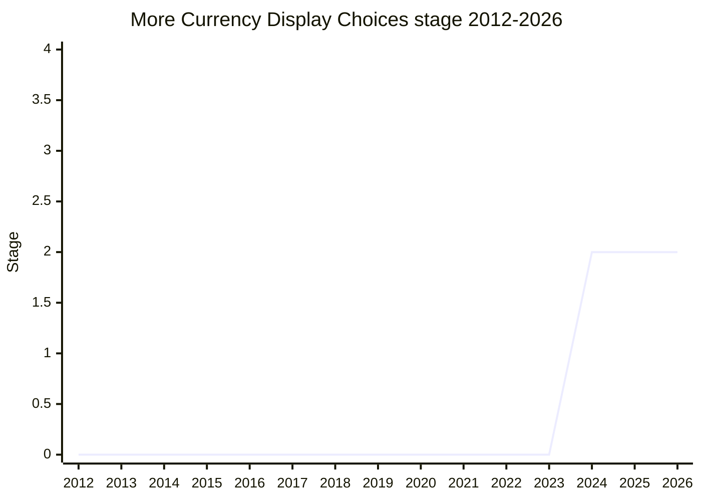

## Overview

"More Currency Display Choices" adds two values to the `currencyDisplay` option of `Intl.NumberFormat` (used with `style: "currency"`). Today the option accepts `"symbol"` (the default), `"narrowSymbol"`, `"code"` and `"name"`. Whether `"symbol"` gives a bare "$" or a qualified "US$" depends on both the currency and the locale: `en-US` shows "$" for USD and "CA$" for CAD, while `en-CA` shows "$" for CAD and "US$" for USD. There is no way to get "US$" in `en-US`, and no way to format a value with currency-dependent rules (most importantly the currency's number of fraction digits) without also showing some currency indicator. The proposal addresses both gaps:

- `"formalSymbol"` always picks the longer, unambiguous symbol, such as "US$" for USD even in `en-US`.
- `"never"` applies currency formatting but shows no currency symbol, code or name. The name follows `signDisplay: "never"`.

```js
// Illustrative; option names are still under discussion (see below)
new Intl.NumberFormat("en-US", { style: "currency", currency: "USD" }).format(5);
// "$5.00" (today, also with currencyDisplay: "narrowSymbol")
new Intl.NumberFormat("en-US", { style: "currency", currency: "USD", currencyDisplay: "formalSymbol" }).format(5);
// proposed: "US$5.00"
new Intl.NumberFormat("en-US", { style: "currency", currency: "JPY", currencyDisplay: "never" }).format(1234.5);
// proposed: "1,235" (JPY's zero fraction digits, no symbol)
```

Both values came from [EAO](../people/EAO.md)'s work on the `:currency` function in Unicode MessageFormat 2 (MF2), which had already added them. [EAO](../people/EAO.md) brought them to ECMA-402 so that MF2 and JavaScript would not end up with conflicting option names. At the Stage 2 plenary [EAO](../people/EAO.md) noted that ICU already supports "something like “formal” and something like “never”", which is where the name "formal" came from. The spec change is small: the two values are added to the places in ECMA-402 that list the `currencyDisplay` values, with a short description of each. [EAO](../people/EAO.md) is the sole champion, as listed in the canonical table and confirmed by the notes.

## Stage history

| Meeting                                                                              | Venue   | Event                                                                                                                                                                                                                                                                                           | Stage |
| ------------------------------------------------------------------------------------ | ------- | ----------------------------------------------------------------------------------------------------------------------------------------------------------------------------------------------------------------------------------------------------------------------------------------------- | ----- |
| [2024-11-25](https://github.com/tc39/ecma402/blob/main/meetings/notes-2024-11-25.md) | TG2     | ecma402#643 "Add support for more currency symbol variants (e.g. formal)". [SFC](../people/SFC.md) asks for a small proposal rather than a PR; [SFC](../people/SFC.md) and [BAN](../people/BAN.md) support. Conclusion: [EAO](../people/EAO.md) to bring a Stage 1 proposal to the December TG1 | 0     |
| [2024-12](https://github.com/tc39/notes/blob/main/meetings/2024-12/december-02.md)   | plenary | Reached Stage 2 directly from Stage 0 in one slot. `More Currency Display Choices`. [EAO](../people/EAO.md) asked for Stage 2 but "would also be happy with a Stage 1"; [JHD](../people/JHD.md) and [NRO](../people/NRO.md) are the Stage 2.7 reviewers                                         | 0 → 2 |
| [2025-01-16](https://github.com/tc39/ecma402/blob/main/meetings/notes-2025-01-16.md) | TG2     | [SFC](../people/SFC.md) notes TG2 had discussed only Stage 1. CLDR data for the formal symbol accepted as a Stage 2.7 blocking concern; naming (`formalSymbol` / `longSymbol`) discussed. No conclusion                                                                                         | 2     |
| [2025-06-12](https://github.com/tc39/ecma402/blob/main/meetings/notes-2025-06-12.md) | TG2     | [YSZ](../people/YSZ.md) reports that JavaScriptCore landed an implementation. [SFC](../people/SFC.md): still Stage 2 until the CLDR data is fuller                                                                                                                                              | 2     |
| [2026-08-06](https://github.com/tc39/ecma402/blob/main/meetings/notes-2026-08-06.md) | TG2     | Reviewed as a Stage 2 proposal without recent updates. The CLDR issue had gained no traction; [SFC](../people/SFC.md) to bring it to the CLDR design group                                                                                                                                      | 2     |



> The proposal went from Stage 0 straight to Stage 2 at the 2024-12 plenary, without a separate Stage 1. The Conclusion reads "“More Currency Display Choices” was accepted for Stage 2, with [JHD](../people/JHD.md) and [NRO](../people/NRO.md) as committed spec reviews." It has stayed at Stage 2 since, waiting on CLDR data. The canonical table lists it under Stage 2, with the 2024-12 plenary as its only Meeting Notes entry.

## Main issues

### Proposal or normative PR, and the jump to Stage 2

At TG2 [2024-11-25](https://github.com/tc39/ecma402/blob/main/meetings/notes-2024-11-25.md) (the file's own heading dates the call 2024-11-21), [EAO](../people/EAO.md) asked whether two new enum values needed the staging process at all. [SFC](../people/SFC.md) answered that the design questions made it a proposal, though a small one:

> [SFC](../people/SFC.md): I think this is a big enough issue that it should probably be a proposal, but it doesn’t have to be a big proposal. It’s okay to have small proposals.

[EAO](../people/EAO.md) then asked for support to bring it to TG1 "as a Stage 1 proposal so that we can have the space to discuss what to call options". [SFC](../people/SFC.md) and [BAN](../people/BAN.md) gave +1, and the conclusion was "[EAO](../people/EAO.md) to create a Stage 1 proposal and add it to the December TG1 agenda."

At the [2024-12](https://github.com/tc39/notes/blob/main/meetings/2024-12/december-02.md) plenary, [EAO](../people/EAO.md) presented the spec text and asked for Stage 2, offering Stage 1 as a fallback. [DLM](../people/DLM.md) first gave Mozilla team support for Stage 1 and hesitated to be the only supporter of Stage 2 because [DLM](../people/DLM.md) and [EAO](../people/EAO.md) work for the same organization. [JHD](../people/JHD.md) checked that the champion saw no remaining design space ("Basically, yes"), and supported Stage 2 without having fully reviewed the spec. [DE](../people/DE.md) also supported it:

> [DE](../people/DE.md): I support this proposal as well. I also haven’t reviewed the spec. But a small feature like this, that adds on to an existing capability is exactly the kind of thing that I would hope to come from TG2, that I look forward to, especially given the concrete motivation.

With support from multiple organizations and no objections, the proposal reached Stage 2. [JHD](../people/JHD.md) and [NRO](../people/NRO.md) volunteered as Stage 2.7 reviewers.

The jump surprised TG2. At [2025-01-16](https://github.com/tc39/ecma402/blob/main/meetings/notes-2025-01-16.md) [SFC](../people/SFC.md) said:

> [SFC](../people/SFC.md): process-wise, just as a note, this proposal was reviewed in this group in December and we approved it for Stage 1 but never for Stage 2. It got to Stage 2 a lot faster than I expected it to.

(The TG2 discussion was in fact the November call.) [EAO](../people/EAO.md) explained that the TG1 agenda item had listed Stage 2, and that a post in the Matrix channel had received thumbs up from two editors. [SFC](../people/SFC.md) called the process "sound" but "a bit regrettable due to holidays in the US", and both left it there.

### What "formal" means, and the option name

The first question was what the new symbol represents. At TG2 [2024-11-25](https://github.com/tc39/ecma402/blob/main/meetings/notes-2024-11-25.md) [SFC](../people/SFC.md) read "formal" as CLDR's `formal` alt variant, which exists for some East Asian currencies whose symbol differs between financial and casual contexts. If so, it would be a property of the message context rather than of the formatter, and not necessarily an option MessageFormat should pass through. [SFC](../people/SFC.md) also explained why "symbol" and "narrowSymbol" exist: the developer says whether the currency is implied by context. [EAO](../people/EAO.md)'s use case was different: a page that mixes US and Canadian dollars in `en-US` cannot make the US dollar explicit. [SFC](../people/SFC.md) agreed with that use case under a different name ("call it a “wideSymbol” or something like that"). [EAO](../people/EAO.md) also left out CLDR's `variant` symbols (defined in practice only for the Turkish lira) as "challenging and difficult to use".

At the plenary, [EAO](../people/EAO.md) flagged `'formalSymbol'` versus `'wideSymbol'` (and possibly a better word than `'never'`) as the remaining bikeshed for Stage 2. TG2 [2025-01-16](https://github.com/tc39/ecma402/blob/main/meetings/notes-2025-01-16.md) took it up. [EAO](../people/EAO.md) said the value has "no well-established name" and that "formal symbol" rests on prior art. [SFC](../people/SFC.md) suggested "medium symbol", which [EAO](../people/EAO.md) found confusing. [RGN](../people/RGN.md) leaned towards "wide" to fit the existing scheme. [SFC](../people/SFC.md) objected that ECMA-402 uses "long", not "wide", in DateTimeFormat, and [RGN](../people/RGN.md) noted that `"short"` / `"narrow"` / `"long"` is the value set of several options. [USA](../people/USA.md) found "formal symbol" acceptable because it does not clash with the existing naming. [SFC](../people/SFC.md) narrowed the choice:

> [SFC](../people/SFC.md): “Formal symbol” and “long symbol” should be our options. Let’s make an issue.

[SFC](../people/SFC.md) wanted to follow whatever CLDR calls the symbol, though ECMA-402 could still pick `longSymbol` if CLDR chose "formal". The timing mattered for MF2. [EAO](../people/EAO.md) said that if the naming took longer, "I’ll ask the MF working group to drop “formal symbol” so we don’t have a conflict", and [SFC](../people/SFC.md) supported changing a status (apparently that of the MF2 option) to "proposed" instead of "required". No naming decision is recorded in the notes so far.

### CLDR data for the formal symbol (Stage 2.7 blocker)

The open issue at [2025-01-16](https://github.com/tc39/ecma402/blob/main/meetings/notes-2025-01-16.md) was [proposal-intl-currency-display-choices#3](https://github.com/tc39/proposal-intl-currency-display-choices/issues/3). [SFC](../people/SFC.md) said CLDR has "very little data about this" and wanted it to "land in CLDR first". [EAO](../people/EAO.md) replied that the data is there indirectly. For USD, `en_US` gives "$" for both symbol and narrow symbol, but the parent locale `en_001` defines the symbol as "US$", so a formal symbol could be resolved by looking past the usual lookup. [EAO](../people/EAO.md) admitted that this resolution might give odd results for some locales. [SFC](../people/SFC.md) wanted such an algorithm defined in CLDR and UTS 35 and implemented in ICU before TG2 discussed it. [EAO](../people/EAO.md) disagreed with that order, since ECMA-402 acts as an end user asking for an API, but accepted the point for the next stage: "I agree that this is a stage 2.7 blocking concern."

[SFC](../people/SFC.md) planned to add the question to an upcoming CLDR design meeting. At [2025-06-12](https://github.com/tc39/ecma402/blob/main/meetings/notes-2025-06-12.md) [YSZ](../people/YSZ.md) reported that JavaScriptCore had landed an implementation but could not ship it. [SFC](../people/SFC.md) explained why the proposal was still at Stage 2:

> [SFC](../people/SFC.md): Still stage 2 because there’s only 1 currency that has a “formal” symbol and I wanted CLDR to add more data. Taiwan dollar is the only case.

By [2026-08-06](https://github.com/tc39/ecma402/blob/main/meetings/notes-2026-08-06.md), when TG2 reviewed Stage 2 proposals without recent updates, the CLDR issue (filed by Mark Davis) had "gained no traction" and [EAO](../people/EAO.md) had not pushed it further. The next step is either more CLDR data or agreement with CLDR that the existing data is appropriate. [SFC](../people/SFC.md) offered to bring it to the CLDR design group (then working on CLDR 49), and [EAO](../people/EAO.md) asked to be pinged when it reaches an agenda. The issue is unresolved as of the latest notes.

### Scope: a "global" currency format

At the same [2026-08-06](https://github.com/tc39/ecma402/blob/main/meetings/notes-2026-08-06.md) review, [SFC](../people/SFC.md) asked whether the "global" currency format (the name used at Google) would be in scope. It combines the narrow currency format with a disambiguating code, so that dollar amounts keep the "$" sign that users in anglophone countries expect. [EAO](../people/EAO.md) found it "pretty clumsy" but was not opposed if there are use cases, and wanted it aligned with whatever CLDR provides. [EAO](../people/EAO.md) saw a difference in kind: this proposal exposes existing CLDR patterns, while a global format would add a new pattern, which "ought to be proposed to CLDR rather than straight from us". [EAO](../people/EAO.md) also raised localization concerns, for example Finnish, which places the currency sign after the number. Both agreed CLDR probably needs to work on it first. The `"never"` value has not drawn objections in the notes so far.

## Related proposals

- [Intl.MessageFormat](intl-messageformat.md): `formalSymbol` and `never` were first added to MF2's `:currency`, and the proposal exists partly to keep MF2 and ECMA-402 option names consistent.
- `intl-unified-numberformat` (Intl.NumberFormat Unified API): the source of `currencyDisplay: "narrowSymbol"`, the value this proposal complements. At TG2 [2018-11-26](https://github.com/tc39/ecma402/blob/main/meetings/notes-2018-11-26.md) the narrow-symbol request (ecma402#200) was noted as "Already covered in Unified Intl.NumberFormat", and the value was still being discussed as `narrow-symbol` vs. `narrowSymbol` (kebab-case at the time).

## Sources

TG2:

- https://github.com/tc39/ecma402/blob/main/meetings/notes-2018-11-26.md
- https://github.com/tc39/ecma402/blob/main/meetings/notes-2024-11-25.md
- https://github.com/tc39/ecma402/blob/main/meetings/notes-2025-01-16.md
- https://github.com/tc39/ecma402/blob/main/meetings/notes-2025-06-12.md
- https://github.com/tc39/ecma402/blob/main/meetings/notes-2026-08-06.md

Plenary:

- https://github.com/tc39/notes/blob/main/meetings/2024-12/december-02.md
