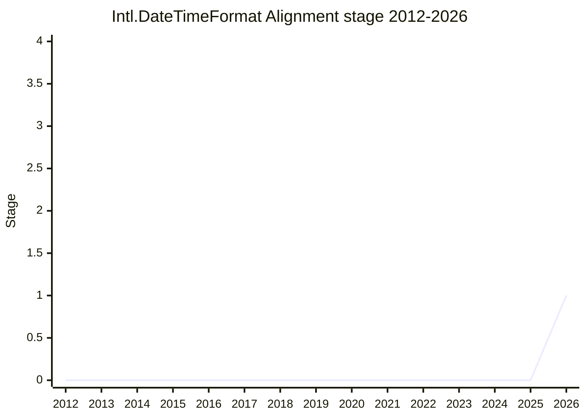

## Overview

The proposal aims for **one set of date/time formatting options that works in JavaScript, HTML and Unicode MessageFormat**. Two other standards are designing date/time formatting options at the same time as ECMA-402. Unicode MessageFormat 2 (MF2) redesigned the options of its `:datetime` function after ICU4X's "semantic skeletons", which name a set of fields plus a few style options instead of one option per field. In HTML, [LCA](../people/LCA.md) is championing a `format` attribute for the `<time>` element that formats its contents without JavaScript and adopts the MF2 options bag. The HTML proposal includes options that `Intl.DateTimeFormat` does not have (`dateFields`, `timePrecision`) and an `"input"` value for `calendar` and `timeZone` that takes the value from the thing being formatted. MF2 and HTML also spell some existing options differently: `dateLength` for `dateStyle`, and `timeZoneStyle` for `timeZoneName`. [EAO](../people/EAO.md)'s problem statement at plenary is that "Users of the web would benefit from the same formatting options being available in HTML, JavaScript, and Unicode MessageFormat".

`Intl.DateTimeFormat` today has two groups of options that cannot be combined: the style shortcuts (`dateStyle`, `timeStyle`) and the per-field component options. The component options also allow combinations that make no sense, which the semantic-skeleton design rules out by allowing only a fixed list of field sets. The starting point presented for Stage 1 adds two options that refine the style shortcuts. `dateFields` selects which date fields are included and `timePrecision` selects which time fields are included. Every new value maps onto component options that engines already support, so the proposal is meant to add no new capabilities and no new locale data.

```js
// today: component options allow nonsensical combinations
new Intl.DateTimeFormat("en", { month: "long", minute: "numeric" });
// formats something like "July at 36" (the example on the 2026-07 plenary slides)

// today: style shortcuts and component options are mutually exclusive
new Intl.DateTimeFormat("en", { dateStyle: "long", weekday: "long" }); // TypeError

// Stage 1 starting point: new options next to the style shortcuts
// dateFields: which date fields to include; timePrecision: which time fields
// (values and the exact interaction with dateStyle/timeStyle are not settled)
```

The canonical table lists [EAO](../people/EAO.md) as author and champion. The repository linked from the plenary agenda was `eemeli/proposal-intl-datetime-alignment`; the canonical table links `tc39/proposal-intl-datetime-alignment`.

## Stage history

| Meeting                                                                              | Venue   | Event                                                                                                                                                                                                                                                                                                                                                                                                                | Stage |
| ------------------------------------------------------------------------------------ | ------- | -------------------------------------------------------------------------------------------------------------------------------------------------------------------------------------------------------------------------------------------------------------------------------------------------------------------------------------------------------------------------------------------------------------------- | ----- |
| [2024-08-22](https://github.com/tc39/ecma402/blob/main/meetings/notes-2024-08-22.md) | TG2     | MFWG update. [SFC](../people/SFC.md) raises semantic skeleton date/time data for MF2 and has a draft spec. [EAO](../people/EAO.md) wants that discussion held "in a datetime formatting context rather than a message formatting context" and asks "Should semantic skeleta be _the_ API in DateTimeFormat and MessageFormat?"                                                                                       | 0     |
| [2024-11-25](https://github.com/tc39/ecma402/blob/main/meetings/notes-2024-11-25.md) | TG2     | During [proposal-intl-eradisplay#10](https://github.com/tc39/proposal-intl-eradisplay/issues/10), [SFC](../people/SFC.md): "I’ve been working on semantic skeletons a lot, may get it into ECMA-402, but in the short term there is the eraDisplay proposal."                                                                                                                                                        | 0     |
| [2025-05-08](https://github.com/tc39/ecma402/blob/main/meetings/notes-2025-05-08.md) | TG2     | The MFWG is pursuing [SFC](../people/SFC.md)'s recommendation of a semantic-skeleton style for MF2 date/time options. [USA](../people/USA.md): "Is there any appetite to add semantic skeletons to Intl.DTF?" [SFC](../people/SFC.md): a five-year plan, with a JS polyfill first. [EAO](../people/EAO.md) warns against "a conflicting 3rd alternative style"                                                       | 0     |
| [2025-08-14](https://github.com/tc39/ecma402/blob/main/meetings/notes-2025-08-14.md) | TG2     | MFWG update ([EAO](../people/EAO.md)): "For date time formatting we have updated the spec and it’s different from how the DTF constructor works. It limits the capabilities of producing nonsensical results through structured skeletons."                                                                                                                                                                          | 0     |
| [2026-07-09](https://github.com/tc39/ecma402/blob/main/meetings/notes-2026-07-09.md) | TG2     | [ecma402#1089](https://github.com/tc39/ecma402/issues/1089) "Harmonize formatting option standarization between Unicode, ECMA, and WHATWG". [EAO](../people/EAO.md) asks whether to bring "a stage 1 proposal as a third way of doing date time formatting"; [SFC](../people/SFC.md): "I’m happy to give [EAO](../people/EAO.md) TG2 approval for a stage 1 proposal, contained in this last comment." (TG2 support) | 0     |
| [2026-07](https://github.com/tc39/notes/blob/main/meetings/2026-07/july-22.md)       | plenary | Reached Stage 1. `` `Intl.DateTimeFormat` Alignment With Other Standards `` ([EAO](../people/EAO.md)). [JSL](../people/JSL.md), [SFC](../people/SFC.md) and [LVU](../people/LVU.md) support; no objections. Conclusion: "The proposal was accepted for Stage 1 with no discussion."                                                                                                                                  | 0 → 1 |



> Stage 1 at the 2026-07 plenary (2026-07-22), thirteen days after TG2 gave its support on 2026-07-09. At that TG2 call [EAO](../people/EAO.md) was recorded as unsure whether it could make the upcoming agenda ("Small change that I can’t get it in for the upcoming meeting"), and also needed support inside Mozilla; at plenary [EAO](../people/EAO.md) said it "came up during the TG2 call we had immediately before the deadline". The idea of semantic-skeleton options in `Intl.DateTimeFormat` goes back to the MF2 discussions from 2024-08 onward, which is why `first_seen` is 2024-08. The canonical table lists 2026-07 as the only plenary anchor and agrees with the notes. TG2 calls from 2026-08-06 to 2026-10-08 do not discuss the proposal.

## Main issues

### Which comes first: semantic skeletons in MessageFormat or in ECMA-402

Semantic skeletons reached ECMA-402 by way of MF2, not as an ECMA-402 proposal. At TG2 2024-08-22 [SFC](../people/SFC.md) explained them as "a field set and some stylistic options": a fixed list of allowed field sets (year-month or month-day, but not year plus day of month) with options for lengths and era display, mappable from classical skeletons in about 20 lines of code. [EAO](../people/EAO.md) did not want MF2 to require anything that lacked an existing Stage 4 implementation in JS, and wanted to avoid "a weird situation where semantic skeleta can be used, but only in MessageFormat rather than DateTimeFormat." At TG2 2025-05-08 [SFC](../people/SFC.md) called the MF2 design "a good departure, but it is a departure from the Intl API" that needs glue code, and preferred a wrapper above `Intl.DateTimeFormat` for now:

> [SFC](../people/SFC.md): I think a five year plan would be to do it, for a two year plan, let’s do a JS polyfill to explore the space first.

At TG2 [2025-07-17](https://github.com/tc39/ecma402/blob/main/meetings/notes-2025-07-17.md) [EAO](../people/EAO.md), now chairing the MFWG, expected that "functions in MF will continue to diverge from functions in JS Intl space", while MF2 as a whole stays a subset of what the JS formatters enable. By TG2 2026-07-09 [SFC](../people/SFC.md) argued the order was wrong. CLDR is the base layer, ECMA-402 implements a subset of it, and HTML and MessageFormat sit on top, so "I don’t want a worl where you can get stuff from HTML tags you can’t get from JS." [SFC](../people/SFC.md) also said that "402 should be adopting semantic skeletons as soon as agreement on design is settled", and that if MessageFormat advances to Stage 2 or higher, semantic skeletons should advance too. [EAO](../people/EAO.md) replied that TC39 has told Intl.MessageFormat it needs adoption outside JS first, that "Unicode MF doesn’t need permission from this group", and that a "must" is too strong when several standards bodies are involved. [SFC](../people/SFC.md) agreed that the request amounts to bringing a Stage 1 proposal to TG2, which became this proposal. [SFC](../people/SFC.md) added that its approval cannot be a prerequisite for MF2 or HTML, "But I think for the sake of JS developers, it really should be."

The upstream design is not final either. MF2's date/time functions stay in draft until semantic skeletons leave technical preview, which at TG2 2026-07-09 was waiting for the ICU implementation (TG2 [2026-06-11](https://github.com/tc39/ecma402/blob/main/meetings/notes-2026-06-11.md): "Version 49: some stuff is blocked by semantic skeletons for date tim still in tech preview. Maybe version 50."). At plenary [EAO](../people/EAO.md) called this "a bit of a chicken-and-egg problem" for MF2.

### A third options style, or new options on the style shortcuts

At TG2 2025-05-08 [EAO](../people/EAO.md) pointed out that `Intl.DateTimeFormat` already offers style options or field options, and that "Adding a conflicting 3rd alternative style, then you don’t get the field options." [USA](../people/USA.md) added that "More options make things confusing", weighed the style shortcuts (less control for the developer) against the component options (which make nonsense strings possible), said DTF "should be a kind of middle ground", and suggested experimenting in userland or polyfills first. Classic ICU skeleton strings were never the candidate: at TG2 [2023-02-09](https://github.com/tc39/ecma402/blob/main/meetings/notes-2023-02-09.md) [EAO](../people/EAO.md) chose to keep working on MF2 for JS without skeleton strings, which JavaScript does not support, and [USA](../people/USA.md) considered the need for them niche.

At TG2 2026-07-09 [EAO](../people/EAO.md) still framed the request as "a third way of doing date time formatting". [SFC](../people/SFC.md) preferred a "surgical" change: keep the existing `short`/`long`/`full` style values and add an option such as date fields that, when present, overrides part of what `dateStyle` selects. [EAO](../people/EAO.md) answered "Sounds like a stage 2 concern", [SFC](../people/SFC.md) agreed and mentioned "a couple other possible designs". The Stage 1 presentation took the surgical shape as its starting point (`dateFields` and `timePrecision` "extending or clarifying exactly what happens when you're using some of the style shortcut options"). At plenary [SFC](../people/SFC.md) supported Stage 1 for the problem statement only:

> [SFC](../people/SFC.md): I think the solutions need to be explored, but I agree that it's a problem.

### Option names that differ between ECMA-402, MF2 and HTML

The immediate trigger was [ecma402#1089](https://github.com/tc39/ecma402/issues/1089), which [EAO](../people/EAO.md) raised through the W3C i18n group. MF2, whose options bag the HTML `<time>` proposal adopts, calls the time zone option `timeZoneStyle` (values `long`/`short`), which does close to what `timeZoneName` does in `Intl.DateTimeFormat`. [EAO](../people/EAO.md) asked at TG2 2026-07-09 what to do about such differences and which forum should discuss them, given that the same people work in TC39, Unicode and WHATWG. At plenary [EAO](../people/EAO.md) listed two ways out for `dateLength`: add it to ECMA-402 as an alias of `dateStyle`, or ask the MFWG and WHATWG to change their spelling. Both are still possible because the HTML change is an open PR at WHATWG stage 1 and MF2's date/time functions are not final. For `timeZoneStyle` [EAO](../people/EAO.md) argued that the MF2 name is better and that ECMA-402 should add it as an alias of `timeZoneName`.

### No new capabilities or locale data

From the start the work has been framed as a different way to reach formats that ECMA-402 can already produce. At TG2 2025-05-08 [SFC](../people/SFC.md) expected a semantic-skeleton API to add no data cost, and said it "should eventually even allow browsers to cut down on data size if they stick with semantic skeletons." At TG2 2026-07-09 [EAO](../people/EAO.md) described the MF2 options as "a subset of the capabilities we already have" and said "Intent is to avoid any data size increase", while allowing that some combinations might add new patterns. At plenary [EAO](../people/EAO.md) said it is not a proposal "proposing to add any new data that needs to be carried in implementations", pointing to example code in the HTML PR that maps every new option value onto existing component options. An implementation may still choose to customize with new data, but the proposal does not require it.

## Related proposals

- [Intl.MessageFormat](intl-messageformat.md): MF2's `:datetime` options, built on semantic skeletons, are one of the two designs this proposal aligns with. Their divergence from ECMA-402 is recorded there under "MF2 functions diverging from ECMA-402 options". At TG2 2026-07-09 [SFC](../people/SFC.md) tied the advancement of Intl.MessageFormat to semantic skeletons advancing as well.
- [eraDisplay option for Intl.DateTimeFormat](intl-eradisplay.md): [SFC](../people/SFC.md) presented eraDisplay as the short-term step while semantic skeletons might come to ECMA-402 later (TG2 2024-11-25), and era display is one of the style options of a semantic skeleton (TG2 2024-08-22).
- `intl-datetime-style` (`dateStyle` / `timeStyle`, Stage 4): the style shortcuts that `dateFields`, `timePrecision` and a `dateLength` alias would extend.

## Sources

TG2:

- https://github.com/tc39/ecma402/blob/main/meetings/notes-2023-02-09.md
- https://github.com/tc39/ecma402/blob/main/meetings/notes-2024-08-22.md
- https://github.com/tc39/ecma402/blob/main/meetings/notes-2024-11-25.md
- https://github.com/tc39/ecma402/blob/main/meetings/notes-2025-05-08.md
- https://github.com/tc39/ecma402/blob/main/meetings/notes-2025-07-17.md
- https://github.com/tc39/ecma402/blob/main/meetings/notes-2025-08-14.md
- https://github.com/tc39/ecma402/blob/main/meetings/notes-2026-06-11.md
- https://github.com/tc39/ecma402/blob/main/meetings/notes-2026-07-09.md

Plenary:

- https://github.com/tc39/notes/blob/main/meetings/2026-07/july-22.md
