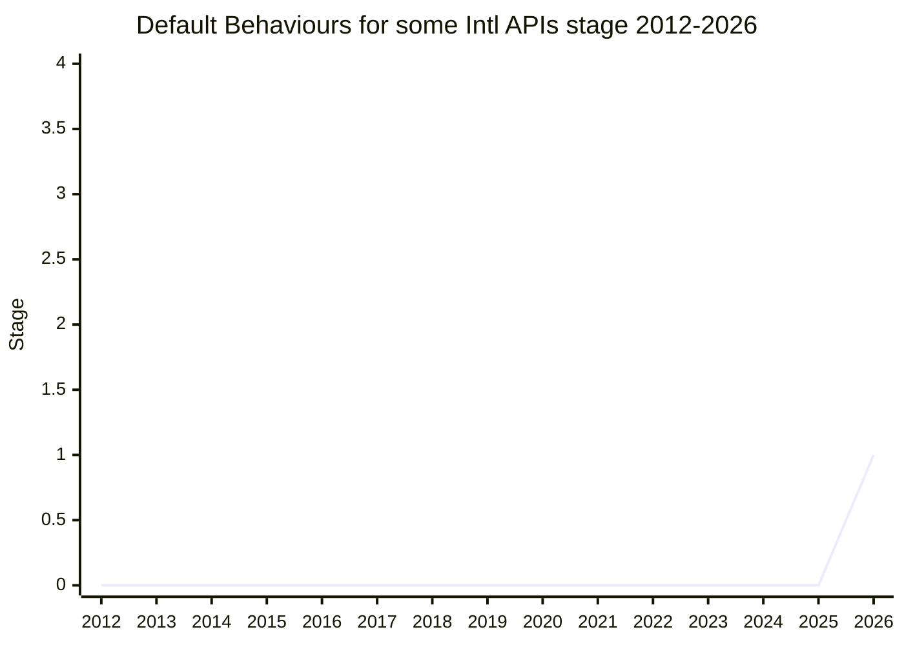

## Overview

Default Behaviours for some Intl APIs gives explicit access to the **locale-independent "root" behaviour** of the Intl APIs that consume text rather than produce it: `Intl.Collator`, `Intl.Segmenter`, and `String.prototype.toLocaleLowerCase` / `toLocaleUpperCase`. That behaviour already exists in every implementation (the CLDR root collation, untailored UAX #29 segmentation, Unicode Default Case Conversion), and the spec itself points to it: the `Intl.Segmenter` note names the UAX #29 default algorithms and recommends locale tailorings on top. But no request string reliably reaches it. `undefined`, and in practice any locale the engine does not ship (including `"und"`), falls back to the host's default locale, so the result depends on where the code runs. The proposal adds no new API. It makes `"und"` (BCP 47 "undetermined", which UTS 35 and CLDR use for the root locale) a supported locale for these APIs. It also gives `zxx`, the Stable Formatting locale, a fallback to `"und"` in those APIs, which have no stable behaviour of their own.

```js
new Intl.Collator("und").compare(a, b); // CLDR root collation, no language tailoring
new Intl.Segmenter("und"); // grapheme clusters: UAX #29 without tailorings
"I".toLocaleLowerCase("und"); // Unicode Default Case Conversion, same as toLowerCase()
new Intl.Collator("zxx"); // no stable Collator behaviour, so it falls back to "und"
// Today all of these fall back to the host default locale instead.
```

As presented for Stage 1, word and sentence segmentation would follow UAX #29 (and UAX #14) "potentially with tailorings as long as those tailorings are the same between all locales". For case mapping, `"und"` would require Default Case Conversion. The current `TransformCase` text already resolves an unmatched locale to `"und"`, but it still permits "an implementation-derived algorithm using _locale_". There is no spec text yet.

[EAO](../people/EAO.md) is the sole champion. The proposal was spun off from [Stable Formatting](stable-formatting.md). That proposal began in 2023-09 as "Define the behavior and properties of the “und” root locale" and settled on `zxx` as a strictly stable locale. Root-locale behaviour for the text-consuming APIs is useful but not fully stable, so it was split off: TG2 agreed to the split on 2026-05-07, and the proposal reached Stage 1 at the 2026-05 plenary. The main open question is the identifier, because `"und"` has meant the host default locale on the web for as long as Intl has existed.

## Stage history

| Meeting                                                                              | Venue   | Event                                                                                                                                                                                                                                                                                                                                                                 | Stage |
| ------------------------------------------------------------------------------------ | ------- | --------------------------------------------------------------------------------------------------------------------------------------------------------------------------------------------------------------------------------------------------------------------------------------------------------------------------------------------------------------------- | ----- |
| [2023-09-07](https://github.com/tc39/ecma402/blob/main/meetings/notes-2023-09-07.md) | TG2     | [EAO](../people/EAO.md) presents "Define the behavior and properties of the “und” root locale" (`eemeli/proposal-intl-root-locale`), the precursor of Stable Formatting; [SFC](../people/SFC.md): "perhaps Collator should be out of scope"                                                                                                                           | 0     |
| [2023-09](https://github.com/tc39/notes/blob/main/meetings/2023-09/september-27.md)  | plenary | Stable Formatting reaches Stage 1. [RGN](../people/RGN.md): segmentation and collation are "domains where you might want stability"; [MF](../people/MF.md): "Can you clarify how that’s language independent?"                                                                                                                                                        | 0     |
| [2024-02-22](https://github.com/tc39/ecma402/blob/main/meetings/notes-2024-02-22.md) | TG2     | [HJS](../people/HJS.md) (written `HSI`): the API has no way to request the root collation or untailored UAX #29; [EAO](../people/EAO.md): "emoji collation is only available from the root locale"                                                                                                                                                                    | 0     |
| [2024-08-22](https://github.com/tc39/ecma402/blob/main/meetings/notes-2024-08-22.md) | TG2     | [ecma402#885](https://github.com/tc39/ecma402/issues/885) (`"und"` unsupported): root, ISO 8601 or host locale? [SFC](../people/SFC.md): "No conclusion reached, but this has been clarifying"                                                                                                                                                                        | 0     |
| [2024-12-19](https://github.com/tc39/ecma402/blob/main/meetings/notes-2024-12-19.md) | TG2     | #885 retitled "Should "und" behave like "root" or undefined?": [HJS](../people/HJS.md) and [SFC](../people/SFC.md) want root for Collator/Segmenter; [USA](../people/USA.md): `undefined` already means host; [ZB](../people/ZB.md) (written `ZBI`) separates host, last-resort and "I don't know" locales. No conclusion                                             | 0     |
| [2025-01-16](https://github.com/tc39/ecma402/blob/main/meetings/notes-2025-01-16.md) | TG2     | [ecma402#896](https://github.com/tc39/ecma402/issues/896) (case-mapping locale resolution). [SFC](../people/SFC.md): "for case mapping, using the root locale is fine". Conclusion: "[RGN](../people/RGN.md) to make a pull request."                                                                                                                                 | 0     |
| [2025-02-06](https://github.com/tc39/ecma402/blob/main/meetings/notes-2025-02-06.md) | TG2     | [ecma402#956](https://github.com/tc39/ecma402/pull/956): should an explicit `"und"` give root case mapping? [EAO](../people/EAO.md): "zxx" would be "a way to trigger root locale behavior". On Stable Formatting PR #18, [RGN](../people/RGN.md): root behaviour is not guaranteed to be stable, and "giving up stability is a one-way door"                         | 0     |
| [2025-02](https://github.com/tc39/notes/blob/main/meetings/2025-02/february-19.md)   | plenary | `Stable Formatting update`: root behaviour for Collator/Segmenter/case mapping separated from stability. Conclusion: "If ‘zxx’ explicitly means “stable”, we may need another special locale identifier for the root locale."                                                                                                                                         | 0     |
| [2025-05-08](https://github.com/tc39/ecma402/blob/main/meetings/notes-2025-05-08.md) | TG2     | #956 shelved: [HJS](../people/HJS.md) and [EAO](../people/EAO.md) against list fallback without case-mapping locale data; [RGN](../people/RGN.md) marks the PR as a draft                                                                                                                                                                                             | 0     |
| [2026-05-19](https://github.com/tc39/ecma402/blob/main/meetings/notes-2026-05-19.md) | TG2     | (Meeting of 2026-05-07.) [proposal-stable-formatting#24](https://github.com/tc39/proposal-stable-formatting/pull/24) "Define und behaviour for Collator, Segmenter & String.p.toLocale{Lower,Upper}Case". TG2 approval to present it as a separate Stage 1 proposal: [SFC](../people/SFC.md) "Yes, it should be spun off"; [RGN](../people/RGN.md) "Approval as well" | 0     |
| [2026-05](https://github.com/tc39/notes/blob/main/meetings/2026-05/may-20.md)        | plenary | Reached Stage 1. `Default Behaviours for some Intl APIs for Stage 1` ([EAO](../people/EAO.md)), right after Stable Formatting's Stage 2. +1 from [MAH](../people/MAH.md) and [ZTZ](../people/ZTZ.md); [SFC](../people/SFC.md) backs the motivation but not `"und"`. "The proposal was approved for Stage 1."                                                          | 0 → 1 |



> How to read: Stage 1 came in 2026-05 (`may-20.md`), the first time the proposal was presented on its own. The 2023-09 to 2026-05 rows are prehistory inside Stable Formatting and ecma402 issues and PRs, so the line stays at 0 until 2026. `first_seen` is 2023-09 because the root-locale idea (and [SFC](../people/SFC.md)'s doubt about including Collator) goes back to Stable Formatting's first TG2 presentation. The TG2 notes file `notes-2026-05-19.md` is headed "2026-05-07 ECMA-402 Meeting", so TG2 agreed to the spin-off before the plenary. The canonical table (`raw/proposals/ecma402/README.md`) lists the proposal under Stage 1 with [EAO](../people/EAO.md) as author and champion, which matches the plenary. Neither the 2026-07 plenary nor the TG2 calls up to 2026-09-17 had an agenda item for it.

## Main issues

### What `"und"` means today: root locale or host default (ecma402#885)

The proposal started from a gap that TG2 kept running into. At [2024-02-22](https://github.com/tc39/ecma402/blob/main/meetings/notes-2024-02-22.md), in the Stable Formatting discussion, [HJS](../people/HJS.md) (written `HSI` in the notes) noted that the root collation and untailored UAX #29 segmentation exist but cannot be requested:

> [HJS](../people/HJS.md): In these cases, we have some definition that is international in some sense, for example in collation we have the root collation, for segmentation we have the Annex 29, that’s in its untailored form, but the API doesn’t yet have a way to request the untailored thing. Not having a locale parameter at all falls to host locale, so we need some string that says “I don’t want a locale, I just want the non-tailored thing”

The obvious string, `"und"`, does not do this in current engines. They do not ship it as an available locale, so it falls back to the host locale just as `undefined` does. At [2024-08-22](https://github.com/tc39/ecma402/blob/main/meetings/notes-2024-08-22.md) ([ecma402#885](https://github.com/tc39/ecma402/issues/885)) [SFC](../people/SFC.md) gave three options for `"und"`: CLDR root, ISO 8601, or the user locale. [SFC](../people/SFC.md) agreed with [HJS](../people/HJS.md) that "und" might make sense for Collator but not for DateTimeFormat. [HJS](../people/HJS.md) called the status quo a trap: "it looks to you that "und" means the thing you think it means, but it doesn’t actually mean that". [RGN](../people/RGN.md) defended it: "Is it horrible behaviour? It is the behaviour that you get when the locale is undefined." [RGN](../people/RGN.md) also objected that UTS 35 treats "und" as the root locale, "which is not what it means in BCP-47". [FYT](../people/FYT.md) found defining behaviour for an "undetermined" code "logically illogical".

At [2024-12-19](https://github.com/tc39/ecma402/blob/main/meetings/notes-2024-12-19.md) the issue was retitled "Should "und" behave like "root" or undefined?". [SFC](../people/SFC.md) argued that for Collator and Segmenter the locale belongs to the text, not the reader: "If we don’t have a locale that’s specified it’s wrong to fallback to host." [HJS](../people/HJS.md) asked how many callers write `"und"` intending host fallback rather than root, and concluded that "Atleast for Collator and Segmenter und should mean root." [USA](../people/USA.md) saw no value in `"und"` as a second spelling of `undefined`, but did see a use for it in "Intl-lite" and stable-formatting cases. [ZB](../people/ZB.md) (written `ZBI`) separated four concepts: undefined language, host locale, last-resort fallback, and a "non-locale locale". [ZB](../people/ZB.md) preferred a heuristic that tries the host before the last resort. No conclusion was recorded. At [2025-02-06](https://github.com/tc39/ecma402/blob/main/meetings/notes-2025-02-06.md) [EAO](../people/EAO.md) summarised where TG2 stood: an explicit `"und"` should get no special root behaviour, because "we've ended up defining/understanding that "und" is short for "undefined" which does fallback". [EAO](../people/EAO.md) then added: "However, "zxx" would be really appropriate here as a way to trigger root locale behavior."

The Stage 1 proposal reverses that, since `zxx` had meanwhile been reserved for strict stability (next section). [EAO](../people/EAO.md)'s Stage 1 motivation quoted an ecma402 issue: “I expected to be able to specify the und locale tag with `Intl.Collator`, in order to access the so-called root collation and obtain a reasonably language-agnostic sort order (or the closest thing available).” A related clean-up landed separately. [ecma402#1072](https://github.com/tc39/ecma402/pull/1072) makes `Intl.Locale.prototype.getCollations()` return the root collations, not the host locale's, for `"und"` or an unknown language. It got TG2 approval on [2026-06-11](https://github.com/tc39/ecma402/blob/main/meetings/notes-2026-06-11.md) and consensus at the [2026-07](https://github.com/tc39/notes/blob/main/meetings/2026-07/july-22.md) plenary. The notes do not present it as part of this proposal.

### The identifier: `"und"`, another string, a symbol, or `zxx`

The mechanism is the open Stage 1 question. At the [2026-05](https://github.com/tc39/notes/blob/main/meetings/2026-05/may-20.md) plenary [EAO](../people/EAO.md) argued for `"und"` because it is "commonly used as a way of identifying the root locale", and against a string like `"root"` or a well-known Symbol. Emoji collation needs the `-u-co-emoji` extension, and that requires the identifier to go through ordinary locale parsing. [SFC](../people/SFC.md) supported the motivation but not the identifier. `"und"` and `undefined` both yield the host default, and [SFC](../people/SFC.md) "would be surprised if it's web compatible to change this". String-only environments also need a spelling of "default locale", which is why `zxx` replaced `null` in Stable Formatting:

> [SFC](../people/SFC.md): I like the motivation but I think we need to explore other options. For what the string locale should be.

> [EAO](../people/EAO.md): Noting of course that it's very much a JavaScript Intl peculiarity that “und” can be considered to have a meaning of “default locale” rather than the root locale.

> [SFC](../people/SFC.md): Yeah. It's had that behavior for 14 years.

[SFC](../people/SFC.md) had made the same observation at the [2025-02](https://github.com/tc39/notes/blob/main/meetings/2025-02/february-19.md) plenary, calling `undefined` ≈ `"und"` "currently the web reality in all major browsers". [RGN](../people/RGN.md) disagreed there: `undefined` is privileged by ECMA-402, whereas "‘und’ is not guaranteed to have the behavior", since an implementation could start shipping it at any time. [HJS](../people/HJS.md) has favoured a split since TG2 2024-08-22, where [HJS](../people/HJS.md) suggested that APIs that consume and that produce natural language might end up with different identifiers. At [2026-05-19](https://github.com/tc39/ecma402/blob/main/meetings/notes-2026-05-19.md) [HJS](../people/HJS.md) put it as "To access the root collation, I would prefer that to be `und`, while stable formatting is `zxx`". [SFC](../people/SFC.md) said at the same call: "If we’re defining special meaning of `und` I’m not ready for that." Stage 1 was granted on the motivation, with the mechanism left to TG2.

### Locale-independent is not stable: the split from Stable Formatting

The proposal exists because the committee decided that root behaviour and stable behaviour must not share an identifier. Stable Formatting's 2025-02 sketch had `zxx` use the root collation, UAX #29 and Default Case Conversion. [EAO](../people/EAO.md) called these "the stablest possible thing" for APIs that consume localized content, not truly stable. At TG2 [2025-02-06](https://github.com/tc39/ecma402/blob/main/meetings/notes-2025-02-06.md) [RGN](../people/RGN.md) objected that root behaviour is locale-independent but not guaranteed to be stable, so it "would need to be indicated as such… giving up stability is a one-way door." At the [2025-02](https://github.com/tc39/notes/blob/main/meetings/2025-02/february-19.md) plenary [SFC](../people/SFC.md) pointed out that root collation and segmentation change when Unicode adds characters or revises rules. [RGN](../people/RGN.md) answered:

> [RGN](../people/RGN.md): I think yes, and yes it is a concern. What is valuable here I think is not access to the root locale, but access to deterministic stability. Access to the root locale is itself valuable, but shouldn’t be mixed together with the concept of stability.

[EAO](../people/EAO.md) then suggested giving these APIs explicit root access "using either the string und and what CLDR and Unicode use for it or some other method", and [RGN](../people/RGN.md) replied "I strongly support that. And in particular support it in a way that is distinct from requesting stability." This became the conclusion's second bullet.

[PR #24](https://github.com/tc39/proposal-stable-formatting/pull/24) on Stable Formatting (TG2 [2026-05-19](https://github.com/tc39/ecma402/blob/main/meetings/notes-2026-05-19.md)) put `"und"` behaviour into the Stable Formatting spec, and the call settled where it belonged. [SFC](../people/SFC.md) worried that `Intl.STABLE` passed to a Collator would look stable when it is not. [RGN](../people/RGN.md) wanted `zxx` reserved for a "Single algorithm usable for all time" (code-point order for collation) and gave a blockchain use case. [HJS](../people/HJS.md) rejected a frozen collator but supported explicit root access. [EAO](../people/EAO.md) agreed that `zxx` should not change and asked TG1 whether `und` belonged in a separate proposal. TG2 approved spinning it off, and [RGN](../people/RGN.md) added a principle for the future:

> [RGN](../people/RGN.md): Approval as well. I think it will become important for any Intl API that _doesn’t_ support deterministic behaviour to indicate itself as such.

At the Stage 2 plenary for Stable Formatting ([2026-05](https://github.com/tc39/notes/blob/main/meetings/2026-05/may-20.md)) [MAH](../people/MAH.md) (Agoric) asked what a Segmenter does with `zxx` today. [EAO](../people/EAO.md) answered that it falls back to the system locale, and [MAH](../people/MAH.md) asked about throwing instead:

> [MAH](../people/MAH.md): Has there been any consideration into for example throwing so that you don't end up with a non-stable behavior?

[EAO](../people/EAO.md) deferred to this proposal, which answers with a fallback rather than an error: in these APIs `zxx` falls back to `"und"`, giving behaviour that is "mostly stable" but carries no guarantee. Throwing was not taken up, and [RGN](../people/RGN.md)'s request that non-deterministic APIs flag themselves is not yet reflected in a design. The Stage 1 summary names only `Intl.Collator` and `Intl.Segmenter`, although the presentation also covered `toLocale{Lower,Upper}Case`.

### Case mapping: locale resolution and an explicit `"und"` (ecma402#896, #956)

Case mapping took its own path through normative PRs. At TG2 [2025-01-16](https://github.com/tc39/ecma402/blob/main/meetings/notes-2025-01-16.md) ([ecma402#896](https://github.com/tc39/ecma402/issues/896)) [RGN](../people/RGN.md) pointed out that `toLocale{Lower,Upper}Case` look only at the first element of the locale list, unlike the rest of ECMA-402. [HJS](../people/HJS.md) replied that the data makes this "just a fancy boolean" for Turkic behaviour (plus Lithuanian). [SFC](../people/SFC.md) distinguished content locales from formatting locales:

> [SFC](../people/SFC.md): It might be surprising if from one engine to another, the behavior of this function changed. I think for formatting it makes sense to fall back, but for case mapping, using the root locale is fine.

[RGN](../people/RGN.md)'s [ecma402#956](https://github.com/tc39/ecma402/pull/956) followed (TG2 [2025-02-06](https://github.com/tc39/ecma402/blob/main/meetings/notes-2025-02-06.md)). [RGN](../people/RGN.md) relayed Anba's ([ABL](../people/ABL.md)'s) point that an explicit unknown locale such as `und` "maybe ought to be deterministic", and set out the open cases: `"I".toLocaleLowerCase("und")` and `"I".toLocaleLowerCase("zxx")` "in a Turkish context". [EAO](../people/EAO.md) answered that `"und"` falls back (quoted above). [SFC](../people/SFC.md) answered, and [RGN](../people/RGN.md) accepted, that `["und", "tr"]` and `["zxx", "tr"]` fall through to `tr`. [HJS](../people/HJS.md)'s objection, that no data distinguishes locales known to use the default case mapping from unknown ones, went on to sink the PR at [2025-05-08](https://github.com/tc39/ecma402/blob/main/meetings/notes-2025-05-08.md): "The PR makes sense in theory, if there really were such data, but we don’t have this distinction." [EAO](../people/EAO.md) agreed with [HJS](../people/HJS.md), and [RGN](../people/RGN.md) agreed to mark the PR as a draft.

The Stage 1 proposal treats case mapping only through `"und"`. With `"und"`, `toLocale{Lower,Upper}Case` would have to give the same result as `toLowerCase` / `toUpperCase` (Unicode Default Case Conversion). [EAO](../people/EAO.md) described this as removing a nominal relaxation. The current text allows "an implementation-derived algorithm using _locale_" even when the locale has resolved to `"und"`, and [EAO](../people/EAO.md) trusted that no engine actually uses it there. List-fallback questions such as `["tt", "tr"]` stay with the shelved #956.

### What "untailored" means for Segmenter

Collation has an obvious default (the CLDR root collation), but segmentation does not. At TG2 [2025-02-06](https://github.com/tc39/ecma402/blob/main/meetings/notes-2025-02-06.md) [HJS](../people/HJS.md) split it by granularity. Grapheme segmentation and sentence rules have untailored defaults. Word segmentation is "harder to define and the default rules don’t work for Chinese/Japanese/etc.", so a global default should keep the tailorings for languages written without spaces rather than turn them off. The Stage 1 presentation follows that: untailored UAX #29 for graphemes, and for word and sentence segmentation, compliance with UAX #29 and UAX #14 "potentially with tailorings as long as those tailorings are the same between all locales". [RGN](../people/RGN.md)'s preference at the 2025-02 plenary for snapshotting "a particular revision of UAX#29" applies to `zxx`, not to `"und"`. [EAO](../people/EAO.md) judged a fixed-version requirement "a cost that is maybe not worthwhile", and that is why Segmenter left Stable Formatting. Which locales count as supported for Segmenter is also loosely defined today. At 2025-02-06 [HJS](../people/HJS.md) called this "totally bogus", and [SFC](../people/SFC.md) explained that Segmenter checks the date-formatting data to decide whether a locale is supported, and [SFC](../people/SFC.md) pointed to CLDR-18187, where segmentation was found to depend more on script than on language.

## Related proposals

- [Stable Formatting](stable-formatting.md) (Stage 2 in 2026-05, [EAO](../people/EAO.md)) is the parent proposal. It defines the strictly stable `zxx` locale and deliberately leaves `Intl.Collator`, `Intl.Segmenter` and `toLocale{Lower,Upper}Case` without `zxx` behaviour. This proposal fills that gap with `"und"`, and in those APIs `zxx` falls back to it.
- ecma402 PR #956 (case-mapping `ResolveLocale`, draft since 2025-05) and PR #1072 (`getCollations()` returns root collations for `"und"` or unknown languages, consensus 2026-07) are normative changes on neighbouring ground. They are not part of this proposal.

## Sources

TG2:

- https://github.com/tc39/ecma402/blob/main/meetings/notes-2023-09-07.md
- https://github.com/tc39/ecma402/blob/main/meetings/notes-2024-02-22.md
- https://github.com/tc39/ecma402/blob/main/meetings/notes-2024-08-22.md
- https://github.com/tc39/ecma402/blob/main/meetings/notes-2024-12-19.md
- https://github.com/tc39/ecma402/blob/main/meetings/notes-2025-01-16.md
- https://github.com/tc39/ecma402/blob/main/meetings/notes-2025-02-06.md
- https://github.com/tc39/ecma402/blob/main/meetings/notes-2025-05-08.md
- https://github.com/tc39/ecma402/blob/main/meetings/notes-2026-05-19.md
- https://github.com/tc39/ecma402/blob/main/meetings/notes-2026-06-11.md

Plenary:

- https://github.com/tc39/notes/blob/main/meetings/2023-09/september-27.md
- https://github.com/tc39/notes/blob/main/meetings/2025-02/february-19.md
- https://github.com/tc39/notes/blob/main/meetings/2026-05/may-20.md
- https://github.com/tc39/notes/blob/main/meetings/2026-07/july-22.md
