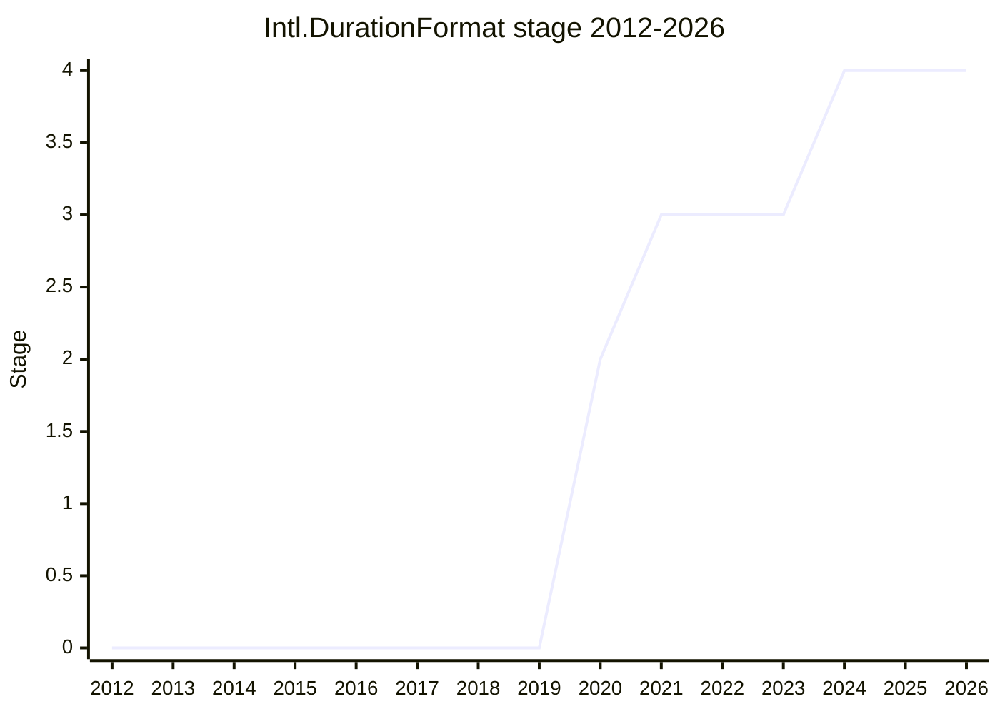

## Overview

`Intl.DurationFormat` is a locale-sensitive formatter for **compound durations of time** (e.g. "1 hour, 46 minutes, 40 seconds" or a clock-like "1:46:40"). `Intl.RelativeTimeFormat` can only format a single unit relative to now, and `Intl.NumberFormat` unit formatting only handles one unit at a time, so before this proposal developers had to glue unit-formatted numbers together with `Intl.ListFormat` themselves. The arrival of `Temporal.Duration` (whose `toLocaleString` needed something to delegate to) gave the long-standing request urgency. Architecturally the spec is built on top of `Intl.NumberFormat` (unit formatting per field) and `Intl.ListFormat` (joining the fields).

```js
new Intl.DurationFormat("en", { style: "long" }).format({ hours: 1, minutes: 46, seconds: 40 });
// "1 hour, 46 minutes, 40 seconds"
new Intl.DurationFormat("en", { style: "digital" }).format({ hours: 1, minutes: 46, seconds: 40 });
// "1:46:40"
new Intl.DurationFormat("en", { hours: "narrow", minutes: "numeric" }).format({ hours: 2, minutes: 5 });
// per-unit styles, akin to Intl.DateTimeFormat
```

The final design (settled in 2021 after several failed iterations) has a base `style` (`"long"`, `"short"` (default), `"narrow"`, `"digital"`), per-unit style options (`years` ... `nanoseconds`, with `"numeric"` / `"2-digit"` for the clock-like units), per-unit `*Display` options (`"auto"` hides zero-valued units, `"always"` shows them), and `fractionalDigits` for sub-second precision. It deliberately does **no balancing or rounding arithmetic** — a duration is displayed as given. Input is a duration-like object (and later `Temporal.Duration`); strings are rejected with a `RangeError` until Temporal integration. The original champion was [YMD](../people/YMD.md) (from 2020); [USA](../people/USA.md) took over as champion in 2021, and from late 2023 [BAN](../people/BAN.md) presented most of the remaining work at plenary. It reached Stage 4 in 2024-12 and ships in ECMA-402 2025 (12th edition).

## Stage history

| Meeting                                                                              | Venue   | Event                                                                                                                                                                                                                                                                      | Stage |
| ------------------------------------------------------------------------------------ | ------- | -------------------------------------------------------------------------------------------------------------------------------------------------------------------------------------------------------------------------------------------------------------------------- | ----- |
| [2016-01](https://github.com/tc39/notes/blob/main/meetings/2016-01/jan-28.md)        | plenary | [ZB](../people/ZB.md) lists `Intl.DurationFormat` among future Intl ideas ("Video player or timer in a watch. Distinct from UnitFormat")                                                                                                                                   | 0     |
| [2017-12-15](https://github.com/tc39/ecma402/blob/main/meetings/notes-2017-12-15.md) | TG2     | Listed under "Less advanced proposals" on the first TG2 agenda ([ecma402#47](https://github.com/tc39/ecma402/issues/47))                                                                                                                                                   | 0     |
| [2019-11-14](https://github.com/tc39/ecma402/blob/main/meetings/notes-2019-11-14.md) | TG2     | Stage 0 pitch from [SFC](../people/SFC.md), motivated by Temporal; [FYT](../people/FYT.md) volunteers as champion                                                                                                                                                          | 0     |
| [2020-01-09](https://github.com/tc39/ecma402/blob/main/meetings/notes-2020-01-09.md) | TG2     | Debate on a new class vs. overloading `DateTimeFormat`/`NumberFormat`; TG2 "Stage 1 consensus", [YMD](../people/YMD.md) to present in February                                                                                                                             | 0     |
| [2020-02](https://github.com/tc39/notes/blob/main/meetings/2020-02/february-6.md)    | plenary | Reached Stage 1. `Time Duration Format Proposal for Stage 1` ([YMD](../people/YMD.md)). "Consensus reached for stage 1"                                                                                                                                                    | 0 → 1 |
| [2020-06](https://github.com/tc39/notes/blob/main/meetings/2020-06/june-2.md)        | plenary | Reached Stage 2. `Intl.DurationFormat for Stage 2` ([YMD](../people/YMD.md)). Stage 3 reviewers: [MF](../people/MF.md), [RBN](../people/RBN.md)                                                                                                                            | 1 → 2 |
| [2021-01-14](https://github.com/tc39/ecma402/blob/main/meetings/notes-2021-01-14.md) | TG2     | `"digital"` favoured in a poll for the style name; tentative agreement: keep a separate class, default width short, minus sign on the first number                                                                                                                         | 2     |
| [2021-08](https://github.com/tc39/notes/blob/main/meetings/2021-08/aug-31.md)        | plenary | Stage 2 update ([USA](../people/USA.md), now champion): the redesigned API with base style, per-unit styles/display and `fractionalDigits`; "approved by TC39-TG2"                                                                                                         | 2     |
| [2021-10-07](https://github.com/tc39/ecma402/blob/main/meetings/notes-2021-10-07.md) | TG2     | [USA](../people/USA.md) plans to ask for Stage 3 this month; [FYT](../people/FYT.md): "I don’t think this is ready yet"                                                                                                                                                    | 2     |
| [2021-10](https://github.com/tc39/notes/blob/main/meetings/2021-10/oct-25.md)        | plenary | Reached Stage 3, "conditional on discussion of whether fractional digits sets minimum as well"                                                                                                                                                                             | 2 → 3 |
| [2022-05-19](https://github.com/tc39/ecma402/blob/main/meetings/notes-2022-05-19.md) | TG2     | Discovery that the spec depends on Temporal AOs (string parsing); conclusion "Decouple the two proposals"                                                                                                                                                                  | 3     |
| [2022-06](https://github.com/tc39/notes/blob/main/meetings/2022-06/jun-07.md)        | plenary | Stage 3 update: how to decouple from Temporal (drop string input; options bags only)                                                                                                                                                                                       | 3     |
| [2022-09](https://github.com/tc39/notes/blob/main/meetings/2022-09/sep-13.md)        | plenary | Consensus: `fractionalDigits` fallback undefined → 0; new `"digital"` defaults (`"short"` for date units, hours/minutes/seconds displayed `"always"`)                                                                                                                      | 3     |
| [2022-11](https://github.com/tc39/notes/blob/main/meetings/2022-11/dec-01.md)        | plenary | Consensus on bug-fix PRs: `RangeError` for strings; `formatToParts` overhaul begins                                                                                                                                                                                        | 3     |
| [2023-01](https://github.com/tc39/notes/blob/main/meetings/2023-01/jan-31.md)        | plenary | Consensus on [PR #126](https://github.com/tc39/proposal-intl-duration-format/pull/126): more granular `formatToParts` output                                                                                                                                               | 3     |
| [2023-04-06](https://github.com/tc39/ecma402/blob/main/meetings/notes-2023-04-06.md) | TG2     | Batch of [ABL](../people/ABL.md)/[FYT](../people/FYT.md) issues: throw on sub-second `"numeric"` + `"always"` (#139), `fractionalDigits` default "option 4" (#144), `roundingMode: "trunc"` (#146)                                                                         | 3     |
| [2023-05](https://github.com/tc39/notes/blob/main/meetings/2023-05/may-17.md)        | plenary | Consensus on `fractionalDigits` redesign (presented as a min/max pair) and throwing on invalid unit options                                                                                                                                                                | 3     |
| [2023-06-29](https://github.com/tc39/ecma402/blob/main/meetings/notes-2023-06-29.md) | TG2     | [USA](../people/USA.md): the 2023-05 plenary change "misunderstood the consensus"; revert PR #150 prepared                                                                                                                                                                 | 3     |
| [2023-07](https://github.com/tc39/notes/blob/main/meetings/2023-07/july-12.md)       | plenary | Consensus on [PR #150](https://github.com/tc39/proposal-intl-duration-format/pull/150) (revert: `fractionalDigits` fallback back to undefined) and [PR #158](https://github.com/tc39/proposal-intl-duration-format/pull/158) (`ToIntegerIfIntegral` aligned with Temporal) | 3     |
| [2023-11-16](https://github.com/tc39/ecma402/blob/main/meetings/notes-2023-11-16.md) | TG2     | TG2 agreement on #169/#176 (negative sign), #155/#178, #170/#180, #157/#173 (Temporal limits); `"fractional"` style deferred to v2                                                                                                                                         | 3     |
| [2023-11](https://github.com/tc39/notes/blob/main/meetings/2023-11/november-28.md)   | plenary | [BAN](../people/BAN.md) presents six normative PRs (negative sign only on the first unit, Temporal.Duration limits, etc.). "TG1 consensus on all PRs"                                                                                                                      | 3     |
| [2024-02](https://github.com/tc39/notes/blob/main/meetings/2024-02/feb-8.md)         | plenary | Consensus on locale-specific digital separators / hour digits ([PR #186](https://github.com/tc39/proposal-intl-duration-format/pull/186)) and Temporal range limits ([PR #173](https://github.com/tc39/proposal-intl-duration-format/pull/173))                            | 3     |
| [2024-04-25](https://github.com/tc39/ecma402/blob/main/meetings/notes-2024-04-25.md) | TG2     | `PartitionDurationFormatPattern` refactor (PR #188); grouping separators in digital styles (#192), [PR #198](https://github.com/tc39/proposal-intl-duration-format/pull/198) approved for TG1                                                                              | 3     |
| [2024-06](https://github.com/tc39/notes/blob/main/meetings/2024-06/june-13.md)       | plenary | Consensus on PR #198 (no grouping separators in `"numeric"`/`"2-digit"` units)                                                                                                                                                                                             | 3     |
| [2024-07](https://github.com/tc39/notes/blob/main/meetings/2024-07/july-29.md)       | plenary | Consensus to fix the dropped negative sign on leading numeric-style zeroes                                                                                                                                                                                                 | 3     |
| [2024-09-26](https://github.com/tc39/ecma402/blob/main/meetings/notes-2024-09-26.md) | TG2     | Stage 4 readiness check: wait for editorial changes and remaining test262 tests                                                                                                                                                                                            | 3     |
| [2024-10](https://github.com/tc39/notes/blob/main/meetings/2024-10/october-09.md)    | plenary | Consensus (again) on PR #198, grouping separators in digital format                                                                                                                                                                                                        | 3     |
| [2024-11-25](https://github.com/tc39/ecma402/blob/main/meetings/notes-2024-11-25.md) | TG2     | [YSZ](../people/YSZ.md) (JSC) and [FYT](../people/FYT.md) (V8) report readiness; "Add to the TG1 agenda" for Stage 4                                                                                                                                                       | 3     |
| [2024-12](https://github.com/tc39/notes/blob/main/meetings/2024-12/december-02.md)   | plenary | Reached Stage 4. `Intl.DurationFormat for Stage 4` ([USA](../people/USA.md), on behalf of [BAN](../people/BAN.md)), "with supporting comments from [DLM](../people/DLM.md) and [PFC](../people/PFC.md)"                                                                    | 3 → 4 |
| [2025-03-06](https://github.com/tc39/ecma402/blob/main/meetings/notes-2025-03-06.md) | TG2     | Merged into the spec for the ECMA-402 2025 edition ([RGN](../people/RGN.md): "Big change was DurationFormat.")                                                                                                                                                             | 4     |



> How to read: Stage 1 in 2020-02 and Stage 2 in 2020-06 (both in 2020, so the 2020 point is 2), Stage 3 in 2021-10 (conditional on the `fractionalDigits` minimum question), Stage 4 in 2024-12; published in ECMA-402 2025. It spent over three years at Stage 3 because of a long tail of implementer-driven normative changes. Note that the champions' own history slides misstate the early dates: [USA](../people/USA.md)'s 2022-11 slide says Stage 1 was "in February 2021", and the 2024-12 Stage 4 deck says "2 on June 22"; the plenary notes put Stage 1 at 2020-02 and Stage 2 at 2020-06.

## Main issues

### A separate formatter, or part of NumberFormat / DateTimeFormat / RelativeTimeFormat?

The first TG2 discussion ([2020-01-09](https://github.com/tc39/ecma402/blob/main/meetings/notes-2020-01-09.md)) was about where duration formatting should live ([ecma402#47](https://github.com/tc39/ecma402/issues/47)). [SFC](../people/SFC.md) laid out the options (DateTimeFormat, NumberFormat because hours/minutes/seconds are units, or a new namespace); [DE](../people/DE.md), [RCA](../people/RCA.md) and [LEO](../people/LEO.md) leaned towards `DateTimeFormat` or a new class for discoverability, and [ZB](../people/ZB.md) argued for a standalone class:

> [ZB](../people/ZB.md): From my perspective, DurationFormat is closest to RelativeTimeFormat. It is a compounded NumberFormat which we don’t have yet. I would say DurationFormat as it’s own class, easier to deprecate once we incorporate into NumberFormat.

At the Stage 1 plenary ([2020-02](https://github.com/tc39/notes/blob/main/meetings/2020-02/february-6.md)) [WH](../people/WH.md) questioned the overlap with unit formatting ("What is the relationship between this and UnitFormat? It seems to be a special case where units are time."). [SFC](../people/SFC.md) answered that durations are special:

> [SFC](../people/SFC.md): When you are formatting a duration, it is conceptually similar. However, we found that durations are different enough than other units that they have a lot of options that don’t apply to other units.

When Temporal made durations signed, [USA](../people/USA.md) reopened the question at [2020-09-10](https://github.com/tc39/ecma402/blob/main/meetings/notes-2020-09-10.md) ([proposal-intl-duration-format#29](https://github.com/tc39/proposal-intl-duration-format/issues/29)): "Should we repurpose the proposal to improve Intl.RelativeTimeFormat instead of making a new class?" [FYT](../people/FYT.md) objected that "RelativeTimeFormat is about a reference point. Durations don't have a reference point." The [2021-01-14](https://github.com/tc39/ecma402/blob/main/meetings/notes-2021-01-14.md) TG2 call recorded the tentative agreement to "Continue having Intl.DurationFormat", and the class stayed separate — though the implementation strategy converged on NumberFormat unit formatting plus ListFormat (the 2022-09 refactor that required adding `microsecond`/`nanosecond` to the sanctioned units, ecma402 PR #708).

### The `"digital"` style: naming, defaults and clock-like output

The clock-like style was the most troublesome part of the API. Its name was debated at [2020-09-10](https://github.com/tc39/ecma402/blob/main/meetings/notes-2020-09-10.md) ([#16](https://github.com/tc39/proposal-intl-duration-format/issues/16), "dotted" vs. "numeric"): [FYT](../people/FYT.md) suggested `"symbol"`, `"delimited"` or `"concise"`, [JSW](../people/JSW.md) `"delimited"`/`"concise"`, [YMD](../people/YMD.md) `"digital"`; [SFC](../people/SFC.md) liked `"digital"` ("It is self-describing") while [PFC](../people/PFC.md) was "not a huge fan of "digital" since it means a lot of things outside the context of digital clocks." A [2021-01-14](https://github.com/tc39/ecma402/blob/main/meetings/notes-2021-01-14.md) poll favoured `"digital"` (digital: [ZB](../people/ZB.md), [JGT](../people/JGT.md), [YMD](../people/YMD.md), [SFC](../people/SFC.md), [EAO](../people/EAO.md); clock: [LAF](../people/LAF.md)). Presenting for Stage 3, [USA](../people/USA.md) admitted:

> [USA](../people/USA.md): That was the controversial style. I was personally more or less convinced that digital is not worth keeping, but people helped convince me otherwise, so there's still all intact.

- **Ambiguous output** ([#54](https://github.com/tc39/proposal-intl-duration-format/issues/54), [2022-09-01](https://github.com/tc39/ecma402/blob/main/meetings/notes-2022-09-01.md)): with every unit on `display: "auto"`, a countdown could render hours+minutes and minutes+seconds identically. [FYT](../people/FYT.md): "So these are different inputs formatted to the exact same string." [USA](../people/USA.md) worried about "educational burden", but [SFC](../people/SFC.md) was "swayed by Frank"; the change ("for style: "digital" to set the default for hour, minute, and second each to numeric and always display") got plenary consensus in [2022-09](https://github.com/tc39/notes/blob/main/meetings/2022-09/sep-13.md), along with switching the digital default for date units from `"narrow"` to `"short"`.
- **Zero minutes between hours and seconds** ([#170](https://github.com/tc39/proposal-intl-duration-format/issues/170) / PR #180): produced a comma-separated list instead of clock output; fixed in [2023-11](https://github.com/tc39/notes/blob/main/meetings/2023-11/november-28.md) by forcing the minutes to display.
- **Locale-specific separators** (PR #186): the spec only allowed one separator; [BAN](../people/BAN.md) cited fr-CA ("H" between hours and minutes) and locales with 2-digit hours. [KG](../people/KG.md) in [2024-02](https://github.com/tc39/notes/blob/main/meetings/2024-02/feb-8.md): "I think it’s fine to make the normative change at this point and say, like, we can just do the right thing."
- **Grouping separators** ([#192](https://github.com/tc39/proposal-intl-duration-format/issues/192), [2024-04-25](https://github.com/tc39/ecma402/blob/main/meetings/notes-2024-04-25.md)): because units are not balanced, `{hours: 20, minutes: 3, seconds: 1234567}` rendered as "20:03:1,234,567". [SFC](../people/SFC.md): "The second one we should change, but it’s not a big change – it’s just setting an option on the NumberFormat." PR #198 turned `useGrouping` off for `"numeric"`/`"2-digit"` units; it received plenary consensus in [2024-06](https://github.com/tc39/notes/blob/main/meetings/2024-06/june-13.md) and, per the notes, was presented again and agreed in [2024-10](https://github.com/tc39/notes/blob/main/meetings/2024-10/october-09.md) ([BAN](../people/BAN.md) in 2024-06: grouping "badly breaks the “digital clock” metaphor").

A proposed rename of the sub-second `"numeric"` style to `"fractional"` ([BAN](../people/BAN.md), [2023-11-16](https://github.com/tc39/ecma402/blob/main/meetings/notes-2023-11-16.md)) was deferred to a v2 after [FYT](../people/FYT.md) and [LAF](../people/LAF.md) found it confusing.

### No arithmetic: rounding, truncation and out-of-range units

Early designs ([YMD](../people/YMD.md)'s `hide`/rounding options, then a fields list, then `smallestUnit`/`largestUnit`/`hideZeroValued` adopted at [2021-02-11](https://github.com/tc39/ecma402/blob/main/meetings/notes-2021-02-11.md), [#32](https://github.com/tc39/proposal-intl-duration-format/issues/32)) kept colliding with the question of whether the formatter should do math on the duration. [SFC](../people/SFC.md) set the principle at [2020-01-30](https://github.com/tc39/ecma402/blob/main/meetings/notes-2020-01-30.md):

> [SFC](../people/SFC.md): I think we should try to make the math all on the Temporal side, and Intl.DurationFormat should optionally filter fields and display them, but no math.

At [2021-04-08](https://github.com/tc39/ecma402/blob/main/meetings/notes-2021-04-08.md) [USA](../people/USA.md) asked whether `smallestUnit`/`largestUnit` could be passed to `format()`; [FYT](../people/FYT.md) (who had prototyped three versions in V8) "strongly opposes putting into format", and [RGN](../people/RGN.md) and [SFC](../people/SFC.md) also preferred constructor options. [FYT](../people/FYT.md) also complained that the spec text lagged behind decisions. At [2021-06-03](https://github.com/tc39/ecma402/blob/main/meetings/notes-2021-06-03.md) the group could not agree what to do with fields outside the requested units; [USA](../people/USA.md) explained why arithmetic was out:

> [USA](../people/USA.md): The issue is that arithmetic does not always work, including rounding. For example, you can't round between months and days if you don't have a point of reference, and you can't provide a point of reference in this API since rounding happens implicitly.

A straw poll (show best-effort / drop / throw / special-case digital) split the room ([USA](../people/USA.md) 4 > 1, [SFC](../people/SFC.md) 1 > 4, [FYT](../people/FYT.md) 3 > 2, [ZB](../people/ZB.md) 2 > 3, [JGT](../people/JGT.md) 3 = 1, [JSW](../people/JSW.md) 4 > 3). The eventual redesign presented in [2021-08](https://github.com/tc39/notes/blob/main/meetings/2021-08/aug-31.md) dropped unit ranges entirely: all units are shown when non-zero, with per-unit `display`, and "Truncating a part of the input value is still not supported" except for sub-second digits via `fractionalDigits`. Fractional hours/minutes ([#89](https://github.com/tc39/proposal-intl-duration-format/issues/89), [2022-01-13](https://github.com/tc39/ecma402/blob/main/meetings/notes-2022-01-13.md)) were left for a v2 ([SFC](../people/SFC.md): "We should hold this discussions for DF v2."). The consequence resurfaced in 2024 with the grouping-separator bug, when [FYT](../people/FYT.md) pushed back on the "no math" narrative:

> [FYT](../people/FYT.md): I agree with [SFC](../people/SFC.md), but I want to note that we do do math, with the subseconds unit. It’s not true that we don’t do math.

### `fractionalDigits`: minimum, maximum, default and naming

`fractionalDigits` (sub-second precision for `"numeric"` units) was reopened more often than any other option.

- **Stage 3 condition** ([2021-10](https://github.com/tc39/notes/blob/main/meetings/2021-10/oct-25.md)): [SFC](../people/SFC.md) noticed that it "currently basically sets maximum fraction digits, but it doesn't set a minimum fraction digits", so trailing zeros could not be shown; Stage 3 was granted conditional on resolving this.
- **Default** ([2022-09](https://github.com/tc39/notes/blob/main/meetings/2022-09/sep-13.md)): the fallback was changed from undefined to 0 as an apparent spec bug. At [2023-04-06](https://github.com/tc39/ecma402/blob/main/meetings/notes-2023-04-06.md) ([#144](https://github.com/tc39/proposal-intl-duration-format/issues/144)) [SFC](../people/SFC.md) pointed out this hid sub-second fields by default ("0:00:01" instead of "0:00:01.23"). Options ranged from changing the hidden maximum to 9, to splitting into NumberFormat-style min/max options, to [USA](../people/USA.md)'s "option 4" (undefined default, resolved to min 0 / max 9 internally). Conclusion: "TG2 positive toward option 4; pending a PR." The same call approved throwing on sub-second `"numeric"` + `display: "always"` (#139, [FYT](../people/FYT.md)) and truncation instead of rounding (#146); [JGT](../people/JGT.md): "Not rounding up is appropriate for time units. You don’t get to say “10 minutes” until you pass 10 minutes."
- **Wrong change approved**: at [2023-05](https://github.com/tc39/notes/blob/main/meetings/2023-05/may-17.md) [USA](../people/USA.md) presented the change as a pair of options ("A minimumFractionalDigits, as well as maximumFractionalDigits") and got consensus; [BSH](../people/BSH.md) questioned changing option names on an already-implemented Stage 3 API just before a Stage 4 request. TG2 then realised the mismatch ([2023-06-29](https://github.com/tc39/ecma402/blob/main/meetings/notes-2023-06-29.md)):

  > [USA](../people/USA.md): Next, what I believe is the last change for DurationFormat. This change is because we had consensus on the wrong change – misunderstood the consensus, presented to plenary a solution that’s not aligned with our consensus. Now it is.

  [2023-07](https://github.com/tc39/notes/blob/main/meetings/2023-07/july-12.md) plenary approved PR #150, "Revert previously approved normative change to how fractionalDigits works in DF", restoring a single `fractionalDigits` whose resolved value is undefined by default; in [2023-11](https://github.com/tc39/notes/blob/main/meetings/2023-11/november-28.md) `resolvedOptions()` stopped outputting it when undefined (PR #167).

- **Naming** ([#131](https://github.com/tc39/proposal-intl-duration-format/issues/131), [2023-01-12](https://github.com/tc39/ecma402/blob/main/meetings/notes-2023-01-12.md)): `fractionalDigits` vs. NumberFormat's `fractionDigits`; [SFC](../people/SFC.md) argued it is closer to DateTimeFormat's `fractionalSecondDigits` and Temporal, and the name was kept.

### Negative durations

Temporal's move to signed durations ([2020-09-10](https://github.com/tc39/ecma402/blob/main/meetings/notes-2020-09-10.md), [#29](https://github.com/tc39/proposal-intl-duration-format/issues/29)) raised the question of how to render them. [FYT](../people/FYT.md) rejected the concept outright:

> [FYT](../people/FYT.md): What is a negative duration? That doesn't make sense. A duration is the amount of time between two points in time, which is always positive.

[PFC](../people/PFC.md) explained the Temporal motivation and [SFC](../people/SFC.md) summarised one path as "add Intl.DurationFormat as its own class to handle only the unsigned case, use it in toLocaleString, and throw a RangeError on negative durations". TG2 tentatively agreed at [2021-01-14](https://github.com/tc39/ecma402/blob/main/meetings/notes-2021-01-14.md) to "Display a minus sign on the first number for negative durations", but the spec as implemented put a sign on every unit. [ABL](../people/ABL.md)'s [#169](https://github.com/tc39/proposal-intl-duration-format/issues/169) reopened it at [2023-10-12](https://github.com/tc39/ecma402/blob/main/meetings/notes-2023-10-12.md) (sign on the first unit vs. on every unit). [JGT](../people/JGT.md): "Option 1 is actively confusing, since if you see the sign on one element and not the others, you may think it’s a mixed duration." [SFC](../people/SFC.md) backed a sign on every unit; [RGN](../people/RGN.md) leaned toward the first-unit option but warned "It’s offputting in a way that would make me think we’ll regret specifying it."; [BAN](../people/BAN.md) and [EAO](../people/EAO.md) liked parentheses ("4 is the only option for which I can be sure of its meaning."); [FYT](../people/FYT.md) floated falling back to `toString`. [SFC](../people/SFC.md) proposed deferring to CLDR, and CLDR's recommendation won: at [2023-11-16](https://github.com/tc39/ecma402/blob/main/meetings/notes-2023-11-16.md) [SFC](../people/SFC.md) called PR #176 "a stopgap recommended by CLDR", and in [2023-11](https://github.com/tc39/notes/blob/main/meetings/2023-11/november-28.md) [BAN](../people/BAN.md) explained that because mixed-sign durations throw, a sign on the largest unit is unambiguous:

> [BAN](../people/BAN.md): And after consulting with CLDR people, we have decided to follow their guidance and for a negative duration, so a negative amount of time, only include the negative sign before the first unit.

A follow-up bug (the sign was dropped when the leading numeric-style unit was zero, e.g. `-0:01:02`) was fixed in [2024-07](https://github.com/tc39/notes/blob/main/meetings/2024-07/july-29.md).

### Coupling with Temporal

DurationFormat was meant to format `Temporal.Duration` but to stand on its own, and keeping them apart took several rounds.

- **Borrowed AOs / string parsing** ([2022-05-19](https://github.com/tc39/ecma402/blob/main/meetings/notes-2022-05-19.md)): a bug fix (PR #92) switched to Temporal's `ToTemporalDurationRecord`, which accepts ISO 8601 strings and pulls in the whole Temporal grammar. [JHD](../people/JHD.md) noticed the unexpected dependency on another Stage 3 spec (as [USA](../people/USA.md) reported it). [FYT](../people/FYT.md): "Still somehow DF progressed to S3 but should not have before resolving exact AOs (dependencies)." TG2 concluded "Decouple the two proposals. Exact mechanism to be discussed." At plenary [2022-06](https://github.com/tc39/notes/blob/main/meetings/2022-06/jun-07.md) [SYG](../people/SYG.md) preferred not creating an extra proposal, and [SFC](../people/SFC.md) stressed:

  > [SFC](../people/SFC.md): I just want to clarify again that DurationFormat was its own well-motivated proposal that happened to coincide with the Temporal proposal, and then the two got tied together with this string parsing operation that they're using.

  DurationFormat went ahead with options bags only.

- **Strings** ([#128](https://github.com/tc39/proposal-intl-duration-format/issues/128), [2022-11-03](https://github.com/tc39/ecma402/blob/main/meetings/notes-2022-11-03.md)): [YSZ](../people/YSZ.md) proposed throwing `RangeError` (as Temporal would for an invalid string) rather than `TypeError`, keeping string support open; [PFC](../people/PFC.md): "+1 for string. a design principle for Temporal was that any entry point taking a Duration would also accept a property bag, or a string". Conclusion "RangeError, strings only"; plenary consensus [2022-11](https://github.com/tc39/notes/blob/main/meetings/2022-11/dec-01.md).
- **Singular vs. plural unit names** ([#44](https://github.com/tc39/proposal-intl-duration-format/issues/44)): [FYT](../people/FYT.md) wanted singular for consistency with NumberFormat/RelativeTimeFormat ([2021-04-08](https://github.com/tc39/ecma402/blob/main/meetings/notes-2021-04-08.md)); [USA](../people/USA.md), a Temporal champion, admitted a "strong conflict of interest". At [2022-12-08](https://github.com/tc39/ecma402/blob/main/meetings/notes-2022-12-08.md) [RGN](../people/RGN.md) favoured consistency with `Temporal.Duration`, and the conclusion was "(A) is plural; (B) is plural, which we believe to be the status quo; (C) is singular." — i.e. plural option/input names, singular unit identifiers.
- **Temporal.Duration limits** ([#157](https://github.com/tc39/proposal-intl-duration-format/issues/157) / PR #173): after Temporal capped duration fields, [DE](../people/DE.md) asked at [2023-07](https://github.com/tc39/notes/blob/main/meetings/2023-07/july-12.md) what DurationFormat would do; the same limits were adopted ([2023-11](https://github.com/tc39/notes/blob/main/meetings/2023-11/november-28.md), [2024-02](https://github.com/tc39/notes/blob/main/meetings/2024-02/feb-8.md)).

The churn made DurationFormat a reference case in process debates: at [2023-07](https://github.com/tc39/notes/blob/main/meetings/2023-07/july-13.md) [SFC](../people/SFC.md) cited "Intl Segmenter, Intl DurationFormat, and Temporal" as proposals with implementer-reported problems at Stage 3 and floated formal criteria for demoting such proposals. At Stage 4 [PFC](../people/PFC.md) said: "With my Temporal hat on, I am very excited about this becoming a way to format the Temporal object." ([2024-12](https://github.com/tc39/notes/blob/main/meetings/2024-12/december-02.md)).

### Granularity of `formatToParts`

Whether `formatToParts` should expose the individual numeric parts of each unit ([#19](https://github.com/tc39/proposal-intl-duration-format/issues/19)) was debated at [2022-08-04](https://github.com/tc39/ecma402/blob/main/meetings/notes-2022-08-04.md); the related [#55](https://github.com/tc39/proposal-intl-duration-format/issues/55) came up at TG2 [2022-11-03](https://github.com/tc39/ecma402/blob/main/meetings/notes-2022-11-03.md). [USA](../people/USA.md) worried about verbosity; [ZB](../people/ZB.md) countered: "The use cases in DurationFormat formatToParts are the same as they are elsewhere. Styling is the easiest one." Conclusion: "[USA](../people/USA.md) to move forward with the assumption of using numeric types". Combined with [FYT](../people/FYT.md)'s bug reports on digital output ([#114](https://github.com/tc39/proposal-intl-duration-format/issues/114)), this became the formatToParts overhaul in PR #126, approved in [2023-01](https://github.com/tc39/notes/blob/main/meetings/2023-01/jan-31.md) ("makes the output more granular as well as makes it more consistent with `NumberFormat` and the rest of `Intl`").

## Related proposals

- [Temporal](temporal.md) — `Temporal.Duration` is the primary input type; the two proposals were coupled and then deliberately decoupled (see above).
- `intl-relativetimeformat` — single-unit relative time formatting; the alternative home considered in 2020.
- `intl-numberformat-v3` / `intl-unified-numberformat` — DurationFormat formats each unit with NumberFormat unit formatting (and relies on `roundingMode: "trunc"` from NumberFormat v3).
- `intl-listformat` — joins the formatted units.
- `stable-formatting` — defines stable (`zxx`) output for DurationFormat in terms of unit and list formatting (TG2 2026-05-19).
- `intl-sequence-units` — compound units like "foot-and-inch" in NumberFormat; its design (and time units in Amount) is repeatedly compared with DurationFormat in 2026.

## Sources

TG2:

- https://github.com/tc39/ecma402/blob/main/meetings/notes-2017-12-15.md
- https://github.com/tc39/ecma402/blob/main/meetings/notes-2019-11-14.md
- https://github.com/tc39/ecma402/blob/main/meetings/notes-2020-01-09.md
- https://github.com/tc39/ecma402/blob/main/meetings/notes-2020-01-30.md
- https://github.com/tc39/ecma402/blob/main/meetings/notes-2020-09-10.md
- https://github.com/tc39/ecma402/blob/main/meetings/notes-2021-01-14.md
- https://github.com/tc39/ecma402/blob/main/meetings/notes-2021-02-11.md
- https://github.com/tc39/ecma402/blob/main/meetings/notes-2021-04-08.md
- https://github.com/tc39/ecma402/blob/main/meetings/notes-2021-06-03.md
- https://github.com/tc39/ecma402/blob/main/meetings/notes-2021-10-07.md
- https://github.com/tc39/ecma402/blob/main/meetings/notes-2022-01-13.md
- https://github.com/tc39/ecma402/blob/main/meetings/notes-2022-05-19.md
- https://github.com/tc39/ecma402/blob/main/meetings/notes-2022-08-04.md
- https://github.com/tc39/ecma402/blob/main/meetings/notes-2022-09-01.md
- https://github.com/tc39/ecma402/blob/main/meetings/notes-2022-11-03.md
- https://github.com/tc39/ecma402/blob/main/meetings/notes-2022-12-08.md
- https://github.com/tc39/ecma402/blob/main/meetings/notes-2023-01-12.md
- https://github.com/tc39/ecma402/blob/main/meetings/notes-2023-04-06.md
- https://github.com/tc39/ecma402/blob/main/meetings/notes-2023-06-29.md
- https://github.com/tc39/ecma402/blob/main/meetings/notes-2023-10-12.md
- https://github.com/tc39/ecma402/blob/main/meetings/notes-2023-11-16.md
- https://github.com/tc39/ecma402/blob/main/meetings/notes-2024-04-25.md
- https://github.com/tc39/ecma402/blob/main/meetings/notes-2024-09-26.md
- https://github.com/tc39/ecma402/blob/main/meetings/notes-2024-11-25.md
- https://github.com/tc39/ecma402/blob/main/meetings/notes-2025-03-06.md
- https://github.com/tc39/ecma402/blob/main/meetings/notes-2026-05-19.md

Plenary:

- https://github.com/tc39/notes/blob/main/meetings/2016-01/jan-28.md
- https://github.com/tc39/notes/blob/main/meetings/2020-02/february-6.md
- https://github.com/tc39/notes/blob/main/meetings/2020-06/june-2.md
- https://github.com/tc39/notes/blob/main/meetings/2021-08/aug-31.md
- https://github.com/tc39/notes/blob/main/meetings/2021-10/oct-25.md
- https://github.com/tc39/notes/blob/main/meetings/2022-06/jun-07.md
- https://github.com/tc39/notes/blob/main/meetings/2022-09/sep-13.md
- https://github.com/tc39/notes/blob/main/meetings/2022-11/dec-01.md
- https://github.com/tc39/notes/blob/main/meetings/2023-01/jan-31.md
- https://github.com/tc39/notes/blob/main/meetings/2023-05/may-17.md
- https://github.com/tc39/notes/blob/main/meetings/2023-07/july-12.md
- https://github.com/tc39/notes/blob/main/meetings/2023-07/july-13.md
- https://github.com/tc39/notes/blob/main/meetings/2023-11/november-28.md
- https://github.com/tc39/notes/blob/main/meetings/2024-02/feb-8.md
- https://github.com/tc39/notes/blob/main/meetings/2024-06/june-13.md
- https://github.com/tc39/notes/blob/main/meetings/2024-07/july-29.md
- https://github.com/tc39/notes/blob/main/meetings/2024-10/october-09.md
- https://github.com/tc39/notes/blob/main/meetings/2024-12/december-02.md
