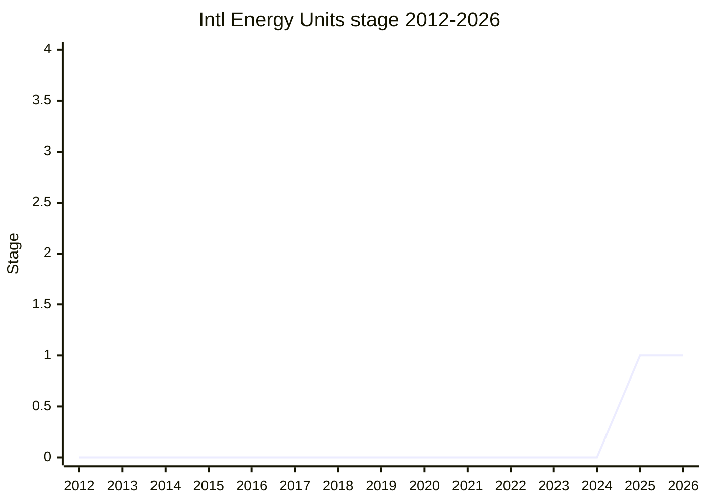

## Overview

Intl Energy Units adds a few energy and power units to the list of sanctioned units that `Intl.NumberFormat` accepts with `style: "unit"`. ECMA-402 has 45 sanctioned units, a subset of CLDR's units chosen around 2019. The engines asked for the subset because shipping localized names for every CLDR unit in every locale made browsers larger. The proposal adds `watt`, `kilowatt` and `kilowatt-hour`: the units used in electricity bills, utility dashboards, electric vehicle charging, battery state and solar generation, all of which have web UIs. All three are already in CLDR. The request started as ecma402#739, "Add kilowatt-hour unit to Intl.NumberFormat", filed by Johan Røed (`@johanrd`), and by 2026 it was one of the most upvoted issues in the ECMA-402 repository (16 thumbs-up in 2026-03, 18 in 2026-08).

```js
// Today `kilowatt-hour` is not a sanctioned unit, so the constructor throws a RangeError.
// With the proposal (illustrative output):
new Intl.NumberFormat("en", { style: "unit", unit: "kilowatt-hour" }).format(42.5); // "42.5 kWh"
new Intl.NumberFormat("en", { style: "unit", unit: "kilowatt", unitDisplay: "long" }).format(7.4); // "7.4 kilowatts"
```

The proposal is deliberately narrow. At the 2026-03 update [SFC](../people/SFC.md) reframed it around two CLDR-style usages, energy usage (`kilowatt-hour`) and power (`watt`, `kilowatt`), and listed what is out of scope: scientific applications (and so `joule`), utility-scale and heavy-industry measurements, natural gas and heating, small electronics, and nutrition. The exact unit list is left to Stage 2, after CLDR has researched which units each region uses for these usages.

The canonical table lists Johan Røed as author and [NRO](../people/NRO.md) and [SFC](../people/SFC.md) as champions. Johan Røed is in delegates.txt as JRD and attended TG2 as an invited expert in 2026-05, but does not speak on this proposal in the notes. [NRO](../people/NRO.md) presented the Stage 1 request "on behalf of [BAN](../people/BAN.md), but [BAN](../people/BAN.md) is the champion", and TG2 had put the item on the plenary agenda under [BAN](../people/BAN.md)'s name. At TG2 2026-01-08 [SFC](../people/SFC.md), asked by [EAO](../people/EAO.md) who the champion was, named the invited expert Kaleb Pace (KAP), who had presented the request at TG2 2025-11-06, and said "(so we’re co-champions)". [BAN](../people/BAN.md) and KAP are listed in `champions` for that reason. Since 2026-03 [SFC](../people/SFC.md) has presented the proposal at plenary and TG2.

## Stage history

| Meeting                                                                              | Venue   | Event                                                                                                                                                                                                                                                                                                                                                                                                                | Stage |
| ------------------------------------------------------------------------------------ | ------- | -------------------------------------------------------------------------------------------------------------------------------------------------------------------------------------------------------------------------------------------------------------------------------------------------------------------------------------------------------------------------------------------------------------------- | ----- |
| [2025-11-06](https://github.com/tc39/ecma402/blob/main/meetings/notes-2025-11-06.md) | TG2     | `Add kilowatt-hour unit to Intl.NumberFormat #739`: invited expert KAP asks for `watt`, `kilowatt` and `kilowatt-hour`. [DLM](../people/DLM.md), [FYT](../people/FYT.md) and [YSZ](../people/YSZ.md) prefer a small proposal over one large new-units proposal. [SFC](../people/SFC.md): "we could bring this to stage 1 without much controversy". Added to the TG1 agenda as "Intl Energy Units for Stage 1 (Ben)" | 0     |
| [2025-11](https://github.com/tc39/notes/blob/main/meetings/2025-11/november-20.md)   | plenary | Reached Stage 1. `Intl Energy Units for Stage 1` ([NRO](../people/NRO.md), no slides). [WH](../people/WH.md) objects to the scope of three units without `joule`, then supports; [MF](../people/MF.md) supports the narrow scope. Conclusion: "The proposal advanced to Stage 1" / "The list of units will be settled for stage 2"                                                                                   | 0 → 1 |
| [2026-01-08](https://github.com/tc39/ecma402/blob/main/meetings/notes-2026-01-08.md) | TG2     | `Intl Energy Units: Unit Choices`: `watt-hour`, `megawatt`, `joule` and calorie discussed. [SFC](../people/SFC.md) proposes asking CLDR for unit preferences for the use cases first, and drops the plan to ask for Stage 2 at the next plenary                                                                                                                                                                      | 1     |
| [2026-03](https://github.com/tc39/notes/blob/main/meetings/2026-03/march-11.md)      | plenary | `Intl Energy Units Stage 1 Update` ([SFC](../people/SFC.md)): reframed as usages (energy usage, power) with an explicit out-of-scope list; possible `megajoule` use for billing still to be researched in CLDR. [MM](../people/MM.md) and [JSC](../people/JSC.md) ask how units are chosen. Conclusion: "Will seek Stage 2 in a future meeting."                                                                     | 1     |
| [2026-03-19](https://github.com/tc39/ecma402/blob/main/meetings/notes-2026-03-19.md) | TG2     | `Quantitative criteria for accepting more unit usages #1047`, the follow-up to [JSC](../people/JSC.md)'s plenary question. Usages stay motivated by developer requests; [SFC](../people/SFC.md) suggests later unit additions (e.g. health units) could be normative PRs. No conclusion                                                                                                                              | 1     |
| [2026-08-06](https://github.com/tc39/ecma402/blob/main/meetings/notes-2026-08-06.md) | TG2     | Listed under "Stage 2 Proposals without recent updates". [SFC](../people/SFC.md) gets no answers from the author on scope (home energy capacity, `kVA`), and the repository is not yet in the tc39 organisation. [RGN](../people/RGN.md): treat home energy usage as in scope, at least provisionally                                                                                                                | 1     |



> How to read: Stage 1 came at the 2025-11 plenary (`november-20.md`, "Intl Energy Units for Stage 1"). The only later plenary item is the 2026-03 Stage 1 update (`march-11.md`), which did not ask for Stage 2. No Stage 2 request appears in the plenary notes through 2026-07, and `raw/proposals/ecma402/README.md` lists the proposal under Stage 1, so the current stage is 1. At TG2 [SFC](../people/SFC.md) twice called it a Stage 2 proposal ("Still stage 2. CLDR is still researching the correct set of units." at [2026-07-09](https://github.com/tc39/ecma402/blob/main/meetings/notes-2026-07-09.md), and "this is a stage 2 proposal" at 2026-08-06, where the item also sits under "Stage 2 Proposals without recent updates"). The plenary record does not support that, so it is read here as a misstatement. ecma402#739 predates the proposal by about three years ([SFC](../people/SFC.md) at 2026-03: "filed almost three years ago"), but the first meeting discussion is TG2 2025-11-06.

## Main issues

### A batch of units or one holistic units proposal

The first question was procedural. At TG2 [2025-11-06](https://github.com/tc39/ecma402/blob/main/meetings/notes-2025-11-06.md) [SFC](../people/SFC.md) noted about ten open issues labelled as new-unit requests (binary prefixes, pixels, nutrition units) and asked whether TG2 should take them one at a time or bundle them into a single new-units proposal. The implementers preferred small proposals. [DLM](../people/DLM.md) put it in terms of process:

> [DLM](../people/DLM.md): In terms of having one large proposal with a bunch of requests, or smaller proposals, my preference would be for smaller proposals that would be less likely to get hung up in long discussions of which particular units are most useful.

[FYT](../people/FYT.md) agreed that "smaller incremental changes are easier to ship, even though process-wise it can take longer". [SFC](../people/SFC.md) accepted this, while noting that a single proposal would show the total size impact at once.

At the [2025-11](https://github.com/tc39/notes/blob/main/meetings/2025-11/november-20.md) plenary [SFC](../people/SFC.md) reported being "the only person if the room" in TG2 who wanted a holistic proposal, and asked the committee for feedback on the narrow approach. [WH](../people/WH.md) disagreed with the problem statement:

> [WH](../people/WH.md): My concern is about the problem area scope here: whether the goal is to support a consistent set of units or to dribble units into the spec, a few at a time. And I am not happy with the problem area scope of dribbling units a few at a time.

[MF](../people/MF.md) argued the opposite, that a larger proposal risks "one small part of it holding back all the other parts", and [EAO](../people/EAO.md) agreed. [WH](../people/WH.md) said they had never been against adding the units, only against the three-unit scope, and supported Stage 1. [NRO](../people/NRO.md) restated the problem statement as "extending Intl with like energy and power units for user facing applications", with the exact list to be narrowed down for Stage 2. The same choice came back at TG2 [2026-07-09](https://github.com/tc39/ecma402/blob/main/meetings/notes-2026-07-09.md), where [EAO](../people/EAO.md) and [SFC](../people/SFC.md) agreed that new units such as arcminute and arcsecond should get their own proposal, following the energy units model.

### Joules, SI units and scientific use cases

[WH](../people/WH.md) objected at the Stage 1 request that the candidate list left out the SI unit:

> [WH](../people/WH.md): On this list I see that you are not even considering any SI units for energy. Kilowatt-hour is not an SI unit. A joule is. And so I see that supporting joules as energy units is not a priority.

[NRO](../people/NRO.md) and [SFC](../people/SFC.md) answered that the README's "lower priority" heading meant low priority for the electric vehicle and energy-consumption use case, not for TC39, and that all SI units for scientific applications could be a separate proposal. At TG2 [2026-01-08](https://github.com/tc39/ecma402/blob/main/meetings/notes-2026-01-08.md) [EAO](../people/EAO.md) said that adding joules would require showing they appear in web content, and that the existing set of units "is already eclectic". [ZB](../people/ZB.md) did not think every dimension needs its base unit, but asked about the calorie, which they expected to be "at least as common as the units proposed right now". [HJS](../people/HJS.md) proposed narrowing the framing:

> [HJS](../people/HJS.md): Framing this as “energy” is less useful than “consumer-facing electricity”.

Food and health units would then be follow-ups in domain-specific proposals. At the [2026-03](https://github.com/tc39/notes/blob/main/meetings/2026-03/march-11.md) update [SFC](../people/SFC.md) made this the scope, saying "when I say Intl energy units, it really should be Intl energy usages", and listed science, utility-scale output, horsepower, BTU for natural gas and heating, milliwatts and mAh, and nutrition as out of scope. [MM](../people/MM.md) asked why units such as kelvin, knots, light-year or [PSI](../people/PSI.md) are missing in general. [SFC](../people/SFC.md) answered that TC39 had only approved certain usages (for temperature, weather temperature, not scientific temperature), and that this proposal asks the committee to approve new usages, after which the required units follow.

### The unit list and CLDR research before Stage 2

The candidate list started as the three units the author found in CLDR. At TG2 [2025-11-06](https://github.com/tc39/ecma402/blob/main/meetings/notes-2025-11-06.md) [SFC](../people/SFC.md) asked whether `megawatt` would be needed too, and [FYT](../people/FYT.md) asked to "minimize the really needed one" and leave out anything nice-to-have. At TG2 [2026-01-08](https://github.com/tc39/ecma402/blob/main/meetings/notes-2026-01-08.md) [SFC](../people/SFC.md) listed `watt-hour` (which the author noted is not in CLDR), `megawatt`, `gigawatt` and `milliwatt` as open questions. [EAO](../people/EAO.md) found `watt-hour` weak but would accept either way. [ZB](../people/ZB.md) worried that there is no clear threshold between the units chosen and the rest:

> [ZB](../people/ZB.md): If we include the first three, it’s going to be a little arbitrary. In SI there are at least 10 dimensions,and they have at least five units – and some of them 50. I’m worried that we’re going to be on a slippery slope.

[SFC](../people/SFC.md) proposed a more principled source: ask CLDR to add unit preferences for the use cases (an EV site showing watt-hours per mile, another miles per kilowatt-hour), let CLDR collect the regional data, and derive the units from that. [ZB](../people/ZB.md) accepted the narrowing to vehicles and residential or commercial energy use. This pushed Stage 2 back:

> [SFC](../people/SFC.md): I was thinking about trying for Stage 2 for the upcoming meeting, but I think we should do this CLDR process first – it might take a couple of months, but we’ll still be on good track with this proposal.

At the [2026-03](https://github.com/tc39/notes/blob/main/meetings/2026-03/march-11.md) update [SFC](../people/SFC.md) said the preliminary research supported just `watt`, `kilowatt` and `kilowatt-hour`, but that there was "at least anecdotal evidence of some regions possibly using megajoules" for billing, which a CLDR ticket is tracking. At TG2 [2026-07-09](https://github.com/tc39/ecma402/blob/main/meetings/notes-2026-07-09.md) CLDR was "still researching the correct set of units". At TG2 [2026-08-06](https://github.com/tc39/ecma402/blob/main/meetings/notes-2026-08-06.md) [SFC](../people/SFC.md) cited CLDR issue 19201 and raised home energy capacity: if it is in scope, `kVA` should be considered. [RGN](../people/RGN.md) replied that home energy usage should be in scope, at least provisionally, because it is closely tied to the electric vehicle case. Unresolved.

### Data size

Data size is why ECMA-402 has a subset of CLDR units at all. At TG2 [2025-11-06](https://github.com/tc39/ecma402/blob/main/meetings/notes-2025-11-06.md) [SFC](../people/SFC.md) recalled that shipping all CLDR units would have taken a browser from about 30 [MB](../people/MB.md) to 32 [MB](../people/MB.md), and [FYT](../people/FYT.md) explained that each unit needs translations for every style in every locale. At the [2025-11](https://github.com/tc39/notes/blob/main/meetings/2025-11/november-20.md) plenary [ACE](../people/ACE.md) asked whether the data was already in browsers and whether the list might grow beyond CLDR. [EAO](../people/EAO.md) answered that CLDR does the localization work, so new units should go through CLDR. [SFC](../people/SFC.md) said Firefox and Chrome would have to start shipping the translations (Safari may already have them from the operating system), at "Probably less than a kilobyte for each unit across all locales", small enough not to trigger the size reviews that large batches do. [WH](../people/WH.md) then agreed with limiting the proposal to CLDR units. When [SHS](../people/SHS.md) asked at 2026-03 what completeness would cost, [SFC](../people/SFC.md) gave the same reason, browser size.

### Criteria for accepting new units and usages (ecma402#1047)

At the [2026-03](https://github.com/tc39/notes/blob/main/meetings/2026-03/march-11.md) update [JSC](../people/JSC.md) pointed out that scientific and biomedical UIs, such as electronic health record systems built on web technology, use a broad range of SI units:

> [JSC](../people/JSC.md): But are you drawing the line to include them or not in your in the mission statement of this proposal? Because if you do include applications like that, whether they be electronic health records or other or scientific applications or those kinds of things, that are user-facing. And why would you not include the entire SI system for formatting?

[SFC](../people/SFC.md) answered "completeness is a non-goal. Usages are goals", and offered to work on "a very exact quantitative rather than qualitative set of criteria" at TG2. The Speaker's Summary records that "Delegates would like more quantitative criteria for adding the usages in the future."

TG2 took it up as ecma402#1047 on [2026-03-19](https://github.com/tc39/ecma402/blob/main/meetings/notes-2026-03-19.md). [SFC](../people/SFC.md) listed possible quantitative measures (share of websites, Google Trends, a text corpus, social media feeds) against direct developer input. [BAN](../people/BAN.md) suggested that criteria for the type of unit might matter more than for specific units. [JSC](../people/JSC.md) asked whether usages such as `length-road` and `mass-person` may overlap, whether usages are exposed in the API, and whether new domains (health, weather) would be surveyed proactively or wait for developers to file issues. [SFC](../people/SFC.md) explained that a usage implies its subsets (supporting `length-rainfall` covers snowfall), that the [Amount](amount.md) proposal may eventually expose usages, and that later additions might not need the full stage process: "Proposal to add health units could be a normative PR". For now new units remain individual proposals driven by developer requests. [JSC](../people/JSC.md) offered to help with a future health units proposal. The issue had no conclusion in the notes.

### Proposal ownership and author feedback

The proposal depends on domain input from its author. At TG2 [2026-08-06](https://github.com/tc39/ecma402/blob/main/meetings/notes-2026-08-06.md) [SFC](../people/SFC.md) said the repository had still not been moved into the tc39 organisation, that questions to Johan Røed had gone unanswered, and that use-case input had come only as screenshots of a utility dashboard:

> [SFC](../people/SFC.md): I know there’s some excitement in plenary for this to advance, but for me as champion it’s hard for me to advance this if my subject matter experts are MIA.

[SFC](../people/SFC.md) asked for the open questions to be filed as issues on the proposal repository. At 2026-03-19 [SFC](../people/SFC.md) had described the expertise needed as developers who build such dashboards, not "PhDs in energy".

### Relationship to Amount and unit conversion

The proposal only adds units for display. At the [2026-03](https://github.com/tc39/notes/blob/main/meetings/2026-03/march-11.md) update [SFC](../people/SFC.md) said that "all units supported by Intl number format will presumably be supported for conversion by amount", so `watt` could be converted to `kilowatt`. When [MM](../people/MM.md) asked whether anything models that a kilowatt-hour relates to kilowatts and hours, [SFC](../people/SFC.md) answered that NumberFormat only localizes the display name, and unit relationships are for [Amount](amount.md)'s conversion work. At the Stage 1 request [WH](../people/WH.md) had asked that unit conversion not depend on CLDR support, even though unit formatting does.

## Related proposals

- [Smart Unit Preferences in Intl.NumberFormat](smart-unit-preferences.md): the `usage`-based unit selection from CLDR unit preferences. This proposal is framed in the same usage terms, and its Stage 2 waits for CLDR unit preferences for energy and power.
- [Amount](amount.md): the ECMA-262 value-with-unit type. It would convert between the new units, and may one day expose usages to developers (TG2 2026-03-19).
- [Intl Unit Protocol](intl-unit-protocol.md): passing a value with its unit to `Intl.NumberFormat`; any new sanctioned unit is also a valid protocol `unit`.
- [Intl Sequence Units](intl-sequence-units.md): mixed units such as `foot-and-inch`. At the [2026-05](https://github.com/tc39/notes/blob/main/meetings/2026-05/may-20.md) plenary [SFC](../people/SFC.md) expected `watt` and `kilowatt` to become a sanctioned sequence unit group once added; at TG2 2026-07-09 its arcminute/arcsecond question was settled by the energy units model of a separate proposal.
- `intl-numberformat-v3` / Unified NumberFormat: the existing unit formatting and its list of sanctioned units.

## Sources

TG2:

- https://github.com/tc39/ecma402/blob/main/meetings/notes-2025-11-06.md
- https://github.com/tc39/ecma402/blob/main/meetings/notes-2026-01-08.md
- https://github.com/tc39/ecma402/blob/main/meetings/notes-2026-03-19.md
- https://github.com/tc39/ecma402/blob/main/meetings/notes-2026-07-09.md
- https://github.com/tc39/ecma402/blob/main/meetings/notes-2026-08-06.md

Plenary:

- https://github.com/tc39/notes/blob/main/meetings/2025-11/november-20.md
- https://github.com/tc39/notes/blob/main/meetings/2026-03/march-11.md
- https://github.com/tc39/notes/blob/main/meetings/2026-05/may-20.md
