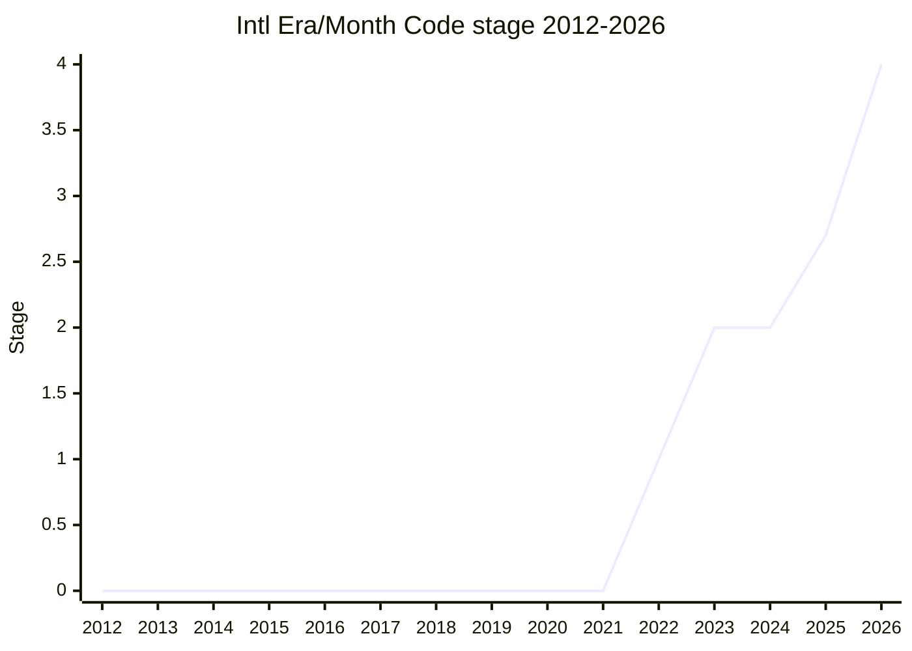

## Overview

"Intl Era and MonthCode" fills in the part of Temporal that Temporal deliberately left out: how the **non-ISO 8601 calendars** behave. Temporal fully specifies only the `iso8601` calendar, but its date types expose `era`, `eraYear`, `year` and `monthCode` for every calendar, and ECMA-402 implementations are expected to support the calendars that CLDR defines (Hebrew, Chinese, Dangi, the Hijri variants, Buddhist, ROC, Japanese, Coptic, Ethiopic, Persian, Indian, ...). Without a specification, one engine could accept `era: "ad"` and another reject it, or read `"M05L"` differently. The proposal adds guardrails without specifying the astronomy. In its final form it gives a closed table of supported calendars with a prose description and authority for each; the valid era codes and aliases (coordinated with CLDR); the valid era-year ranges and the epoch year behind `year`; which calendars have week numbers; how adding years behaves in lunisolar calendars with leap months; a date-difference algorithm; a range and table of reference years for `PlainMonthDay`; and special handling of the legacy `islamic` / `islamic-rgsa` identifiers.

```js
// Hebrew leap month Adar I (month code "M05L") in the year 5779
Temporal.PlainDate.from({ calendar: "hebrew", year: 5779, monthCode: "M05L", day: 1 });

// Gregorian era codes are "ce" / "bce" ("ad" / "bc" remain as aliases)
Temporal.PlainDate.from({ calendar: "gregory", era: "bce", eraYear: 1, monthCode: "M01", day: 1 });

// Chinese `year` is the related ISO year, so this date falls in ISO 2025
Temporal.PlainDate.from({ calendar: "chinese", year: 2024, monthCode: "M12", day: 8 });

// Unqualified "islamic": DateTimeFormat falls back (engines may warn), Temporal throws
new Intl.DateTimeFormat("ar-SA-u-ca-islamic").resolvedOptions().calendar; // "islamic-tbla"
Temporal.PlainDate.from("2025-06-09").withCalendar("islamic"); // throws
```

[FYT](../people/FYT.md) started the proposal in 2022 as a V8 implementer of Temporal, and [SFC](../people/SFC.md) presented it for Stage 1 on [FYT](../people/FYT.md)'s behalf. After Stage 2 (2023-01) it stalled for two years. [SFC](../people/SFC.md) then took it over in 2025 ("I’ve sort of taken up the mantle of this proposal", plenary [2025-04](https://github.com/tc39/notes/blob/main/meetings/2025-04/april-16.md)), and Igalia took over the spec work: [USA](../people/USA.md) presented it for Stage 2.7 as "by me and Philip" ([PFC](../people/PFC.md)), and the conclusion credits "the champions" with the request. [BAN](../people/BAN.md) took it through Stage 3 and 4. The canonical table lists only [FYT](../people/FYT.md) and [BAN](../people/BAN.md) as champions; [SFC](../people/SFC.md), [USA](../people/USA.md) and [PFC](../people/PFC.md) are included in `champions` because the notes show them in that role. Most of the substance was settled in TG2, at monthly calls in 2025-2026, often after discussion in the Temporal champions' meeting. The proposal reached Stage 4 on 2026-03-10, the day before Temporal itself, and its spec text was folded into the Temporal ECMA-402 PR ([ecma402#1044](https://github.com/tc39/ecma402/pull/1044)).

## Stage history

| Meeting                                                                              | Venue   | Event                                                                                                                                                                                                                                                                                                                                              | Stage   |
| ------------------------------------------------------------------------------------ | ------- | -------------------------------------------------------------------------------------------------------------------------------------------------------------------------------------------------------------------------------------------------------------------------------------------------------------------------------------------------- | ------- |
| [2022-05-19](https://github.com/tc39/ecma402/blob/main/meetings/notes-2022-05-19.md) | TG2     | [FYT](../people/FYT.md): the ECMA-402 part of Temporal needs attention ("E.g., Era, etc. should be made visible to this community"); [SFC](../people/SFC.md) hopes for a Unicode specification of "what error codes and other things mean"                                                                                                         | 0       |
| [2022-06-16](https://github.com/tc39/ecma402/blob/main/meetings/notes-2022-06-16.md) | TG2     | [FYT](../people/FYT.md): "Era is missing" from Temporal; will open a Stage 0 repo as a placeholder and define the scope with [USA](../people/USA.md)                                                                                                                                                                                               | 0       |
| [2022-10-06](https://github.com/tc39/ecma402/blob/main/meetings/notes-2022-10-06.md) | TG2     | `proposal-intl-temporal` renamed at [PFC](../people/PFC.md)'s suggestion: "We approved the change of name proposal-intl-era-and-month-codes"                                                                                                                                                                                                       | 0       |
| [2022-11](https://github.com/tc39/notes/blob/main/meetings/2022-11/dec-01.md)        | plenary | Reached Stage 1. `Intl era and monthCode proposal for Stage 1`, presented by [SFC](../people/SFC.md) on behalf of [FYT](../people/FYT.md); [MF](../people/MF.md) uneasy about TC39 defining calendar data                                                                                                                                          | 0 → 1   |
| [2023-01-12](https://github.com/tc39/ecma402/blob/main/meetings/notes-2023-01-12.md) | TG2     | [FYT](../people/FYT.md)'s update after going to CLDR: "most of the work will move to CLDR with a thin addition to 402"                                                                                                                                                                                                                             | 1       |
| [2023-01](https://github.com/tc39/notes/blob/main/meetings/2023-01/feb-01.md)        | plenary | Reached Stage 2. `Intl era and monthCode for Stage 2` ([FYT](../people/FYT.md)); support from [USA](../people/USA.md) and [JHX](../people/JHX.md); [EAO](../people/EAO.md) and [SFC](../people/SFC.md) volunteer as Stage 3 reviewers                                                                                                              | 1 → 2   |
| [2023-12-14](https://github.com/tc39/ecma402/blob/main/meetings/notes-2023-12-14.md) | TG2     | [FYT](../people/FYT.md): "This is still a proposal we need. I just haven't had time to work on it."                                                                                                                                                                                                                                                | 2       |
| [2025-03-06](https://github.com/tc39/ecma402/blob/main/meetings/notes-2025-03-06.md) | TG2     | Firefox, preparing to ship Temporal, reports calendar problems; "What do implementers need in order to ship Temporal?" ([#21](https://github.com/tc39/proposal-intl-era-monthcode/issues/21)) and who should drive the stalled proposal; `islamic` / `islamic-rgsa` unshipping raised ([ecma402#971](https://github.com/tc39/ecma402/issues/971))  | 2       |
| [2025-04-03](https://github.com/tc39/ecma402/blob/main/meetings/notes-2025-04-03.md) | TG2     | Era codes worked through calendar by calendar (`ce`/`bce`, Chinese extended year, Coptic, Minguo, Ethiopic); proposed conclusion on Hijri calendars ([#29](https://github.com/tc39/proposal-intl-era-monthcode/issues/29))                                                                                                                         | 2       |
| [2025-04](https://github.com/tc39/notes/blob/main/meetings/2025-04/april-16.md)      | plenary | Stage 2 update by [SFC](../people/SFC.md): era codes now based on era names, arithmetical year, Hijri draft, out-of-range dates; [DLM](../people/DLM.md) joins [EAO](../people/EAO.md) and [SFC](../people/SFC.md) as a Stage 2.7 reviewer. "An update was given."                                                                                 | 2       |
| [2025-06-12](https://github.com/tc39/ecma402/blob/main/meetings/notes-2025-06-12.md) | TG2     | Conclusions on calendar aliases ("Accept and canonicalize") and on describing Gregorian-like calendars; agreement on epoch years and week numbering; no agreement on the `islamic` fallback                                                                                                                                                        | 2       |
| [2025-07-17](https://github.com/tc39/ecma402/blob/main/meetings/notes-2025-07-17.md) | TG2     | [SFC](../people/SFC.md)'s interim compromise on `islamic` (implementation- and locale-dependent fallback); no concerns about asking for Stage 2.7 that month                                                                                                                                                                                       | 2       |
| [2025-07](https://github.com/tc39/notes/blob/main/meetings/2025-07/july-30.md)       | plenary | Reached Stage 2.7, "conditional on approval from one of the editors from Ecma-402". `Intl Era and month code` ([USA](../people/USA.md), with [PFC](../people/PFC.md) absent); reviewers [EAO](../people/EAO.md) and [SFC](../people/SFC.md) approve; PR #69 accepted as "editorial in spirit"                                                      | 2 → 2.7 |
| [2025-08-14](https://github.com/tc39/ecma402/blob/main/meetings/notes-2025-08-14.md) | TG2     | [PR #69](https://github.com/tc39/proposal-intl-era-monthcode/pull/69): is ECMA-402 the right body to define calendar arithmetic? [PFC](../people/PFC.md) and [RGN](../people/RGN.md) doubt it; left for further review                                                                                                                             | 2.7     |
| [2025-09-11](https://github.com/tc39/ecma402/blob/main/meetings/notes-2025-09-11.md) | TG2     | `overflow: "reject"` should also reject a missing leap month ([temporal-v2#36](https://github.com/js-temporal/proposal-temporal-v2/issues/36)); [SFC](../people/SFC.md): "this is then a normative change against the era month code proposal"                                                                                                     | 2.7     |
| [2025-09](https://github.com/tc39/notes/blob/main/meetings/2025-09/september-23.md)  | plenary | Stage 2.7 update ([BAN](../people/BAN.md)), then consensus on two normative changes: revert to rejecting nonexistent leap months ([PR #82](https://github.com/tc39/proposal-intl-era-monthcode/pull/82)) and reference years up to 2035 ([#60](https://github.com/tc39/proposal-intl-era-monthcode/issues/60))                                     | 2.7     |
| [2025-10-13](https://github.com/tc39/ecma402/blob/main/meetings/notes-2025-10-13.md) | TG2     | (Meeting of 2025-10-09.) TG2 approval for dropping era aliases to match CLDR 48 ([PR #72](https://github.com/tc39/proposal-intl-era-monthcode/pull/72)) and for a proleptic Thai Buddhist calendar before 1941 ([PR #76](https://github.com/tc39/proposal-intl-era-monthcode/pull/76)); `islamic` → `islamic-tbla` agreed; safe date range debated | 2.7     |
| [2025-11](https://github.com/tc39/notes/blob/main/meetings/2025-11/november-20.md)   | plenary | Stage 3 not requested because of late normative changes; consensus on PR #72 and on removing era-year range checks ([PR #89](https://github.com/tc39/proposal-intl-era-monthcode/pull/89)). "Review open issues and return to next plenary"                                                                                                        | 2.7     |
| [2025-12-04](https://github.com/tc39/ecma402/blob/main/meetings/notes-2025-12-04.md) | TG2     | Room agrees the list of calendars should be closed; `islamic-rgsa` to be ignored ([PR #99](https://github.com/tc39/proposal-intl-era-monthcode/pull/99)); `iso8601` in DateTimeFormat ([ecma402#1036](https://github.com/tc39/ecma402/issues/1036))                                                                                                | 2.7     |
| [2026-01-08](https://github.com/tc39/ecma402/blob/main/meetings/notes-2026-01-08.md) | TG2     | "TG2 approves of the pull request, pending [HJS](../people/HJS.md)'s review" (#99); Japanese calendar to switch from Gregorian eras at 1873-01-01 (#86); rare leap months constrain or reject (#60)                                                                                                                                                | 2.7     |
| [2026-01](https://github.com/tc39/notes/blob/main/meetings/2026-01/january-20.md)    | plenary | Reached Stage 3. `Intl Era/Month Code for Stage 3` ([BAN](../people/BAN.md)): PRs #99, #101, #102 and #108, covering the Meiji start date, `islamic-rgsa` and the closed calendar list (#99), and very rare leap months (#108), plus a NonISODateSurpasses fix. "All PRs approved" / "Stage 3 achieved"                                            | 2.7 → 3 |
| [2026-02-19](https://github.com/tc39/ecma402/blob/main/meetings/notes-2026-02-19.md) | TG2     | "TG2 approval for Stage 4, pending open PRs"; [PFC](../people/PFC.md) will add the proposal to the Temporal Stage 4 PR ecma402#1044                                                                                                                                                                                                                | 3       |
| [2026-03](https://github.com/tc39/notes/blob/main/meetings/2026-03/march-10.md)      | plenary | Reached Stage 4. `Introducing: Intl Era/Month Code for Stage 4` ([BAN](../people/BAN.md)); SpiderMonkey and V8 at about 100% of test262; support from [DLM](../people/DLM.md), [RGN](../people/RGN.md), [SFC](../people/SFC.md). "Stage 4 achieved!"                                                                                               | 3 → 4   |
| [2026-03](https://github.com/tc39/notes/blob/main/meetings/2026-03/march-11.md)      | plenary | Temporal reaches Stage 4; [PFC](../people/PFC.md): the ECMA-402 PR "also includes the Intl Era/Month Code proposal"                                                                                                                                                                                                                                | 4       |
| [2026-04-16](https://github.com/tc39/ecma402/blob/main/meetings/notes-2026-04-16.md) | TG2     | [USA](../people/USA.md): "In position to cut new version of official spec, Era Monthcode and Temporal not in cut."                                                                                                                                                                                                                                 | 4       |
| [2026-06-11](https://github.com/tc39/ecma402/blob/main/meetings/notes-2026-06-11.md) | TG2     | [SFC](../people/SFC.md): the proposal-tracking table should be updated for Intl Era/Month Code (Stage 4, merged with Temporal)                                                                                                                                                                                                                     | 4       |



> How to read: Stage 1 in 2022-11 (`dec-01.md`), Stage 2 in 2023-01 (`feb-01.md`; both plenaries ran into the next month, so the file names do not match the canonical month), Stage 2.7 in 2025-07 (`july-30.md`, conditional on an ECMA-402 editor's approval), Stage 3 in 2026-01 (`january-20.md`) and Stage 4 in 2026-03 (`march-10.md`). The flat line in 2023-2024 is a real stall: the proposal was barely discussed until implementers preparing to ship Temporal revived it in 2025-03. The 2025-11 plenary slot was titled "for Stage 3" but no advancement was requested, so it is not a transition. **Publication**: `raw/proposals` gives an Expected Publication Year of 2026, but the text was not merged by the March freeze. The spec lives in the Temporal ECMA-402 PR (ecma402#1044), and the editors said the ES2026 cut did not include it (TG2 [2026-04-16](https://github.com/tc39/ecma402/blob/main/meetings/notes-2026-04-16.md); at [2026-05-07](https://github.com/tc39/ecma402/blob/main/meetings/notes-2026-05-19.md) [RGN](../people/RGN.md) added: "Not going to make the cut. So the 402 aspects won’t get in, either."). As of the 2026-09 raw snapshot the ECMA-402 spec source still has no era/monthCode text, so the canonical 2026 looks optimistic. The sources do not yet name the edition it will ship in. The TG2 file `notes-2025-10-13.md` is headed "2025-10-09 ECMA-402 Meeting", and `notes-2026-05-19.md` is headed "2026-05-07".

## Main issues

### Who is the authority for era codes: TC39 or CLDR?

At the Stage 1 plenary ([2022-11](https://github.com/tc39/notes/blob/main/meetings/2022-11/dec-01.md)), [SFC](../people/SFC.md) (presenting for [FYT](../people/FYT.md)) argued that identifier strings "really need be to be clear and specified", since CLDR had only integer era indexes, up to 236 for Japanese. [USA](../people/USA.md) welcomed [FYT](../people/FYT.md)'s move away from relying on TC39 alone to standardise calendar data. API asked whether CLDR had been consulted, and [MF](../people/MF.md) was blunt:

> [MF](../people/MF.md): I don't have any stage 1 concerns with this. In fact, I definitely think that this should reach stage one, but I do feel kind of uneasy about us defining this data. I think there are other bodies who have many more experts that can make more informed decisions.

[FYT](../people/FYT.md) took this to the CLDR TC, which set up a working group aiming at CLDR 43. By the Stage 2 plenary ([2023-01](https://github.com/tc39/notes/blob/main/meetings/2023-01/feb-01.md)) the spec draft followed CLDR PR 6225, with a table of era codes and aliases per calendar and a subset of the Japanese eras that left out the pre-Meiji ones. [MF](../people/MF.md) asked why the Japanese aliases did not include the kanji era names and agreed to leave such questions to CLDR. The resulting CLDR codes reused the calendar name as the era code (e.g. `gregory` / `gregory-inverse`). In 2025 the champions reversed this. [SFC](../people/SFC.md) explained at plenary ([2025-04](https://github.com/tc39/notes/blob/main/meetings/2025-04/april-16.md)) that delegates had found repeating the calendar name confusing, so era codes would now use a commonly known English/Latin acronym for the era, or a transliteration where none exists. They are no longer globally unique (`am` means different eras in the Coptic, Ethiopic and Hebrew calendars). This time TG2 decided the codes and then sent them to CLDR. [SFC](../people/SFC.md) at TG2 ([2025-04-03](https://github.com/tc39/ecma402/blob/main/meetings/notes-2025-04-03.md)): "We landed it in CLDR without consultation with this group which didn’t make the group happy." In 2025-10 CLDR 48 cut most aliases, and TG2 approved matching it ([PR #72](https://github.com/tc39/proposal-intl-era-monthcode/pull/72), TG2 [2025-10-13](https://github.com/tc39/ecma402/blob/main/meetings/notes-2025-10-13.md), plenary [2025-11](https://github.com/tc39/notes/blob/main/meetings/2025-11/november-20.md)). Only the Gregorian `ad`/`bc` aliases remain, and [SFC](../people/SFC.md) observed that "tg2 is the body that I think is basically been taking ownership of which aliases we want to see".

### Choosing the codes: `ce`/`bce`, Minguo vs. ROC, Coptic, Ethiopic

TG2 [2025-04-03](https://github.com/tc39/ecma402/blob/main/meetings/notes-2025-04-03.md) went through the calendars one by one. For the Gregorian eras, [HJS](../people/HJS.md), MGR (Manish Goregaokar), [EAO](../people/EAO.md), [DLM](../people/DLM.md) and [USA](../people/USA.md) argued for the non-religious `CE`/`BCE`: these are developer-facing codes, not display strings, so there is no reason to prefer the older form. [YSZ](../people/YSZ.md) noted that AD/BC is what people in Japan know, and [LAF](../people/LAF.md) and [PFC](../people/PFC.md) considered either acceptable. [FYT](../people/FYT.md) asked why the group was "shifting ground" away from the CLDR codes. [SFC](../people/SFC.md) closed with "No universal consensus, but CE/BCE seems to have a stronger claim." For the Coptic calendar [SFC](../people/SFC.md) and [LAF](../people/LAF.md) wanted to drop the "Before Diocletian" era. [EAO](../people/EAO.md) advised giving it an unattractive name if it was going away ("If it sticks around, it becomes real"), and [SFC](../people/SFC.md) proposed following CLDR's "inverse" naming. For the Ethiopic calendar, transliterated Amharic `AA`/`AM` drew no objection. For the ROC calendar, [SFC](../people/SFC.md) proposed the transliteration "Minguo", while [FYT](../people/FYT.md) pointed out that Taiwan, where the calendar is actually used, writes "ROC" in English. At [2025-06-12](https://github.com/tc39/ecma402/blob/main/meetings/notes-2025-06-12.md) nobody advocated `minguo` over `roc`.

The Japanese calendar raised range questions. Pre-Meiji eras were excluded from the start. At TG2 [2025-03-06](https://github.com/tc39/ecma402/blob/main/meetings/notes-2025-03-06.md) [SFC](../people/SFC.md) justified this by keeping eras "for which we have people alive who were born in that era", and [HJS](../people/HJS.md) said an out-of-range era year such as "heisei 32" "shouldn’t throw" (the notes print the speaker as `HYS`). The spec had a "spurious check" for out-of-range era years, which [PR #89](https://github.com/tc39/proposal-intl-era-monthcode/pull/89) removed at plenary [2025-11](https://github.com/tc39/notes/blob/main/meetings/2025-11/november-20.md). For the start of the calendar, [HJS](../people/HJS.md) first asked for the exact Meiji start date to be written down, because a wrong date had spread from CLDR ([#86](https://github.com/tc39/proposal-intl-era-monthcode/issues/86), TG2 [2025-10-13](https://github.com/tc39/ecma402/blob/main/meetings/notes-2025-10-13.md)). [HJS](../people/HJS.md) then argued for starting at 6 Meiji, when Japan actually adopted the solar calendar (TG2 [2026-01-08](https://github.com/tc39/ecma402/blob/main/meetings/notes-2026-01-08.md)):

> [HJS](../people/HJS.md): For Meiji years before 6 Meiji… historically they were lunisolar monthdays. Interpreting them as Gregorian monthdays has been a source of mistakes.

The proposed resolution was that dates up to 1872-12-31 use Gregorian eras and later dates the solar Japanese eras, all extended proleptically. [BAN](../people/BAN.md) brought it to plenary as a normative change, and it passed with the Stage 3 package ([2026-01](https://github.com/tc39/notes/blob/main/meetings/2026-01/january-20.md)). TG2 also agreed that the era _ranges_ are "as defined by the Japanese government" ([PR #79](https://github.com/tc39/proposal-intl-era-monthcode/pull/79)). In the same discussion [RGN](../people/RGN.md) asked authors to be clear about whether "a conforming implementation allowed to have a differing opinion on any aspect of the proposal".

### What `year` means: epoch years and the related ISO year

Temporal's `year` is an arithmetic year used when no era is given, so each calendar needs an anchor. At TG2 [2025-04-03](https://github.com/tc39/ecma402/blob/main/meetings/notes-2025-04-03.md) [SFC](../people/SFC.md) compared deriving anchors from another calendar's era ("Robert’s framework" in the notes) with anchoring each calendar on its own. [PFC](../people/PFC.md), [HJS](../people/HJS.md) and MGR preferred [SFC](../people/SFC.md)'s per-calendar approach (e.g. Ethiopic anchored on `AM`, not `AA`). For the Chinese calendar, which has no eras, the group chose the related ISO year (+1 from [EAO](../people/EAO.md), [LAF](../people/LAF.md), MGR), the year that overlaps most with the lunar year. This is what the Temporal polyfill already did. Dangi was left for later research. At [2025-06-12](https://github.com/tc39/ecma402/blob/main/meetings/notes-2025-06-12.md) TG2 agreed that the proposal, not the CLDR "extended year", defines the epoch year of each calendar ([#33](https://github.com/tc39/proposal-intl-era-monthcode/issues/33)).

### The Hijri calendars: `islamic`, `islamic-rgsa` and the fallback

This was the longest-running dispute. The triggering issue was [ecma402#971](https://github.com/tc39/ecma402/issues/971) at TG2 [2025-03-06](https://github.com/tc39/ecma402/blob/main/meetings/notes-2025-03-06.md). [DLM](../people/DLM.md) (Firefox, preparing to ship Temporal) proposed unshipping `islamic`, an astronomical simulation with an unspecified observation point that ICU4C and ICU4X disagree on, and `islamic-rgsa`, which Oracle requested and no ICU ever implemented. [FYT](../people/FYT.md) asked what "unship" could mean when DateTimeFormat cannot throw. [SFC](../people/SFC.md) laid out the direction at plenary ([2025-04](https://github.com/tc39/notes/blob/main/meetings/2025-04/april-16.md)): Temporal supports only the variants with a ground truth (Umm al-Qura and the two tabular calendars), while DateTimeFormat keeps accepting `islamic` and maps it to one of them. [DLM](../people/DLM.md) added that they had "very little evidence that these are being used on the web", and [SHS](../people/SHS.md) asked about OS-level Hijri adjustments.

At TG2 [2025-04-03](https://github.com/tc39/ecma402/blob/main/meetings/notes-2025-04-03.md) MGR and [HJS](../people/HJS.md) said Temporal, not yet shipped, could reject these identifiers. [PFC](../people/PFC.md) warned about perception:

> [PFC](../people/PFC.md): replying to the controversy: it’s bad to show someone the wrong date. Another class of error that’s worse: appear to drop support for a whole country/culture. If we remove RGSA, we don’t want the story “JS doesn’t support Saudi Arabia”.

[SFC](../people/SFC.md) proposed a conclusion: identifiers accepted in formatting must not start throwing, remapping the `islamic` variants in DateTimeFormat is acceptable, and Temporal uses only the three stable algorithms. [EAO](../people/EAO.md) objected that the remapping bullet reversed the burden of proof. At [2025-06-12](https://github.com/tc39/ecma402/blob/main/meetings/notes-2025-06-12.md) the question was what `islamic` should resolve to. [SFC](../people/SFC.md) wanted a best-effort, locale-dependent fallback (Umm al-Qura for `ar-SA`, tabular elsewhere). [HJS](../people/HJS.md), after digging through old pages in HTTP Archive, argued for unconditional `islamic-tbla`, because that is what `-u-ca-islamic` gave in old Microsoft engines, when those pages were written. [EAO](../people/EAO.md) and [FYT](../people/FYT.md) opposed any regional dependency ([EAO](../people/EAO.md): "Having a calendar date formatting being possibly changeable based on changes to the region is not good behavior"). The group agreed only that developers should not rely on unqualified `islamic` and that engines should warn. The 2025-07-17 call settled on an interim implementation- and locale-dependent fallback. At the Stage 2.7 plenary [EAO](../people/EAO.md) noted the novelty:

> [EAO](../people/EAO.md): I believe this is the first time we’re adding a recommendation to emit a warning to 402. A couple of these already exist in 262.

TG2 [2025-10-13](https://github.com/tc39/ecma402/blob/main/meetings/notes-2025-10-13.md) replaced the interim rule. [SFC](../people/SFC.md) accepted [HJS](../people/HJS.md)'s argument that a fallback nobody should reach is better spec-defined than implementation-defined. Both `en-US-u-ca-islamic` and `ar-SA-u-ca-islamic` must resolve to `islamic-tbla`, Temporal must throw for `islamic`, `islamic-umalqura` must be supported, and every calendar DateTimeFormat can return must work in Temporal. [HJS](../people/HJS.md): "LGTM!" `islamic-rgsa` followed at [2025-12-04](https://github.com/tc39/ecma402/blob/main/meetings/notes-2025-12-04.md) ([PR #99](https://github.com/tc39/proposal-intl-era-monthcode/pull/99)). [HJS](../people/HJS.md) and [EAO](../people/EAO.md) preferred treating it like `islamic`, and [SFC](../people/SFC.md) preferred ignoring it. Once the calendar list was closed (next section), ignoring it carried little risk. [RGN](../people/RGN.md) worried that the warning text would fire for every formatter created in a loop, and [FYT](../people/FYT.md) did not know how to implement it. At the Stage 3 plenary ([2026-01](https://github.com/tc39/notes/blob/main/meetings/2026-01/january-20.md)) [SFC](../people/SFC.md) summed up `islamic-rgsa`: "because it was never implemented, it’s only a footgun for engines to ship it". Whether `Intl.DisplayNames` keeps names for these identifiers was left to ECMA-402 ([#91](https://github.com/tc39/proposal-intl-era-monthcode/issues/91), TG2 [2026-01-08](https://github.com/tc39/ecma402/blob/main/meetings/notes-2026-01-08.md)).

### A closed list of calendars

The spec required implementations to support _at least_ the calendars in its table. A test262 test that assumed an exact list ([test262#4677](https://github.com/tc39/test262/issues/4677), [#94](https://github.com/tc39/proposal-intl-era-monthcode/issues/94)) brought this to TG2 [2025-12-04](https://github.com/tc39/ecma402/blob/main/meetings/notes-2025-12-04.md). [SFC](../people/SFC.md) had already raised #94 at the [2025-11](https://github.com/tc39/notes/blob/main/meetings/2025-11/november-20.md) plenary, citing the risk that one browser ships `islamic-rgsa` and others do not. [EAO](../people/EAO.md) and [HJS](../people/HJS.md) pointed to the precedent of the closed list of sanctioned units, and [SFC](../people/SFC.md) contrasted calendars with numbering systems, which can fall back to `latn`:

> [SFC](../people/SFC.md): If browser 1 ships a calendar, the rest of the community may have to say they have to add that calendar too. Instead it’s this body that should have the say over when a calendar gets added.

[PFC](../people/PFC.md) did not mind, "My main goal here is to not make TG2 the authority on calendrical calculations", and accepted [SFC](../people/SFC.md)'s description of how a new calendar would be added (a new table row with prose algorithm, era codes, month codes and ISO year conversion). [FYT](../people/FYT.md) agreed with a closed list but disputed that numbering systems are simple. The change shipped in PR #99, which TG2 approved on [2026-01-08](https://github.com/tc39/ecma402/blob/main/meetings/notes-2026-01-08.md) and plenary in [2026-01](https://github.com/tc39/notes/blob/main/meetings/2026-01/january-20.md). By Stage 4 [BAN](../people/BAN.md) described it as "a closed set of calendars now. It's not possible without normative changes to add additional calendars."

### Calendar arithmetic: should ECMA-402 specify it? (PR #69)

The proposal first said, in prose, that calendar arithmetic was implementation-defined but followed general steps. [PR #69](https://github.com/tc39/proposal-intl-era-monthcode/pull/69) turned that prose into algorithm steps for adding and differencing dates in any calendar. At the Stage 2.7 plenary ([2025-07](https://github.com/tc39/notes/blob/main/meetings/2025-07/july-30.md)) [SFC](../people/SFC.md) wanted 2.7 made conditional on it. [USA](../people/USA.md) argued it was editorial, and [SFC](../people/SFC.md) accepted that "69 is editorial in spirit". At TG2 [2025-08-14](https://github.com/tc39/ecma402/blob/main/meetings/notes-2025-08-14.md) the question was whether ECMA-402 should be the body that defines a general calendar arithmetic algorithm. [PFC](../people/PFC.md) (as `PCO` in the notes) cited the experience of specifying time zones in Temporal, and [RGN](../people/RGN.md) agreed strongly:

> [RGN](../people/RGN.md): I think that’s well-framed, I strongly agree. The editor group and this TG in general is not qualified to do this. We are a body that essentially maps internationalization and localization best practices into ecmascript, we are not the originators of the algorithms involved, and we’re not qualified to be – that’s not the composition of this group.

[SFC](../people/SFC.md) replied that the algorithm defines only how Temporal's arithmetical years and ordinal months work, not anything calendar-specific. [HJS](../people/HJS.md) (as `HSI`) argued that interoperable implementations need it written down somewhere, and nowhere else would do it. [SFC](../people/SFC.md) also cited an RFC's recurrence rules as prior art for the Hebrew Adar cases, and [RGN](../people/RGN.md) asked for it to be referenced (the notes garble its number). The "editorial" label did not hold. At the [2025-11](https://github.com/tc39/notes/blob/main/meetings/2025-11/november-20.md) plenary [SFC](../people/SFC.md) pointed to [issue #96](https://github.com/tc39/proposal-intl-era-monthcode/issues/96):

> [SFC](../people/SFC.md): … it appears to be related to PR69, which this committee approved PR69 under the understanding it was an editorial change, and it turns out this was a case that where the behavior changed slightly across PR69, meaning that the resulting behavior that’s currently in the specification is not the behavior that this committee approved for Stage 2.7.

The Stage 3 package ([2026-01](https://github.com/tc39/notes/blob/main/meetings/2026-01/january-20.md)) restored the earlier `NonISODateSurpasses` behaviour. [SFC](../people/SFC.md) described the choice of approach (PR 111) as a "very, very weak preference" for [PFC](../people/PFC.md)'s version. [MF](../people/MF.md) checked that the fix only made differences more often the exact negation of the swapped operands, never less. [SFC](../people/SFC.md) and [PFC](../people/PFC.md) explained that Temporal can guarantee only that A plus (B − A) gives B.

### Adding a year to a leap month: constrain or reject?

A leap month such as Adar I of Hebrew 5784 does not exist in the following year. The Stage 2.7 text ([PR #67](https://github.com/tc39/proposal-intl-era-monthcode/pull/67)) did not reject in this case, even with `overflow: "reject"`: it moved to the non-leap month. The direction is calendar-specific, backwards for Chinese/Dangi and forwards for Hebrew. At TG2 [2025-09-11](https://github.com/tc39/ecma402/blob/main/meetings/notes-2025-09-11.md) [SFC](../people/SFC.md) defended the lenient behaviour, on the grounds that developers using `reject` would not think of leap months. [HJS](../people/HJS.md) and [PFC](../people/PFC.md) saw no difference between a nonexistent day and a nonexistent month, and [EAO](../people/EAO.md) settled it:

> [EAO](../people/EAO.md): I think we have to have the strict behavior be properly strict, and also complain if the month doesn’t exist. If we do the looser thing and allow that, it becomes a webcompat issue to later make the strict thing more strict. This is such a corner case that we could and should start out by being more strict, and then figure out later if we want to fix that.

[BAN](../people/BAN.md) brought the revert ([PR #82](https://github.com/tc39/proposal-intl-era-monthcode/pull/82)) to plenary in [2025-09](https://github.com/tc39/notes/blob/main/meetings/2025-09/september-23.md) as matching February 29 in ISO 8601: "We’re at this point planning on erroring towards strictness, because if we lose that, we can go the other way." [DLM](../people/DLM.md) and [ACE](../people/ACE.md) supported it. The default `overflow: "constrain"` still clamps. For the reverse case in Hebrew, [SFC](../people/SFC.md) had argued at TG2 [2025-08-14](https://github.com/tc39/ecma402/blob/main/meetings/notes-2025-08-14.md) that Adar plus a year into a leap year lands in Adar II, because the RFC defines Adar II as month code `M06`.

### Reference years, rare leap months and the "safe" date range

A `PlainMonthDay` is stored as an ISO date in a reference year. Gregorian calendars use 1972, but some Chinese leap months (with or without a 30th day) last occurred centuries ago. [BAN](../people/BAN.md) showed [ABL](../people/ABL.md)'s table, which goes back as far as 1404 for one combination. The reference-year window was therefore extended to 2035, to catch the leap month M11L in 2033 ([#60](https://github.com/tc39/proposal-intl-era-monthcode/issues/60), consensus [2025-09](https://github.com/tc39/notes/blob/main/meetings/2025-09/september-23.md)). The broader question of how far back calendars must match ground truth ([#64](https://github.com/tc39/proposal-intl-era-monthcode/issues/64)) took a long debate at TG2 [2025-10-13](https://github.com/tc39/ecma402/blob/main/meetings/notes-2025-10-13.md). [SFC](../people/SFC.md) proposed a universal floor of 1900, from "the oldest person currently alive" rounded to a decade, with the same argument that had fixed Meiji as the first Japanese era. [HJS](../people/HJS.md) and [RGN](../people/RGN.md) preferred calendar-by-calendar constraints: Umm al-Qura data covers only 1882-2147, and the modern Chinese algorithm starts in 1912. Curated Chinese data exists back to 1645 at about three bytes a year, but it is published by a third party. [RGN](../people/RGN.md) framed the requirement:

> [RGN](../people/RGN.md): And if the source publishes easily available data from 1900 onwards, then that seems to be the appropriate date. Implementations _may_ go back farther, but we’re not requiring it, because we don’t want to impose an undue burden on implementation in terms of size, trust, or effort.

[SFC](../people/SFC.md): "I really like the “size, trust, and effort” principle". For the Thai Buddhist calendar, whose new year moved from April to January in 1941, TG2 kept proleptic behaviour ([PR #76](https://github.com/tc39/proposal-intl-era-monthcode/pull/76)). [HJS](../people/HJS.md) found that the JDK and .NET do the same. [SFC](../people/SFC.md) insisted this is "to match software precedent (JDK, .NET, ICU)", not an endorsement. The rare leap months still left over ([SFC](../people/SFC.md) at plenary [2025-11](https://github.com/tc39/notes/blob/main/meetings/2025-11/november-20.md)) were resolved at TG2 [2026-01-08](https://github.com/tc39/ecma402/blob/main/meetings/notes-2026-01-08.md) with "option B". Instead of arbitrary reference years, such month-days reject under `overflow: "reject"` and constrain to the non-leap month (or last day) otherwise. [PFC](../people/PFC.md) came round because this keeps serialization web-compatible when the data range grows. [PR #108](https://github.com/tc39/proposal-intl-era-monthcode/pull/108) added a hard-coded reference-year table at Stage 3. The format of that table was still open at TG2 [2026-02-19](https://github.com/tc39/ecma402/blob/main/meetings/notes-2026-02-19.md) (#114), but judged fine for Stage 4.

### Smaller decisions: aliases, week numbers, Gregorian-like calendars, `iso8601`

- **Calendar aliases** ([#11](https://github.com/tc39/proposal-intl-era-monthcode/issues/11), TG2 [2025-06-12](https://github.com/tc39/ecma402/blob/main/meetings/notes-2025-06-12.md)): legacy calendar IDs are accepted and canonicalized, by analogy with `Intl.Locale` ([RGN](../people/RGN.md), [DLM](../people/DLM.md)). Conclusion: "Accept and canonicalize the aliases."
- **Week numbering** ([#15](https://github.com/tc39/proposal-intl-era-monthcode/issues/15), same meeting): for now only `iso8601` supports `weekOfYear`. [SFC](../people/SFC.md) did not want code to assume ISO weeks for Gregorian dates, and [HJS](../people/HJS.md) floated an `isoWeekOfYear` field. [PFC](../people/PFC.md) had already suggested at plenary ([2024-02](https://github.com/tc39/notes/blob/main/meetings/2024-02/feb-6.md)) that which calendars have week numbers "may be in scope for that proposal".
- **Gregorian-like calendars** ([#2](https://github.com/tc39/proposal-intl-era-monthcode/issues/2), [ecma402#1003](https://github.com/tc39/ecma402/issues/1003)): conclusion that "The spec should contain a high-level description of the algorithm for all calendars", so ROC, Buddhist and Japanese state that their months and days are those of ISO 8601 (proleptic, no Julian switchover).
- **`iso8601` in DateTimeFormat** ([ecma402#1036](https://github.com/tc39/ecma402/issues/1036), TG2 [2025-12-04](https://github.com/tc39/ecma402/blob/main/meetings/notes-2025-12-04.md), [2026-01-08](https://github.com/tc39/ecma402/blob/main/meetings/notes-2026-01-08.md)): an ECMA-402 issue raised during the Temporal and era/monthCode work and assigned to [BAN](../people/BAN.md). TG2 recommended to CLDR that `u-ca-iso8601` keep `-` and `:` separators and the h23 hour cycle in all locales. In 2026-09 [PFC](../people/PFC.md) noted that test262 hardcodes the `-u-ca-iso8601` value "as we have done in Temporal and Intl Era/Month Codes".

### Relationship with Temporal and the publication year

The proposal existed only because Temporal had declared non-ISO calendars out of scope. At Stage 2 [FYT](../people/FYT.md) kept it separate so as not to complicate Stage 3 Temporal ("we tried not to bring in too much complication to the development of Temporal"). At the 2022-10-06 rename, [PFC](../people/PFC.md) suggested the old name "intl-temporal" would "raise unnecessary questions", and [FYT](../people/FYT.md) described the core as "the ERA for each calendar and the meaning of each month when working with temporal." The two converged at the end. In [2025-11](https://github.com/tc39/notes/blob/main/meetings/2025-11/november-18.md) [PFC](../people/PFC.md) planned to request Temporal's Stage 4 "together with the Time Zone Canonicalization and Intl Era Monthcode proposals", and at TG2 [2026-02-19](https://github.com/tc39/ecma402/blob/main/meetings/notes-2026-02-19.md) said the era/monthCode text would go into the Temporal ECMA-402 PR (ecma402#1044). At the Temporal Stage 4 plenary ([2026-03](https://github.com/tc39/notes/blob/main/meetings/2026-03/march-11.md)):

> [PFC](../people/PFC.md): All right, there are two pull requests open for the spec text. There's one for ECMA 262 and one for ECMA 402. The ECMA 402 one also includes the Intl Era/Month Code proposal. It was easier to put them in the same pull request.

This tied the proposal's publication to Temporal's merge. Temporal's ECMA-262 PR missed the ES2026 cut, and [RGN](../people/RGN.md) did not want the ECMA-402 half merged without it (TG2 2026-05-07: "I don’t want it merged into 402 but not 262"). The ECMA-402 editors therefore left both out of the 2026 edition (TG2 [2026-04-16](https://github.com/tc39/ecma402/blob/main/meetings/notes-2026-04-16.md)). In 2026-07 [YSZ](../people/YSZ.md) reported that JavaScriptCore was enabling Temporal but "not truly having era month code in Temporal" yet (TG2 [2026-07-09](https://github.com/tc39/ecma402/blob/main/meetings/notes-2026-07-09.md)). Meanwhile the canonical table still gives 2026 as the Expected Publication Year (see the chart note).

## Related proposals

- `proposal-temporal` — the parent proposal. Era/monthCode defines the ECMA-402 behaviour of its non-ISO calendars, and the spec text was merged into the Temporal ECMA-402 PR (ecma402#1044).
- `proposal-canonical-tz` (Time Zone Canonicalization) — the other Temporal-adjacent ECMA-402 proposal planned to move to Stage 4 together with Temporal.
- [eraDisplay option for Intl.DateTimeFormat](intl-eradisplay.md) — the `eraDisplay` option for `Intl.DateTimeFormat`, discussed in TG2 in the same period. [SFC](../people/SFC.md) (2023-12-14) wanted variant era names revisited "when Temporal, Era Code, and Era Display are all landed".
- [Intl.DurationFormat](intl-durationformat.md) — another date-time proposal entangled with Temporal (and decoupled from it in 2022).
- [Stable Formatting](stable-formatting.md) — the `iso8601`-calendar formatting discussion (ecma402#1036) was repeatedly compared to it.

## Sources

TG2:

- https://github.com/tc39/ecma402/blob/main/meetings/notes-2022-05-19.md
- https://github.com/tc39/ecma402/blob/main/meetings/notes-2022-06-16.md
- https://github.com/tc39/ecma402/blob/main/meetings/notes-2022-10-06.md
- https://github.com/tc39/ecma402/blob/main/meetings/notes-2023-01-12.md
- https://github.com/tc39/ecma402/blob/main/meetings/notes-2023-12-14.md
- https://github.com/tc39/ecma402/blob/main/meetings/notes-2025-03-06.md
- https://github.com/tc39/ecma402/blob/main/meetings/notes-2025-04-03.md
- https://github.com/tc39/ecma402/blob/main/meetings/notes-2025-06-12.md
- https://github.com/tc39/ecma402/blob/main/meetings/notes-2025-07-17.md
- https://github.com/tc39/ecma402/blob/main/meetings/notes-2025-08-14.md
- https://github.com/tc39/ecma402/blob/main/meetings/notes-2025-09-11.md
- https://github.com/tc39/ecma402/blob/main/meetings/notes-2025-10-13.md
- https://github.com/tc39/ecma402/blob/main/meetings/notes-2025-12-04.md
- https://github.com/tc39/ecma402/blob/main/meetings/notes-2026-01-08.md
- https://github.com/tc39/ecma402/blob/main/meetings/notes-2026-02-19.md
- https://github.com/tc39/ecma402/blob/main/meetings/notes-2026-04-16.md
- https://github.com/tc39/ecma402/blob/main/meetings/notes-2026-05-19.md
- https://github.com/tc39/ecma402/blob/main/meetings/notes-2026-06-11.md
- https://github.com/tc39/ecma402/blob/main/meetings/notes-2026-07-09.md
- https://github.com/tc39/ecma402/blob/main/meetings/notes-2026-09-17.md

Plenary:

- https://github.com/tc39/notes/blob/main/meetings/2022-11/dec-01.md
- https://github.com/tc39/notes/blob/main/meetings/2023-01/feb-01.md
- https://github.com/tc39/notes/blob/main/meetings/2024-02/feb-6.md
- https://github.com/tc39/notes/blob/main/meetings/2025-04/april-16.md
- https://github.com/tc39/notes/blob/main/meetings/2025-07/july-30.md
- https://github.com/tc39/notes/blob/main/meetings/2025-09/september-23.md
- https://github.com/tc39/notes/blob/main/meetings/2025-11/november-18.md
- https://github.com/tc39/notes/blob/main/meetings/2025-11/november-20.md
- https://github.com/tc39/notes/blob/main/meetings/2026-01/january-20.md
- https://github.com/tc39/notes/blob/main/meetings/2026-03/march-10.md
- https://github.com/tc39/notes/blob/main/meetings/2026-03/march-11.md
