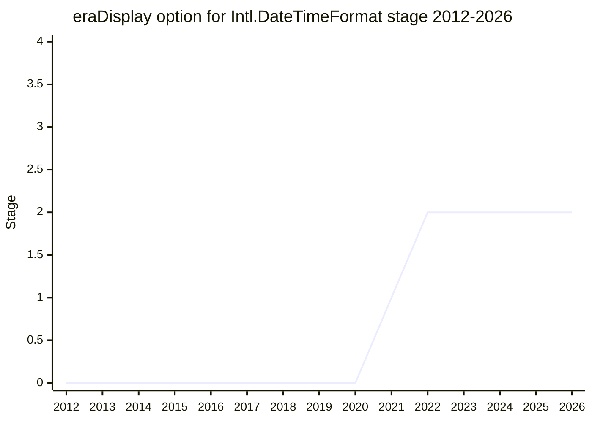

## Overview

The `eraDisplay` option gives `Intl.DateTimeFormat` control over **when the era field is shown**. Today the era only appears if `era` is requested as a field, so a Gregorian year before 1 AD is printed without "BC"/"BCE". Two dates that are about 4000 years apart can then format to the same string. The problem is worse in calendars where eras change often (the Japanese era changed from Heisei to Reiwa in 2019) or where the era is the only marker of which reckoning is meant (Buddhist "BE" next to Gregorian dates). The proposal adds an option with three values. `"always"` always shows the era, `"never"` never shows it, and `"auto"` shows it "if and only if it is different from the reference era", which is the era of the current date. `"auto"` becomes the default, so the proposal also changes today's output.

```js
const dtf = new Intl.DateTimeFormat("en", { year: "numeric", timeZone: "UTC" });
dtf.format(new Date(Date.UTC(2021, 0, 1)));  // "2021"
dtf.format(new Date(Date.UTC(-2020, 0, 1))); // today also "2021" (the year 2021 BC)

// proposed: eraDisplay "auto" (the new default) adds the era only when it differs
// from the current era, so the second date gets "BC"; "always" / "never" force it
new Intl.DateTimeFormat("en", { year: "numeric", eraDisplay: "always" });
```

Implementing it requires **runtime pattern selection**. Whether to show the era depends on the date being formatted, so the constructor keeps a second pattern that contains the era field, and `format` picks one of the two patterns (the precedents are `formatRange` and Temporal's per-type patterns). The idea came from [LAF](../people/LAF.md) (Louis-Aimé de Fouquières, an invited expert who works on non-Gregorian calendar logic), who wrote the repository (first at `Louis-Aime/proposal-intl-eradisplay`) and presented it in TG2. [SFC](../people/SFC.md) is the TC39 champion ("I'll be the TC39 champion for this", plenary 2021-01; "Another proposal that I am the co-champion of is eraDisplay", plenary 2021-01-25), and the canonical table lists both as champions. The proposal reached Stage 1 in 2021-01 and Stage 2 in 2022-11, and then stayed at Stage 2. Since 2023 the work has moved from the three-value option to two harder questions. One is what `"auto"` should mean: a CLDR-driven rule instead of a plain comparison with the current era. The other is whether the option should also control two- and four-digit years and negative ("numeric") years, as ICU4X's `YearStyle` does. In 2026-08 [SFC](../people/SFC.md) said "I think this is pretty close to advancing to 2.7."

## Stage history

| Meeting                                                                              | Venue   | Event                                                                                                                                                                                                                                                                                                                                                    | Stage |
| ------------------------------------------------------------------------------------ | ------- | -------------------------------------------------------------------------------------------------------------------------------------------------------------------------------------------------------------------------------------------------------------------------------------------------------------------------------------------------------- | ----- |
| [2020-11-05](https://github.com/tc39/ecma402/blob/main/meetings/notes-2020-11-05.md) | TG2     | Issue [ecma402#426](https://github.com/tc39/ecma402/issues/426) "Option eraDisplay in Intl.DateTimeFormat()" discussed; [FBN](../people/FBN.md) asks whether to generalise it to hiding the current year, [SFC](../people/SFC.md) prefers "separate flags to control era display and year display"                                                       | 0     |
| [2020-12-04](https://github.com/tc39/ecma402/blob/main/meetings/notes-2020-12-04.md) | TG2     | [LAF](../people/LAF.md) presents `eraDisplay option for Intl.DateTimeFormat for Stage 1`; [CCN](../people/CCN.md), [ZB](../people/ZB.md), [JSW](../people/JSW.md), [FYT](../people/FYT.md), [RGN](../people/RGN.md) and [USA](../people/USA.md) +1. "Approved for Stage 1" (TG2 recommendation)                                                          | 0     |
| [2021-01](https://github.com/tc39/notes/blob/main/meetings/2021-01/jan-27.md)        | plenary | Reached Stage 1. `EraDisplay for Stage 1` ([SFC](../people/SFC.md), crediting [LAF](../people/LAF.md) for much of the content); [WH](../people/WH.md): "this is an interesting area to explore", [FYT](../people/FYT.md) supports; no objections                                                                                                         | 0 → 1 |
| [2022-02-10](https://github.com/tc39/ecma402/blob/main/meetings/notes-2022-02-10.md) | TG2     | [#7](https://github.com/tc39/proposal-intl-eradisplay/issues/7) hiding "lower-power fields": "Focus in solving the eras issue and look into it in further detail in future"                                                                                                                                                                              | 1     |
| [2022-04-21](https://github.com/tc39/ecma402/blob/main/meetings/notes-2022-04-21.md) | TG2     | [#4](https://github.com/tc39/proposal-intl-eradisplay/issues/4) pattern selection: "Use internal slots. Try to make the mechanism consistent with Temporal once one or the other proposal is merged." [SFC](../people/SFC.md) says the proposal is "blocked on me as a co-champion to finish spec work", hoping for Stage 2 by July                      | 1     |
| [2022-05-19](https://github.com/tc39/ecma402/blob/main/meetings/notes-2022-05-19.md) | TG2     | [SFC](../people/SFC.md): "all the items on Era Display have been discussed", looks ready for Stage 2, aiming for July; [LAF](../people/LAF.md) agrees. In 2022-06-16 it is "the only one that looks ready for S2" (written "Error Display" in those notes)                                                                                               | 1     |
| [2022-11-03](https://github.com/tc39/ecma402/blob/main/meetings/notes-2022-11-03.md) | TG2     | Group is fine with decoupling Era Display from Temporal ([USA](../people/USA.md) would have waited for Temporal); "[SFC](../people/SFC.md) to put the presentation on the TG1 agenda and mail it to this group."                                                                                                                                         | 1     |
| [2022-11](https://github.com/tc39/notes/blob/main/meetings/2022-11/nov-29.md)        | plenary | Reached Stage 2. `eraDisplay option for Intl.DateTimeFormat` ([SFC](../people/SFC.md)); spec text was late for the 10-day deadline; +1 from [USA](../people/USA.md); [EAO](../people/EAO.md) and [DLM](../people/DLM.md) are Stage 3 reviewers                                                                                                           | 1 → 2 |
| [2023-12-14](https://github.com/tc39/ecma402/blob/main/meetings/notes-2023-12-14.md) | TG2     | [LAF](../people/LAF.md) proposes six values (`void`, `auto`, `discreet`, `explicit`, `always`, `never`); [SFC](../people/SFC.md) wants to keep `"auto"` as the default and raises an era cutoff date; [FYT](../people/FYT.md) accepts the extra pattern slot; [SFC](../people/SFC.md) hopes to return "and then maybe put this up for stage advancement" | 2     |
| [2024-02-22](https://github.com/tc39/ecma402/blob/main/meetings/notes-2024-02-22.md) | TG2     | [#9](https://github.com/tc39/proposal-intl-eradisplay/issues/9) data-driven approach: the CLDR committee suggests per-calendar date ranges in which `"auto"` suppresses the era                                                                                                                                                                          | 2     |
| [2024-03-28](https://github.com/tc39/ecma402/blob/main/meetings/notes-2024-03-28.md) | TG2     | [LAF](../people/LAF.md)'s "how CLDR may help": CLDR attributes for the year ranges that need an era, and four values (`auto`, `always`, `never`, `hide`); [SFC](../people/SFC.md): the data "Could land in CLDR 46", then the ECMAScript proposal can move                                                                                               | 2     |
| [2024-11-25](https://github.com/tc39/ecma402/blob/main/meetings/notes-2024-11-25.md) | TG2     | [#10](https://github.com/tc39/proposal-intl-eradisplay/issues/10) year precision (ICU4X `auto` / `full` / `withEra`). Conclusion: "Good to move forward with centuries also handled with this option"; "Investigate new option name and values"                                                                                                          | 2     |
| [2026-03-19](https://github.com/tc39/ecma402/blob/main/meetings/notes-2026-03-19.md) | TG2     | #10: names for a negative-year ("numeric") style compared (`algebraic`, `linear` preferred). #9: [SFC](../people/SFC.md)'s proposed conclusion that the current date must not decide era or century display (cutoffs from locale data). [SFC](../people/SFC.md): the proposal "hasn’t changed in six years"                                              | 2     |
| [2026-08-06](https://github.com/tc39/ecma402/blob/main/meetings/notes-2026-08-06.md) | TG2     | Listed under "Stage 2 Proposals without recent updates". Option names still to be settled (follow CLDR); [HJS](../people/HJS.md) objects to modelling the Julian-to-Gregorian switchover. [SFC](../people/SFC.md): "I think this is pretty close to advancing to 2.7."                                                                                   | 2     |



> Stage 1 at the 2021-01 plenary (TG2 had recommended it on 2020-12-04), and Stage 2 at the 2022-11 plenary (2022-11-29). No Stage 2.7 request has been made at plenary yet. TG2's 2022-11-03 notes speak of "December TG1", but the meeting that week was the 2022-11 plenary, which ran from Nov 29 to Dec 1. Several TG2 notes carry a different date in their own heading than in the filename: 2020-12-04 is titled "December 12, 2020 Meeting", 2024-03-28 "2023-03-28" and 2024-11-25 "2024-11-21". The filename dates are used here. The canonical table lists 2021-01 and 2022-11 as the plenary anchors and agrees with the notes.

## Main issues

### Scope: only the era, or every "lower-power" field?

From the start, people asked whether this was really a general problem: hide any field that the current date already implies. At the first TG2 discussion of ecma402#426 ([2020-11-05](https://github.com/tc39/ecma402/blob/main/meetings/notes-2020-11-05.md)) [FBN](../people/FBN.md) asked "Should we generalize this, e.g., to the year? If the year is the current year, then hide the year?". [EAO](../people/EAO.md) compared it to date ranges, and [SFC](../people/SFC.md) answered: "I think it would make sense to have separate flags to control era display and year display." At the Stage 1 plenary ([2021-01](https://github.com/tc39/notes/blob/main/meetings/2021-01/jan-27.md)) [SFC](../people/SFC.md) still listed generalisation as something to explore at Stage 1 ("hiding the year if you're in the current year" is a common client request). [LAF](../people/LAF.md) later raised it formally as [#7](https://github.com/tc39/proposal-intl-eradisplay/issues/7) ([2022-02-10](https://github.com/tc39/ecma402/blob/main/meetings/notes-2022-02-10.md)). [JGT](../people/JGT.md) made hiding "CE" the priority and saw an easy workaround for the general case:

> [JGT](../people/JGT.md): I don’t see this as a common use case to justify a built-in

[GPT](../people/GPT.md) was nervous about the maintenance cost of more patterns and also preferred a workaround. [SFC](../people/SFC.md) summed up: "I think my conclusion from this discussion is that we should focus on the era use case and consider the general case as a potential future proposal." The conclusion read "Focus in solving the eras issue and look into it in further detail in future". The narrowing held. From 2024 the scope did widen again, but only to the year's own precision (see the year-style issue below), not to other fields.

### Option values and the default

The Stage 1 shape was `"always"` / `"never"` / `"auto"`. [SFC](../people/SFC.md) chose these keywords because they are "used other places in 402" and in Temporal. At the TG2 Stage 1 review ([2020-12-04](https://github.com/tc39/ecma402/blob/main/meetings/notes-2020-12-04.md)) [FYT](../people/FYT.md) questioned `"never"`:

> [FYT](../people/FYT.md): I see the value of "also" and "always", but I don't see "never".

[LAF](../people/LAF.md) gave the use case of very ancient dates whose era is clear from context. [SFC](../people/SFC.md) wanted to keep `"never"` "for spec consistency", and [EAO](../people/EAO.md) added a tool that formats dates relative to a past point and would hide the Japanese era. [EAO](../people/EAO.md) also wanted to be able to display the era by itself. At the Stage 2 plenary ([2022-11](https://github.com/tc39/notes/blob/main/meetings/2022-11/nov-29.md)) [SFC](../people/SFC.md) made it explicit that the default changes as well: "So the change with this proposal is to have the default behavior be auto."

[LAF](../people/LAF.md) later pushed for finer distinctions. At [2023-12-14](https://github.com/tc39/ecma402/blob/main/meetings/notes-2023-12-14.md) [LAF](../people/LAF.md) proposed `void` (the existing behaviour), `auto`, `discreet` (hide the era only if it is the present era), `explicit` (show it only when `year` is present), `always` and `never`. [SFC](../people/SFC.md) rejected both keeping the old behaviour and splitting `explicit` from `always`:

> [SFC](../people/SFC.md): In my opinion, we should keep "auto" as the default. I don't think this rises to the level of keeping around the old, broken behavior.

> [SFC](../people/SFC.md): I don't think "explicit" and "always" should be separate. We should just do the right thing. There is another proposal to fix field resolution.

[LAF](../people/LAF.md) and [FYT](../people/FYT.md) agreed on the default. At [2024-03-28](https://github.com/tc39/ecma402/blob/main/meetings/notes-2024-03-28.md) [LAF](../people/LAF.md) reduced the list to four values: `"auto"` (follow CLDR), `"always"`, `"never"`, and `"hide"`, which treats the era as implied, e.g. a document known to use the Buddhist calendar. [SFC](../people/SFC.md) asked how `"auto"` and `"hide"` differ. No final value set has been agreed. In 2026-08 [SFC](../people/SFC.md) preferred "to start with a narrow set of options" and to add enum values later if use cases appear.

### Runtime pattern selection and internal slots

`eraDisplay: "auto"` cannot be resolved in the constructor the way `hourCycle` can, because the decision depends on the formatted date. At [2020-12-04](https://github.com/tc39/ecma402/blob/main/meetings/notes-2020-12-04.md) [FYT](../people/FYT.md) warned "It could be more costly to evaluate at format time rather than construction time", and [SFC](../people/SFC.md) answered "You can initialize both formatters in the constructor, and decide which one to use in the formatter." The question came back as [LAF](../people/LAF.md)'s [#4](https://github.com/tc39/proposal-intl-eradisplay/issues/4) "patterns or last time deletion" ([2022-04-21](https://github.com/tc39/ecma402/blob/main/meetings/notes-2022-04-21.md)): should the spec pick between two patterns, or delete the era field at the last moment? [EAO](../people/EAO.md) asked why the choice was externally visible at all, and [FYT](../people/FYT.md) replied that the spec text has to reflect it. [GPT](../people/GPT.md) asked whether adding slots, as Temporal does, was a philosophical change to how the object works. [USA](../people/USA.md) wanted a more composable mechanism. [ZB](../people/ZB.md) framed it as tension between i18n and "pixel-perfect" solutions. [SFC](../people/SFC.md) was not worried about a "slippery slope" for eras alone ("Era is a display-time thing."). The conclusion read:

> Use internal slots. Try to make the mechanism consistent with Temporal once one or the other proposal is merged.

At the Stage 2 plenary [SFC](../people/SFC.md) called the proposal interesting precisely "because it has runtime pattern selection". It follows `formatRange` and Temporal by adding a slot for the pattern that contains the era. At [2023-12-14](https://github.com/tc39/ecma402/blob/main/meetings/notes-2023-12-14.md) [FYT](../people/FYT.md) accepted the `PatternEra` slot:

> [FYT](../people/FYT.md): That seems fine to me. The concerns I had was when the slots contained much deeper data.

### Coupling with Temporal and the reference era

`"auto"` compares a date's era with the era of the current date, and Temporal offers that directly. At [2022-11-03](https://github.com/tc39/ecma402/blob/main/meetings/notes-2022-11-03.md) [SFC](../people/SFC.md) asked whether the proposal should depend on Temporal. [USA](../people/USA.md) thought "it seems to make sense to hold for Temporal" and wanted a single normative way to determine the era. [SFC](../people/SFC.md) called the current-time question "a bit of a red herring" ("Temporal.Now.plainDate().era gives us the current era", but `Date` can also give the current date). [EAO](../people/EAO.md) suggested landing with implementation-defined behaviour and switching to Temporal later. [LAF](../people/LAF.md) said "I am ok with decoupling EraDisplay from Temporal." [SFC](../people/SFC.md) then took the decoupled version to the 2022-11 plenary, where the reference era was "defined in the specification as the era of the current dates". On ICU4C [SFC](../people/SFC.md) said it would be implementable, "but hopefully easier on ICU4X." The "current date" dependency was later dropped altogether (next issue).

### What `"auto"` means: current era vs. CLDR data and cutoffs

The original rule, which [SFC](../people/SFC.md) summarised as "if era is current era, hide era field", does not match practice. Writers often say "763 AD" but "1600", and Buddhist-era dates are marked "BE" even in the current era to set them apart from Gregorian dates. [SFC](../people/SFC.md) raised this at [2023-12-14](https://github.com/tc39/ecma402/blob/main/meetings/notes-2023-12-14.md) ("How about era display before a cutoff date?"), and [LAF](../people/LAF.md) thought it "Could be specified in CLDR". In [#9](https://github.com/tc39/proposal-intl-eradisplay/issues/9) ([2024-02-22](https://github.com/tc39/ecma402/blob/main/meetings/notes-2024-02-22.md)) [SFC](../people/SFC.md) brought back the CLDR committee's suggestion: CLDR data that says "by default suppress the era field only between these dates", for each calendar and era. The strawman range for Gregorian was 1500 to 10000. [FYT](../people/FYT.md) asked what "1500" means in a Japanese era. [SFC](../people/SFC.md) answered that this is CLDR's concern: "this is CLDR, and our job is not to bikeshed this". [LAF](../people/LAF.md) still wanted explicit author control alongside the data. [LAF](../people/LAF.md)'s [2024-03-28](https://github.com/tc39/ecma402/blob/main/meetings/notes-2024-03-28.md) presentation proposed CLDR attributes for these year ranges and separated the calendar from the "reckoning system". [SFC](../people/SFC.md) planned to bring [LAF](../people/LAF.md) to a CLDR meeting, saying the data "Could land in CLDR 46". TG2 followed up on #9 at [2024-06-20](https://github.com/tc39/ecma402/blob/main/meetings/notes-2024-06-20.md) ([LAF](../people/LAF.md) asked for a mock-up of the CLDR data) and at [2024-07-18](https://github.com/tc39/ecma402/blob/main/meetings/notes-2024-07-18.md) (taken to an "after meeting deep dive").

At [2026-03-19](https://github.com/tc39/ecma402/blob/main/meetings/notes-2026-03-19.md) [SFC](../people/SFC.md) described ICU4X's `YearAmbiguity`. For Gregorian, years before 1000 need both era and century, 1000–1949 need the century, and 1950–2049 are unambiguous. In Japanese the era is always shown in auto mode. [SFC](../people/SFC.md) disliked hard-coded boundaries that only move with a browser update, but noted that using the current date would need new plumbing to inject it, since the ICU4X implementation is stateless. [RGN](../people/RGN.md) objected to any dependence on the clock:

> [RGN](../people/RGN.md): _Is_ that a thing we want? That kind of variability? In ECMA-262 proper, the setYear and getYear methods on Dates are discouraged, regardless they’re hard-coded with cutoff of 1900, I don’t know we should reintroduce variability based on what the current clock says, much prefer hard cutoffs and avoid ambiguous shortenings.

[SFC](../people/SFC.md)'s alternative, checking about three decades on either side of the current date, drew "That sounds worse to me" from [RGN](../people/RGN.md). [LAF](../people/LAF.md) suggested constants that are fixed when the browser or its CLDR version is updated. [RGN](../people/RGN.md) warned that "ECMAScript listing the cutoffs would come with the expectation that the cutoffs don’t change." [SFC](../people/SFC.md) then stated a "Proposed conclusion": "we should not use current date to determine whether to display era or century". Cutoffs would come from locale data, which only changes with browser versions. The notes record no formal TG2 conclusion.

### Year precision: two-digit years, centuries and a "numeric" year style

While working on semantic skeletons, [SFC](../people/SFC.md) reported a finding from the CLDR working group: the era is only one dimension of how a year is written ([#10](https://github.com/tc39/proposal-intl-eradisplay/issues/10), [2024-11-25](https://github.com/tc39/ecma402/blob/main/meetings/notes-2024-11-25.md)): "whether to show the era is one dimension, but there’s another option we want to consider: do we show the century?" ICU4X had implemented `"auto"` (allows '24, 2024, 2024 AD), `"full"` (2024, 2024 AD) and `"withEra"` (2024 AD). [SFC](../people/SFC.md) wanted ICU4C support before a 402 proposal relied on it. [LAF](../people/LAF.md) wanted a style that writes years before the common era as signed numbers. [RGN](../people/RGN.md) noted that such an option "rhymes with NumberFormat.signDisplay", and [EAO](../people/EAO.md) supported folding it into the era option:

> [EAO](../people/EAO.md): I was just going to say that effectively in the calendar we tend to use, a century is an era.

The conclusion was "Good to move forward with centuries also handled with this option" and "Investigate new option name and values". At [2026-03-19](https://github.com/tc39/ecma402/blob/main/meetings/notes-2026-03-19.md) [SFC](../people/SFC.md) presented it as a `yearStyle`-like option modelled on ICU4X's `YearStyle` (`Auto`, `Full`, `WithEra`, `NoEra`). [SFC](../people/SFC.md) noted that Temporal's `year` already behaves like the requested "numeric" style (`-1` for 2 BCE in `gregory`). The group then bikeshedded the name. The candidates were `numeric`, `algebraic`, `extended`, `arithmetic`, `linear` and `monotonic`. [RGN](../people/RGN.md) objected to `extended`, which ISO 8601 already uses for years with more than four digits. [SFC](../people/SFC.md) and [LAF](../people/LAF.md) ranked `algebraic` first and `linear` second. [SFC](../people/SFC.md) noted that an implementation now exists, which [SFC](../people/SFC.md) had previously required before advancing. At [2026-08-06](https://github.com/tc39/ecma402/blob/main/meetings/notes-2026-08-06.md) the names were still unsettled ("Bikeshedding and some confusion"). [SFC](../people/SFC.md) had put the naming on the CLDR side: "We can just follow whatever CLDR chooses." The option's own name may change too ("We called this era display…").

The same decoupling of era from field selection came up in a 2026 DateTimeFormat discussion. On ecma402#1043 ([2026-02-19](https://github.com/tc39/ecma402/blob/main/meetings/notes-2026-02-19.md)) [SFC](../people/SFC.md) observed that `dateStyle` patterns of the same length use the same fields in every locale "except maybe turning era on and off", and asked: "eraDisplay to decouple era from being a field?"

### Julian/Gregorian reckoning and calendar switchovers

[LAF](../people/LAF.md) repeatedly argued that the era marks a reckoning system. AD/BC belongs to the Julian calendar and CE to the proleptic Gregorian one, and historical applications may need to show which system a date uses. On ecma402#845, variant era names ([2023-12-14](https://github.com/tc39/ecma402/blob/main/meetings/notes-2023-12-14.md)), [SFC](../people/SFC.md) preferred to get "the era display differences via changing the calendar system (between gregory, gregory-julian, and julian)" over adding a new option. The issue went to the backlog, to be revisited "when Temporal, Era Code, and Era Display are all landed". At [2024-03-28](https://github.com/tc39/ecma402/blob/main/meetings/notes-2024-03-28.md) [SFC](../people/SFC.md) floated a `juli-greg` calendar code. [LAF](../people/LAF.md) noted that the change dates differ by country (1582–1585 in France, 1700 in Germany, 1753 in the UK). At [2024-06-20](https://github.com/tc39/ecma402/blob/main/meetings/notes-2024-06-20.md) [LAF](../people/LAF.md) described a "sub-era", a way of writing dates used only to avoid ambiguity. At [2026-08-06](https://github.com/tc39/ecma402/blob/main/meetings/notes-2026-08-06.md) [LAF](../people/LAF.md) suggested treating "ancient style, new style" as a separate issue. [HJS](../people/HJS.md) pushed back:

> [HJS](../people/HJS.md): I thought we agreed not to model the Julian-to-Gregorian switchover.

[SFC](../people/SFC.md) agreed that it is not modelled now. [SFC](../people/SFC.md) sketched a possible future in which applications pick one of a fixed set of switchovers ("maybe 10-15"), "But we do not propose adding it now." [HJS](../people/HJS.md) pointed to the Swedish calendar as a case with no single switchover date.

### Slow progress and champion bandwidth

Most of the delays come from limited champion time, not from objections. At the 2021-04 plenary ([2021-04](https://github.com/tc39/notes/blob/main/meetings/2021-04/apr-19.md)) [SFC](../people/SFC.md) said "eraDisplay: I'm Champion for this one" and planned to focus on it after NumberFormat v3. In 2022 TG2 kept hearing that it was nearly ready: "blocked on me as a co-champion to finish spec work" (2022-04-21), aiming for July (2022-05-19), then "July (maybe September.)" (2022-06-16). Stage 2 finally came in 2022-11 with spec text that had missed the 10-day deadline, which [SFC](../people/SFC.md) accepted because "it's also just going to stage two, not stage 3". [SFC](../people/SFC.md) also asked for Stage 3 reviewers, expecting Stage 3 "in a couple meetings from now". That did not happen. The 2023–2024 TG2 discussions all concerned design, and in 2026 [SFC](../people/SFC.md) said the proposal "hasn’t changed in six years". [SFC](../people/SFC.md) asked whether [LAF](../people/LAF.md), [SFC](../people/SFC.md) or [BAN](../people/BAN.md) should update the spec. [SFC](../people/SFC.md)'s view:

> [SFC](../people/SFC.md): I think this proposal was ahead of its time, and now it is is time.

## Related proposals

- [Intl Era/Month Code](intl-era-month-code.md) defines the era _codes_ that Temporal passes in and returns, while this proposal is about when the localized era is _displayed_. When [FYT](../people/FYT.md) presented Era/Month Code for Stage 2 (plenary [2023-01](https://github.com/tc39/notes/blob/main/meetings/2023-01/feb-01.md)), [FYT](../people/FYT.md) contrasted the two: the existing option bag only controls "whether you display the era or not display the era", and "not just talking about era display". The two proposals were discussed in TG2 in the same period, and ecma402#845 waits on both.
- `temporal` supplies the current era via `Temporal.Now` (the proposal was decoupled from Temporal on 2022-11-03). It is also the precedent for per-type pattern slots in `Intl.DateTimeFormat`, and its `year` field matches the proposed "numeric" year style.
- `Intl.DateTimeFormat.prototype.formatRange` was the first feature with runtime pattern selection, and this proposal follows its internal-slot design.

## Sources

TG2:

- https://github.com/tc39/ecma402/blob/main/meetings/notes-2020-11-05.md
- https://github.com/tc39/ecma402/blob/main/meetings/notes-2020-12-04.md
- https://github.com/tc39/ecma402/blob/main/meetings/notes-2022-02-10.md
- https://github.com/tc39/ecma402/blob/main/meetings/notes-2022-04-21.md
- https://github.com/tc39/ecma402/blob/main/meetings/notes-2022-05-19.md
- https://github.com/tc39/ecma402/blob/main/meetings/notes-2022-06-16.md
- https://github.com/tc39/ecma402/blob/main/meetings/notes-2022-11-03.md
- https://github.com/tc39/ecma402/blob/main/meetings/notes-2023-12-14.md
- https://github.com/tc39/ecma402/blob/main/meetings/notes-2024-02-22.md
- https://github.com/tc39/ecma402/blob/main/meetings/notes-2024-03-28.md
- https://github.com/tc39/ecma402/blob/main/meetings/notes-2024-06-20.md
- https://github.com/tc39/ecma402/blob/main/meetings/notes-2024-07-18.md
- https://github.com/tc39/ecma402/blob/main/meetings/notes-2024-11-25.md
- https://github.com/tc39/ecma402/blob/main/meetings/notes-2026-02-19.md
- https://github.com/tc39/ecma402/blob/main/meetings/notes-2026-03-19.md
- https://github.com/tc39/ecma402/blob/main/meetings/notes-2026-08-06.md

Plenary:

- https://github.com/tc39/notes/blob/main/meetings/2021-01/jan-25.md
- https://github.com/tc39/notes/blob/main/meetings/2021-01/jan-27.md
- https://github.com/tc39/notes/blob/main/meetings/2021-04/apr-19.md
- https://github.com/tc39/notes/blob/main/meetings/2022-11/nov-29.md
- https://github.com/tc39/notes/blob/main/meetings/2023-01/feb-01.md
