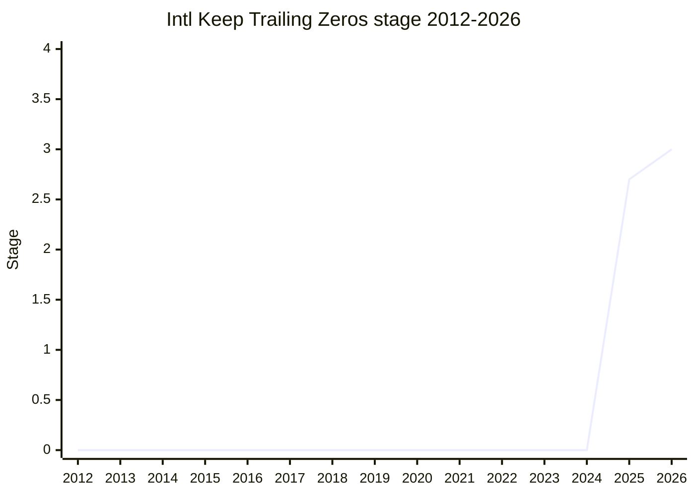

## Overview

"Keep trailing zeros in Intl.NumberFormat and Intl.PluralRules" fixes a long-standing inconsistency in how the two APIs treat **numeric string input**. Both `Intl.NumberFormat.prototype.format` and `Intl.PluralRules.prototype.select` already accept decimal strings, but they discard any trailing zeros, so `"1.0"` is treated exactly like the number `1`: it formats as "1" and selects the English plural category `"one"`, although "1.0 apples" takes the `"other"` form. The proposal keeps the precision that the string carries and applies it inside the existing digit options. Number and BigInt input are unaffected, and `minimumFractionDigits` / `maximumFractionDigits` / significant-digit options work as before, with string digits clamped between them.

```js
const nf = new Intl.NumberFormat("en", { minimumFractionDigits: 1 });
nf.format("1");      // "1.0" (unchanged)
nf.format("1.00");   // today "1.0", proposed "1.00"
nf.format("1.0000"); // "1.000" (capped by the default maximumFractionDigits of 3)
new Intl.PluralRules("en").select("1.0"); // today "one", proposed "other"

new Intl.NumberFormat("en", { maximumFractionDigits: 1 }).format("2.03");
// today "2", proposed "2.0" (issue #11: zeros produced by rounding are kept too)
```

The change is almost entirely internal. The Intl mathematical value becomes a record that also counts the digits of a string input (later named the "Intl MV Record", with a `[[StringFractionDigitCount]]` field), and `ToRawPrecision` / `ToRawFixed` stop trimming zeros once they reach that count. The only visible API addition is a new `trailingZeroDisplay` value, `"stripToMinimum"`, which brings back the old behaviour. [EAO](../people/EAO.md) is the sole champion. [EAO](../people/EAO.md) called it "effectively a small bugfix" and said it came out of the TC39 numerics discussions around Decimal and Amount/Measure. It reached Stage 1 and Stage 2 / 2.7 within two months (2025-05, 2025-07). Stage 3 took until 2026-05: first the digit-counting corner cases and the `stripToMinimum` option had to be settled, and then a dispute over how values that round to zero should be shown (issue #15).

## Stage history

| Meeting                                                                              | Venue   | Event                                                                                                                                                                                                                                                                                                                                                       | Stage   |
| ------------------------------------------------------------------------------------ | ------- | ----------------------------------------------------------------------------------------------------------------------------------------------------------------------------------------------------------------------------------------------------------------------------------------------------------------------------------------------------------- | ------- |
| [2024-10](https://github.com/tc39/notes/blob/main/meetings/2024-10/october-09.md)    | plenary | Decimal Stage 1 update: [JMN](../people/JMN.md) announces that Decimal will drop trailing zeros and that "this idea for trailing zeros has kind of been off loaded" to a separate precision-carrying proposal (the future Measure/Amount)                                                                                                                   | 0       |
| [2025-05-08](https://github.com/tc39/ecma402/blob/main/meetings/notes-2025-05-08.md) | TG2     | [EAO](../people/EAO.md) introduces "Intl Keep Trailing Zeros" (still at `eemeli/proposal-intl-keep-trailing-zeros`, no spec text yet); [SFC](../people/SFC.md) and [DLM](../people/DLM.md) support Stage 1                                                                                                                                                  | 0       |
| [2025-05](https://github.com/tc39/notes/blob/main/meetings/2025-05/may-28.md)        | plenary | Reached Stage 1. `Keep trailing zeros in Intl.NumberFormat and Intl.PluralRules for Stage 1` ([EAO](../people/EAO.md)). "The proposal was accepted for Stage 1." [SFC](../people/SFC.md) volunteers to review the spec text                                                                                                                                 | 0 → 1   |
| [2025-07-17](https://github.com/tc39/ecma402/blob/main/meetings/notes-2025-07-17.md) | TG2     | Spec text presented ([PR #4](https://github.com/tc39/proposal-intl-keep-trailing-zeros/pull/4)); [SFC](../people/SFC.md) asks "Do we have agreement in TG2 for advancing this proposal to Stage 2 and/or 2.7?"; +1 from [RGN](../people/RGN.md), [SFC](../people/SFC.md), [PFC](../people/PFC.md), [YSZ](../people/YSZ.md) ("I think it's fine")            | 1       |
| [2025-07](https://github.com/tc39/notes/blob/main/meetings/2025-07/july-29.md)       | plenary | Reached Stage 2. [RGN](../people/RGN.md) and [SFC](../people/SFC.md) become Stage 2.7 reviewers; [WH](../people/WH.md) is "fine with this proposal going to stage 2, but not stage 2.7" because of the `ToIntlMathematicalValue` range limit                                                                                                                | 1 → 2   |
| [2025-07](https://github.com/tc39/notes/blob/main/meetings/2025-07/july-30.md)       | plenary | Continuation on day three: reviews complete, [WH](../people/WH.md) agrees the `ToIntlMathematicalValue` issue can be fixed separately. "The proposal reached Stage 2.7."                                                                                                                                                                                    | 2 → 2.7 |
| [2025-08-14](https://github.com/tc39/ecma402/blob/main/meetings/notes-2025-08-14.md) | TG2     | W3C i18n review adopted as a TG2 stage-advancement requirement; [SFC](../people/SFC.md): for this proposal "It would become a stage 3 requirement". The separate Intl MV limits fix (ecma402 PR #1022) is discussed                                                                                                                                         | 2.7     |
| [2025-11-06](https://github.com/tc39/ecma402/blob/main/meetings/notes-2025-11-06.md) | TG2     | PR #10 (corner cases found in testing), issue #11 (rounding keeps trailing zeros) and PR #12 (`stripToMinimum`) discussed with [EAO](../people/EAO.md) absent; TG2 "happy with the recommendation of the champions group"; Stage 3 targeted for January                                                                                                     | 2.7     |
| [2025-11](https://github.com/tc39/notes/blob/main/meetings/2025-11/november-18.md)   | plenary | Update: [PR #10](https://github.com/tc39/proposal-intl-keep-trailing-zeros/pull/10) and [PR #12](https://github.com/tc39/proposal-intl-keep-trailing-zeros/pull/12) get "support in principle for merging (pending review)"; the behaviour in [issue #11](https://github.com/tc39/proposal-intl-keep-trailing-zeros/issues/11) "was accepted as reasonable" | 2.7     |
| [2026-02-19](https://github.com/tc39/ecma402/blob/main/meetings/notes-2026-02-19.md) | TG2     | "Approval from TG2 for Stage 3, pending final reviews from [RGN](../people/RGN.md), [SFC](../people/SFC.md), [YSZ](../people/YSZ.md)."                                                                                                                                                                                                                      | 2.7     |
| [2026-03](https://github.com/tc39/notes/blob/main/meetings/2026-03/march-10.md)      | plenary | Presented for Stage 3, but advancement not requested: "Issue #15 should be resolved with a change as requested." / "Issue #17 should be resolved by retaining the current behaviour."                                                                                                                                                                       | 2.7     |
| [2026-03-19](https://github.com/tc39/ecma402/blob/main/meetings/notes-2026-03-19.md) | TG2     | [SFC](../people/SFC.md) disputes what the plenary conclusion on #15 means; [RGN](../people/RGN.md) and [EAO](../people/EAO.md) treat it as settled; moved to the numerics call                                                                                                                                                                              | 2.7     |
| [2026-05-19](https://github.com/tc39/ecma402/blob/main/meetings/notes-2026-05-19.md) | TG2     | (Meeting of 2026-05-07.) [EAO](../people/EAO.md): a PR from [RGN](../people/RGN.md) fixing #15 is expected; "Addressing this issue has been the only blocker for stage 3 here"                                                                                                                                                                              | 2.7     |
| [2026-05](https://github.com/tc39/notes/blob/main/meetings/2026-05/may-19.md)        | plenary | Reached Stage 3. `Intl: Keep Trailing Zeros for Stage 3` ([EAO](../people/EAO.md)); support from [SFC](../people/SFC.md), [DLM](../people/DLM.md), [RGN](../people/RGN.md). "The proposal got support for advancing to Stage 3, with PRs #19 and #20 merged."                                                                                               | 2.7 → 3 |
| [2026-08-06](https://github.com/tc39/ecma402/blob/main/meetings/notes-2026-08-06.md) | TG2     | Stage 3 follow-up: [SFC](../people/SFC.md) notes a V8 PR; [EAO](../people/EAO.md)'s test262 PR is waiting for review                                                                                                                                                                                                                                        | 3       |



> How to read: Stage 1 came in 2025-05 (`may-28.md`). Stage 2 and Stage 2.7 were both reached at the 2025-07 plenary, on consecutive days (`july-29.md`, `july-30.md`), so the 2025 point is 2.7. Stage 3 came in 2026-05 (`may-19.md`). TG2 had already approved Stage 3 in 2026-02, and the 2026-03 plenary slot was titled "for Stage 3", but no advancement was requested there, so 2026-03 is not a transition. The underlying i18n argument (that `Intl.NumberFormat` and `Intl.PluralRules` should honour trailing zeros) is older: [SFC](../people/SFC.md) made it in the Decimal discussions from 2023 (see below). The TG2 notes file `notes-2026-05-19.md` is headed "2026-05-07 ECMA-402 Meeting", so that call came before the 2026-05-19 plenary.

## Main issues

### Origins in the Decimal debate: bug fix or proposal?

The request first came up as an Intl argument for Decimal. When the Decimal champions planned to normalize values, dropping trailing zeros, [SFC](../people/SFC.md) objected at plenary ([2023-11](https://github.com/tc39/notes/blob/main/meetings/2023-11/november-27.md)):

> [SFC](../people/SFC.md): Second, as I have said, trailing zeros are important for internationalization. There’s a difference between having 1 star versus 1.0 stars.

At the Decimal Stage 2 request in [2024-06](https://github.com/tc39/notes/blob/main/meetings/2024-06/june-13.md), [SFC](../people/SFC.md) made Stage 2 support conditional on "Intl.NumberFormat and Intl.PluralRules having behavior that retains trailing zeros", and in [2024-07](https://github.com/tc39/notes/blob/main/meetings/2024-07/july-31.md) welcomed "the champion's support for retaining trailing zeroes in the data model". At TG2 [2024-07-18](https://github.com/tc39/ecma402/blob/main/meetings/notes-2024-07-18.md), [SFC](../people/SFC.md) called trailing zeros "a justification for an integration of Decimal with NumberFormat and PluralRules", while [EAO](../people/EAO.md) suggested designing an input protocol for NumberFormat/PluralRules that would carry fraction digits and units instead. In [2024-10](https://github.com/tc39/notes/blob/main/meetings/2024-10/october-09.md) [JMN](../people/JMN.md) announced that Decimal would normalize after all, and that the trailing-zeros use case had moved to a separate "numeric values with precision" effort (which became Measure, then Amount).

[EAO](../people/EAO.md) then took the narrowest piece, strings that `format()`/`select()` already accept, and proposed it on its own. At TG2 [2025-05-08](https://github.com/tc39/ecma402/blob/main/meetings/notes-2025-05-08.md) [SFC](../people/SFC.md) said it evolves from the earlier NumberFormat v3 change that raised string precision, and "I consider this largely a bugfix, we continue to get issues about this in 402". [EAO](../people/EAO.md) opened the Stage 1 plenary ([2025-05](https://github.com/tc39/notes/blob/main/meetings/2025-05/may-28.md)) with:

> [EAO](../people/EAO.md): This is a proposal that is distinct from `Decimal` but coming out of the discussions we have had between the Decimal and Amount/Measure folks in the TC39-numerics group. It’s effectively a small bugfix of `Intl.NumberFormat` and `Intl.PluralRules`.

[EAO](../people/EAO.md) admitted it was "kind of close whether we ought to be filing this as a normative PR or as a tracked proposal", but TG2 had advised a staged proposal. The web-compat argument, repeated at every stage, was that string handling had changed recently without harm: the NumberFormat v3 work in 2023 raised fraction precision from 20 to 100 digits, "with no ill effect for users". The separation held up. In 2026 [EAO](../people/EAO.md) called the proposal "a bit of a prequel" to Amount ([2026-03](https://github.com/tc39/notes/blob/main/meetings/2026-03/march-10.md)), and at the [2026-07](https://github.com/tc39/notes/blob/main/meetings/2026-07/july-22.md) Decimal update [CLA](../people/CLA.md) cited Amount and Keep Trailing Zeros as the proposals that now cover canonicalization and keeping trailing-zero information, taking that use case away from Decimal.

### How string digits interact with the digit options

The central design question was what counting a string's digits means next to the existing precision options. At TG2 [2025-05-08](https://github.com/tc39/ecma402/blob/main/meetings/notes-2025-05-08.md) [SFC](../people/SFC.md) first pictured the string's precision as a fallback used "when the options for precision aren’t changed", taking "precedence over the value from the string" otherwise. [EAO](../people/EAO.md) disagreed: the digits are part of the value, and the options clamp them as they would any digits ("If you format 1.23456 the output by default would just include 3 fractional digits"). At plenary [SFC](../people/SFC.md) came round and passed on a rule from [NRO](../people/NRO.md):

> [SFC](../people/SFC.md): The rule of thumb is basically that trailing zeros that come in on inputs should be treated the same as any other type of digit.

The Stage 2 spec text ([PR #4](https://github.com/tc39/proposal-intl-keep-trailing-zeros/pull/4), TG2 [2025-07-17](https://github.com/tc39/ecma402/blob/main/meetings/notes-2025-07-17.md), plenary [2025-07](https://github.com/tc39/notes/blob/main/meetings/2025-07/july-29.md)) counts the decimal digits while parsing the `StringNumericLiteral` and turns the Intl mathematical value into a record carrying that count, which is zero for Numbers and BigInts. `ToRawPrecision` / `ToRawFixed` then stop stripping zeros early. At TG2 [SFC](../people/SFC.md) questioned the wording "number of decimal digits in the source text" versus "significant digits", given leading zeros. [EAO](../people/EAO.md) kept leading-zero preservation out of scope ("I’d rather not add that to the proposal"), and confirmed that `roundingPriority` and `roundingMode` work unchanged. [RGN](../people/RGN.md) at the Stage 2 plenary: "I think it is going to be good to keep the precision."

Writing tests against a patched FormatJS polyfill exposed corner cases, fixed in [PR #10](https://github.com/tc39/proposal-intl-keep-trailing-zeros/pull/10) (TG2 [2025-11-06](https://github.com/tc39/ecma402/blob/main/meetings/notes-2025-11-06.md), plenary [2025-11](https://github.com/tc39/notes/blob/main/meetings/2025-11/november-18.md)):

- leading zeros must not count (`"0012.3"` has three string digits; this needed a new `ZeroDigits` syntax rule);
- an elided leading zero must count (`".45"` has three);
- exponent shifts must adjust the count, so that `"0.06"` formatted as a percent is "6%", not "6.00%". This can apply twice, because `style: "percent"` combines with `notation: "scientific"` / `"engineering"`.

### Rounding keeps trailing zeros too (#11), and the `stripToMinimum` escape hatch (#1, #12)

From the start, [EAO](../people/EAO.md) offered a fallback ([issue #1](https://github.com/eemeli/proposal-intl-keep-trailing-zeros/issues/1)). If anyone needed the old behaviour, or if the change turned out not to be web-compatible, a third value would be added to `trailingZeroDisplay`, the NumberFormat v3 option (`"auto"` / `"stripIfInteger"`, agreed at TG2 [2021-04-08](https://github.com/tc39/ecma402/blob/main/meetings/notes-2021-04-08.md)). At the Stage 1 plenary [SFC](../people/SFC.md) defended the existing `"stripIfInteger"` use case (a sequence like "1.99", "2", "2.01") as unaffected. At TG2 [2025-07-17](https://github.com/tc39/ecma402/blob/main/meetings/notes-2025-07-17.md) [EAO](../people/EAO.md) sketched a `"stripFromString"` value but preferred "that this not be added unless someone comes up with a decent reason for doing so".

Test writing then showed that the Stage 2.7 spec affects more than inputs with trailing zeros ([issue #11](https://github.com/tc39/proposal-intl-keep-trailing-zeros/issues/11)). With `maximumFractionDigits: 1`, `"2.03"` and `"1.96"` both round to "2.0" instead of "2", while the Numbers `2.03` and `1.96` still give "2". At TG2 [2025-11-06](https://github.com/tc39/ecma402/blob/main/meetings/notes-2025-11-06.md) [SFC](../people/SFC.md) reported the numerics call's view that this was correct but broader than first thought, which made the opt-out ([PR #12](https://github.com/tc39/proposal-intl-keep-trailing-zeros/pull/12), `trailingZeroDisplay: "stripToMinimum"`) worth considering. [SFC](../people/SFC.md) still did not find it motivated enough. [HJS](../people/HJS.md) challenged the direction of the option:

> [HJS](../people/HJS.md): If we have an option, one way the option can go is the old behaviour, one is the new behaviour, why do we need to opt in to the old behaviour rather than opting into the new one?

[SFC](../people/SFC.md) replied that the committee regarded the change as web-compatible. If it were not, the default itself should be reconsidered, not just an option added. The question went to plenary ([2025-11](https://github.com/tc39/notes/blob/main/meetings/2025-11/november-18.md)). [SFC](../people/SFC.md) now preferred the rounding behaviour: with `"2.00"` and `"2.01"`, "it doesn’t make a lot of sense that one of them retains the trailing zero". [JAD](../people/JAD.md) found the difference from `toString` "weird", while [SHS](../people/SHS.md) found it natural:

> [SHS](../people/SHS.md): Yeah, I just wanted to point out that initially I thought it was little bit weird, but when I think about it further, converting between string and number is inherently either fabricating or losing that precision data, and I think it’s actually quite natural that this a different result.

On the option, [NRO](../people/NRO.md) "would prefer to not do the option unless somebody says we need this". [CHU](../people/CHU.md) wanted it anyway as a quick fix for sites whose layout changes, and [WH](../people/WH.md) supplied a concrete use case:

> [WH](../people/WH.md): I have a use case for doing exactly what the current behavior does and what this option would let me do—there are situations where I want to display numbers without extraneous trailing zeroes, but I don’t want to round them too much.

[SFC](../people/SFC.md) added a use case of their own (showing the shortest form of a decimal string longer than a double can hold), but called the option mainly an "insurance policy", adding: "we still need to be clear as a committee that we believe is a web compatible change". Nobody opposed merging PR #12, with the name open to bikeshedding in TG2. By [2026-03](https://github.com/tc39/notes/blob/main/meetings/2026-03/march-10.md) `"stripToMinimum"` was presented as the proposal's only externally visible change. In 2026, sequence units raised the question of whether `trailingZeroDisplay` should also hide zero-valued trailing components ("6ft 0in"). [EAO](../people/EAO.md) mildly preferred reusing it, but [SFC](../people/SFC.md) and [DLM](../people/DLM.md) wanted that solved in Amount, if at all (TG2 [2026-07-09](https://github.com/tc39/ecma402/blob/main/meetings/notes-2026-07-09.md)).

### Values that round to zero (#15) and integer trailing zeros (#17)

Two final questions held up Stage 3 at [2026-03](https://github.com/tc39/notes/blob/main/meetings/2026-03/march-10.md).

- **[Issue #15](https://github.com/tc39/proposal-intl-keep-trailing-zeros/issues/15)**: the string `"1.2e-10"` with `maximumFractionDigits: 5` formatted as "0.0", because the input's two digits of precision carried over to the zero. The alternative was "0.00000" (the maximum-fraction-digits representation). [EAO](../people/EAO.md) personally preferred leaving it alone "because it would be so much simpler", and credited [RGN](../people/RGN.md) with identifying the issue. [RGN](../people/RGN.md) argued that the exponent form and the spelled-out `0.00000000012` are mathematically equivalent and should format alike; [WH](../people/WH.md) then favoured "0.00000". [NRO](../people/NRO.md) called the status quo the worst option ("I think the current behavior proposal, so 0.0, is probably the worst of the possible alternatives"). [SFC](../people/SFC.md) read the spec as tracking significant digits ("I don't see any world in which the bottom output is ever expected") and proposed formatting as a plain zero once all significant digits are rounded away. [WH](../people/WH.md) and [RGN](../people/RGN.md) both answered "No."
- **Issue #17**: whether `"700"` has three significant digits (`7.00E2` in scientific notation) or one (`7E2`). [NRO](../people/NRO.md) and [SFC](../people/SFC.md) backed the current three-digit reading. [WH](../people/WH.md) would rather get `1e9` than `1.000000000e9` for a spelled-out billion, but "would not object".

[EAO](../people/EAO.md) did not request Stage 3. The recorded conclusion was "Issue #15 should be resolved with a change as requested" and "Issue #17 should be resolved by retaining the current behaviour". At TG2 [2026-03-19](https://github.com/tc39/ecma402/blob/main/meetings/notes-2026-03-19.md) the conclusion on #15 was disputed. [RGN](../people/RGN.md) and [EAO](../people/EAO.md) took it as a direction ("0.0001" with `maximumFractionDigits: 3` ⇒ "0.000"). [SFC](../people/SFC.md) had understood it as a request to discuss further, and still held that such zeros are leading zeros with no significant digits left. [RGN](../people/RGN.md): "This is not a matter of sig digits, it’s fraction digits. It may or may not be significant, but it’s definitely fractional." [SFC](../people/SFC.md) drew a process lesson:

> [SFC](../people/SFC.md): Great. I still don’t know what “change as requested” means. I had made a comment two rows above that in the notes requesting a change for issue 15. This is why we should not resolve issues in TG1 without having actual PRs.

[RGN](../people/RGN.md) and [EAO](../people/EAO.md) replied that the comment in question was about #17. [EAO](../people/EAO.md) declined to relitigate a plenary direction in TG2, and the matter moved to the numerics call. The eventual fix followed the plenary direction: PR #19 adds a `[[StringFractionDigitCount]]` field to the Intl MV Record that accounts for the applied exponent, so that such values end up "with the precision of 0. the maximum fraction digits representation effectively in most cases". A companion editorial change names the "Intl MV Record" in ECMA-402. Both had approval from [RGN](../people/RGN.md) and [SFC](../people/SFC.md), and Stage 3 followed at [2026-05](https://github.com/tc39/notes/blob/main/meetings/2026-05/may-19.md) with PRs #19 and #20 merged. Note a discrepancy in the champion's own account: in 2026-03 [EAO](../people/EAO.md) credited [RGN](../people/RGN.md) with identifying #15, while in 2026-05 [EAO](../people/EAO.md) described it as the issue "that [SFC](../people/SFC.md) raised" in review.

### `ToIntlMathematicalValue` range limits and PluralRules input

At the Stage 2 plenary ([2025-07](https://github.com/tc39/notes/blob/main/meetings/2025-07/july-29.md)) [WH](../people/WH.md) blocked Stage 2.7 over `ToIntlMathematicalValue`, and explained the problem during the following Amount item. The existing range limit turns large finite strings (e.g. `1.797E308` rounded to three significant digits) into infinity, which is also incompatible with a future Decimal. [SFC](../people/SFC.md) and [EAO](../people/EAO.md) pointed out that the proposal did not touch that step. The next day [WH](../people/WH.md) agreed to separate it ([2025-07](https://github.com/tc39/notes/blob/main/meetings/2025-07/july-30.md)):

> [WH](../people/WH.md): You can do this as a separate change, I’m fine with that. My main concern is that we fix this bug quickly.

[SFC](../people/SFC.md) followed up with ecma402 PR #1022, "Increase limits on Intl MV and explicitly limit significant digits" (TG2 [2025-08-14](https://github.com/tc39/ecma402/blob/main/meetings/notes-2025-08-14.md), [2025-09-11](https://github.com/tc39/ecma402/blob/main/meetings/notes-2025-09-11.md)). A second overlapping change was ecma402 PR #1026, which makes `Intl.PluralRules` operate on Intl mathematical values (so BigInt works). It got TG2 approval at [2025-09-11](https://github.com/tc39/ecma402/blob/main/meetings/notes-2025-09-11.md), where [EAO](../people/EAO.md) noted "this is a subset of the changes in Intl Keep Trailing Zeros".

### Process: first proposal through W3C i18n review

The proposal was a test case for newer process steps. At the Stage 2 plenary [CDA](../people/CDA.md) asked whether the whole editor group had signed off for Stage 2.7; [SFC](../people/SFC.md) noted that [BAN](../people/BAN.md) was on leave and that ECMA-402 proposals had previously gone ahead with a single editor's review, and [RGN](../people/RGN.md) answered: "We can consider this as approved by the ECMA-402 editor group." [SFC](../people/SFC.md) also asked whether a Stage 2 proposal with tests could skip 2.7. After TG2 adopted W3C i18n review as a stage requirement ([2025-08-14](https://github.com/tc39/ecma402/blob/main/meetings/notes-2025-08-14.md)), [EAO](../people/EAO.md) had still not filed the request by [2025-09-11](https://github.com/tc39/ecma402/blob/main/meetings/notes-2025-09-11.md). By the [2025-11](https://github.com/tc39/notes/blob/main/meetings/2025-11/november-18.md) plenary [EAO](../people/EAO.md) reported "this is the example case that’s gone through that process and has the review and approval from there". Stage 3 was requested on the basis of a test262 PR and a FormatJS-based polyfill. At Stage 2.7, [SFC](../people/SFC.md) noted that "there is not an engine implementation" but nothing prevented one behind a flag (TG2 [2025-11-06](https://github.com/tc39/ecma402/blob/main/meetings/notes-2025-11-06.md)).

## Related proposals

- `proposal-decimal` — the origin of the trailing-zeros argument; Decimal chose normalization and left precision to other proposals.
- `proposal-amount` (formerly Measure) — carries precision alongside a value; discussed in the same plenary sessions (2025-07, 2026-03), and shares the `ToIntlMathematicalValue` limits question.
- `intl-numberformat-v3` — introduced `trailingZeroDisplay` and the string-precision changes this proposal builds on.
- `intl-unit-protocol` / `intl-sequence-units` — 2026 unit proposals where `trailingZeroDisplay` semantics came up again.
- [Intl.DurationFormat](intl-durationformat.md) — its `fractionalDigits` Stage 3 condition (2021) was also about showing trailing zeros.

## Sources

TG2:

- https://github.com/tc39/ecma402/blob/main/meetings/notes-2021-04-08.md
- https://github.com/tc39/ecma402/blob/main/meetings/notes-2024-07-18.md
- https://github.com/tc39/ecma402/blob/main/meetings/notes-2025-05-08.md
- https://github.com/tc39/ecma402/blob/main/meetings/notes-2025-07-17.md
- https://github.com/tc39/ecma402/blob/main/meetings/notes-2025-08-14.md
- https://github.com/tc39/ecma402/blob/main/meetings/notes-2025-09-11.md
- https://github.com/tc39/ecma402/blob/main/meetings/notes-2025-11-06.md
- https://github.com/tc39/ecma402/blob/main/meetings/notes-2026-02-19.md
- https://github.com/tc39/ecma402/blob/main/meetings/notes-2026-03-19.md
- https://github.com/tc39/ecma402/blob/main/meetings/notes-2026-05-19.md
- https://github.com/tc39/ecma402/blob/main/meetings/notes-2026-07-09.md
- https://github.com/tc39/ecma402/blob/main/meetings/notes-2026-08-06.md

Plenary:

- https://github.com/tc39/notes/blob/main/meetings/2023-11/november-27.md
- https://github.com/tc39/notes/blob/main/meetings/2024-06/june-13.md
- https://github.com/tc39/notes/blob/main/meetings/2024-07/july-31.md
- https://github.com/tc39/notes/blob/main/meetings/2024-10/october-09.md
- https://github.com/tc39/notes/blob/main/meetings/2025-05/may-28.md
- https://github.com/tc39/notes/blob/main/meetings/2025-07/july-29.md
- https://github.com/tc39/notes/blob/main/meetings/2025-07/july-30.md
- https://github.com/tc39/notes/blob/main/meetings/2025-11/november-18.md
- https://github.com/tc39/notes/blob/main/meetings/2026-03/march-10.md
- https://github.com/tc39/notes/blob/main/meetings/2026-05/may-19.md
- https://github.com/tc39/notes/blob/main/meetings/2026-07/july-22.md
