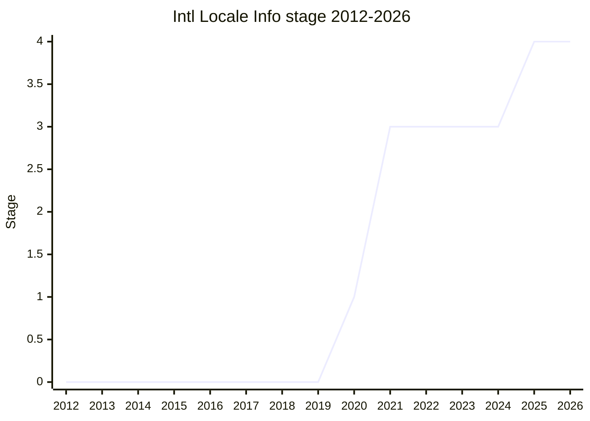

## Overview

Intl Locale Info adds methods to `Intl.Locale` that expose **locale data derived from CLDR** that applications otherwise hard-code or pull from userland libraries: the week data needed to lay out a calendar widget (first day of the week, which days are the weekend), the default text direction of the locale's script, and the calendars, collations, hour cycles, numbering systems and time zones commonly used in the locale. [FYT](../people/FYT.md) introduced it in TG2 in 2020-08, building on ecma402 issue #6 (`Intl.getCalendarInfo()`) and on Mozilla's internal `mozIntl.getCalendarInfo`. The idea is older still: in 2015-11 and 2016-01 [EF](../people/EF.md) and [ZB](../people/ZB.md) presented an `Intl.resolveLocaleInfo(locale[, options])` returning `direction`, `firstDay` and `hour12` as part of "Abstract Locale Operations". The API returns data about the locale, not user preferences: WebKit and Firefox said they would not feed OS preferences into it, to avoid fingerprinting (TG2 2021-04-08). It also describes what a region _uses_, not what the engine _supports_, which is how [FYT](../people/FYT.md) distinguished it from the Intl Enumeration API (plenary 2021-04).

```js
const us = new Intl.Locale("en-US");
us.getWeekInfo();     // { firstDay: 7, weekend: [6, 7] }  (ISO weekday numbers, Monday = 1)
us.getHourCycles();   // ["h12"]
new Intl.Locale("ar").getTextInfo();   // { direction: "rtl" }
new Intl.Locale("ja-JP").getTimeZones(); // ["Asia/Tokyo"]; undefined when the locale has no region

const fw = new Intl.Locale("en-US-u-fw-mon");
fw.firstDayOfWeek;          // "mon" (the -u-fw subtag as written)
fw.getWeekInfo().firstDay;  // 1
new Intl.Locale("en-US", { firstDayOfWeek: 1 }).firstDayOfWeek; // "mon" ("0"-"7" are mapped to UTS 35 strings)
```

The final shape is seven methods (`getCalendars()`, `getCollations()`, `getHourCycles()`, `getNumberingSystems()`, `getTimeZones()`, `getTextInfo()`, `getWeekInfo()`) plus a new `firstDayOfWeek` option and getter for the UTS 35 `-u-fw` keyword. It did not start that way. The Stage 3 version (2021-04) had seven **getters** (`.calendars`, `.weekInfo`, ...), and `weekInfo` had `weekendStart` / `weekendEnd` / `minimalDays`. After Chrome and Safari had shipped those getters, TC39 turned them into `get`-prefixed methods (2022-11, 2023-01). The weekend became an array (2021-10), `-u-fw` support was added through three rounds of plenary debate over how to represent weekdays (2023-07 to 2024-07), `minimalDays` was removed (2025-02), and `getTextInfo().direction` stopped falling back to `"ltr"` (2025-05). [FYT](../people/FYT.md) is the sole champion throughout. [ZB](../people/ZB.md) was asked to co-champion in 2020 and declined, and [SFC](../people/SFC.md) presented the 2025-02 and 2025-05 updates on [FYT](../people/FYT.md)'s behalf. [ABL](../people/ABL.md) (Anba, Mozilla's implementer) filed most of the Stage 3 spec issues and wrote the final normative PR #92. The proposal spent four and a half years at Stage 3 and reached Stage 4 in 2025-11, for ES2026. After Stage 4 more implementation feedback led to several normative ECMA-402 PRs on the same algorithms (2026).

## Stage history

| Meeting                                                                              | Venue   | Event                                                                                                                                                                                                                                                                                                                         | Stage |
| ------------------------------------------------------------------------------------ | ------- | ----------------------------------------------------------------------------------------------------------------------------------------------------------------------------------------------------------------------------------------------------------------------------------------------------------------------------- | ----- |
| [2015-11](https://github.com/tc39/notes/blob/main/meetings/2015-11/nov-19.md)        | plenary | Precursor: [EF](../people/EF.md) presents `Intl.resolveLocaleInfo` within "Abstract Locale Operations" (Stage 1 for that bundle): "the results provides a summary of available information, this will grow"                                                                                                                   | 0     |
| [2016-01](https://github.com/tc39/notes/blob/main/meetings/2016-01/jan-28.md)        | plenary | Precursor: [ZB](../people/ZB.md) shows `Intl.resolveLocaleInfo(locale[ ,options])` with `{direction, firstDay, hour12}`; the filter argument is dropped and [MM](../people/MM.md) asks for "a fresh one or a deeply frozen one" (the bundle reaches Stage 2)                                                                  | 0     |
| [2020-02-27](https://github.com/tc39/ecma402/blob/main/meetings/notes-2020-02-27.md) | TG2     | User preferences discussion around ecma402 #6 (`Intl.getCalendarInfo()`): a `mozIntl.getCalendarInfo`-style function or getters on `Intl.Locale` ([JSW](../people/JSW.md))                                                                                                                                                    | 0     |
| [2020-08-13](https://github.com/tc39/ecma402/blob/main/meetings/notes-2020-08-13.md) | TG2     | [FYT](../people/FYT.md) introduces "Intl Locale Info API" (week data, direction, measurement system); [ZB](../people/ZB.md) declines to co-champion; TG2 "Consensus for Stage 1"                                                                                                                                              | 0     |
| [2020-09](https://github.com/tc39/notes/blob/main/meetings/2020-09/sept-23.md)       | plenary | Reached Stage 1. `Intl Locale Info for stage 1` ([FYT](../people/FYT.md)); +1 from [SFC](../people/SFC.md) and [PDL](../people/PDL.md)                                                                                                                                                                                        | 0 → 1 |
| [2020-12-04](https://github.com/tc39/ecma402/blob/main/meetings/notes-2020-12-04.md) | TG2     | [JSW](../people/JSW.md) and [USA](../people/USA.md) doubt the three-way measurement system model; TG2 "Stage 2 approved"                                                                                                                                                                                                      | 1     |
| [2021-01-14](https://github.com/tc39/ecma402/blob/main/meetings/notes-2021-01-14.md) | TG2     | "Consensus on Stage 2" ([ZB](../people/ZB.md), [YSV](../people/YSV.md))                                                                                                                                                                                                                                                       | 1     |
| [2021-01](https://github.com/tc39/notes/blob/main/meetings/2021-01/jan-26.md)        | plenary | Reached Stage 2. `Intl Locale Info for stage 2` ([FYT](../people/FYT.md)). "Stage 2 without the unit info part." ([MF](../people/MF.md) objects to `unitInfo`)                                                                                                                                                                | 1 → 2 |
| [2021-04-08](https://github.com/tc39/ecma402/blob/main/meetings/notes-2021-04-08.md) | TG2     | Spec review: explicit `-u-` keywords restrict the lists ("Propose choosing the shorter list"); [ZB](../people/ZB.md) joins [SFC](../people/SFC.md) as Stage 3 reviewer; TG2 consensus for Stage 3 ([SFC](../people/SFC.md), [USA](../people/USA.md), [RGN](../people/RGN.md), [ZB](../people/ZB.md), [LAF](../people/LAF.md)) | 2     |
| [2021-04](https://github.com/tc39/notes/blob/main/meetings/2021-04/apr-20.md)        | plenary | Reached Stage 3. `Intl Locale Info for Stage 3` ([FYT](../people/FYT.md)); support from [YSV](../people/YSV.md) (Mozilla), [DE](../people/DE.md), [LEO](../people/LEO.md), [SFC](../people/SFC.md)                                                                                                                            | 2 → 3 |
| [2021-07](https://github.com/tc39/notes/blob/main/meetings/2021-07/july-13.md)       | plenary | Update: "Consensus for removing “standard” and “search” from Intl.Locale.prototype.collations" (PR #36); [ABL](../people/ABL.md)'s review questions listed                                                                                                                                                                    | 3     |
| [2021-09-09](https://github.com/tc39/ecma402/blob/main/meetings/notes-2021-09-09.md) | TG2     | PR #43 (Annex A) and PR #44 (non-contiguous weekend) approved; #33 list order escalated to TG1; #30: the whole locale should influence week info                                                                                                                                                                              | 3     |
| [2021-10](https://github.com/tc39/notes/blob/main/meetings/2021-10/oct-26.md)        | plenary | Update: consensus on `weekend` as a list, Annex A additions, canonicalized identifiers                                                                                                                                                                                                                                        | 3     |
| [2021-11-04](https://github.com/tc39/ecma402/blob/main/meetings/notes-2021-11-04.md) | TG2     | #59 "textInfo.direction is a very simplified model of reality": [MCM](../people/MCM.md) questions the field, [ZB](../people/ZB.md) defends it; no change                                                                                                                                                                      | 3     |
| [2021-12](https://github.com/tc39/notes/blob/main/meetings/2021-12/dec-14.md)        | plenary | Update: "#60 and #61 approved" (weekend in ascending order; canonical time zones, empty list when none); [SFC](../people/SFC.md) flags the text-direction limitation                                                                                                                                                          | 3     |
| [2022-10-06](https://github.com/tc39/ecma402/blob/main/meetings/notes-2022-10-06.md) | TG2     | Planned Stage 4 slot; #62 (getters return a new object each call) and #33 (alphabetical order) discussed: "Delay Stage 4 advancement"                                                                                                                                                                                         | 3     |
| [2022-11](https://github.com/tc39/notes/blob/main/meetings/2022-11/nov-30.md)        | plenary | Update (not Stage 4): "Getters to become functions"; shipped in Chrome 99 and Safari; [DLM](../people/DLM.md) relays [ABL](../people/ABL.md)'s open issues as Mozilla's blockers                                                                                                                                              | 3     |
| [2022-12-08](https://github.com/tc39/ecma402/blob/main/meetings/notes-2022-12-08.md) | TG2     | PR #65 (getters to methods): [RGN](../people/RGN.md) and [DLM](../people/DLM.md) favour a `get` prefix, [ZB](../people/ZB.md) opposes; "This group is OK with either conclusion"                                                                                                                                              | 3     |
| [2023-01](https://github.com/tc39/notes/blob/main/meetings/2023-01/jan-31.md)        | plenary | Update: "Reached consensus to Merge PR 67" (`get`-prefixed methods; [SYG](../people/SYG.md), [RGN](../people/RGN.md), [JHD](../people/JHD.md) in favour); Stage 4 put off beyond ES2023                                                                                                                                       | 3     |
| [2023-05-04](https://github.com/tc39/ecma402/blob/main/meetings/notes-2023-05-04.md) | TG2     | #68 `-u-fw` support: [FYT](../people/FYT.md) hesitant at Stage 3, [SFC](../people/SFC.md) calls the omission a spec bug; "Plan to propose it as normative PR in July"                                                                                                                                                         | 3     |
| [2023-07](https://github.com/tc39/notes/blob/main/meetings/2023-07/july-12.md)       | plenary | Update: no consensus on [PR #70](https://github.com/tc39/proposal-intl-locale-info/pull/70) (`firstDayOfWeek` option and getter); [EAO](../people/EAO.md) and [DE](../people/DE.md) object to string weekdays; sent back to TG2                                                                                               | 3     |
| [2023-09-07](https://github.com/tc39/ecma402/blob/main/meetings/notes-2023-09-07.md) | TG2     | #73 keep `getTimeZones()` / `getCalendars()`; #71 keep `undefined` for region-less time zones; #68 "Tentative agreement on option C" (lenient input)                                                                                                                                                                          | 3     |
| [2023-09](https://github.com/tc39/notes/blob/main/meetings/2023-09/september-26.md)  | plenary | Update: "Consensus reach for merging PR 70" (accept 3-letter strings and "0"-"7", output numbers 1-7)                                                                                                                                                                                                                         | 3     |
| [2023-11-16](https://github.com/tc39/ecma402/blob/main/meetings/notes-2023-11-16.md) | TG2     | #78 (unknown `-u-fw` values): go back to returning the string; [DE](../people/DE.md) agrees offline                                                                                                                                                                                                                           | 3     |
| [2023-11](https://github.com/tc39/notes/blob/main/meetings/2023-11/november-28.md)   | plenary | Update: consensus on [PR 79](https://github.com/tc39/proposal-intl-locale-info/pull/79) (`firstDayOfWeek` echoes the subtag); [DE](../people/DE.md), [SFC](../people/SFC.md), [DLM](../people/DLM.md) raise a possible return to Stage 2; "may be downgraded to Stage 2 if outstanding issues aren’t fixed promptly"          | 3     |
| [2024-07-18](https://github.com/tc39/ecma402/blob/main/meetings/notes-2024-07-18.md) | TG2     | #82 / PR #83: `WeekInfoOfLocale` must convert `[[FirstDayOfWeek]]` to a number; explicit ISO 8601 handling kept, the `language_id` / no-`-rg` part reverted                                                                                                                                                                   | 3     |
| [2024-07](https://github.com/tc39/notes/blob/main/meetings/2024-07/july-30.md)       | plenary | Update: PR 83 consensus ([DLM](../people/DLM.md): conditional on [ABL](../people/ABL.md)'s review comments); CLDR/UTS 35 dependency resolved; polyfill available                                                                                                                                                              | 3     |
| [2024-12-19](https://github.com/tc39/ecma402/blob/main/meetings/notes-2024-12-19.md) | TG2     | Stage 4 PR ecma402#942 not ready: #76 (fallback behaviour), #86 (`minimalDays`), #90 (direction); "TG2 feels that these issues should be fixed"                                                                                                                                                                               | 3     |
| [2025-02-06](https://github.com/tc39/ecma402/blob/main/meetings/notes-2025-02-06.md) | TG2     | Confirms the January decision to remove `minimalDays`; [FYT](../people/FYT.md): "let’s get those issues resolved before Stage 4"                                                                                                                                                                                              | 3     |
| [2025-02](https://github.com/tc39/notes/blob/main/meetings/2025-02/february-19.md)   | plenary | Update ([SFC](../people/SFC.md) for [FYT](../people/FYT.md)): "Reached consensus on PR 99" (remove `minimalDays`); issue 76 must be resolved first                                                                                                                                                                            | 3     |
| [2025-05-08](https://github.com/tc39/ecma402/blob/main/meetings/notes-2025-05-08.md) | TG2     | #100: direction should not fall back to `"ltr"`; return `undefined` when unknown (a `"ttb"` value also floated)                                                                                                                                                                                                               | 3     |
| [2025-05](https://github.com/tc39/notes/blob/main/meetings/2025-05/may-28.md)        | plenary | Update ([SFC](../people/SFC.md)): `undefined` approved as a `getTextInfo()` direction; no pre-approval for extra string values                                                                                                                                                                                                | 3     |
| [2025-06-12](https://github.com/tc39/ecma402/blob/main/meetings/notes-2025-06-12.md) | TG2     | PR #101 ("ltr", "rtl" or `undefined`, not "ttb") merged per the TG1 addendum                                                                                                                                                                                                                                                  | 3     |
| [2025-10-13](https://github.com/tc39/ecma402/blob/main/meetings/notes-2025-10-13.md) | TG2     | (Notes titled 2025-10-09.) PR #103 (editorial note on direction) trimmed; PR #92 (explicit lookup algorithms) agreed; TG2 approves Stage 4 ([YSZ](../people/YSZ.md), [SFC](../people/SFC.md))                                                                                                                                 | 3     |
| [2025-11](https://github.com/tc39/notes/blob/main/meetings/2025-11/november-18.md)   | plenary | Reached Stage 4. `Intl Locale Info API for Stage 4` ([FYT](../people/FYT.md)). "TG1 agree to merge PR92" / "TG1 agree for Stage 4"; support from [SFC](../people/SFC.md), [DLM](../people/DLM.md) and others                                                                                                                  | 3 → 4 |
| [2026-05-19](https://github.com/tc39/ecma402/blob/main/meetings/notes-2026-05-19.md) | TG2     | (Meeting of 2026-05-07.) [DLM](../people/DLM.md): [ABL](../people/ABL.md) has finished the SpiderMonkey implementation, in Firefox Nightly                                                                                                                                                                                    | 4     |
| [2026-06-11](https://github.com/tc39/ecma402/blob/main/meetings/notes-2026-06-11.md) | TG2     | Post-Stage-4 fixes: TG2 approves ecma402 #1074, #1072, #1051 (`RegionPreference` in `WeekInfoOfLocale`); #1059 judged to need a proposal                                                                                                                                                                                      | 4     |
| [2026-07](https://github.com/tc39/notes/blob/main/meetings/2026-07/july-22.md)       | plenary | Needs-consensus PRs ([SFC](../people/SFC.md)): ecma402 #1086, #1074, #1072 and #1051 approved                                                                                                                                                                                                                                 | 4     |
| [2026-09-17](https://github.com/tc39/ecma402/blob/main/meetings/notes-2026-09-17.md) | TG2     | ecma402 PR #1097 (`getWeekInfo().firstDay` from UTS 35 First Day Overrides) gets TG2 approval                                                                                                                                                                                                                                 | 4     |



> How to read: Stage 1 came in 2020-09 (`sept-23.md`), Stage 2 in 2021-01 (`jan-26.md`) and Stage 3 in 2021-04 (`apr-20.md`), so the 2021 point is already 3. It then stayed at Stage 3 until 2025-11 (`november-18.md`). The Stage 4 slot planned for 2022-11 was turned into an update, and the 2023-11 plenary raised but did not decide a return to Stage 2. Stage 4 matches the canonical `finished-proposals.md` (Expected Publication Year 2026). The 2015-11 and 2016-01 rows belong to the separate "Abstract Locale Operations" proposal, whose `Intl.resolveLocaleInfo` was an early form of the same idea. They are plotted as 0.

## Main issues

### Scope: the measurement system and `unitInfo`

The Stage 1 proposal also exposed a locale's measurement system (CLDR's metric / US / UK split). In TG2 ([2020-12-04](https://github.com/tc39/ecma402/blob/main/meetings/notes-2020-12-04.md)) [JSW](../people/JSW.md) and [USA](../people/USA.md) pointed out that many places mix systems unit by unit, and [USA](../people/USA.md) noted "This is way more common in the global south imo". At the Stage 2 plenary ([2021-01](https://github.com/tc39/notes/blob/main/meetings/2021-01/jan-26.md)) [MF](../people/MF.md) objected to the `unitInfo` getter:

> [MF](../people/MF.md): The simplified API seems to make it very easy to do the incorrect thing and that worries me.

[SFC](../people/SFC.md) said UTS 35 only defines the three coarse groups and that the Smart Unit Preferences proposal (Stage 1) was the better home. [FYT](../people/FYT.md) agreed to drop it, and Stage 2 was granted "without the unit info part". The same Stage 2 draft had a `.defaults` object. Before Stage 3 it was replaced by separate plural getters (`calendars`, `collations`, `hourCycles`, `numberingSystems`, `timeZones`) returning the values commonly used in the locale (plenary [2021-04](https://github.com/tc39/notes/blob/main/meetings/2021-04/apr-20.md)).

### Preference lists, `-u-` keywords and user preferences

At the Stage 3 spec review ([2021-04-08](https://github.com/tc39/ecma402/blob/main/meetings/notes-2021-04-08.md)) [FYT](../people/FYT.md) asked what `getCalendars()`-style lists should return when the locale carries an explicit keyword such as `-u-ca-japanese`: only that value, or the whole locale list. [RGN](../people/RGN.md) wanted to restrict ("If the preference is provided explicitly, then we should reflect that"). [ZB](../people/ZB.md) leaned the other way because "There is no way for the user to say that they DON’T want a calendar, just that they do a specific one". [SFC](../people/SFC.md) preferred the single-element answer, since dropping the keyword gives back the long list. The conclusion was "Propose choosing the shorter list, but document that applications can change that if they choose." In the same discussion [MCM](../people/MCM.md) and [ZB](../people/ZB.md) said WebKit and Firefox would not expose OS preferences through the API, and [SFC](../people/SFC.md) agreed that "There should not be a way to get OS data through ECMA-402". At the 2020-08-13 introduction [SFC](../people/SFC.md) had already asked how the getters would interact with user preferences, and [FYT](../people/FYT.md) answered that the locale identifier already carries them.

List order was a separate, recurring question. At [ABL](../people/ABL.md)'s suggestion the time-zone list is sorted with `%Array.prototype.sort%` (PR #37, TG2 [2021-06-03](https://github.com/tc39/ecma402/blob/main/meetings/notes-2021-06-03.md)). The `"standard"` and `"search"` collations were excluded from `getCollations()` because `Intl.Collator` reaches them through `usage` (PR #36, TG2 2021-06-03; retroactive plenary consensus [2021-07](https://github.com/tc39/notes/blob/main/meetings/2021-07/july-13.md)). For `getCollations()` order (#33), [SFC](../people/SFC.md) wanted lists to define their order while [ZB](../people/ZB.md) argued developers should not depend on it. [SFC](../people/SFC.md) turned the general question into a TG1 style-guide item (TG2 [2021-09-09](https://github.com/tc39/ecma402/blob/main/meetings/notes-2021-09-09.md)). After inconclusive TG2 rounds ([2022-04-21](https://github.com/tc39/ecma402/blob/main/meetings/notes-2022-04-21.md), [2022-06-16](https://github.com/tc39/ecma402/blob/main/meetings/notes-2022-06-16.md)), TG2 settled on alphabetical order for collations and time zones ([2022-10-06](https://github.com/tc39/ecma402/blob/main/meetings/notes-2022-10-06.md)); [FYT](../people/FYT.md) reported it as resolved in PR 63 at the [2022-11](https://github.com/tc39/notes/blob/main/meetings/2022-11/nov-30.md) plenary.

### The weekend model

`weekInfo` originally had `weekendStart` and `weekendEnd`. [ABL](../people/ABL.md) found that Brunei's weekend is Friday and Sunday, which a start/end pair cannot express. PR #44 replaced them with a `weekend` array (TG2 [2021-09-09](https://github.com/tc39/ecma402/blob/main/meetings/notes-2021-09-09.md); plenary consensus [2021-10](https://github.com/tc39/notes/blob/main/meetings/2021-10/oct-26.md)). [LAF](../people/LAF.md) asked whether "business day" was a better term. [EAO](../people/EAO.md) answered that Brunei itself calls these days "weekend", and [SFC](../people/SFC.md) asked [LAF](../people/LAF.md) to open an issue. Following the TG1 guidance on list order, PR #60 required the array to be in ascending order ([2021-12](https://github.com/tc39/notes/blob/main/meetings/2021-12/dec-14.md)). The spec now describes the weekend as days that "may be non-contiguous".

### Getters become `get`-prefixed methods

Issue #62 pointed out that the getters created a new array or object on every access. It surfaced just as [FYT](../people/FYT.md) was preparing for Stage 4 (TG2 [2022-10-06](https://github.com/tc39/ecma402/blob/main/meetings/notes-2022-10-06.md)). [RGN](../people/RGN.md) said "We should return the same object". [SFC](../people/SFC.md) listed four options: make them functions, leave them, return frozen objects, or wait for Records and Tuples. [SFC](../people/SFC.md) also warned about compatibility:

> [SFC](../people/SFC.md): This Stage 3 and already shipped in the browsers, so the change might affect implementations and maybe we shouldn’t be changed at this point

> [RGN](../people/RGN.md) : Web compat only applies when something is merged into the spec

[FYT](../people/FYT.md) cancelled the Stage 4 request and took the question to plenary ([2022-11](https://github.com/tc39/notes/blob/main/meetings/2022-11/nov-30.md)). [DE](../people/DE.md) agreed "that getters should act like data properties at a high level in terms of returning the same object from multiple calls" and thought caching would be affordable, but was fine with functions. [EAO](../people/EAO.md) suggested a `getWeekInfo` method, [SFC](../people/SFC.md) pointed to the parallel Temporal decision (issue 1808), and [BSH](../people/BSH.md) preferred functions:

> [BSH](../people/BSH.md): We really, really like to be able to assume that if you say a.b that that does not do anything.

The conclusion was "Getters to become functions". Seven years earlier [MM](../people/MM.md) had raised the same concern about `Intl.resolveLocaleInfo`, asking for "a fresh one or a deeply frozen one" ([2016-01](https://github.com/tc39/notes/blob/main/meetings/2016-01/jan-28.md)). Naming followed in TG2 ([2022-12-08](https://github.com/tc39/ecma402/blob/main/meetings/notes-2022-12-08.md)). [RGN](../people/RGN.md) wanted `get` names: "If the property starts with `get`, then it's a function; otherwise it just returns the data." [ZB](../people/ZB.md) cited `keys()` / `values()` and noted that "a lot of Rust folks" in TC39 encourage dropping the prefix. TG2 was "OK with either conclusion". [FYT](../people/FYT.md) brought two competing PRs to plenary, and [SYG](../people/SYG.md), [RGN](../people/RGN.md) and [JHD](../people/JHD.md) backed the prefix, so PR 67 was merged ([2023-01](https://github.com/tc39/notes/blob/main/meetings/2023-01/jan-31.md)). Engines then had to replace the shipped getters. Safari removed them early. V8 kept them for compatibility (TG2 [2024-11-25](https://github.com/tc39/ecma402/blob/main/meetings/notes-2024-11-25.md)) and only won approval to drop them for Chrome 143 around the Stage 4 decision (TG2 [2025-10-13](https://github.com/tc39/ecma402/blob/main/meetings/notes-2025-10-13.md)). Summing up at the 2025-02 plenary, [SFC](../people/SFC.md) said: "So it’s not necessarily a great example of what should be happening at Stage 3, but it is what it is."

### `firstDayOfWeek` and the `-u-fw` keyword

Issue [#68](https://github.com/tc39/proposal-intl-locale-info/issues/68) asked that UTS 35's `-u-fw` keyword (first day of week) affect `getWeekInfo()`; [FYT](../people/FYT.md) brought it to TG2. [FYT](../people/FYT.md) was reluctant to add an extension key, a constructor option and a getter at Stage 3. [SFC](../people/SFC.md) saw the omission as a spec bug, and TG2 planned a normative PR for July ([2023-05-04](https://github.com/tc39/ecma402/blob/main/meetings/notes-2023-05-04.md)). The difficulty was representation. `Date` counts Sunday as 0, Temporal and `getWeekInfo()` count Monday to Sunday as 1-7, and `-u-fw` uses the strings `"mon"` ... `"sun"`. TG2 kept numbers for `getWeekInfo()` and planned to ask TG1 about the rest ([2023-06-29](https://github.com/tc39/ecma402/blob/main/meetings/notes-2023-06-29.md)). At the [2023-07](https://github.com/tc39/notes/blob/main/meetings/2023-07/july-12.md) plenary PR #70 proposed a `firstDayOfWeek` option and getter with the UTS 35 strings. [EAO](../people/EAO.md) objected to the strings:

> [EAO](../people/EAO.md): I am not going to block any of this. I am just really quite uncomfortable with a third definition of weekdays.

> [DE](../people/DE.md): If JavaScript defines weekdays as 1 through 7 in Temporal, that’s the thing we should use for output and accepted as input, in addition to the Unicode values, which I agree is necessary to interface with.

[FYT](../people/FYT.md) would not accept numeric output on the spot, and [USA](../people/USA.md) worried about interoperability, so the PR went back to TG2. TG2 chose the fully lenient "option C" ([2023-09-07](https://github.com/tc39/ecma402/blob/main/meetings/notes-2023-09-07.md)). The revised PR 70 accepted the seven strings and "0"-"7" as input and returned 1-7 or `undefined`, and got consensus ([2023-09](https://github.com/tc39/notes/blob/main/meetings/2023-09/september-26.md)). [NRO](../people/NRO.md) supported it but found the approach "weird".

Normalising the getter then broke on syntactically valid but unknown values (#78). An `-u-fw` value can be any 3-8 alphanumerics, and `Intl.Locale` getters otherwise echo whatever was written, as [RGN](../people/RGN.md) noted:

> [RGN](../people/RGN.md): `new Intl.Locale("en-u-ca-mistake").calendar // => "mistake"` is current specified behavior.

TG2 ([2023-10-12](https://github.com/tc39/ecma402/blob/main/meetings/notes-2023-10-12.md), [2023-11-16](https://github.com/tc39/ecma402/blob/main/meetings/notes-2023-11-16.md)) chose to go back to returning the string, with "0"-"7" still mapped to the UTS 35 names on input. [FYT](../people/FYT.md) persuaded [DE](../people/DE.md) offline. At the [2023-11](https://github.com/tc39/notes/blob/main/meetings/2023-11/november-28.md) plenary [DE](../people/DE.md) supported PR 79 for consistency, since "hourCycle is treated similarly–an invalid value is still accessible directly via Intl.Locale.prototype getters", and the numeric value stays available from `getWeekInfo()`. [WH](../people/WH.md) and [PFC](../people/PFC.md) discussed calendars whose weeks are not seven days long. A follow-up fix came from the polyfill work: PR 79 had left `getWeekInfo().firstDay` returning the string, and PR 83 converted it (issue #82; TG2 [2024-07-18](https://github.com/tc39/ecma402/blob/main/meetings/notes-2024-07-18.md); plenary [2024-07](https://github.com/tc39/notes/blob/main/meetings/2024-07/july-30.md)).

### Which parts of the locale drive week info (calendar, region override)

[ABL](../people/ABL.md) asked whether a `-u-ca` keyword affects `weekInfo` (#30). TG2 agreed that "the whole locale (including extension subtags) should influence the weekInfo" ([2021-09-09](https://github.com/tc39/ecma402/blob/main/meetings/notes-2021-09-09.md)). [LAF](../people/LAF.md) argued that ISO 8601 weeks are international, and [ZB](../people/ZB.md) recalled that the mozIntl original served date pickers. The issue stayed open for years. At the [2022-11](https://github.com/tc39/notes/blob/main/meetings/2022-11/nov-30.md) plenary [DLM](../people/DLM.md) said [ABL](../people/ABL.md)'s #30 and a forward-compatibility question were what blocked SpiderMonkey. [FYT](../people/FYT.md) then deferred to CLDR, which scheduled a rule for CLDR 44 (plenary [2023-09](https://github.com/tc39/notes/blob/main/meetings/2023-09/september-26.md)) and published the UTS 35 algorithm in late 2023 ([2023-11](https://github.com/tc39/notes/blob/main/meetings/2023-11/november-28.md)). In PR 83 ([2024-07-18](https://github.com/tc39/ecma402/blob/main/meetings/notes-2024-07-18.md)) [FYT](../people/FYT.md) made the `-u-ca-iso8601` case explicit, as [ABL](../people/ABL.md) had asked. TG2 debated a further [ABL](../people/ABL.md) change that would look only at the language ID and so ignore `-rg`. [LAF](../people/LAF.md) and [SFC](../people/SFC.md) argued that calendars such as Hebrew do move the first day, and [FYT](../people/FYT.md) reverted that part. The region question came back after Stage 4. ecma402 #1051 makes `WeekInfoOfLocale` call `RegionPreference`, as `CalendarsOfLocale` and `HourCyclesOfLocale` already did. It got TG2 approval ([2026-06-11](https://github.com/tc39/ecma402/blob/main/meetings/notes-2026-06-11.md)) and plenary approval ([2026-07](https://github.com/tc39/notes/blob/main/meetings/2026-07/july-22.md)), where [SFC](../people/SFC.md) reported that "[RGN](../people/RGN.md) describes it as a glaring mistake that that weekInfo didn't use those other subtags." The broader `-rg` / subdivision alignment (#1059) was judged to need its own proposal. PR #1097, presented through [PFC](../people/PFC.md)'s prepared notes, derives `getWeekInfo().firstDay` from UTS 35 "First Day Overrides" and hard-codes `-u-ca-iso8601`. It got TG2 approval on [2026-09-17](https://github.com/tc39/ecma402/blob/main/meetings/notes-2026-09-17.md).

### Text direction and the `"ltr"` fallback

`textInfo.direction` returns only `"ltr"` or `"rtl"`. [FYT](../people/FYT.md) had noted from the start that "no language, not even Arabic, is strictly right-to-left" (TG2 [2020-08-13](https://github.com/tc39/ecma402/blob/main/meetings/notes-2020-08-13.md)). After the topic came up at the Unicode Conference, [SFC](../people/SFC.md) brought #59 (vertical scripts and other models) to TG2 (TG2 [2021-11-04](https://github.com/tc39/ecma402/blob/main/meetings/notes-2021-11-04.md)). [MCM](../people/MCM.md) questioned whether a localized site would ever need the field ("Common cases already handled by DIR attribute") and proposed removing it. [ZB](../people/ZB.md) defended it as the source for direction-dependent UI, with Gecko and Closure prior art:

> [ZB](../people/ZB.md): [...] In the absence of this API, people will assume only the binary choice of RTL and LTR.

([ZB](../people/ZB.md) is recorded as `ZBI` in these notes.) [SFC](../people/SFC.md) judged it too late to change a Stage 3 proposal, and the issue was closed. [SFC](../people/SFC.md) told the [2021-12](https://github.com/tc39/notes/blob/main/meetings/2021-12/dec-14.md) plenary about "this limitation in the proposal where text direction uses a simplistic model, consistent with what w3c is using". The unknown-script case came back when [SFC](../people/SFC.md) noted that the spec returned `"ltr"` where CLDR returns null (#90; TG2 [2024-12-19](https://github.com/tc39/ecma402/blob/main/meetings/notes-2024-12-19.md), [2025-02-06](https://github.com/tc39/ecma402/blob/main/meetings/notes-2025-02-06.md)). In TG2 ([2025-05-08](https://github.com/tc39/ecma402/blob/main/meetings/notes-2025-05-08.md), #100) [USA](../people/USA.md) preferred null and [EAO](../people/EAO.md) suggested `"ttb"` for Mongolian. At the [2025-05](https://github.com/tc39/notes/blob/main/meetings/2025-05/may-28.md) plenary [SFC](../people/SFC.md) explained that `"ttb"` cannot be derived from Unicode's script metadata and asked for `undefined` for unknown scripts. [EAO](../people/EAO.md) questioned whether TG1 was the right venue, and [DLM](../people/DLM.md) would not pre-approve further enum values:

> TG1 approves adding the return value of undefined to the return value of gettext info, but the committee would like more time to consider adding other string values to the enumerations.

TG2 merged PR #101 accordingly ([2025-06-12](https://github.com/tc39/ecma402/blob/main/meetings/notes-2025-06-12.md)). At the Stage 4 TG2 call ([2025-10-13](https://github.com/tc39/ecma402/blob/main/meetings/notes-2025-10-13.md)) an editorial note on using the locale direction as a fallback (PR #103) lost its pointer to the W3C string-meta draft at [HJS](../people/HJS.md)'s request. [SFC](../people/SFC.md) wondered whether the property should have been called `defaultDirection`, but said "this proposal has changed way too much in stage 3".

### Time zones: missing regions and naming

For a region that has no time zones, PR #61 made `timeZones` return an empty list of canonical IDs ([2021-12](https://github.com/tc39/notes/blob/main/meetings/2021-12/dec-14.md)). For a locale with no region subtag at all, [ABL](../people/ABL.md) suggested maximizing the locale as `getWeekInfo()` / `getHourCycles()` do (#71). [SFC](../people/SFC.md) first proposed `["UTC"]`. [JGT](../people/JGT.md) objected that UTC "is not the timezone of any human on the planet", and TG2 kept `undefined` ([2023-09-07](https://github.com/tc39/ecma402/blob/main/meetings/notes-2023-09-07.md)). [ABL](../people/ABL.md)'s forward-compatibility question (#73) asked whether `getTimeZones()` should be `getTimeZoneIDs()` to avoid a clash with UTS 35's short time-zone IDs. [RGN](../people/RGN.md) and [JGT](../people/JGT.md) preferred to stay consistent with the rest of ECMA-402, so `getTimeZones()` and `getCalendars()` were kept. [FYT](../people/FYT.md) reported both outcomes at the [2023-09](https://github.com/tc39/notes/blob/main/meetings/2023-09/september-26.md) plenary.

### Removing `minimalDays`

`weekInfo.minimalDays` (the minimum number of days in the first week of the year, from mozIntl and Java-style APIs) was questioned in #86 (TG2 [2024-12-19](https://github.com/tc39/ecma402/blob/main/meetings/notes-2024-12-19.md)). [HJS](../people/HJS.md) and [SFC](../people/SFC.md) found no locale-dependent week numbering in real use. [FYT](../people/FYT.md) cited Java, PHP and .NET, and [LAF](../people/LAF.md) explained its role in week numbering. [EAO](../people/EAO.md) argued that since Temporal only offers ISO week numbers, exposing the value would mislead ([2025-01-16](https://github.com/tc39/ecma402/blob/main/meetings/notes-2025-01-16.md)):

> [EAO](../people/EAO.md): [...] it would be misleading to present something about minima days that potentially doesn’t match what the user gets when operating on week numbers in JS.

[HJS](../people/HJS.md) also rejected the Stage 3 argument for keeping it ("We should avoid things sailing through that are regrettable"). TG2 confirmed the removal with [FYT](../people/FYT.md) present ([2025-02-06](https://github.com/tc39/ecma402/blob/main/meetings/notes-2025-02-06.md)). [SFC](../people/SFC.md) presented PR 99 at the [2025-02](https://github.com/tc39/notes/blob/main/meetings/2025-02/february-19.md) plenary, noting that CLDR had adopted ISO week numbering:

> [SFC](../people/SFC.md): [...] I have yet to find any regular person who has a specific expectation for how week numbering should happen in any system other than the ISO week numbering system.

Browsers that had shipped the `minimalDays` field were expected to drop it.

### Implementation-defined fallbacks and [ABL](../people/ABL.md)'s spec issues (the last Stage 4 blocker)

[FYT](../people/FYT.md) later described the original lookup text as high-level prose that in effect said to return the value for the locale. [ABL](../people/ABL.md) asked for defined fallback behaviour when the engine has no data for a locale (#76). In TG2 ([2024-12-19](https://github.com/tc39/ecma402/blob/main/meetings/notes-2024-12-19.md)) [FYT](../people/FYT.md) argued the spec does not depend on CLDR and that "this is not observable behavior. We can’t test for a fallback". [HJS](../people/HJS.md) answered:

> [HJS](../people/HJS.md): If we want interop, we need to specify it. Need to minimize implementation-defined behavior.

[SFC](../people/SFC.md) agreed with [ABL](../people/ABL.md). At the [2025-02](https://github.com/tc39/notes/blob/main/meetings/2025-02/february-19.md) plenary [DLM](../people/DLM.md) said #76 was "blocking our implementation". [ABL](../people/ABL.md)'s PR #92 replaced the prose with explicit lookup algorithms, which [FYT](../people/FYT.md) summed up as "do what ICU does". TG2 agreed to it and recommended Stage 4 ([2025-10-13](https://github.com/tc39/ecma402/blob/main/meetings/notes-2025-10-13.md)). At the [2025-11](https://github.com/tc39/notes/blob/main/meetings/2025-11/november-18.md) plenary PR92 was merged and Stage 4 granted on the strength of V8 (Chrome 99 onward) and JavaScriptCore/Safari, with Firefox waiting only on #92. SpiderMonkey's implementation landed in Nightly by 2026-05 (TG2 [2026-05-19](https://github.com/tc39/ecma402/blob/main/meetings/notes-2026-05-19.md)). The refactor also caused a regression: `getNumberingSystems()` returned only one item, which ecma402 #1074 fixed. Along with #1072 (`getCollations()` no longer falls back to the default locale) and #1086 (the language subtag counts in hour-cycle and calendar lookup; TG2 [2026-07-09](https://github.com/tc39/ecma402/blob/main/meetings/notes-2026-07-09.md)), it was approved at the [2026-07](https://github.com/tc39/notes/blob/main/meetings/2026-07/july-22.md) plenary. [SFC](../people/SFC.md) described these as fixes after "implementers have found some minor spec issues with the proposal spec."

### A long Stage 3

The proposal was cited in the committee's staging discussions. After another `firstDayOfWeek` reversal at the [2023-11](https://github.com/tc39/notes/blob/main/meetings/2023-11/november-28.md) plenary, [DE](../people/DE.md) suggested it might go back to Stage 2:

> [DE](../people/DE.md): I don’t think we should have proposals that are at Stage 3 for a longer period of time where we still have open questions that we’re not on the path to resolving really quickly.

[SFC](../people/SFC.md) and [DLM](../people/DLM.md) agreed that a return to Stage 2 carries no shame, and [FYT](../people/FYT.md) accepted this. [SFC](../people/SFC.md) attributed the churn to reviews that only arrived after Stage 3, which "happens a lot, especially with Intl proposals". The conclusion recorded that the proposal "may be downgraded to Stage 2 if outstanding issues aren’t fixed promptly". It never was. At Stage 4 [SFC](../people/SFC.md) said: "It was supposed to be a small proposal and we found a lot of issues with it throughout—on the way and [FYT](../people/FYT.md) has stuck with us to the end" ([2025-11](https://github.com/tc39/notes/blob/main/meetings/2025-11/november-18.md)).

## Related proposals

- `intl-locale` (Intl.Locale) — the object this proposal extends. [DE](../people/DE.md), a co-champion of Intl.Locale, said it "fits in a clean way to the design of Intl.Locale" (2021-04).
- `intl-enumeration` (Intl Enumeration API) — also by [FYT](../people/FYT.md) and discussed alongside it. It lists what the engine _supports_, while Locale Info lists what a locale _uses_ (plenary 2021-04, 2021-05).
- [Smart Unit Preferences in Intl.NumberFormat](smart-unit-preferences.md) — took over the measurement-system question dropped at Stage 2.
- [Temporal](temporal.md) — source of the 1-7 weekday numbering that `getWeekInfo()` and the `firstDayOfWeek` debate followed; its issue 1808 (getters vs functions) ran in parallel.
- Post-Stage-4 ECMA-402 normative PRs on the same algorithms: #1051 (`RegionPreference` in `WeekInfoOfLocale`), #1072 (`getCollations()` without default-locale fallback), #1074 (`getNumberingSystems()` returning more than one item), #1086 (language subtag in hour-cycle lookup), #1097 (First Day Overrides), and the `-rg` / subdivision question (#1059) that TG2 wants handled as a proposal.

## Sources

TG2:

- https://github.com/tc39/ecma402/blob/main/meetings/notes-2020-02-27.md
- https://github.com/tc39/ecma402/blob/main/meetings/notes-2020-08-13.md
- https://github.com/tc39/ecma402/blob/main/meetings/notes-2020-12-04.md
- https://github.com/tc39/ecma402/blob/main/meetings/notes-2021-01-14.md
- https://github.com/tc39/ecma402/blob/main/meetings/notes-2021-04-08.md
- https://github.com/tc39/ecma402/blob/main/meetings/notes-2021-06-03.md
- https://github.com/tc39/ecma402/blob/main/meetings/notes-2021-09-09.md
- https://github.com/tc39/ecma402/blob/main/meetings/notes-2021-11-04.md
- https://github.com/tc39/ecma402/blob/main/meetings/notes-2022-04-21.md
- https://github.com/tc39/ecma402/blob/main/meetings/notes-2022-06-16.md
- https://github.com/tc39/ecma402/blob/main/meetings/notes-2022-10-06.md
- https://github.com/tc39/ecma402/blob/main/meetings/notes-2022-12-08.md
- https://github.com/tc39/ecma402/blob/main/meetings/notes-2023-05-04.md
- https://github.com/tc39/ecma402/blob/main/meetings/notes-2023-06-29.md
- https://github.com/tc39/ecma402/blob/main/meetings/notes-2023-09-07.md
- https://github.com/tc39/ecma402/blob/main/meetings/notes-2023-10-12.md
- https://github.com/tc39/ecma402/blob/main/meetings/notes-2023-11-16.md
- https://github.com/tc39/ecma402/blob/main/meetings/notes-2024-07-18.md
- https://github.com/tc39/ecma402/blob/main/meetings/notes-2024-11-25.md
- https://github.com/tc39/ecma402/blob/main/meetings/notes-2024-12-19.md
- https://github.com/tc39/ecma402/blob/main/meetings/notes-2025-01-16.md
- https://github.com/tc39/ecma402/blob/main/meetings/notes-2025-02-06.md
- https://github.com/tc39/ecma402/blob/main/meetings/notes-2025-05-08.md
- https://github.com/tc39/ecma402/blob/main/meetings/notes-2025-06-12.md
- https://github.com/tc39/ecma402/blob/main/meetings/notes-2025-10-13.md
- https://github.com/tc39/ecma402/blob/main/meetings/notes-2026-05-19.md
- https://github.com/tc39/ecma402/blob/main/meetings/notes-2026-06-11.md
- https://github.com/tc39/ecma402/blob/main/meetings/notes-2026-07-09.md
- https://github.com/tc39/ecma402/blob/main/meetings/notes-2026-09-17.md

Plenary:

- https://github.com/tc39/notes/blob/main/meetings/2015-11/nov-19.md
- https://github.com/tc39/notes/blob/main/meetings/2016-01/jan-28.md
- https://github.com/tc39/notes/blob/main/meetings/2020-09/sept-23.md
- https://github.com/tc39/notes/blob/main/meetings/2021-01/jan-26.md
- https://github.com/tc39/notes/blob/main/meetings/2021-04/apr-20.md
- https://github.com/tc39/notes/blob/main/meetings/2021-04/apr-21.md
- https://github.com/tc39/notes/blob/main/meetings/2021-05/may-25.md
- https://github.com/tc39/notes/blob/main/meetings/2021-07/july-13.md
- https://github.com/tc39/notes/blob/main/meetings/2021-10/oct-26.md
- https://github.com/tc39/notes/blob/main/meetings/2021-12/dec-14.md
- https://github.com/tc39/notes/blob/main/meetings/2022-11/nov-30.md
- https://github.com/tc39/notes/blob/main/meetings/2023-01/jan-31.md
- https://github.com/tc39/notes/blob/main/meetings/2023-07/july-12.md
- https://github.com/tc39/notes/blob/main/meetings/2023-09/september-26.md
- https://github.com/tc39/notes/blob/main/meetings/2023-11/november-28.md
- https://github.com/tc39/notes/blob/main/meetings/2024-07/july-30.md
- https://github.com/tc39/notes/blob/main/meetings/2025-02/february-19.md
- https://github.com/tc39/notes/blob/main/meetings/2025-05/may-28.md
- https://github.com/tc39/notes/blob/main/meetings/2025-11/november-18.md
- https://github.com/tc39/notes/blob/main/meetings/2026-07/july-22.md
