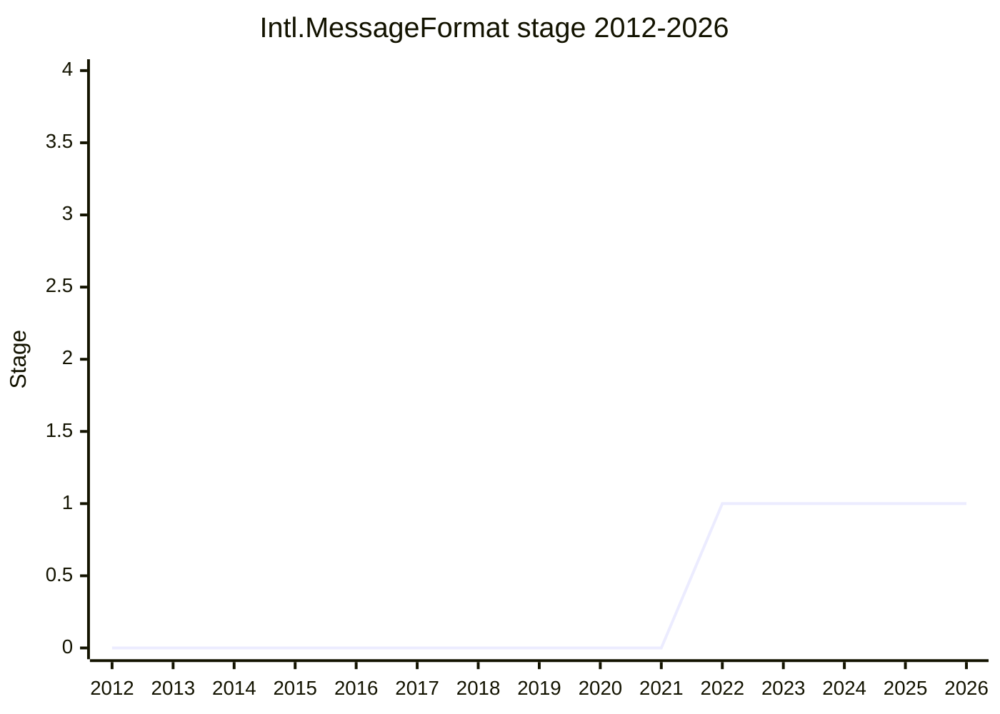

## Overview

Intl.MessageFormat would add a **localizable message formatter** to ECMA-402: one object that takes a message written by developers and translators, selects the right variant (plural, gender and so on), fills its placeholders through the existing Intl formatters, and returns a string or parts. Unlike every other Intl constructor, it is driven by **user-supplied data** (the message), not by locale data shipped with the engine. The message syntax and data model are not defined in TC39. They come from **Unicode MessageFormat 2 (MF2)**, which the Unicode MessageFormat Working Group (MFWG) under the CLDR-TC developed after TG2 handed the syntax question to Unicode in 2019. The API shape presented at TG2 [2024-01-18](https://github.com/tc39/ecma402/blob/main/meetings/notes-2024-01-18.md) looks roughly like this (the message is written in the later, final MF2 syntax):

```js
const source = `.input {$count :number}
.match $count
0   {{You have no new notifications}}
one {{You have {$count} new notification}}
*   {{You have {$count} new notifications}}`;

const mf = new Intl.MessageFormat(source, "en"); // (source, locales, options); argument order still debated
mf.format({ count: 42 });        // "You have 42 new notifications"
mf.formatToParts({ count: 42 }); // a placeholder part can itself carry NumberFormat parts
mf.format({}, (err) => log(err)); // onError: errors are reported, a fallback message is still returned
new Intl.MessageFormat(source, "en", { functions: { image } }); // custom functions next to :number, :datetime, ...
```

The idea is as old as ECMA-402. Message formatting was on the "International 2.0" (2nd edition) list at the 2012-11 plenary, and a 2013 strawman existed. The current proposal reached **Stage 1 at the 2022-03 plenary** and is still at Stage 1. In 2022 the bundle/resource part was split off as its own Stage 1 proposal, Intl.MessageResource. The proposal stalled in 2024. At the 2024-02 plenary, some delegates said they would not accept a new DSL (the MF2 syntax) in the language until it had years of real-world use. [EAO](../people/EAO.md) offered to drop the syntax and keep only the MF2 data model. The Google i18n delegates in TG2 ([SFC](../people/SFC.md), [FYT](../people/FYT.md)) opposed that, holding that without a syntax the proposal is not motivated. In 2024-08 TG2 then made a TC39-TG5 user study of MF2 a prerequisite for moving forward. MF2 itself became a CLDR-TC-approved "final candidate" in 2024-12, and the TG5 report came back favourable in 2025-03. Since then the remaining gate has been industry adoption and implementations (ICU4C in particular). As of the 2026-07 plenary (the latest in the notes), the proposal had not returned to plenary since 2024-06.

**Champions.** The canonical table lists [EAO](../people/EAO.md) alone. [EAO](../people/EAO.md) presented the 2022-03 Stage 1 request as "championed by me and by Dan Minor", and TG2 2022-01-13 lists "ECMA-402 Champions ([EAO](../people/EAO.md), [DLM](../people/DLM.md))", so [DLM](../people/DLM.md) is kept as a historical co-champion. At TG2 [2024-03-28](https://github.com/tc39/ecma402/blob/main/meetings/notes-2024-03-28.md) [EAO](../people/EAO.md) announced "I am stepping back as a champion of these proposals". At the [2024-04](https://github.com/tc39/notes/blob/main/meetings/2024-04/april-10.md) plenary [USA](../people/USA.md) offered to take over. [EAO](../people/EAO.md) asked [USA](../people/USA.md) instead to join "as a fellow champion, if I don’t step down", and the conclusion records "[USA](../people/USA.md) joined the proposal as co-champion in order to assist [EAO](../people/EAO.md)". [EAO](../people/EAO.md) has kept working on the proposal and on MF2, and has chaired the MFWG since 2025-07, so this page treats [EAO](../people/EAO.md), [DLM](../people/DLM.md) and [USA](../people/USA.md) as champions. [SFC](../people/SFC.md) presented the 2024-06 plenary item as "by default sort of a champion now" but is not recorded as a champion. [RCA](../people/RCA.md) organised the original MFWG in 2019-2020 and gave its TG2 updates until Addison Phillips became its chair (TG2 2023-01-12), but was never a champion of the TC39 proposal.

## Stage history

| Meeting                                                                              | Venue   | Event                                                                                                                                                                                                                                                                                                                                                          | Stage |
| ------------------------------------------------------------------------------------ | ------- | -------------------------------------------------------------------------------------------------------------------------------------------------------------------------------------------------------------------------------------------------------------------------------------------------------------------------------------------------------------- | ----- |
| [2012-11](https://github.com/tc39/notes/blob/main/meetings/2012-11/nov-27.md)        | plenary | "International 2.0" planning lists "Message Formatting, including gender and plural handling" as a high-priority item; a `globalization:messageformatting` strawman follows ([2013-01](https://github.com/tc39/notes/blob/main/meetings/2013-01/jan-29.md))                                                                                                    | 0     |
| [2018-08-16](https://github.com/tc39/ecma402/blob/main/meetings/notes-2018-08-16.md) | TG2     | "MessageFormat (and Romulo's effort)": [ZB](../people/ZB.md) would be "reluctant to choose" ICU MessageFormat, presents Fluent, and reports interest in "MessageFormat 2.0" at Unicode                                                                                                                                                                         | 0     |
| [2019-06-13](https://github.com/tc39/ecma402/blob/main/meetings/notes-2019-06-13.md) | TG2     | [RCA](../people/RCA.md) surveys i18next, messageformat, Fluent, FBT and goog.i18n. [ZB](../people/ZB.md): "start by engaging with Unicode Project on the proposal for MessageFormat 2.0"; [DE](../people/DE.md) suggests a separate sub-committee                                                                                                              | 0     |
| [2019-11-14](https://github.com/tc39/ecma402/blob/main/meetings/notes-2019-11-14.md) | TG2     | After a series of 1:1 stakeholder meetings, [RCA](../people/RCA.md) calls the first MessageFormat Working Group meeting for 25 November                                                                                                                                                                                                                        | 0     |
| [2020-02](https://github.com/tc39/notes/blob/main/meetings/2020-02/february-4.md)    | plenary | ECMA-402 update: [SFC](../people/SFC.md) notes that the MFWG "is formalized under the Unicode Consortium, not TC39"                                                                                                                                                                                                                                            | 0     |
| [2022-02-10](https://github.com/tc39/ecma402/blob/main/meetings/notes-2022-02-10.md) | TG2     | [EAO](../people/EAO.md) presents "Intl.MessageFormat for Stage 1" (`MessageFormat` and `MessageResource` classes); [SFC](../people/SFC.md) asks about primordial count and mutability. "We have consensus for Stage 1 and add this for upcoming TC39 meetings"                                                                                                 | 0     |
| [2022-03](https://github.com/tc39/notes/blob/main/meetings/2022-03/mar-30.md)        | plenary | Reached Stage 1. `Intl.MessageFormat for Stage 1` ([EAO](../people/EAO.md), "championed by me and by Dan Minor"). [CM](../people/CM.md) objects to the word "message"; [KG](../people/KG.md) wants the case for "in the language" made before Stage 2. "Stage 1"                                                                                               | 0 → 1 |
| [2022-09-01](https://github.com/tc39/ecma402/blob/main/meetings/notes-2022-09-01.md) | TG2     | Since the MF2 spec covers single messages only, [SFC](../people/SFC.md) proposes splitting the proposal "into two distinct stage 1 proposals"                                                                                                                                                                                                                  | 1     |
| [2022-10-06](https://github.com/tc39/ecma402/blob/main/meetings/notes-2022-10-06.md) | TG2     | "Leave out MessageFormat.parseResource() from this proposal" ([PR #16](https://github.com/tc39/proposal-intl-messageformat/pull/16)): "Approved message resources for Stage 1, split from the main proposal". The MF2 tech preview has landed for ICU 72                                                                                                       | 1     |
| [2022-11](https://github.com/tc39/notes/blob/main/meetings/2022-11/nov-29.md)        | plenary | `Intl MessageResource for Stage 1`: "Stage 1 for MessageResource". Intl.MessageFormat now covers a single message. [KG](../people/KG.md) calls the split "a little bit premature"                                                                                                                                                                              | 1     |
| [2023-09-07](https://github.com/tc39/ecma402/blob/main/meetings/notes-2023-09-07.md) | TG2     | Stage 1 update on the refactored API ([PR #22](https://github.com/tc39/proposal-intl-messageformat/pull/22)): `format()`/`formatToParts()`, nested parts, compound values, warn-not-throw errors. [SFC](../people/SFC.md) calls for an incubator call                                                                                                          | 1     |
| [2023-09](https://github.com/tc39/notes/blob/main/meetings/2023-09/september-26.md)  | plenary | `Intl.MessageFormat: Stage 1 update and discussion`: "General approval for the proposal’s progress."; API details to an incubator call                                                                                                                                                                                                                         | 1     |
| [2024-01-18](https://github.com/tc39/ecma402/blob/main/meetings/notes-2024-01-18.md) | TG2     | "Intl.MessageFormat for Stage 2?": spec text nearly complete, MF2 at feature freeze, but TC39 members object to a new DSL. [EAO](../people/EAO.md) floats leaving out the syntax; [SFC](../people/SFC.md), [DLM](../people/DLM.md) and [USA](../people/USA.md) advise a plenary update rather than a Stage 2 request                                           | 1     |
| [2024-02](https://github.com/tc39/notes/blob/main/meetings/2024-02/feb-6.md)         | plenary | `Intl.MessageFormat: I have some questions`: when can a MF2 parser be in JavaScript, once the spec is final (A) or after years of use (B)? [DE](../people/DE.md), [CP](../people/CP.md), [SFC](../people/SFC.md), [ZB](../people/ZB.md) and [USA](../people/USA.md) argue for A; [MF](../people/MF.md) and [KG](../people/KG.md) for B                         | 1     |
| [2024-02](https://github.com/tc39/notes/blob/main/meetings/2024-02/feb-7.md)         | plenary | Continuation: a data-model-only proposal. [KG](../people/KG.md) and [MF](../people/MF.md) could accept it for Stage 2; [EAO](../people/EAO.md) defers to TG2. Conclusion: a future "presentation on Intl.MessageFormat for Stage 2, leaving out the parser", and TC39 "encourages continued development, prototyping and deployment of MessageFormat 2 syntax" | 1     |
| [2024-02-22](https://github.com/tc39/ecma402/blob/main/meetings/notes-2024-02-22.md) | TG2     | "MessageFormat: Drop string source support #47" ([PR #47](https://github.com/tc39/proposal-intl-messageformat/pull/47)): [SFC](../people/SFC.md) and [FYT](../people/FYT.md) doubt the motivation without syntax; no conclusion, team positions requested                                                                                                      | 1     |
| [2024-03-28](https://github.com/tc39/ecma402/blob/main/meetings/notes-2024-03-28.md) | TG2     | PR #47 again: [SFC](../people/SFC.md) gives the Google i18n position against a data-model-only proposal ("trouble supporting advancement to stage 2"). [EAO](../people/EAO.md): "I am stepping back as a champion of these proposals"                                                                                                                          | 1     |
| [2024-04](https://github.com/tc39/notes/blob/main/meetings/2024-04/april-10.md)      | plenary | `Intl.MessageFormat status update` ([issue #49](https://github.com/tc39/proposal-intl-messageformat/issues/49)): "This proposal is stuck." Conclusion: "The proposal has hit some blockers"; "[USA](../people/USA.md) joined the proposal as co-champion in order to assist [EAO](../people/EAO.md)."                                                          | 1     |
| [2024-04-25](https://github.com/tc39/ecma402/blob/main/meetings/notes-2024-04-25.md) | TG2     | MF2 tech preview is live as UTS 35 section 9 (CLDR 45). [SFC](../people/SFC.md) suggests approaching TC39-TG5 about MessageFormat                                                                                                                                                                                                                              | 1     |
| [2024-06](https://github.com/tc39/notes/blob/main/meetings/2024-06/june-11.md)       | plenary | `Intl.MessageFormat Stage 1 open question involving error handling design patterns` ([SFC](../people/SFC.md)): option 2 (throwing) rejected, new options 4-6 to the champion group. The TG5 report at the same meeting notes a planned user study on MF2                                                                                                       | 1     |
| [2024-08-22](https://github.com/tc39/ecma402/blob/main/meetings/notes-2024-08-22.md) | TG2     | "Recommendation about TG5 study and MessageFormat 2.0" ([tg5#3](https://github.com/tc39/tg5/issues/3)): TG2 "requires that a TG5 study be complete before moving forward on the Intl.MessageFormat proposal"                                                                                                                                                   | 1     |
| [2024-12-19](https://github.com/tc39/ecma402/blob/main/meetings/notes-2024-12-19.md) | TG2     | MF2 "is officially at "final candidate" status, in that it has been approved by CLDR TC", to land in CLDR 47 as final                                                                                                                                                                                                                                          | 1     |
| [2025-03-06](https://github.com/tc39/ecma402/blob/main/meetings/notes-2025-03-06.md) | TG2     | TG5 researchers (UC San Diego) present their report; [SFC](../people/SFC.md): "This report certainly gives me more confidence." [USA](../people/USA.md) reports adoption prototypes and suggests presenting to committee again                                                                                                                                 | 1     |
| [2026-04-16](https://github.com/tc39/ecma402/blob/main/meetings/notes-2026-04-16.md) | TG2     | ICU4C implementation still blocked on review. [SFC](../people/SFC.md): "Cannot have adoption before implementations"; plenary return possible in July or September once there is a cohesive story                                                                                                                                                              | 1     |



> How to read: Stage 1 came at the 2022-03 plenary (`mar-30.md`), and nothing has changed since. TG2's "consensus for Stage 1" (2022-02-10) was a recommendation, not the transition. The 2022-11 plenary (`nov-29.md`) gave Stage 1 to the split-off Intl.MessageResource and left this proposal's stage unchanged. No Stage 2 request was ever made. [EAO](../people/EAO.md) planned one for 2024-02, turned it into a discussion, and at the end of the feb-7 slot chose not to ask for Stage 2 with only the data model. The canonical table's six plenary anchors (2022-03, 2023-09, two in 2024-02, 2024-04, 2024-06) are all Stage 1 items. Before 2022 the work happened in TG2 and in the Unicode MFWG, not in a TC39 proposal.

## Main issues

### Which message syntax: ICU MessageFormat, Fluent, or a new MessageFormat 2

When TG2 revived the topic, the problem was that no existing format was acceptable. At [2018-08-16](https://github.com/tc39/ecma402/blob/main/meetings/notes-2018-08-16.md) [ZB](../people/ZB.md) put it plainly:

> [ZB](../people/ZB.md): Update on where we are with this. There is only a single format that we'd consider at all, which is MessageFormat (ICU). Based on our experience at Mozilla, we'd be reluctant to choose that.

[ZB](../people/ZB.md) presented Mozilla's Fluent instead. At [2019-06-13](https://github.com/tc39/ecma402/blob/main/meetings/notes-2019-06-13.md) [RCA](../people/RCA.md) (written `RC` in the notes) surveyed i18next, messageformat, Fluent, FBT and goog.i18n. [EAO](../people/EAO.md), at the time maintainer of the `messageformat` library (written `EA` in the notes), said "I think it would be a mistake for Intl.MessageFormat to implement ICU MessageFormat", but also found Fluent "not ready for use yet as an Intl specification". `MN` proposed focusing on the data model first, and [ZB](../people/ZB.md), [RCA](../people/RCA.md) and [DE](../people/DE.md) agreed. [FYT](../people/FYT.md) (written `FT`) proposed picking a champion. [ZB](../people/ZB.md)'s counter-proposal won: "start by engaging with Unicode Project on the proposal for MessageFormat 2.0 and cooperate on that together." [RCA](../people/RCA.md) held 1:1 meetings with stakeholders through the autumn and called the first MFWG meeting for 2019-11-25 (TG2 [2019-11-14](https://github.com/tc39/ecma402/blob/main/meetings/notes-2019-11-14.md)). By the [2020-02](https://github.com/tc39/notes/blob/main/meetings/2020-02/february-4.md) plenary the group sat under the Unicode Consortium.

From then on TG2's standing "MessageFormat Working Group" item tracked MF2, and the data model took most of 2021. In 2021 two competing models remained, one by Mihai Niță and one by [EAO](../people/EAO.md) (TG2 [2021-07-01](https://github.com/tc39/ecma402/blob/main/meetings/notes-2021-07-01.md)). A "middle-ground data model" followed ([2021-09-09](https://github.com/tc39/ecma402/blob/main/meetings/notes-2021-09-09.md)), and the syntax debate ran through 2022. The tech preview landed in ICU 72 in 2022-10. As a result, the message language itself was designed outside TC39. At the 2024-02 plenary [SFC](../people/SFC.md) argued that the syntax "is largely built for ECMA", while delegates outside TG2 treated MF2 as an external, unproven DSL.

### Library or language?

[KG](../people/KG.md) set the bar at the Stage 1 plenary ([2022-03](https://github.com/tc39/notes/blob/main/meetings/2022-03/mar-30.md)):

> [KG](../people/KG.md): Yeah, I'm fine with this going to stage 1, but before going to stage two, I would like it to be made more clear why it is important that this be in the language itself and cannot just be like a templating engine library.

[RCA](../people/RCA.md) answered with npm download counts for i18n libraries (around five million). [CM](../people/CM.md) raised a separate naming concern: "I'm very confused by the use of the word "message"", since a message elsewhere in programming is one computer talking to another. [EAO](../people/EAO.md) was open to renaming, and [USA](../people/USA.md) recalled the BreakIterator-to-Segmenter rename. [KG](../people/KG.md) repeated the point at the MessageResource Stage 1 request ([2022-11](https://github.com/tc39/notes/blob/main/meetings/2022-11/nov-29.md)): designs still being experimented with belong in libraries, because "when you are still experimenting, it can't be in the language and therefore has to be a library."

The same question returned inside TG2 once the syntax was in doubt. At TG2 [2024-01-18](https://github.com/tc39/ecma402/blob/main/meetings/notes-2024-01-18.md) [SFC](../people/SFC.md) listed the Stage 2 tests (hard to do in userland? wide impact? prior art?) and warned that "an API that takes an AST and interpolates stuff into a string" might not pass them. [EAO](../people/EAO.md)'s answers over 2024 were that a native parser needs no JavaScript download; that a common data model would unify a "quite fractured" ecosystem; that Intl.MessageFormat is a prerequisite for DOM/HTML localization work in W3C/WHATWG; and that about a third of web localization already depends on `intl-messageformat`, a polyfill of the 2013 version of this API ([2024-04](https://github.com/tc39/notes/blob/main/meetings/2024-04/april-10.md) plenary).

### Single messages vs. resources: the MessageResource split

As presented for Stage 1, the constructor took a whole **resource** of messages, and `format` addressed a message by path. A static `parseResource()` read a resource string. At TG2 [2022-03-17](https://github.com/tc39/ecma402/blob/main/meetings/notes-2022-03-17.md) [EAO](../people/EAO.md) warned that "The MessageFormat 2.0 spec may not include a message bundle spec". At [2022-09-01](https://github.com/tc39/ecma402/blob/main/meetings/notes-2022-09-01.md) [FYT](../people/FYT.md) asked whether the resource side was a dependency. [SFC](../people/SFC.md) suggested asking TG2 and then the November plenary "if we could split this proposal into two distinct stage 1 proposals". [EAO](../people/EAO.md) agreed: the current API only needed one function to unbundle, and the Unicode Consortium was "dragging on recognizing the message bundle working group". TG2 approved the split on [2022-10-06](https://github.com/tc39/ecma402/blob/main/meetings/notes-2022-10-06.md) ([PR #16](https://github.com/tc39/proposal-intl-messageformat/pull/16)), with [SFC](../people/SFC.md), [DLM](../people/DLM.md), [RCA](../people/RCA.md) and [YSZ](../people/YSZ.md) in support. Intl.MessageResource reached Stage 1 at the [2022-11](https://github.com/tc39/notes/blob/main/meetings/2022-11/nov-29.md) plenary. There [SFC](../people/SFC.md) asked whether TC39 is even the right body for a bundle file format, and [KG](../people/KG.md) did not object but saw no reason for follow-on proposals while the main proposal had no committed API shape. Bundles stayed outside Unicode. TG2 [2025-12-04](https://github.com/tc39/ecma402/blob/main/meetings/notes-2025-12-04.md) reports that the message resource work "has been picked up for incubation by the W3C i18n working group". [SFC](../people/SFC.md) still sees message resources as part of the "cohesive story" for plenary ([2026-04-16](https://github.com/tc39/ecma402/blob/main/meetings/notes-2026-04-16.md)).

### A new DSL in the language: how stable must MF2 be?

This became the blocking issue. When [EAO](../people/EAO.md) put a Stage 2 request on the 2024-02 agenda, some TC39 members replied that they were "not necessarily comfortable with us bringing in any more DSL to JavaScript until it is very very stable" (TG2 [2024-01-18](https://github.com/tc39/ecma402/blob/main/meetings/notes-2024-01-18.md)). TG2 turned the request into a question for plenary. At the [2024-02](https://github.com/tc39/notes/blob/main/meetings/2024-02/feb-6.md) plenary [EAO](../people/EAO.md) offered two options: accept a MF2 parser once the Unicode spec is final with a stability guarantee (A), or only after years of usage and external support (B). [DE](../people/DE.md), [CP](../people/CP.md) (Caridy Patiño, "one of the champions of these ten years ago"), [SFC](../people/SFC.md), [SBE](../people/SBE.md), [RCA](../people/RCA.md), [USA](../people/USA.md) and [ZB](../people/ZB.md) argued for A or near it. [MF](../people/MF.md) and [KG](../people/KG.md) argued for B:

> [MF](../people/MF.md): Yeah. I guess I’m the dissenting opinion here. The parsers that we add to JavaScript should be extremely time-tested, things that are effectively permanently relevant.

> [KG](../people/KG.md): So the idea of standardizing a DSL without it having been used in practice, in the field, is – I don’t like that idea. I would be much happier if there years of widespread usage experience before it was codified. At least in JavaScript, because we can’t ever change anything.

[SYG](../people/SYG.md) cited the 2023 NNBSP outage as reason to distrust CLDR's sense of stability. [ZB](../people/ZB.md) replied that MessageFormat binds existing formatters rather than depending on CLDR data, and called the alternative bleak: "It’s MessageFormat 2 or, honestly, status quo." [PFC](../people/PFC.md) asked whether 30-year-old gettext would satisfy the "field experience" camp. [KG](../people/KG.md) answered that gettext shows why a DSL must be proven first. Asked what would be enough, [KG](../people/KG.md) said "at least a few years with more than 3 companies using it", and [MF](../people/MF.md) agreed. [DE](../people/DE.md) pushed for criteria based on use rather than years. The feb-7 Speaker's Summary records the result:

> To standardize the syntax of a DSL, it would be meaningful/persuasive to see around a dozen organizations of various sizes, including ones which were not involved in MF2 development, make significant use in production of MF2 syntax across their stack (engaging application developers, translators, infrastructure developers, …). This will likely be required for Stage 2.7. It remains to be defined whether an intermediate, lower amount of experience would be sufficient for Stage 2.

At the [2024-04](https://github.com/tc39/notes/blob/main/meetings/2024-04/april-10.md) plenary [EAO](../people/EAO.md) quoted this bar and saw the next step as having moved "across the wider industry of localization". [DE](../people/DE.md) and [SFC](../people/SFC.md) objected to the word "impasse" in the conclusion, and [DE](../people/DE.md) said "It’s just not a statement of fact to say that it’s at an impasse." [DE](../people/DE.md) also said the agreed bar was "some experience", not adoption by "every major enterprise". [SFC](../people/SFC.md) thought Stage 2 parameters with syntax could be worked out "within 2024". The final conclusion speaks of "blockers" and of improving "adoption and gain experience for the syntax". At TG2 [2024-11-25](https://github.com/tc39/ecma402/blob/main/meetings/notes-2024-11-25.md) [SFC](../people/SFC.md) reported talking with [MF](../people/MF.md) and [KG](../people/KG.md), the most hesitant TG1 delegates. They were aligned with the early-adopter plan, and [MF](../people/MF.md) had said that once the proposal reaches Stage 2 "there will be a low bar to get to stage 3".

### Dropping the string syntax: a data-model-only proposal (PR #47)

[EAO](../people/EAO.md)'s way out was to drop the parser and accept messages only as the MF2 **data model** (a JSON-representable `MessageData` structure). This needed only a small spec change ([PR #47](https://github.com/tc39/proposal-intl-messageformat/pull/47), "about 5 or 10 lines"). At the [2024-02](https://github.com/tc39/notes/blob/main/meetings/2024-02/feb-7.md) continuation, the plenary critics accepted it:

> [KG](../people/KG.md): I would certainly be less concerned with going to Stage 2 with just the API portions of it. Most of my concerns are about the DSL specifically.

[MF](../people/MF.md) agreed for Stage 2, and [SYG](../people/SYG.md) confirmed in chat that there was no objection. [NRO](../people/NRO.md) asked how much is left once the parser is gone. [SFC](../people/SFC.md) asked to review it in TG2 first, so [EAO](../people/EAO.md) did not ask for Stage 2. TG2 then rejected the idea. At [2024-02-22](https://github.com/tc39/ecma402/blob/main/meetings/notes-2024-02-22.md) [SFC](../people/SFC.md) held that a proposal must be motivated "if we never add anything again", and argued that the data model is no more proven than the syntax. [FYT](../people/FYT.md) predicted that users who need a serialized form would invent one (JSON in a database), so that a syntax added later would face competitors: "You’re essentially creating a competitor for yourself." [USA](../people/USA.md) and [RGN](../people/RGN.md) were more sympathetic. [RGN](../people/RGN.md) noted the data model is close to the one implied by ICU MessageFormat. At [2024-03-28](https://github.com/tc39/ecma402/blob/main/meetings/notes-2024-03-28.md) [EAO](../people/EAO.md) brought Mozilla's view that the already fractured ecosystem would not get worse. [SFC](../people/SFC.md) answered with the Google i18n position in five points: the syntax is the MFWG's primary deliverable; the proposal is only useful with a serialized form; a JSON form is too verbose to author; turning the data model into a string is too easy to meet the ECMA-402 bar; and the data model was still changing in tech preview.

> [SFC](../people/SFC.md): None of these positions are written in stone, but we nevertheless have trouble supporting advancement to stage 2 without addressing these concerns.

[USA](../people/USA.md) suggested a separate parser proposal. [EAO](../people/EAO.md) had planned exactly that, but saw no path: "A most significant meta-point here is that I am stepping back as a champion of these proposals." [SFC](../people/SFC.md) suggested keeping it at Stage 1 on the backburner, or saying "I’m no longer a champion of this proposal" while recording that it reached Stage 1. At the [2024-04](https://github.com/tc39/notes/blob/main/meetings/2024-04/april-10.md) plenary [EAO](../people/EAO.md) explained that "the Google internationalization group" had concerns about removing the parser, so the proposal "needs syntax parsing in order to proceed at all". [USA](../people/USA.md) joined as co-champion, and [SFC](../people/SFC.md) said that someone from Google might also join "later in the year". TG2 restated the position on 2024-08-22: "MessageFormat should include a syntax, and is not motivated without a syntax".

### Gating on MF2 maturity and the TG5 user study

From the start, TG2 tied Intl.MessageFormat to MF2's progress. In 2023-09 [EAO](../people/EAO.md) told the plenary that the proposal is "intended to be blocked on" MF2's release. At TG2 [2024-01-18](https://github.com/tc39/ecma402/blob/main/meetings/notes-2024-01-18.md) [SFC](../people/SFC.md) said "the ECMAScript stage 2 should be gated on the Unicode proposal being stage 3 (or stage 3 equivalent)". After the 2024-02 plenary, TG2 turned to evidence. Once MF2 entered tech preview (UTS 35 section 9, CLDR 45; TG2 [2024-04-25](https://github.com/tc39/ecma402/blob/main/meetings/notes-2024-04-25.md)), [SFC](../people/SFC.md) proposed involving TC39-TG5, the experimentation task group. TG5 reported a planned MF2 user study at the [2024-06](https://github.com/tc39/notes/blob/main/meetings/2024-06/june-11.md) plenary. At TG2 [2024-08-22](https://github.com/tc39/ecma402/blob/main/meetings/notes-2024-08-22.md) [EAO](../people/EAO.md) asked whether MF2 should leave tech preview that autumn, given "relatively little feedback from implementers or localizers who weren’t previously engaged". [SFC](../people/SFC.md) answered: "I see the TG5 study as prerequisite for Intl.MessageFormat, but also v2". TG2 adopted a formal recommendation (LGTM: [SFC](../people/SFC.md), [ECH](../people/ECH.md), [YSZ](../people/YSZ.md), [EAO](../people/EAO.md), [FYT](../people/FYT.md)):

> - TG39-TG2 requires that a TG5 study be complete before moving forward on the Intl.MessageFormat proposal. The study's scope should determine what shape of Intl.MessageFormat API and syntax delivers the most value to Web developers.
> - Because Intl.MessageFormat depends on Unicode MessageFormat 2.0, TC39-TG2 recommends that the TG5 study be completed and feedback from the study integrated into Unicode MessageFormat 2.0 before that specification graduates from tech preview.

The second half was not met. CLDR leadership wanted 2.0 out within 2024 (TG2 [2024-09-26](https://github.com/tc39/ecma402/blob/main/meetings/notes-2024-09-26.md), where [SFC](../people/SFC.md) called that timeline "not realistic"). The MFWG relaxed its stability policy so that later 2.x versions can change syntax, and at [2024-11-25](https://github.com/tc39/ecma402/blob/main/meetings/notes-2024-11-25.md) [SFC](../people/SFC.md) concluded "the user study cannot reshape, but can make changes at the edges." The study was run at UC San Diego (Michael Coblenz, per the 2024-11-25 notes) and was presented at a TG5 workshop in Seattle alongside the [2025-02](https://github.com/tc39/notes/blob/main/meetings/2025-02/february-18.md) plenary. At TG2 [2025-03-06](https://github.com/tc39/ecma402/blob/main/meetings/notes-2025-03-06.md) [SFC](../people/SFC.md) reported that "MessageFormat is achieving its job", with some counterintuitive points, and that "This report certainly gives me more confidence." [USA](../people/USA.md) described React and Next.js prototypes at Bloomberg and XLIFF integration, and suggested taking the proposal back to committee once CLDR publishes.

MF2 milestones as reported at TG2: ICU 72 tech preview (2022-10/11); feature freeze (2024-01-18); tech preview in CLDR 45 (2024-04-25) and an update in CLDR 46 (2024-09-26); "final candidate" approved by the CLDR-TC (2024-12-19); CLDR 47.1 with some parts "proposed" rather than "stable" (2025-03-06); the CLDR 48 version approved (2025-09-11); the CLDR 49 version recommended (2026-01-08). [EAO](../people/EAO.md) became MFWG chair after Addison Phillips stepped back (2025-07-17, official by 2025-08-14). Adoption is now the open gate. At [2026-04-16](https://github.com/tc39/ecma402/blob/main/meetings/notes-2026-04-16.md) [EAO](../people/EAO.md) said:

> [EAO](../people/EAO.md): The ask was to show industry adoption outside the working group itself, which continues to be a source of challenge.

The ICU4C implementation was waiting for review. [SFC](../people/SFC.md) wanted ICU4C, ICU4X, the Angular and React implementations and progress on message resources in place before going back to plenary, with July or September 2026 as possible targets. The TG2 MFWG updates in 2026-05 to 2026-09 report little activity, and the 2026-07 plenary has no Intl.MessageFormat item.

### Error handling: the `onError` callback and its alternatives

MF2 requires that formatting always produce some representation of a message, with errors reported separately. The MFWG merged this in early 2023 (TG2 [2023-02-09](https://github.com/tc39/ecma402/blob/main/meetings/notes-2023-02-09.md)). The proposal therefore warns by default and offers an `onError` callback on `format()`/`formatToParts()`. [EAO](../people/EAO.md) defended this at the [2023-09](https://github.com/tc39/notes/blob/main/meetings/2023-09/september-26.md) plenary, because unlike other formatters "this is depending on user data" that passes through translators, so a missing translation should not break a whole UI. [JHD](../people/JHD.md) suggested returning the errors with the result instead, [DE](../people/DE.md) "would have expected it would just throw", and [LCA](../people/LCA.md) hoped for an alternative that does not involve a synchronous callback. At TG2 [2024-05-23](https://github.com/tc39/ecma402/blob/main/meetings/notes-2024-05-23.md) ([issue #58](https://github.com/tc39/proposal-intl-messageformat/issues/58), "Please remove onError parameter") [EAO](../people/EAO.md) cited the clunky tuple return of Fluent's JavaScript API. [SFC](../people/SFC.md) suggested exceptions or an upgraded `FormattedMessage` return value instead, and took the question to plenary.

At the [2024-06](https://github.com/tc39/notes/blob/main/meetings/2024-06/june-11.md) plenary [SFC](../people/SFC.md) set out three options: (1) the callback, (2) a thrown error carrying the fallback, and (3) an expressive return value. [DLM](../people/DLM.md) said "my strongest preference is against the throwing". [JWS](../people/JWS.md), [ACE](../people/ACE.md) and [EAO](../people/EAO.md) preferred option 1, and [USA](../people/USA.md) option 1 or 3. [RGN](../people/RGN.md) objected that a callback "is just unnecessarily confusing with respect to control flow" (reentrancy) and proposed separate throwing and fallback functions. [PST](../people/PST.md) and [JGT](../people/JGT.md) proposed a constructor option. [EAO](../people/EAO.md) and [USA](../people/USA.md) argued against it, since many errors only arise while formatting. The conclusion:

> - Potential concern about reentrancy in option 1
> - Agreement that option 2 is undesirable to most delegates
> - No strong objection to option 3, but majority of delegates prefer something else
> - New options 4, 5, and 6 were added which will be considered by the champion group

The matter went back to the MFWG, which held a ballot in 2024-07 on how strictly fallback and error reporting should be required (TG2 [2024-07-18](https://github.com/tc39/ecma402/blob/main/meetings/notes-2024-07-18.md)). The notes record no TC39 decision after that.

### API shape: constructor, parts, compound values and custom functions

Several design points stayed open at Stage 1:

- **Primordials and mutability.** At TG2 [2022-02-10](https://github.com/tc39/ecma402/blob/main/meetings/notes-2022-02-10.md) [SFC](../people/SFC.md) worried about the number of new classes and asked why the resource should be mutable. [EAO](../people/EAO.md) cited Firefox's experience of adding resources at run time. The 2023 refactor ([PR #22](https://github.com/tc39/proposal-intl-messageformat/pull/22)) dropped the resource and replaced `resolveMessage()` with ordinary `format()`/`formatToParts()`. TG1 had wanted the API to be "more normal, more aligned with the format and formatToParts methods in other Intl objects" (TG2 2024-05-23).
- **Constructor arguments.** `source` comes first because it is required, unlike `locales`. [FYT](../people/FYT.md) wanted consistency with other constructors (TG2 [2023-09-07](https://github.com/tc39/ecma402/blob/main/meetings/notes-2023-09-07.md)), and [SFC](../people/SFC.md) and others suggested `locales, source, options` (TG2 2024-01-18). The notes record no decision.
- **Nested parts.** `formatToParts()` returns parts that may have their own `parts` (a placeholder's NumberFormat parts) and non-string values (a DOM element from a custom function). [RGN](../people/RGN.md) pointed to `formatRangeToParts`, which stays flat and uses a `source` property (TG2 2023-09-07). The MFWG did not standardise a parts structure, so it is defined in this proposal only (TG2 [2023-12-14](https://github.com/tc39/ecma402/blob/main/meetings/notes-2023-12-14.md), [2024-04-25](https://github.com/tc39/ecma402/blob/main/meetings/notes-2024-04-25.md)).
- **Compound values.** A number with its currency must stay together, so that a translator cannot turn "42 Euros" into 42 Yen. The proposal reads such values through `valueOf()` plus an `options` property (2023-09 plenary). That put it at odds with [KG](../people/KG.md)'s "Stop Coercing Things" direction. [EAO](../people/EAO.md) asked there for an exception for wrapped primitives ([2023-09](https://github.com/tc39/notes/blob/main/meetings/2023-09/september-28.md), [2023-11](https://github.com/tc39/notes/blob/main/meetings/2023-11/november-29.md)). MF2 later left compound-value options out of its required set (TG2 2024-02-22). [EAO](../people/EAO.md) has since treated a value-with-unit type as the fix. At the [2025-02](https://github.com/tc39/notes/blob/main/meetings/2025-02/february-19.md) plenary [EAO](../people/EAO.md) said "something like measure or amount unblocks a lot of the issues for Intl messageformat", and MessageFormat is a standing motivation for [Amount](amount.md) and [Intl Unit Protocol](intl-unit-protocol.md).
- **Custom functions.** [DE](../people/DE.md) was "a little bit worried about the overall size of the custom formatter’s API" (2023-09 plenary). At TG2 [2024-07-18](https://github.com/tc39/ecma402/blob/main/meetings/notes-2024-07-18.md) ([issue #54](https://github.com/tc39/proposal-intl-messageformat/issues/54)) [EAO](../people/EAO.md) proposed exposing the built-in functions as statics (`MessageFormat.number`, ...) instead of through `resolvedOptions().functions`. [FYT](../people/FYT.md) agreed with statics and did not want `resolvedOptions()` to return functions. [SFC](../people/SFC.md) noted that `resolvedOptions()` has so far returned only primitives, and [EAO](../people/EAO.md) offered to drop `resolvedOptions()` altogether.

### MF2 functions diverging from ECMA-402 options

MF2's built-in functions (`:number`, `:integer`, `:datetime`, ...) wrap the Intl formatters, but their options have drifted from ECMA-402's. In 2023-02 [EAO](../people/EAO.md) and [USA](../people/USA.md) chose options bags over ICU skeleton strings. MF2 then used one `select` option (`exact`/`plural`/`ordinal`) where `Intl.PluralRules` has `type` (TG2 [2024-08-22](https://github.com/tc39/ecma402/blob/main/meetings/notes-2024-08-22.md)). It added `:currency`, a `:unit` with a `usage` option for locale-specific conversion, and `:math` in place of ICU's plural offset (TG2 [2024-11-25](https://github.com/tc39/ecma402/blob/main/meetings/notes-2024-11-25.md)). Date/time options moved toward ICU4X-style semantic skeletons at [SFC](../people/SFC.md)'s suggestion (TG2 [2025-05-08](https://github.com/tc39/ecma402/blob/main/meetings/notes-2025-05-08.md)), and percent formatting got its own function. At TG2 [2025-07-17](https://github.com/tc39/ecma402/blob/main/meetings/notes-2025-07-17.md) [EAO](../people/EAO.md) said that "functions in MF will continue to diverge from functions in JS Intl space", although MF2 as a whole would remain a subset of what the JS formatters enable. [SFC](../people/SFC.md) called it "a good departure", but one that needs glue code above `Intl.DateTimeFormat` (2025-05-08). In 2026-07 the gap prompted a separate Stage 1 proposal by [EAO](../people/EAO.md), Intl.DateTimeFormat Alignment With Other Standards. It aims for the same date/time options in HTML, JavaScript and Unicode MessageFormat, for example a `dateLength` alias.

## Related proposals

- `intl-messageresource` (Intl.MessageResource, Stage 1 at the 2022-11 plenary, [EAO](../people/EAO.md)): the resource/bundle part split off from this proposal in 2022. The underlying format work moved to the W3C i18n WG in 2025.
- [Amount](amount.md): [EAO](../people/EAO.md) and [SFC](../people/SFC.md) cite MessageFormat's need to keep a number together with its currency or unit as a core motivation.
- [Intl Unit Protocol](intl-unit-protocol.md): lets `Intl.NumberFormat` take a number and its unit together. MessageFormat is the motivating example.
- [Smart Unit Preferences](smart-unit-preferences.md): MF2's `:unit` `usage` option offers locale- and value-specific unit conversion that `Intl.NumberFormat` does not have.
- `intl-datetime-alignment` (Intl.DateTimeFormat Alignment With Other Standards, Stage 1 at the 2026-07 plenary, [EAO](../people/EAO.md)): aligns DateTimeFormat options with HTML and Unicode MessageFormat.
- [Stable Formatting](stable-formatting.md): [EAO](../people/EAO.md)'s other 2023 proposal. The two were chartered for incubator calls together at the 2023-09 plenary.

## Sources

TG2:

- https://github.com/tc39/ecma402/blob/main/meetings/notes-2018-08-16.md
- https://github.com/tc39/ecma402/blob/main/meetings/notes-2019-06-13.md
- https://github.com/tc39/ecma402/blob/main/meetings/notes-2019-11-14.md
- https://github.com/tc39/ecma402/blob/main/meetings/notes-2022-01-13.md
- https://github.com/tc39/ecma402/blob/main/meetings/notes-2022-02-10.md
- https://github.com/tc39/ecma402/blob/main/meetings/notes-2021-07-01.md
- https://github.com/tc39/ecma402/blob/main/meetings/notes-2021-09-09.md
- https://github.com/tc39/ecma402/blob/main/meetings/notes-2022-03-17.md
- https://github.com/tc39/ecma402/blob/main/meetings/notes-2022-09-01.md
- https://github.com/tc39/ecma402/blob/main/meetings/notes-2022-10-06.md
- https://github.com/tc39/ecma402/blob/main/meetings/notes-2022-11-03.md
- https://github.com/tc39/ecma402/blob/main/meetings/notes-2023-01-12.md
- https://github.com/tc39/ecma402/blob/main/meetings/notes-2023-02-09.md
- https://github.com/tc39/ecma402/blob/main/meetings/notes-2023-09-07.md
- https://github.com/tc39/ecma402/blob/main/meetings/notes-2023-10-12.md
- https://github.com/tc39/ecma402/blob/main/meetings/notes-2023-12-14.md
- https://github.com/tc39/ecma402/blob/main/meetings/notes-2024-01-18.md
- https://github.com/tc39/ecma402/blob/main/meetings/notes-2024-02-22.md
- https://github.com/tc39/ecma402/blob/main/meetings/notes-2024-03-28.md
- https://github.com/tc39/ecma402/blob/main/meetings/notes-2024-04-25.md
- https://github.com/tc39/ecma402/blob/main/meetings/notes-2024-05-23.md
- https://github.com/tc39/ecma402/blob/main/meetings/notes-2024-07-18.md
- https://github.com/tc39/ecma402/blob/main/meetings/notes-2024-08-22.md
- https://github.com/tc39/ecma402/blob/main/meetings/notes-2024-09-26.md
- https://github.com/tc39/ecma402/blob/main/meetings/notes-2024-11-25.md
- https://github.com/tc39/ecma402/blob/main/meetings/notes-2024-12-19.md
- https://github.com/tc39/ecma402/blob/main/meetings/notes-2025-03-06.md
- https://github.com/tc39/ecma402/blob/main/meetings/notes-2025-05-08.md
- https://github.com/tc39/ecma402/blob/main/meetings/notes-2025-07-17.md
- https://github.com/tc39/ecma402/blob/main/meetings/notes-2025-08-14.md
- https://github.com/tc39/ecma402/blob/main/meetings/notes-2025-09-11.md
- https://github.com/tc39/ecma402/blob/main/meetings/notes-2025-12-04.md
- https://github.com/tc39/ecma402/blob/main/meetings/notes-2026-01-08.md
- https://github.com/tc39/ecma402/blob/main/meetings/notes-2026-04-16.md
- https://github.com/tc39/ecma402/blob/main/meetings/notes-2026-09-17.md

Plenary:

- https://github.com/tc39/notes/blob/main/meetings/2012-11/nov-27.md
- https://github.com/tc39/notes/blob/main/meetings/2013-01/jan-29.md
- https://github.com/tc39/notes/blob/main/meetings/2020-02/february-4.md
- https://github.com/tc39/notes/blob/main/meetings/2022-03/mar-30.md
- https://github.com/tc39/notes/blob/main/meetings/2022-11/nov-29.md
- https://github.com/tc39/notes/blob/main/meetings/2023-09/september-26.md
- https://github.com/tc39/notes/blob/main/meetings/2023-09/september-28.md
- https://github.com/tc39/notes/blob/main/meetings/2023-11/november-29.md
- https://github.com/tc39/notes/blob/main/meetings/2024-02/feb-6.md
- https://github.com/tc39/notes/blob/main/meetings/2024-02/feb-7.md
- https://github.com/tc39/notes/blob/main/meetings/2024-04/april-10.md
- https://github.com/tc39/notes/blob/main/meetings/2024-06/june-11.md
- https://github.com/tc39/notes/blob/main/meetings/2025-02/february-18.md
- https://github.com/tc39/notes/blob/main/meetings/2025-02/february-19.md
- https://github.com/tc39/notes/blob/main/meetings/2026-07/july-22.md
