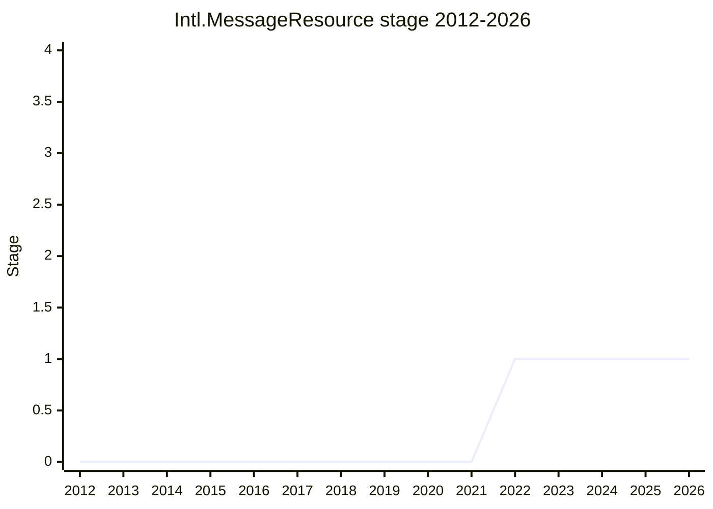

## Overview

Intl.MessageResource would let JavaScript parse a whole **resource** of localizable messages at once. A resource is a file-like collection of related messages, possibly hierarchical, with comments and metadata that developers attach for translators. It is the part of [Intl.MessageFormat](intl-messageformat.md) that handled more than one message. When Intl.MessageFormat reached Stage 1 at the 2022-03 plenary, its constructor took a resource and a static `parseResource()` read one from a string. In 2022 the Unicode MessageFormat 2 (MF2) work settled on a single-message specification, so the resource side was split off into this proposal. TG2 approved the split on 2022-10-06, and the proposal reached **Stage 1 at the 2022-11 plenary**. It has not been back to plenary since.

As presented at the [2022-11](https://github.com/tc39/notes/blob/main/meetings/2022-11/nov-29.md) plenary, the proposal keeps the static method that the split removed from Intl.MessageFormat. It takes the string form of a resource and returns a `Map`, possibly nested, whose leaves are `Intl.MessageFormat` instances, each built around a single message. The sketch below follows that description. The resource syntax itself (shown on the slides as "very toml-y", with JSDoc-like metadata comments) was explicitly work in progress, and the plenary was not asked to discuss it.

```js
// source: a resource string holding several messages (e.g. "arrive" and "depart")
// plus comments and metadata for translators, in a resource syntax still being designed
const resource = Intl.MessageFormat.parseResource(source); // Map, possibly nested
const arrive = resource.get("arrive"); // an Intl.MessageFormat for one message
// ...then resolve and format it with the single-message API of Intl.MessageFormat
```

**Champions.** The canonical table lists [EAO](../people/EAO.md) as author and champion. [EAO](../people/EAO.md) presented both the 2022-10-06 TG2 item and the 2022-11 plenary request. At TG2 [2024-03-28](https://github.com/tc39/ecma402/blob/main/meetings/notes-2024-03-28.md) [EAO](../people/EAO.md) said "I am stepping back as a champion of these proposals", which covered both message proposals. [USA](../people/USA.md) joined Intl.MessageFormat as co-champion at the [2024-04](https://github.com/tc39/notes/blob/main/meetings/2024-04/april-10.md) plenary, but nobody has been recorded as joining Intl.MessageResource, and the canonical table still lists [EAO](../people/EAO.md). The first repository was `eemeli/proposal-intl-message-resource` (cited at TG2 2022-10-06). It later moved to the tc39 org.

Since 2022 the resource format work has moved away from TC39. [EAO](../people/EAO.md) originally expected it to be defined under the Unicode Consortium. TG2 [2025-12-04](https://github.com/tc39/ecma402/blob/main/meetings/notes-2025-12-04.md) heard that it had been picked up for incubation by the W3C i18n working group. As of the latest TG2 notes (2026-10-08), the W3C i18n WG had cleared [EAO](../people/EAO.md) to create a repository for the message resource specification. In the TG2 notes so far, this work appears as part of the case for Intl.MessageFormat, not as a proposal being prepared for its own stage request.

## Stage history

| Meeting                                                                              | Venue   | Event                                                                                                                                                                                                                                                     | Stage |
| ------------------------------------------------------------------------------------ | ------- | --------------------------------------------------------------------------------------------------------------------------------------------------------------------------------------------------------------------------------------------------------- | ----- |
| [2022-02-10](https://github.com/tc39/ecma402/blob/main/meetings/notes-2022-02-10.md) | TG2     | "Intl.MessageFormat for Stage 1": [EAO](../people/EAO.md) lists `MessageFormat` and `MessageResource` as the proposal's two primordial classes. [SFC](../people/SFC.md) asks why the resource should be mutable                                           | 0     |
| [2022-03](https://github.com/tc39/notes/blob/main/meetings/2022-03/mar-30.md)        | plenary | Intl.MessageFormat reaches Stage 1 with a resource-based constructor and a resource parser. [EAO](../people/EAO.md) expects the first MF2 specification to "only define a single message syntax", with resource syntax specified separately under Unicode | 0     |
| [2022-03-17](https://github.com/tc39/ecma402/blob/main/meetings/notes-2022-03-17.md) | TG2     | [EAO](../people/EAO.md): "The MessageFormat 2.0 spec may not include a message bundle spec."                                                                                                                                                              | 0     |
| [2022-09-01](https://github.com/tc39/ecma402/blob/main/meetings/notes-2022-09-01.md) | TG2     | [FYT](../people/FYT.md) asks whether the resource side is a dependency. [SFC](../people/SFC.md) suggests asking TG2 and then the November plenary to "split this proposal into two distinct stage 1 proposals"                                            | 0     |
| [2022-10-06](https://github.com/tc39/ecma402/blob/main/meetings/notes-2022-10-06.md) | TG2     | "Leave out MessageFormat.parseResource() from this proposal" ([proposal-intl-messageformat#16](https://github.com/tc39/proposal-intl-messageformat/pull/16)). Conclusion: "Approved message resources for Stage 1, split from the main proposal"          | 0     |
| [2022-11](https://github.com/tc39/notes/blob/main/meetings/2022-11/nov-29.md)        | plenary | Reached Stage 1. `Intl MessageResource for Stage 1`. [SFC](../people/SFC.md) asks whether TC39 is the right body for the format. [KG](../people/KG.md) does not object but calls the split premature. "Stage 1 for MessageResource"                       | 0 → 1 |
| [2024-03-28](https://github.com/tc39/ecma402/blob/main/meetings/notes-2024-03-28.md) | TG2     | [EAO](../people/EAO.md): "I am stepping back as a champion of these proposals". [SFC](../people/SFC.md): MessageFormat must stand on its own without assuming a later message bundles proposal                                                            | 1     |
| [2025-12-04](https://github.com/tc39/ecma402/blob/main/meetings/notes-2025-12-04.md) | TG2     | The message resource specification work "has been picked up for incubation by the W3C i18n working group"                                                                                                                                                 | 1     |
| [2026-04-16](https://github.com/tc39/ecma402/blob/main/meetings/notes-2026-04-16.md) | TG2     | [SFC](../people/SFC.md) wants "some progress on Message Resources" before Intl.MessageFormat returns to plenary                                                                                                                                           | 1     |
| [2026-10-08](https://github.com/tc39/ecma402/blob/main/meetings/notes-2026-10-08.md) | TG2     | [EAO](../people/EAO.md) has clearance from the W3C i18n WG "to create a repo for the message resource specification". [SFC](../people/SFC.md): "I think W3C is a good home for things such as MessageBundles."                                            | 1     |



> How to read: Stage 1 came at the 2022-11 plenary (`nov-29.md`), and nothing has changed since. The canonical table's only plenary anchor is that meeting. TG2's "Approved message resources for Stage 1" (2022-10-06) was a recommendation, not the transition. Between 2022-03 and 2022-11 the same content was part of the Stage 1 Intl.MessageFormat proposal. The Stage column counts only this proposal, so those rows show 0. No later plenary has had an Intl.MessageResource item. At the 2023-09 plenary [EAO](../people/EAO.md) only noted that the resource had "been left out into its own proposal".

## Main issues

### Splitting resources out of Intl.MessageFormat

At its Stage 1 request in 2022-03, Intl.MessageFormat was built around resources. [EAO](../people/EAO.md) argued that a localization system never deals with "one message at a time", and that a native parser for the string form of a resource would save libraries from shipping their own. The plan depended on Unicode specifying both a message syntax and a resource syntax. At TG2 [2022-03-17](https://github.com/tc39/ecma402/blob/main/meetings/notes-2022-03-17.md) [EAO](../people/EAO.md) warned that the MF2 spec might cover single messages only.

By TG2 [2022-09-01](https://github.com/tc39/ecma402/blob/main/meetings/notes-2022-09-01.md) that had happened. [EAO](../people/EAO.md) was trying to set up a separate working group for message resources and noted that the Unicode Consortium was "dragging on recognizing the message bundle working group". [FYT](../people/FYT.md) asked whether the resource part was a dependency, and [SFC](../people/SFC.md) asked whether the JavaScript proposal could also handle the two parts separately. [EAO](../people/EAO.md) agreed, since the existing API had just one resource function. [FYT](../people/FYT.md) was concerned about future dependencies:

> [FYT](../people/FYT.md): My concern is that the bundle proposal may have additional dependencies on something that the single message one has. When you have more dependency, that's harder to address.

[EAO](../people/EAO.md) answered that there were none as the proposal stood, but the resource side was less advanced and "A new dependency might be message references, which were left out from the single message spec". TG2 approved [proposal-intl-messageformat#16](https://github.com/tc39/proposal-intl-messageformat/pull/16) on [2022-10-06](https://github.com/tc39/ecma402/blob/main/meetings/notes-2022-10-06.md), with [SFC](../people/SFC.md), [DLM](../people/DLM.md), [RCA](../people/RCA.md) and [YSZ](../people/YSZ.md) in support. At the [2022-11](https://github.com/tc39/notes/blob/main/meetings/2022-11/nov-29.md) plenary [EAO](../people/EAO.md) gave three reasons for the split: single-message and resource formatting are separate concerns, the Unicode work had already separated them, and two atomic changes are better than one large one. Intl.MessageFormat has been a single-message API since then. Its 2023 refactor also replaced `resolveMessage()` with `format()`/`formatToParts()`.

### Why the language should parse resources

The question that [KG](../people/KG.md) raised for [Intl.MessageFormat](intl-messageformat.md) at its Stage 1 request came back at the 2022-11 plenary. [KG](../people/KG.md) did not object to Stage 1 but saw the split as premature while the upstream proposal had no fixed API:

> [KG](../people/KG.md): But we do not have anything like a commitment to an API shape for MessageFormat it right now. So I'm not sure it makes sense to be trying to add follow on proposals, at this stage.

[EAO](../people/EAO.md) wanted to advance the resource work in parallel so that feedback could reach the resource syntax while it was still being defined. [KG](../people/KG.md) replied that experiments belong in a library: "I can write a parser in user land just as well as I can write it in an engine." [EAO](../people/EAO.md)'s technical argument was that a resource parser has to understand the messages inside it. A native `parseResource()` could make "a single pass parser through a whole resource and emits the individual messages", while a userland library would have to be shipped to every client and the messages parsed twice. [KG](../people/KG.md) kept the point general:

> [KG](../people/KG.md): So when you are still experimenting, it can't be in the language and therefore has to be a library.

[KG](../people/KG.md) ended with "if you would like to split it out, go for it", and Stage 1 was granted with [SFC](../people/SFC.md) and [RCA](../people/RCA.md) in support. The question was not resolved, only deferred. Stage 1 commits only to the problem.

### A new resource format, and who should define it

[EAO](../people/EAO.md)'s case for a new format at the 2022-11 plenary was that existing formats are either too generic or too closely tied to one framework (gettext, Fluent `.ftl`), and that few configuration formats define how comments and metadata attach to individual values:

> [EAO](../people/EAO.md): One is that we really need a format that establishes a good way and a solid formal way of communicating between developers and translators, who explicitly are not developers themselves.

The venue was uncertain from the start. At TG2 2022-10-06 [YSZ](../people/YSZ.md) asked whether the resource spec would define the actual format, and [EAO](../people/EAO.md) answered "That specification is undergoing under Unicode. We're hoping to rely on that." At the plenary [SFC](../people/SFC.md) supported Stage 1 but asked whether a file format belongs in ECMA-402 at all:

> [SFC](../people/SFC.md): Iis ecma402 to the right place to put the definition of the of that syntax in the parser for that syntax? you know and does this fit better in some other place?

The work eventually went to the W3C, not to Unicode. In early 2025 the resource work still seems to have been tied to CLDR: when [SFC](../people/SFC.md) planned to take a `currencyDisplay` naming question to the CLDR design meetings, [EAO](../people/EAO.md) said that Message Resources were "already in that loop" (TG2 [2025-01-16](https://github.com/tc39/ecma402/blob/main/meetings/notes-2025-01-16.md)). At TG2 [2025-12-04](https://github.com/tc39/ecma402/blob/main/meetings/notes-2025-12-04.md) [EAO](../people/EAO.md) reported:

> [EAO](../people/EAO.md): One other detail… The message resource specification work has been picked up for incubation by the W3C i18n working group, so the research on how a whole pile of messages is going to work is going to continue largely under W3C rather than Unicode

[EAO](../people/EAO.md) added that a TPAC meeting with WHATWG about DOM resources was much of the reason the i18n WG wanted to incubate resources. The W3C i18n WG's charter now includes incubating Message Resources (TG2 [2026-04-16](https://github.com/tc39/ecma402/blob/main/meetings/notes-2026-04-16.md)). At TG2 [2026-10-08](https://github.com/tc39/ecma402/blob/main/meetings/notes-2026-10-08.md) the WG had cleared a repository for the specification, "an upgrade from i18n-discuss", and [SFC](../people/SFC.md) said "I think W3C is a good home for things such as MessageBundles." The notes do not yet say what this means for the TC39 proposal, for example whether it would end up as a JavaScript parser for a W3C-defined format.

### Message resources in the case for Intl.MessageFormat

When Intl.MessageFormat stalled in 2024, resources appeared in its motivation rather than as a proposal of their own. At TG2 [2024-02-22](https://github.com/tc39/ecma402/blob/main/meetings/notes-2024-02-22.md) [SFC](../people/SFC.md) asked for the bigger web-platform picture: "What I’d really like to see in terms of the Web platform is this idea of a message bundle, which is something that [ZB](../people/ZB.md) put on the table." At the [2024-02](https://github.com/tc39/notes/blob/main/meetings/2024-02/feb-6.md) plenary [DE](../people/DE.md) placed message formatting under possible "higher-level understandings of dictionaries of strings and formatting instructions as a web platform ability". At TG2 2024-03-28 [EAO](../people/EAO.md) planned to move the MF2 parser into a separate proposal, "much like the message resource proposal that is adding a resource parser as well". [SFC](../people/SFC.md) rejected an incremental plan of that kind:

> [SFC](../people/SFC.md): We can’t assume that some other proposal will come after this one that will complete this one, in terms of for example the message bundles syntax.

[EAO](../people/EAO.md) then announced stepping back as champion of "these proposals", in order "to focus more on W3C". By 2026 the resource work was one of the conditions for bringing Intl.MessageFormat back to plenary. At TG2 2026-04-16 [SFC](../people/SFC.md) said "once we get some progress on Message Resources we might have enough to present to plenary with a cohesive story", and [EAO](../people/EAO.md) noted that the Message Resource group was working toward a DOM implementation, where more adoption would be "another indicator that it should be included in JS".

### Mutable resources

At TG2 [2022-02-10](https://github.com/tc39/ecma402/blob/main/meetings/notes-2022-02-10.md), before the split, [SFC](../people/SFC.md) asked "why you were thinking that MessageFormat Resource functions should be mutable", since Intl objects are almost all immutable. [EAO](../people/EAO.md) cited Firefox, where an instance can be built from a subset of resource files and, "if we encounter an unhandled message, we could potentially add the resource without having to reconstruct the instance." [SFC](../people/SFC.md) accepted the answer. The notes do not come back to mutability after the split, when the proposal became a parser from a resource string to a `Map` of single-message formatters.

## Related proposals

- [Intl.MessageFormat](intl-messageformat.md): the single-message formatter this proposal was split from in 2022. Intl.MessageResource builds on it, and progress on message resources is part of the case for bringing it back to plenary.

## Sources

TG2:

- https://github.com/tc39/ecma402/blob/main/meetings/notes-2022-02-10.md
- https://github.com/tc39/ecma402/blob/main/meetings/notes-2022-03-17.md
- https://github.com/tc39/ecma402/blob/main/meetings/notes-2022-09-01.md
- https://github.com/tc39/ecma402/blob/main/meetings/notes-2022-10-06.md
- https://github.com/tc39/ecma402/blob/main/meetings/notes-2024-02-22.md
- https://github.com/tc39/ecma402/blob/main/meetings/notes-2024-03-28.md
- https://github.com/tc39/ecma402/blob/main/meetings/notes-2025-01-16.md
- https://github.com/tc39/ecma402/blob/main/meetings/notes-2025-12-04.md
- https://github.com/tc39/ecma402/blob/main/meetings/notes-2026-04-16.md
- https://github.com/tc39/ecma402/blob/main/meetings/notes-2026-10-08.md

Plenary:

- https://github.com/tc39/notes/blob/main/meetings/2022-03/mar-30.md
- https://github.com/tc39/notes/blob/main/meetings/2022-11/nov-29.md
- https://github.com/tc39/notes/blob/main/meetings/2023-09/september-26.md
- https://github.com/tc39/notes/blob/main/meetings/2024-02/feb-6.md
- https://github.com/tc39/notes/blob/main/meetings/2024-04/april-10.md
