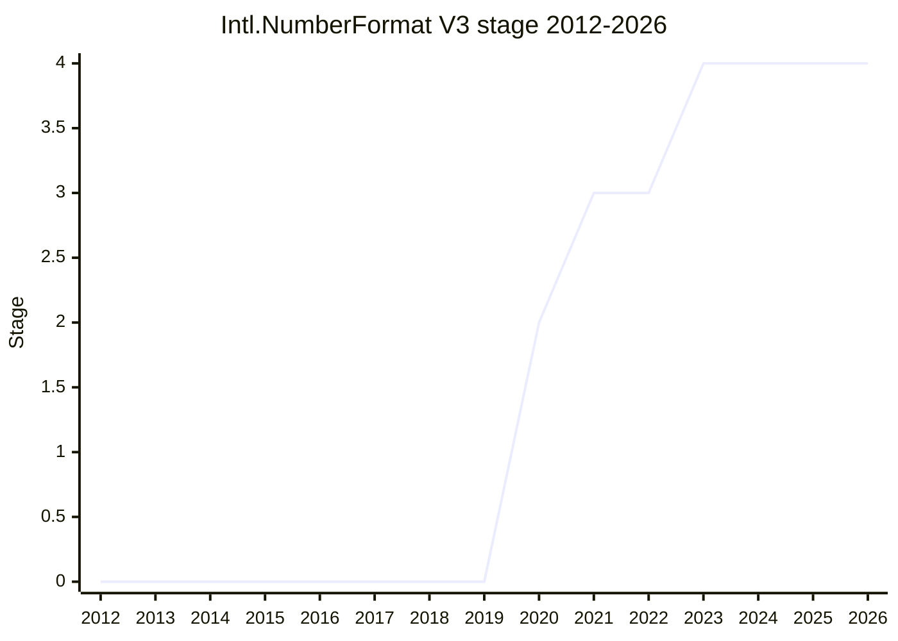

## Overview

Intl.NumberFormat V3 is a **bundle of number-formatting features** that [SFC](../people/SFC.md) collected from the feature requests filed against ECMA-402 and that were judged to have several stakeholders, prior art in CLDR/ICU, and a high cost to implement in userland. [SFC](../people/SFC.md) explained the name at TG2: "It’s called V3 because unified NumberFormat was supposed to be V2." Each feature is a new method or a new option (or option value) on the existing `Intl.NumberFormat` / `Intl.PluralRules` constructors rather than a new class:

- **Range formatting**: `Intl.NumberFormat.prototype.formatRange` / `formatRangeToParts` and `Intl.PluralRules.prototype.selectRange`, with a localized approximately sign when both ends round to the same value, ranges to Infinity but not NaN, and (since 2022) no requirement that the start be smaller than the end.
- **Grouping strategies**: `useGrouping` takes `"min2"`, `"auto"`, `"always"` or `false` instead of only a boolean.
- **Rounding and precision options**: `roundingPriority` (`"auto"`, `"morePrecision"`, `"lessPrecision"`), `roundingIncrement` (1, 2, 5, 10, 20, 25, 50, ... 5000), `trailingZeroDisplay` (`"auto"`, `"stripIfInteger"`) and `roundingMode` with nine modes (`ceil`, `floor`, `expand`, `trunc`, and their `half*` variants plus `halfEven`; the default stays `halfExpand`).
- **Strings as decimals**: string input is parsed with the `StringNumericLiteral` grammar into an "Intl mathematical value" instead of being cast to a Number, so long decimal strings keep their precision.
- **`signDisplay: "negative"`**: like `"auto"` but without a sign on negative zero.

```js
const nf = new Intl.NumberFormat("en-US", { style: "currency", currency: "USD", maximumFractionDigits: 0 });
nf.formatRange(3, 5);     // "$3 – $5"
nf.formatRange(2.9, 3.1); // "~$3"
new Intl.PluralRules("en").selectRange(1, 2); // "other"

new Intl.NumberFormat("en", { minimumFractionDigits: 2, maximumFractionDigits: 2, roundingIncrement: 5 }).format(1.23); // "1.25"
new Intl.NumberFormat("en", { useGrouping: "min2" }).format(1000); // "1000"
new Intl.NumberFormat("en").format("987654321987654321"); // "987,654,321,987,654,321" (no loss of precision)
```

[SFC](../people/SFC.md) was the sole champion from Stage 1 to Stage 4 and presented the proposal at every stage request and update; [FYT](../people/FYT.md) presented the 2022-07 range-ordering change, and [USA](../people/USA.md) reported the `useGrouping` fix in the 2022-09 ECMA-402 status update. Much of the Stage 3 work came from implementers: [FYT](../people/FYT.md) (V8), [YSZ](../people/YSZ.md) (JSC), [ABL](../people/ABL.md) (SpiderMonkey) and [RCA](../people/RCA.md), who wrote several of the follow-up PRs. The proposal reached Stage 1 in 2020-03, Stage 2 in 2020-06, Stage 3 in 2021-07 and Stage 4 in 2023-01, and was merged into ECMA-402 2023 (10th edition) through [ecma402#753](https://github.com/tc39/ecma402/pull/753).

## Stage history

| Meeting                                                                              | Venue   | Event                                                                                                                                                                                                                                                                                                                        | Stage |
| ------------------------------------------------------------------------------------ | ------- | ---------------------------------------------------------------------------------------------------------------------------------------------------------------------------------------------------------------------------------------------------------------------------------------------------------------------------- | ----- |
| [2018-07-19](https://github.com/tc39/ecma402/blob/main/meetings/notes-2018-07-19.md) | TG2     | During Unified NumberFormat, [SRL](../people/SRL.md) asks for cash rounding (e.g. CHF 0.05); [SFC](../people/SFC.md) defers rounding increments and modes, to "either add it into the proposal later, or add it into a follow-on proposal"                                                                                   | 0     |
| [2020-03-26](https://github.com/tc39/ecma402/blob/main/meetings/notes-2020-03-26.md) | TG2     | [SFC](../people/SFC.md) presents the six-part bundle before plenary; [ZB](../people/ZB.md) questions the shift from reactive to proactive API growth; the group agrees (thumbs up) on the problem spaces for Stage 1                                                                                                         | 0     |
| [2020-03](https://github.com/tc39/notes/blob/main/meetings/2020-03/april-1.md)       | plenary | Reached Stage 1. `Intl.NumberFormat v3 for Stage 1` ([SFC](../people/SFC.md)). "Consensus reached for Intl.NumberFormat V3 for Stage 1."                                                                                                                                                                                     | 0 → 1 |
| [2020-04-23](https://github.com/tc39/ecma402/blob/main/meetings/notes-2020-04-23.md) | TG2     | The `scale` option ([#1](https://github.com/tc39/proposal-intl-numberformat-v3/issues/1)) is put on pause, and the PluralRules shortcut ([ecma402#397](https://github.com/tc39/ecma402/issues/397)) is left to documentation                                                                                                 | 1     |
| [2020-06](https://github.com/tc39/notes/blob/main/meetings/2020-06/june-2.md)        | plenary | Reached Stage 2. `Intl.NumberFormat V3 for stage 2` ([SFC](../people/SFC.md)). Stage 3 reviewers: [DE](../people/DE.md) working with [USA](../people/USA.md), [YSV](../people/YSV.md) shadowing [JSW](../people/JSW.md), [WH](../people/WH.md) "only for the decimal portion", [SRV](../people/SRV.md)                       | 1 → 2 |
| [2020-10-08](https://github.com/tc39/ecma402/blob/main/meetings/notes-2020-10-08.md) | TG2     | `useGrouping` returns `false` or one of three strings; ranges with Infinity allowed; `selectRange` added ([#16](https://github.com/tc39/proposal-intl-numberformat-v3/issues/16)); negative ranges supported                                                                                                                 | 2     |
| [2021-02-11](https://github.com/tc39/ecma402/blob/main/meetings/notes-2021-02-11.md) | TG2     | Rounding-mode names bikeshed ([#7](https://github.com/tc39/proposal-intl-numberformat-v3/issues/7)); `"min2"` name kept; `signDisplay: "negative"` agreed                                                                                                                                                                    | 2     |
| [2021-04-08](https://github.com/tc39/ecma402/blob/main/meetings/notes-2021-04-08.md) | TG2     | Agreement on the "Rounding Options Puzzle" ([#8](https://github.com/tc39/proposal-intl-numberformat-v3/issues/8)) and on nine rounding modes                                                                                                                                                                                 | 2     |
| [2021-04](https://github.com/tc39/notes/blob/main/meetings/2021-04/apr-19.md)        | plenary | Stage 2 update with the settled design; "Proposal was not seeking advancement"                                                                                                                                                                                                                                               | 2     |
| [2021-07-01](https://github.com/tc39/ecma402/blob/main/meetings/notes-2021-07-01.md) | TG2     | Last design issues settled (`roundingIncrement` values, `roundingPriority: "auto"`); "TC39-TG2 approval for Stage 3"                                                                                                                                                                                                         | 2     |
| [2021-07](https://github.com/tc39/notes/blob/main/meetings/2021-07/july-15.md)       | plenary | Reached Stage 3. `Intl.NumberFormat v3 for stage 3` ([SFC](../people/SFC.md)). "Stage 3, [KG](../people/KG.md) to review the specification of the string grammar (and [WH](../people/WH.md) if interested)."                                                                                                                 | 2 → 3 |
| [2022-05-19](https://github.com/tc39/ecma402/blob/main/meetings/notes-2022-05-19.md) | TG2     | "OK to add limits" to the Intl mathematical value ([#98](https://github.com/tc39/proposal-intl-numberformat-v3/issues/98)); `roundingIncrement` alone no longer throws ([#97](https://github.com/tc39/proposal-intl-numberformat-v3/issues/97))                                                                              | 3     |
| [2022-07](https://github.com/tc39/notes/blob/main/meetings/2022-07/jul-20.md)        | plenary | Consensus on removing the range order check ([FYT](../people/FYT.md); proposal PR #100 together with ecma402 PR #701 for DateTimeFormat). Stage 3 update: consensus on the `roundingIncrement` changes and the Intl mathematical value PR, but not on `useGrouping` string handling, which [KG](../people/KG.md) objected to | 3     |
| [2022-08-04](https://github.com/tc39/ecma402/blob/main/meetings/notes-2022-08-04.md) | TG2     | `useGrouping`: map `"true"` and `"false"` to `"auto"` and reject other unspecified strings ([#74](https://github.com/tc39/proposal-intl-numberformat-v3/issues/74)); confirmed as `RangeError` at [2022-09-01](https://github.com/tc39/ecma402/blob/main/meetings/notes-2022-09-01.md)                                       | 3     |
| [2022-11](https://github.com/tc39/notes/blob/main/meetings/2022-11/nov-29.md)        | plenary | Stage 3 update: "Consensus for the presented PRs" (`useGrouping`, `roundingIncrement`, limits on the Intl mathematical value, `source` on the approximately sign); on [dec-01](https://github.com/tc39/notes/blob/main/meetings/2022-11/dec-01.md) the limit becomes a minimum required precision instead                    | 3     |
| [2023-01-12](https://github.com/tc39/ecma402/blob/main/meetings/notes-2023-01-12.md) | TG2     | `approximatelySign` name kept ([#121](https://github.com/tc39/proposal-intl-numberformat-v3/issues/121)); "No change in NFv3" to the read order ([#122](https://github.com/tc39/proposal-intl-numberformat-v3/issues/122)); optional limit set at R(Number.MAX_VALUE) (PR #117)                                              | 3     |
| [2023-01](https://github.com/tc39/notes/blob/main/meetings/2023-01/jan-31.md)        | plenary | Reached Stage 4. `Intl.NumberFormat V3 for Stage 4` ([SFC](../people/SFC.md)). "Proposal reached Stage 4 consensus, with explicit support from [DE](../people/DE.md), [RGN](../people/RGN.md), [DLM](../people/DLM.md)"                                                                                                      | 3 → 4 |
| [2023-02-09](https://github.com/tc39/ecma402/blob/main/meetings/notes-2023-02-09.md) | TG2     | Stage 4 PR [ecma402#753](https://github.com/tc39/ecma402/pull/753) ("No normative changes, solely editorial") waiting for reviews; merged for ECMA-402 2023                                                                                                                                                                  | 4     |
| [2023-07](https://github.com/tc39/notes/blob/main/meetings/2023-07/july-11.md)       | plenary | Consensus on [proposal PR #130](https://github.com/tc39/proposal-intl-numberformat-v3/pull/130) (option read order, which had not been presented to plenary) and [ecma402#768](https://github.com/tc39/ecma402/pull/768) (move `roundingPriority` in `resolvedOptions`)                                                      | 4     |
| [2025-09](https://github.com/tc39/notes/blob/main/meetings/2025-09/september-24.md)  | plenary | Consensus on [ecma402#1022](https://github.com/tc39/ecma402/pull/1022), increasing the limits on the Intl mathematical value ([SFC](../people/SFC.md))                                                                                                                                                                       | 4     |



> How to read: Stage 1 in 2020-03 (the notes file is `april-1.md` because the remote March 2020 meeting ran into April 1) and Stage 2 in 2020-06, so the 2020 point is 2; Stage 3 in 2021-07; Stage 4 in 2023-01, published in ECMA-402 2023. In the Stage 4 presentation [SFC](../people/SFC.md) recalled that the proposal "got to stage 2 in 2021"; the plenary notes put Stage 2 at 2020-06. The canonical table lists the 2023-07 plenary item among the proposal's meetings; that was a post-Stage-4 consensus on PR #130, not a stage change.

## Main issues

### Scope: a bundle of feature requests

At the TG2 call before the Stage 1 request ([2020-03-26](https://github.com/tc39/ecma402/blob/main/meetings/notes-2020-03-26.md)), [SFC](../people/SFC.md) presented six parts: `formatRange` ([ecma402#393](https://github.com/tc39/ecma402/issues/393)), a NumberFormat/PluralRules shortcut ([ecma402#397](https://github.com/tc39/ecma402/issues/397)), grouping options ([ecma402#367](https://github.com/tc39/ecma402/issues/367)), new rounding/precision options ([ecma402#286](https://github.com/tc39/ecma402/issues/286)), a `scale` option and decimal string input ([ecma402#334](https://github.com/tc39/ecma402/issues/334)). [ZB](../people/ZB.md) objected less to the features than to the way they were chosen: ECMA-402 had been "a reactive group", and the bundle seemed to rest on use cases that were not public:

> [ZB](../people/ZB.md): what I see here is that Google is in a way short-circuiting to ECMA 402, by progressing proposals that satisfy internal needs without appropriately doing the legwork by exposing their internal use-cases.

[SFC](../people/SFC.md) answered that each issue had public use cases and was "not things that are required for mere completeness"; [DE](../people/DE.md) asked that all proposals be held to the same standard of motivation, and [FYT](../people/FYT.md) suggested that delegates bring the people with the use case into the GitHub threads. [RCA](../people/RCA.md) added a banking use case (currency ranges for loans and mortgages), and [FYT](../people/FYT.md) strongly supported the grouping part ("when we shipped Unified NumberFormat, we had a lot of bug reports in Chromium, mostly for Spanish, regarding this"). The group agreed on all six problem spaces for Stage 1, and the plenary ([2020-03](https://github.com/tc39/notes/blob/main/meetings/2020-03/april-1.md)) raised only a question from [WH](../people/WH.md) about `"min2"` before [AKI](../people/AKI.md) remarked:

> [AKI](../people/AKI.md): I’m over here marveling on IRC because every time anything from Intl comes before committee, there are no questions and everyone’s happy with it.

Two parts were then dropped. At [2020-04-23](https://github.com/tc39/ecma402/blob/main/meetings/notes-2020-04-23.md), [FYT](../people/FYT.md) argued that the PluralRules shortcut adds no new capability and that "developers still need to read the documentation", so [SFC](../people/SFC.md) took it out ("It makes the proposal a tad bit smaller"). In the same call, the `scale` option ([#1](https://github.com/tc39/proposal-intl-numberformat-v3/issues/1)) raised the worry that older browsers would silently ignore it and format a value off by a power of ten. [SFC](../people/SFC.md): "I've changed my mind about this. We can still move the proposal forward without this, and put it on pause." [DE](../people/DE.md) was "really disappointed"; `scale` does not appear in any later presentation. [ZB](../people/ZB.md)'s question was turned into the general ECMA-402 entrance criteria ([ecma402#442](https://github.com/tc39/ecma402/issues/442), [2020-10-08](https://github.com/tc39/ecma402/blob/main/meetings/notes-2020-10-08.md)): broad appeal, prior art, and difficulty of a userland implementation. From the 2021-04 Stage 2 update onward [SFC](../people/SFC.md) opened each presentation with these three criteria, showing number ranges (accepted) against additional scientific notation styles (rejected: few stakeholders, partial CLDR support).

The size of the API remained a concern. At the [2021-04](https://github.com/tc39/notes/blob/main/meetings/2021-04/apr-19.md) plenary [SYG](../people/SYG.md) asked about discoverability:

> [SYG](../people/SYG.md): So what I'm struck by with these updates that there are just many knobs to turn for using number format V3.

[SFC](../people/SFC.md) replied that most additions extend existing options (`useGrouping`, `signDisplay`) or mirror `DateTimeFormat` (`formatRange`); [SYG](../people/SYG.md) agreed that this reuse "does go a long way in getting the cognitive burden down", and [DE](../people/DE.md) stressed documentation on MDN.

### Rounding modes: which ones and what to call them

[#7](https://github.com/tc39/proposal-intl-numberformat-v3/issues/7) asked which rounding modes to expose. At [2021-02-11](https://github.com/tc39/ecma402/blob/main/meetings/notes-2021-02-11.md) [MLS](../people/MLS.md) raised hardware rounding modes and asked for a robust test suite for corner cases of conversion to an exact mathematical value; [SFC](../people/SFC.md) answered that ICU rounds in software and that ECMA-402 already rounds the exact decimal value. The name of the mode that rounds away from zero was bikeshedded ("expand" from [RGN](../people/RGN.md), "outward" from [JSW](../people/JSW.md), "uceil" from [LEO](../people/LEO.md) via [SFC](../people/SFC.md), "bigger" from [EAO](../people/EAO.md)), until [MCM](../people/MCM.md) objected:

> [MCM](../people/MCM.md): I’m surprised this group is coming up with names for rounding modes. Surely there are terms-of-art for these. People have been rounding for centuries.

[LEO](../people/LEO.md) suggested leaving the choice to the champion, and the call ended with silence on adopting the ten names under discussion. By [2021-04-08](https://github.com/tc39/ecma402/blob/main/meetings/notes-2021-04-08.md) the list was down to nine ("HalfOdd was dropped because no use cases were found."), and [RGN](../people/RGN.md), [YMD](../people/YMD.md) and [FYT](../people/FYT.md) gave +1. In the plenary update ([2021-04](https://github.com/tc39/notes/blob/main/meetings/2021-04/apr-19.md)) [SFC](../people/SFC.md) described them as covering ICU, CSS and ECMA-262 `Math` and expected them to set a precedent for Decimal and Temporal. [WH](../people/WH.md) asked how 1.225 rounds to a nickel when a double cannot represent 1.225 exactly; [SFC](../people/SFC.md) explained that ECMA-402 first converts the double to its shortest decimal representation and rounds that decimal value. Temporal adopted the same names ([PFC](../people/PFC.md) at the [2021-03](https://github.com/tc39/notes/blob/main/meetings/2021-03/mar-9.md) plenary: "we want to make sure that we use the same names as the Intl.NumberFormat v3 proposal does"), and [Intl.DurationFormat](intl-durationformat.md) later relied on `roundingMode: "trunc"`.

The same 2021-02-11 call agreed on `signDisplay: "negative"` ([#17](https://github.com/tc39/proposal-intl-numberformat-v3/issues/17)), which hides the sign of negative zero, and on treating `-0` like zero in rounding ([#21](https://github.com/tc39/proposal-intl-numberformat-v3/issues/21); [EAO](../people/EAO.md): "-0 is a variant of 0.", [RGN](../people/RGN.md): "That's also consistent with 262.").

### The rounding options puzzle: `roundingPriority`, `roundingIncrement`, `trailingZeroDisplay`

[SFC](../people/SFC.md) called [#8](https://github.com/tc39/proposal-intl-numberformat-v3/issues/8) "one of the most challenging puzzles I've had to solve in my work on API design" ([2021-03-11](https://github.com/tc39/ecma402/blob/main/meetings/notes-2021-03-11.md), where the notes record only the main points of a 40-minute discussion). The core problem is a conflict between fraction-digit and significant-digit settings, explained at the [2021-04](https://github.com/tc39/notes/blob/main/meetings/2021-04/apr-19.md) plenary:

> [SFC](../people/SFC.md): When you do this you specify two conflicting strategies for how you want to round the number.

After a separate deep dive with [RGN](../people/RGN.md), TG2 accepted the solution at [2021-04-08](https://github.com/tc39/ecma402/blob/main/meetings/notes-2021-04-08.md): a `roundingPriority` option (the old behaviour, in which significant digits always win, plus `"morePrecision"` and `"lessPrecision"`, the former being what compact notation needs), `roundingIncrement` limited to 1 or 5 followed by zeros, and `trailingZeroDisplay` as a separate option (its value is recorded in those notes as `"stringIfInteger"`; the shipped name is `"stripIfInteger"`). Further changes followed:

- **Name of the default** ([#32](https://github.com/tc39/proposal-intl-numberformat-v3/pull/32), [2021-07-01](https://github.com/tc39/ecma402/blob/main/meetings/notes-2021-07-01.md)): `roundingPriority: "significantDigits"` became `"auto"`.
- **Allowed increments** ([#33](https://github.com/tc39/proposal-intl-numberformat-v3/issues/33), 2021-07-01): [FYT](../people/FYT.md) wanted only increments with known use cases (nickel and dime rounding); [SFC](../people/SFC.md) wanted rounding to 500 ("turn left in 500 meters"); [EAO](../people/EAO.md) had a real case for 20 ("I recently needed to round to a multiple of 20."). The conclusion was the fixed list « 1, 2, 5, 10, 20, 25, 50, 100, 200, 250, 500, 1000, 2000, 2500, 5000 ».
- **No mixing with significant digits** ([#46](https://github.com/tc39/proposal-intl-numberformat-v3/issues/46), 2021-07-01): the constructor throws if `roundingIncrement` is combined with significant-digit rounding. [EAO](../people/EAO.md) found it surprising that the option would throw rather than take part in the priority fallback; [SFC](../people/SFC.md) answered that only code adding the new option can see the exception.
- **Error type** ([#68](https://github.com/tc39/proposal-intl-numberformat-v3/issues/68), [2022-03-17](https://github.com/tc39/ecma402/blob/main/meetings/notes-2022-03-17.md)): following [RGN](../people/RGN.md) ("a bug relating to interaction between multiple options does not seem like a RangeError"), the conflict with significant digits throws a `TypeError`; [USA](../people/USA.md) was to consider adding the rule to the ECMA-402 style guide.
- **Fraction digits must match** ([#81](https://github.com/tc39/proposal-intl-numberformat-v3/issues/81), [2022-01-13](https://github.com/tc39/ecma402/blob/main/meetings/notes-2022-01-13.md)): because of an ICU limitation, `minimumFractionDigits` must equal `maximumFractionDigits` when an increment is used, and the constructor throws otherwise ([GPT](../people/GPT.md): "It’s better to be more restricted now since we always have the option to relax it later."). [#97](https://github.com/tc39/proposal-intl-numberformat-v3/issues/97) ([2022-05-19](https://github.com/tc39/ecma402/blob/main/meetings/notes-2022-05-19.md)) then made `{ roundingIncrement: 1000 }` alone work by defaulting the maximum to the minimum (option 2); both changes got plenary consensus in [2022-07](https://github.com/tc39/notes/blob/main/meetings/2022-07/jul-20.md).
- **What "precision" means** ([#96](https://github.com/tc39/proposal-intl-numberformat-v3/issues/96), [2022-06-16](https://github.com/tc39/ecma402/blob/main/meetings/notes-2022-06-16.md)): [PFC](../people/PFC.md) proposed a clearer algorithm for resolving the fraction-digit minimum under `roundingPriority`. [SFC](../people/SFC.md) liked it but asked whether it was important enough to change at Stage 3; with [FYT](../people/FYT.md) slightly in favour and [RCA](../people/RCA.md) "In favor but somewhat afraid of the impact", [SFC](../people/SFC.md) took the action to write the change and implement it in ICU.

### `useGrouping`: string values and web compatibility

Grouping control was one of the most requested features. At [2020-10-08](https://github.com/tc39/ecma402/blob/main/meetings/notes-2020-10-08.md) ([#3](https://github.com/tc39/proposal-intl-numberformat-v3/issues/3)) the group chose to keep the existing `useGrouping` option and accept strings in it, although [JGT](../people/JGT.md) found "Having an option take either a boolean or a string is weird." and [JSW](../people/JSW.md) said "I think we would probably use all strings if designing this from scratch." `resolvedOptions()` returns `false` or one of the three strings. The `"min2"` name was kept at [2021-02-11](https://github.com/tc39/ecma402/blob/main/meetings/notes-2021-02-11.md) ([#23](https://github.com/tc39/proposal-intl-numberformat-v3/issues/23); [JGT](../people/JGT.md) liked having a digit "like `h12` and `h24`"), and at [2022-01-13](https://github.com/tc39/ecma402/blob/main/meetings/notes-2022-01-13.md) ([#77](https://github.com/tc39/proposal-intl-numberformat-v3/issues/77)) a proposal to let locale data override `"min2"` was closed without change.

The trouble came after shipping. The Stage 3 spec read `useGrouping` with a strict option reader, so the string `"true"`, which pages already passed and which older engines coerced to `true`, started to throw ([#74](https://github.com/tc39/proposal-intl-numberformat-v3/issues/74), reported by [ABL](../people/ABL.md)). At [2022-03-17](https://github.com/tc39/ecma402/blob/main/meetings/notes-2022-03-17.md) TG2 decided to "preserve most of compat cases by looking for the exact string enum values and then casting everything else to a boolean", that is, every other string meant `"auto"`. [KG](../people/KG.md) strongly objected at the [2022-07](https://github.com/tc39/notes/blob/main/meetings/2022-07/jul-20.md) plenary:

> [KG](../people/KG.md): Having some strings that are truthy be different from other gibberish strings is not a behavior that I am in favor of.

> [KG](../people/KG.md): The thing is that like someone is going to write `min2` and then someone else is going to come along and change that to `min3` and they are going to pass a number in the billions and they're going to see three commas and be like "that totally works".

[JHD](../people/JHD.md) added that mapping unknown strings to `"auto"` would make it impossible to add new values web-compatibly later. [SFC](../people/SFC.md) argued that `"auto"` was already implementation-defined behaviour, but agreed to continue the discussion on GitHub, and the plenary gave consensus on everything else. Back in TG2 ([2022-08-04](https://github.com/tc39/ecma402/blob/main/meetings/notes-2022-08-04.md)), with [KG](../people/KG.md) on the call, [USA](../people/USA.md) floated splitting the option in two, and [FYT](../people/FYT.md) wanted `"false"` to throw. [KG](../people/KG.md) framed the trade-off:

> [KG](../people/KG.md): So there's breaking in theory and breaking in practice.

The conclusion was to treat `"true"` and `"false"` as `"auto"` and reject everything else, confirmed at [2022-09-01](https://github.com/tc39/ecma402/blob/main/meetings/notes-2022-09-01.md) as "throw RangeError on unspecified strings", reported to plenary by [USA](../people/USA.md) in [2022-09](https://github.com/tc39/notes/blob/main/meetings/2022-09/sep-13.md) and included in the presented PRs in [2022-11](https://github.com/tc39/notes/blob/main/meetings/2022-11/nov-29.md). (The current spec text replaces `"true"` and `"false"` with the default value, which is `"min2"` for compact notation and `"auto"` otherwise, and maps boolean `true` to `"always"`.)

### `formatRange` and `selectRange` semantics

Range formatting was modelled on `Intl.DateTimeFormat.prototype.formatRange`. At [2020-10-08](https://github.com/tc39/ecma402/blob/main/meetings/notes-2020-10-08.md) the group allowed Infinity in ranges ([#12](https://github.com/tc39/proposal-intl-numberformat-v3/issues/12); [JSW](../people/JSW.md): "5+" style output "should be its own option"), added `PluralRules.prototype.selectRange` ([#16](https://github.com/tc39/proposal-intl-numberformat-v3/issues/16), backed by CLDR plural-range data), and rejected [SFC](../people/SFC.md)'s suggestion to throw on negative values ([#11](https://github.com/tc39/proposal-intl-numberformat-v3/issues/11)) after [RGN](../people/RGN.md) and [JSW](../people/JSW.md) cited temperatures and uncertainty ranges. How `signDisplay` applies to ranges ([#13](https://github.com/tc39/proposal-intl-numberformat-v3/issues/13)) was sent back for a new design. At [2021-01-14](https://github.com/tc39/ecma402/blob/main/meetings/notes-2021-01-14.md) ([#10](https://github.com/tc39/proposal-intl-numberformat-v3/issues/10)) implementations were allowed to collapse a range whose two ends format the same and add an approximately sign, even when the inputs are equal before rounding ([SFC](../people/SFC.md): "If you want to have different display, you can check `a === b` before you call formatRange."). At [2021-11-04](https://github.com/tc39/ecma402/blob/main/meetings/notes-2021-11-04.md) ([#65](https://github.com/tc39/proposal-intl-numberformat-v3/issues/65)) [RGN](../people/RGN.md) and [RCA](../people/RCA.md) chose to make `selectRange` as strict as `formatRange` (a `TypeError` for `undefined` ends).

The biggest change at Stage 3 was dropping the requirement that the start be no greater than the end. Comparing two arbitrary-precision decimal strings was expensive to implement, and [FYT](../people/FYT.md) found real uses for ranges whose start is greater than the end in cyclic domains. At [2022-07-07](https://github.com/tc39/ecma402/blob/main/meetings/notes-2022-07-07.md) ([ecma402#692](https://github.com/tc39/ecma402/issues/692)) TG2 agreed, and [SFC](../people/SFC.md) recalled who had added the check to DateTimeFormat: "The person was me 4 years ago before being convinced by the use cases". [QMO](../people/QMO.md)'s idea of a separate checked method was rejected because of the implementation cost. [FYT](../people/FYT.md) presented the change at the [2022-07](https://github.com/tc39/notes/blob/main/meetings/2022-07/jul-20.md) plenary as two PRs, one against the Stage 3 proposal and one against ECMA-402 for DateTimeFormat, so that the two formatters would behave the same, using street signs such as "no parking from 6 p.m. to 8:00 a.m." and fiscal years as examples; [FYT](../people/FYT.md) also noted that the CLDR plural-range data assumes the first value is smaller, though no locale is known to be affected. Both PRs got consensus, with support from [DE](../people/DE.md) and [DLM](../people/DLM.md).

Late in Stage 3, [RGN](../people/RGN.md) asked whether the `formatToParts` type `"approximatelySign"` should be `"approximateSign"` ([#121](https://github.com/tc39/proposal-intl-numberformat-v3/issues/121), [2023-01-12](https://github.com/tc39/ecma402/blob/main/meetings/notes-2023-01-12.md)). [SFC](../people/SFC.md) noted the name came from ICU and CLDR and browsers had shipped it, and the issue was closed "primarily on the basis that there isn't a clear best alternative to the status quo, and we should favor the status quo at Stage 3".

### Strings as decimals: the Intl mathematical value and its limits

Before V3, a string passed to `format` was converted to a Number and lost precision. In the Stage 2 plenary ([2020-06](https://github.com/tc39/notes/blob/main/meetings/2020-06/june-2.md)) [WH](../people/WH.md) asked what the strings may contain; [SFC](../people/SFC.md): "No, we accept same as Number constructor. Only difference is we don't cast it to a double." [WH](../people/WH.md) agreed to review "the decimal aspect and the rounding modes". For Stage 3, [SFC](../people/SFC.md) specified a new spec type, the Intl mathematical value (a mathematical value plus positive/negative infinity, NaN and negative zero), parsed with the `StringNumericLiteral` grammar. Whether this should also accept hex and other non-decimal strings ([#54](https://github.com/tc39/proposal-intl-numberformat-v3/issues/54)) was raised at the [2021-07](https://github.com/tc39/notes/blob/main/meetings/2021-07/july-15.md) plenary; since such strings were already accepted, [KG](../people/KG.md) preferred to keep accepting them and agreed to review the grammar, which became the condition attached to Stage 3. TG2 confirmed the approach at [2021-11-04](https://github.com/tc39/ecma402/blob/main/meetings/notes-2021-11-04.md). Raising `maximumFractionDigits` from 20 to 100 for long decimal strings ([#34](https://github.com/tc39/proposal-intl-numberformat-v3/issues/34)) was moved out of the proposal at [2021-07-01](https://github.com/tc39/ecma402/blob/main/meetings/notes-2021-07-01.md) and later landed as [ecma402#786](https://github.com/tc39/ecma402/pull/786) (TG2 approval [2023-06-01](https://github.com/tc39/ecma402/blob/main/meetings/notes-2023-06-01.md), plenary consensus [2023-07](https://github.com/tc39/notes/blob/main/meetings/2023-07/july-11.md)).

Implementers found unbounded values hard: ICU4X could not represent them, and V8 needed string comparisons for range checks. At [2022-05-19](https://github.com/tc39/ecma402/blob/main/meetings/notes-2022-05-19.md) ([#98](https://github.com/tc39/proposal-intl-numberformat-v3/issues/98)) [SFC](../people/SFC.md) proposed limits on both the exponent (about ±10,000, derived from a 16-bit exponent in ICU4X) and the number of digits, citing `toExponential` and the Date time range as precedent. [GPT](../people/GPT.md) was "Vaguely in favor though. We can eventually remove the limitation if there is a need.", and the conclusion was "OK to add limits." In the [2022-11](https://github.com/tc39/notes/blob/main/meetings/2022-11/nov-29.md) plenary [SFC](../people/SFC.md) used the total value of Bitcoin in circulation (20 significant digits) to show that a limit of 30 to 100 digits still covered the motivating case, but two days later ([dec-01](https://github.com/tc39/notes/blob/main/meetings/2022-11/dec-01.md)) [RCA](../people/RCA.md)'s research showed that the shipping browsers did not agree on a limit, so the committee ([SYG](../people/SYG.md), [EAO](../people/EAO.md), [DE](../people/DE.md)) accepted "Option 1": the spec requires only a minimum precision. TG2 then settled ([2023-01-12](https://github.com/tc39/ecma402/blob/main/meetings/notes-2023-01-12.md), PR #117) on "Use R(Number.MAX_VALUE) as the (optional) limit", with the range of a Number and higher precision, as [SFC](../people/SFC.md) described it at the Stage 4 plenary.

The question came back after Stage 4. At the 2025-07 plenary [WH](../people/WH.md) objected to the range limit while reviewing [Intl Keep Trailing Zeros](intl-keep-trailing-zeros.md), and [SFC](../people/SFC.md)'s [ecma402#1022](https://github.com/tc39/ecma402/pull/1022) ([2025-08-14](https://github.com/tc39/ecma402/blob/main/meetings/notes-2025-08-14.md)) proposed spec-defined limits about two orders of magnitude higher, noting that "we had accidentally dropped the limits when implementing v3" and that the [Amount](amount.md) champions were watching the outcome. The [2025-09](https://github.com/tc39/notes/blob/main/meetings/2025-09/september-24.md) plenary agreed both to raise the limits and to the specific values.

### Order of option reads and of `resolvedOptions`

Because option reads are observable, [RGN](../people/RGN.md) asked at [2023-01-12](https://github.com/tc39/ecma402/blob/main/meetings/notes-2023-01-12.md) ([#122](https://github.com/tc39/proposal-intl-numberformat-v3/issues/122)) whether the new options could be read in a more understandable order ("Alphabetical is more predictable."). [FYT](../people/FYT.md) pushed back that NumberFormat had never been alphabetical, and [SFC](../people/SFC.md) called it "a ship that’s already sailed for NFv3". The conclusion was "No change in NFv3. Revisit the issue in the context of ECMA-402 at large independently of NFv3."

The same topic came back during the merge. At [2023-04-06](https://github.com/tc39/ecma402/blob/main/meetings/notes-2023-04-06.md) [RGN](../people/RGN.md) disliked `roundingPriority` being appended at the end of `resolvedOptions()` instead of next to the other rounding fields. [FYT](../people/FYT.md) preferred to fix it after the merge ("I feel this should be approached post-ship in NFv4."), and [SFC](../people/SFC.md), as both author and convenor, did not want to hold up a Stage 4 proposal on it. [RGN](../people/RGN.md) approved the merge and filed [ecma402#768](https://github.com/tc39/ecma402/pull/768), which got TG2 agreement at [2023-05-04](https://github.com/tc39/ecma402/blob/main/meetings/notes-2023-05-04.md). At the [2023-07](https://github.com/tc39/notes/blob/main/meetings/2023-07/july-11.md) plenary [SFC](../people/SFC.md) also brought proposal PR #130, which had changed the option read order (and added the missing reads in PluralRules) before Stage 4:

> [SFC](../people/SFC.md): Unfortunately, it slipped through the cracks and didn’t get presented in this group.

Both got consensus together with other ECMA-402 PRs.

## Related proposals

- `intl-unified-numberformat` — the 2018-2019 "V2" of NumberFormat (units, compact and scientific notation, `signDisplay`); rounding increments were deferred from it to "a follow-on proposal".
- [Intl Keep Trailing Zeros](intl-keep-trailing-zeros.md) — builds on V3's string input and `trailingZeroDisplay`, adding a `"stripToMinimum"` value; [WH](../people/WH.md)'s review of it reopened the Intl mathematical value limits.
- [Decimal](decimal.md) — [DE](../people/DE.md)'s decimal work motivated the `scale` option and string input in 2020, and [SFC](../people/SFC.md) expected Decimal to follow V3's rounding modes.
- [Amount](amount.md) — its champions follow the Intl mathematical value limits set by ecma402#1022.
- [Temporal](temporal.md) — uses the same rounding mode names.
- [Intl.DurationFormat](intl-durationformat.md) — formats each unit through NumberFormat and uses `roundingMode: "trunc"`.
- `intl-datetimeformat-formatrange` — the model for `formatRange`; its order check was removed together with V3's in 2022-07.
- [Smart Unit Preferences in Intl.NumberFormat](smart-unit-preferences.md) — a later number-formatting proposal in the same family.

## Sources

TG2:

- https://github.com/tc39/ecma402/blob/main/meetings/notes-2018-07-19.md
- https://github.com/tc39/ecma402/blob/main/meetings/notes-2020-03-26.md
- https://github.com/tc39/ecma402/blob/main/meetings/notes-2020-04-23.md
- https://github.com/tc39/ecma402/blob/main/meetings/notes-2020-10-08.md
- https://github.com/tc39/ecma402/blob/main/meetings/notes-2021-01-14.md
- https://github.com/tc39/ecma402/blob/main/meetings/notes-2021-02-11.md
- https://github.com/tc39/ecma402/blob/main/meetings/notes-2021-03-11.md
- https://github.com/tc39/ecma402/blob/main/meetings/notes-2021-04-08.md
- https://github.com/tc39/ecma402/blob/main/meetings/notes-2021-07-01.md
- https://github.com/tc39/ecma402/blob/main/meetings/notes-2021-11-04.md
- https://github.com/tc39/ecma402/blob/main/meetings/notes-2022-01-13.md
- https://github.com/tc39/ecma402/blob/main/meetings/notes-2022-03-17.md
- https://github.com/tc39/ecma402/blob/main/meetings/notes-2022-05-19.md
- https://github.com/tc39/ecma402/blob/main/meetings/notes-2022-06-16.md
- https://github.com/tc39/ecma402/blob/main/meetings/notes-2022-07-07.md
- https://github.com/tc39/ecma402/blob/main/meetings/notes-2022-08-04.md
- https://github.com/tc39/ecma402/blob/main/meetings/notes-2022-09-01.md
- https://github.com/tc39/ecma402/blob/main/meetings/notes-2023-01-12.md
- https://github.com/tc39/ecma402/blob/main/meetings/notes-2023-02-09.md
- https://github.com/tc39/ecma402/blob/main/meetings/notes-2023-04-06.md
- https://github.com/tc39/ecma402/blob/main/meetings/notes-2023-05-04.md
- https://github.com/tc39/ecma402/blob/main/meetings/notes-2023-06-01.md
- https://github.com/tc39/ecma402/blob/main/meetings/notes-2025-08-14.md

Plenary:

- https://github.com/tc39/notes/blob/main/meetings/2020-03/april-1.md
- https://github.com/tc39/notes/blob/main/meetings/2020-06/june-2.md
- https://github.com/tc39/notes/blob/main/meetings/2021-03/mar-9.md
- https://github.com/tc39/notes/blob/main/meetings/2021-04/apr-19.md
- https://github.com/tc39/notes/blob/main/meetings/2021-07/july-15.md
- https://github.com/tc39/notes/blob/main/meetings/2022-07/jul-20.md
- https://github.com/tc39/notes/blob/main/meetings/2022-09/sep-13.md
- https://github.com/tc39/notes/blob/main/meetings/2022-11/nov-29.md
- https://github.com/tc39/notes/blob/main/meetings/2022-11/dec-01.md
- https://github.com/tc39/notes/blob/main/meetings/2023-01/jan-31.md
- https://github.com/tc39/notes/blob/main/meetings/2023-07/july-11.md
- https://github.com/tc39/notes/blob/main/meetings/2025-09/september-24.md
