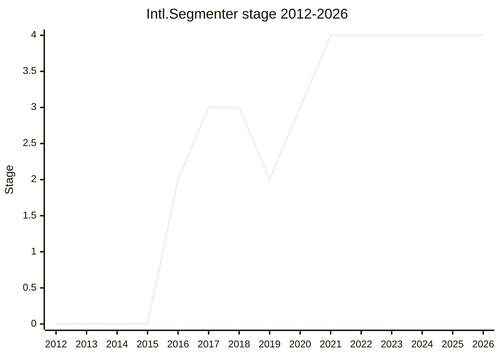

## Overview

`Intl.Segmenter` exposes **locale-sensitive text segmentation** — grapheme clusters, words and sentences as defined by Unicode UAX #29, with locale tailorings — so that JavaScript code can work with "characters", words and sentences as humans perceive them rather than with code units or code points. Before it, the only option on the web was Chrome's non-standard, prefixed `Intl.v8BreakIterator` (which the proposal set out to replace) or shipping a userland library together with its large break dictionaries. Use cases named over the years include cursor movement and text editors, word counts and find-in-page, and spell checking.

```js
const segmenter = new Intl.Segmenter("en", { granularity: "word" });
const segments = segmenter.segment("Hello, world!");
for (const { segment, index, isWordLike } of segments) {
  // "Hello" 0 true, "," 5 false, " " 6 false, "world" 7 true, "!" 12 false
}
segments.containing(8); // { segment: "world", index: 7, input: "Hello, world!", isWordLike: true }
```

The shipped design (settled in 2020 after a long Stage 3 redesign) has three objects: an `Intl.Segmenter` holding the locale and `granularity` (`"grapheme"` (default), `"word"`, `"sentence"`), a `Segments` object returned by `segment(string)` that is an **iterable** with stateless random access through `containing(index)`, and a segment iterator. Each segment is a plain object `{ segment, index, input }`, plus `isWordLike` for word granularity. The breaking algorithm itself is deliberately left to the implementation (a spec note says "Boundary determination is implementation-dependent", points to UAX #29 for the default algorithms, and recommends CLDR tailorings); line breaking (UAX #14) was in the proposal until 2019 and was removed. The proposal was created and first championed by [DE](../people/DE.md) (2016-2019); [RGN](../people/RGN.md) took over the redesign in 2019 and is the canonical champion. [FYT](../people/FYT.md) wrote the V8 implementation. It shipped in V8 (Chrome 87) and JavaScriptCore before Stage 4, reached Stage 4 in 2021-10, and is part of ECMA-402 2022 (9th edition); the ICU4X-based implementation in Firefox reached release builds at the end of 2023.

## Stage history

| Meeting                                                                              | Venue   | Event                                                                                                                                                                                                                                                      | Stage |
| ------------------------------------------------------------------------------------ | ------- | ---------------------------------------------------------------------------------------------------------------------------------------------------------------------------------------------------------------------------------------------------------- | ----- |
| [2012-11](https://github.com/tc39/notes/blob/main/meetings/2012-11/nov-27.md)        | plenary | "Internationalization Update": "Text segmentation: word and line breaks" is a medium-priority item for ECMA-402 2.0 ("Chrome already has impl"); a strawman followed (2013-01)                                                                             | 0     |
| [2016-09](https://github.com/tc39/notes/blob/main/meetings/2016-09/sept-28.md)       | plenary | Reached Stage 1. `Intl.Segmenter` ([DE](../people/DE.md)): grapheme/word/line/sentence breaks, to replace `Intl.v8BreakIterator`. "Stage 1 acceptance"                                                                                                     | 0 → 1 |
| [2016-11](https://github.com/tc39/notes/blob/main/meetings/2016-11/nov-30.md)        | plenary | Reached Stage 2. "Stage 2 acceptance"                                                                                                                                                                                                                      | 1 → 2 |
| [2017-03](https://github.com/tc39/notes/blob/main/meetings/2017-03/mar-21.md)        | plenary | `Intl.Segmenter (requesting stage 3)`: new `preceding`/`following` methods to jump to a position; only Stage 3 reviewers identified ([CP](../people/CP.md), someone from PayPal). "Remains at stage 2"                                                     | 2     |
| [2017-05](https://github.com/tc39/notes/blob/main/meetings/2017-05/may-23.md)        | plenary | `Intl.Segmenter for Stage 3`: [BT](../people/BT.md) and [AWB](../people/AWB.md) question features that are in practice defined by ICU; stays at Stage 2, reviewers [CP](../people/CP.md), [BT](../people/BT.md), PayPal                                    | 2     |
| [2017-07](https://github.com/tc39/notes/blob/main/meetings/2017-07/jul-25.md)        | plenary | `Intl.Segmenter for Stage 3` again: word break types cut down to two; the ICU discussion continues. "leave the proposal at stage 2"                                                                                                                        | 2     |
| [2017-09](https://github.com/tc39/notes/blob/main/meetings/2017-09/sept-26.md)       | plenary | Reached Stage 3. "Stage 3 acceptance"                                                                                                                                                                                                                      | 2 → 3 |
| [2017-12-15](https://github.com/tc39/ecma402/blob/main/meetings/notes-2017-12-15.md) | TG2     | First TG2 call: [ZB](../people/ZB.md) reports Mozilla's concern that Segmenter data adds ~3 [MB](../people/MB.md) to Firefox                                                                                                                               | 3     |
| [2018-03-16](https://github.com/tc39/ecma402/blob/main/meetings/notes-2018-03-16.md) | TG2     | Locale extension options ([proposal-intl-segmenter#23](https://github.com/tc39/proposal-intl-segmenter/issues/23)): `lb` was added as `lineBreakStyle` (PR #24, #25); `lw` rejected, `ss` left for later                                                   | 3     |
| [2018-10-18](https://github.com/tc39/ecma402/blob/main/meetings/notes-2018-10-18.md) | TG2     | [FYT](../people/FYT.md)'s V8 implementation; position in the iteration result (PR #42) and `breakType` vs `segmentType` naming (#44)                                                                                                                       | 3     |
| [2018-11-26](https://github.com/tc39/ecma402/blob/main/meetings/notes-2018-11-26.md) | TG2     | [MCM](../people/MCM.md) (written `SLi`) objects to `granularity: "line"` (#49); "rough consensus" to iterate boundaries rather than segments (#59)                                                                                                         | 3     |
| [2019-01-17](https://github.com/tc39/ecma402/blob/main/meetings/notes-2019-01-17.md) | TG2     | Line breaking dropped from the proposal (left to CSS Houdini); Mark Davis argues for a boundary-based API                                                                                                                                                  | 3     |
| [2019-02-21](https://github.com/tc39/ecma402/blob/main/meetings/notes-2019-02-21.md) | TG2     | [DE](../people/DE.md) asks for consensus on a break-based API and offers to take it on as champion while [RGN](../people/RGN.md) is unreachable; [SFC](../people/SFC.md): "It's unfortunate that the changes are coming when Intl.Segmenter is in Stage 3" | 3     |
| [2019-03](https://github.com/tc39/notes/blob/main/meetings/2019-03/mar-28.md)        | plenary | `Intl.Segmenter Stage 3 to Stage 2` ([SFC](../people/SFC.md)): "It's incorrect to implement it in its current form". "Demoting to Stage 2 from Stage 3."                                                                                                   | 3 → 2 |
| [2019-05-09](https://github.com/tc39/ecma402/blob/main/meetings/notes-2019-05-09.md) | TG2     | Segment classification ([#80](https://github.com/tc39/proposal-intl-segmenter/issues/80)): explore set-based types instead of a single `breakType`; `following`/`preceding` semantics (#82)                                                                | 2     |
| [2019-10](https://github.com/tc39/notes/blob/main/meetings/2019-10/october-1.md)     | plenary | Intl update ([SFC](../people/SFC.md)): "championed by Richard", candidate for Stage 3 in December; Stage 3 reviewers [PDL](../people/PDL.md) and [MPC](../people/MPC.md)                                                                                   | 2     |
| [2020-01-30](https://github.com/tc39/ecma402/blob/main/meetings/notes-2020-01-30.md) | TG2     | [RGN](../people/RGN.md)'s three-object redesign with random access; [ZB](../people/ZB.md) (data size) and MGR (Manish Goregaokar; random access) ask for time, so the February slot becomes an update                                                      | 2     |
| [2020-02](https://github.com/tc39/notes/blob/main/meetings/2020-02/february-5.md)    | plenary | `Intl.Segmenter` Stage 2 update ([RGN](../people/RGN.md)). "Update done, no stage advancement requested"                                                                                                                                                   | 2     |
| [2020-03-26](https://github.com/tc39/ecma402/blob/main/meetings/notes-2020-03-26.md) | TG2     | [ZB](../people/ZB.md): bundle size "not a blocker for this proposal anymore"; [FYT](../people/FYT.md) and [MCM](../people/MCM.md) ask for a definition of `isWordLike` (#100)                                                                              | 2     |
| [2020-06](https://github.com/tc39/notes/blob/main/meetings/2020-06/june-4.md)        | plenary | `Intl.Segmenter for Stage 3`: debate on getters that expose objects from internal slots (SES hazard, #96); timebox ends without advancement                                                                                                                | 2     |
| [2020-07-09](https://github.com/tc39/ecma402/blob/main/meetings/notes-2020-07-09.md) | TG2     | [RGN](../people/RGN.md) will drop the `segmenter` and `string` back-links from Segments (#96) and add the input to segment data (#116)                                                                                                                     | 2     |
| [2020-07](https://github.com/tc39/notes/blob/main/meetings/2020-07/july-21.md)       | plenary | Reached Stage 3 again. `Intl.Segmenter for Stage 3` ([RGN](../people/RGN.md)); [MM](../people/MM.md) no longer objects to the internal slots. "Stage 3!"                                                                                                   | 2 → 3 |
| [2021-03](https://github.com/tc39/notes/blob/main/meetings/2021-03/mar-10.md)        | plenary | `Intl.Segmenter for Stage 4` turned into an update: shipping in V8 and JSC, but Mozilla asked for time to build on ICU4X. "was not seeking advancement"                                                                                                    | 3     |
| [2021-03-11](https://github.com/tc39/ecma402/blob/main/meetings/notes-2021-03-11.md) | TG2     | Custom dictionaries ([#133](https://github.com/tc39/proposal-intl-segmenter/issues/133)) declined for this version                                                                                                                                         | 3     |
| [2021-10-07](https://github.com/tc39/ecma402/blob/main/meetings/notes-2021-10-07.md) | TG2     | "Intl.Segmenter can proceed to Stage 4."; [FYT](../people/FYT.md) announces a Segmenter v2 with line breaking                                                                                                                                              | 3     |
| [2021-10](https://github.com/tc39/notes/blob/main/meetings/2021-10/oct-25.md)        | plenary | Reached Stage 4. `Intl.Segmenter for Stage 4` ([RGN](../people/RGN.md)); [YSV](../people/YSV.md): Mozilla is "comfortable" although its ICU4X implementation is unfinished. "Stage 4"                                                                      | 3 → 4 |
| [2022-04-21](https://github.com/tc39/ecma402/blob/main/meetings/notes-2022-04-21.md) | TG2     | Listed in the 2022 edition; [FYT](../people/FYT.md): "Segmenter has been merged." (ecma402#553)                                                                                                                                                            | 4     |
| [2022-06-16](https://github.com/tc39/ecma402/blob/main/meetings/notes-2022-06-16.md) | TG2     | Word breaks inside URLs and e-mail addresses in Chrome ([ecma402#656](https://github.com/tc39/ecma402/issues/656)): "This a chrome bug , we agree"; a test262 test is requested                                                                            | 4     |
| [2023-07](https://github.com/tc39/notes/blob/main/meetings/2023-07/july-11.md)       | plenary | Sentence break suppressions ([ecma402#783](https://github.com/tc39/ecma402/pull/783)) not landed: [DLM](../people/DLM.md) cannot support it on ICU4X                                                                                                       | 4     |
| [2023-12-14](https://github.com/tc39/ecma402/blob/main/meetings/notes-2023-12-14.md) | TG2     | [EAO](../people/EAO.md): Intl.Segmenter is going into release Firefox, implemented with ICU4X                                                                                                                                                              | 4     |
| [2024-10-24](https://github.com/tc39/ecma402/blob/main/meetings/notes-2024-10-24.md) | TG2     | Which locales a Segmenter "supports" ([ecma402#895](https://github.com/tc39/ecma402/issues/895)); no conclusion, taken to CLDR                                                                                                                             | 4     |
| [2025-07](https://github.com/tc39/notes/blob/main/meetings/2025-07/july-28.md)       | plenary | Consensus on [ecma402#1015](https://github.com/tc39/ecma402/pull/1015) (missing `name` of `%IntlSegmentsPrototype%[%Symbol.iterator%]`, TG2 approval 2025-07-17)                                                                                           | 4     |



> How to read: Stage 1 in 2016-09 and Stage 2 in 2016-11 (both in 2016, so the 2016 point is 2), Stage 3 in 2017-09 after three Stage 3 requests (2017-03, 2017-05, 2017-07), **demoted to Stage 2 in 2019-03** for the boundary-vs-segment redesign, Stage 3 again in 2020-07 (the 2020-06 request ran out of time), and Stage 4 in 2021-10 (a 2021-03 request was withdrawn at Mozilla's request); published in ECMA-402 2022. Text segmentation was already on the ECMA-402 2.0 wish list in 2012-11, which is why the line starts there at 0. In the 2021-10 plenary [RGN](../people/RGN.md) said "TG2 approved it last month", but the TG2 conclusion is in the notes of 2021-10-07, the same month. [USA](../people/USA.md) told the 2022-01 plenary that Segmenter "was merged to the Ecma 402 repository", while TG2 2022-01-13 still described the PR as under review; the merge is confirmed at TG2 2022-04-21.

## Main issues

### Dependence on ICU, data size and how much to specify

From the first presentation, the committee asked what it means to standardise an algorithm that only ICU implements well. At the [2016-09](https://github.com/tc39/notes/blob/main/meetings/2016-09/sept-28.md) plenary [JSL](../people/JSL.md) noted that the prefixed API "Only works if you have full ICU", and [DE](../people/DE.md) said "The advice is: callout to ICU or you'll do it wrong". At the [2017-05](https://github.com/tc39/notes/blob/main/meetings/2017-05/may-23.md) Stage 3 request [BT](../people/BT.md) (Chakra, which did not use ICU) described interoperability bugs that came from the Intl spec leaving behaviour to implementations, and [AWB](../people/AWB.md) asked whether ECMA-402 should keep adding features that are not fully specified:

> [AWB](../people/AWB.md): I think we shouldn't advance "implementation dependent" features

At [2017-07](https://github.com/tc39/notes/blob/main/meetings/2017-07/jul-25.md) [BT](../people/BT.md) still thought "we're walking into a situation where ICU is the only reasonable choice for implementations, in reality", and [AWB](../people/AWB.md) proposed the rule of thumb that "things that go in ECMA-262 cannot have dependencies on ICU or other equivalent datasets". [BT](../people/BT.md) did not want to hold the proposal back, and it reached Stage 3 in 2017-09.

Data size was the implementers' version of the same question. At the first TG2 call ([2017-12-15](https://github.com/tc39/ecma402/blob/main/meetings/notes-2017-12-15.md)) [ZB](../people/ZB.md) reported:

> [ZB](../people/ZB.md): Mozilla has a concern about the size increase related to implementing Segmenter. Segmenter adds ~3 [MB](../people/MB.md) to the bundle size, which is a 100% increase over the rest of Intl.

Jungshik Shin (Google) put it at about 800K without the Chinese/Japanese dictionaries (but with the South-East Asian ones), and said Chrome on Android already ships without the CJK dictionaries. At [2018-01-19](https://github.com/tc39/ecma402/blob/main/meetings/notes-2018-01-19.md) TG2 kept the existing approach, in which the spec "deliberately doesn't specify segmentation algorithm" ([NC](../people/NC.md): "It won’t be possible to specify an algorithm"). The size question came back when the redesign was ready ([2020-01-30](https://github.com/tc39/ecma402/blob/main/meetings/notes-2020-01-30.md)): [ZB](../people/ZB.md) wanted to evaluate low-data environments, and MGR (Manish Goregaokar) argued it was also a spec concern, because "if people start relying on the behavior to be a certain way, we essentially de-facto mandate that this thing use ICU". [DE](../people/DE.md) pointed out that line-break segmentation had been removed. By [2020-03-26](https://github.com/tc39/ecma402/blob/main/meetings/notes-2020-03-26.md) Mozilla had cleared it: "the increase of bundle size is not a blocker for this proposal anymore". Mozilla later chose to build Segmenter on ICU4X, which delayed Stage 4 (see below).

The resulting spec defines the interface, not the breaks. Answering [JHX](../people/JHX.md) at the [2021-03](https://github.com/tc39/notes/blob/main/meetings/2021-03/mar-10.md) plenary, [RGN](../people/RGN.md) said:

> [RGN](../people/RGN.md): … So what Segmenter defines is the interface by which that is accessed but it does not define how it will actually behave when presented with any given piece of data and combination of options.

### Line breaking

The proposal originally covered UAX #14 line breaks as well as UAX #29, and in early 2018 it gained the `lb` locale extension as a `lineBreakStyle` option (TG2 [2018-02-16](https://github.com/tc39/ecma402/blob/main/meetings/notes-2018-02-16.md), PR #24, #25). For Jungshik Shin, "line breaking is the most important piece" (TG2 2018-01-19). At TG2 [2018-11-26](https://github.com/tc39/ecma402/blob/main/meetings/notes-2018-11-26.md) [MCM](../people/MCM.md) (Apple, written `SLi`) objected that `granularity: "line"` encourages reimplementing paragraph layout in script ([proposal-intl-segmenter#49](https://github.com/tc39/proposal-intl-segmenter/issues/49)):

> SLi: Yeah, so implementing CSS in JS is what I’m trying to discourage.

[FYT](../people/FYT.md) (WebGL text, e-mail wrapping), [SRL](../people/SRL.md) (written `SL`; plain-text editors, Node.js) and [DE](../people/DE.md) argued for keeping it. At [2019-01-17](https://github.com/tc39/ecma402/blob/main/meetings/notes-2019-01-17.md) [DE](../people/DE.md) relayed a suggestion from Tab (CSS) to handle line layout in CSS Houdini within a year or two, [NC](../people/NC.md) agreed ("We should do segmentation in EcmaScript, but not have line in EcmaScript for now"), [SFC](../people/SFC.md) found that Google Docs no longer used `v8BreakIterator` for line breaks, and [FYT](../people/FYT.md) accepted the compromise. Mark Davis (Unicode) disagreed in the same call, saying line breaks are useful beyond layout, e.g. for [SMS](../people/SMS.md). [MCM](../people/MCM.md) (written `MM`) summarised the rationale a month later: line breaking needs geometry as well as break positions, so it belongs in Houdini.

The removal stuck. At TG2 [2020-06-11](https://github.com/tc39/ecma402/blob/main/meetings/notes-2020-06-11.md) [FYT](../people/FYT.md) reported that only 0.07% of pages used `v8BreakIterator` for line breaking, which made deprecating it after Segmenter shipped look feasible. When [FYT](../people/FYT.md) announced a follow-up at TG2 [2021-10-07](https://github.com/tc39/ecma402/blob/main/meetings/notes-2021-10-07.md), [RGN](../people/RGN.md) said "I am sad that line break needed to be dropped", and line breaking became the core of `intl-segmenter-v2` (Stage 1 in 2021-12; [SFC](../people/SFC.md) called it abandoned at TG2 2022-05-19).

### Locale extension options: `lb`, `lw`, `ss`

TG2 discussed in early 2018 which UTS #35 segmentation keys to expose as options ([proposal-intl-segmenter#23](https://github.com/tc39/proposal-intl-segmenter/issues/23)). At [2018-03-16](https://github.com/tc39/ecma402/blob/main/meetings/notes-2018-03-16.md) Jungshik Shin opposed `lw` (line word-break behaviour) as not useful without part-of-speech data, [SRL](../people/SRL.md) (written `Steven`) wanted `ss` (sentence break suppressions after abbreviations such as "Mr.") for translation tools, and [ZB](../people/ZB.md) asked "What’s the problem with adding it later?"; the group took that path. `lineBreakStyle` disappeared with line breaking in 2019.

`ss` came back five years later as a normative PR, [ecma402#783](https://github.com/tc39/ecma402/pull/783) (TG2 [2023-06-01](https://github.com/tc39/ecma402/blob/main/meetings/notes-2023-06-01.md), where [YSZ](../people/YSZ.md) wanted to check that it is "only a string-related thing, not related to layout"). At the [2023-07](https://github.com/tc39/notes/blob/main/meetings/2023-07/july-11.md) plenary [DLM](../people/DLM.md) could not support it because SpiderMonkey uses ICU4X, which lacks the feature, and [DE](../people/DE.md) preferred fewer optional features. [USA](../people/USA.md) withdrew it; the conclusion records that the plenary "decided against landing" it "for now, as the optionality causes interoperability risk".

### Segments or boundaries: the API redesign and the demotion

The 2016-2017 API was a stateful iterator that visited break positions, with `index` and `breakType` getters and `preceding`/`following` jumps (added before the 2017-03 plenary). Once [FYT](../people/FYT.md) implemented it in V8, the model was questioned. At TG2 [2018-10-18](https://github.com/tc39/ecma402/blob/main/meetings/notes-2018-10-18.md) [FYT](../people/FYT.md) reported that colleagues asked why the spec mixes "Break" and "Segmenter" ([#44](https://github.com/tc39/proposal-intl-segmenter/issues/44)), and at [2018-11-26](https://github.com/tc39/ecma402/blob/main/meetings/notes-2018-11-26.md) [RGN](../people/RGN.md) (written `RG`) framed the question in Unicode terms ([#59](https://github.com/tc39/proposal-intl-segmenter/issues/59)):

> RG: Unicode specifies what these mean: "segment" and "boundary". Are we iterating over the boundaries or the segments?

At [2019-01-17](https://github.com/tc39/ecma402/blob/main/meetings/notes-2019-01-17.md) Mark Davis recommended boundaries ("We explicitly iterate over boundaries and not segments, since boundaries are more useful"), and at [2019-02-21](https://github.com/tc39/ecma402/blob/main/meetings/notes-2019-02-21.md) [DE](../people/DE.md) asked for consensus on a break-based API and offered to drive it, since the pending PRs (#57 from [RGN](../people/RGN.md), and #61) were tied to the same change. Because the API, already implemented behind a flag in V8, was about to change, [SFC](../people/SFC.md) asked the [2019-03](https://github.com/tc39/notes/blob/main/meetings/2019-03/mar-28.md) plenary to demote the proposal:

> [SFC](../people/SFC.md): It's incorrect to implement it in its current form, so being at Stage 3 sends the wrong signal. Also, we don't have spec text for the new form.

The details took most of 2019. At TG2 [2019-04-19](https://github.com/tc39/ecma402/blob/main/meetings/notes-2019-04-19.md) [RGN](../people/RGN.md) proposed removing `breakType`, because a boundary has a word on one side only and the value depends on the direction of iteration; [DE](../people/DE.md) and [SRL](../people/SRL.md) insisted that word vs. non-word must stay in the MVP. At [2019-05-09](https://github.com/tc39/ecma402/blob/main/meetings/notes-2019-05-09.md) the classification question ([#80](https://github.com/tc39/proposal-intl-segmenter/issues/80)) turned to ICU's richer rule status values (number, letter, kana, ideographic); [SFC](../people/SFC.md) wanted all tags treated equally, and the group agreed to investigate a set-based approach. In the end the API went back to iterating segments. [RGN](../people/RGN.md) presented the result at TG2 [2020-01-30](https://github.com/tc39/ecma402/blob/main/meetings/notes-2020-01-30.md):

> [RGN](../people/RGN.md): We split 2 classes into 3. The Intl.Segmenter object stores locale and options. You call `.segments(string)` to get a Segments, which is iterable and has `.contains(i)` for random indexing. So now we have stateless random access and stateful forward iteration, with room to add additional methods if we want to do so in the future.

(The notes' `.segments` / `.contains` are the shipped `segment()` / `containing()`.) Iteration now yields segments again, the direction-dependent `breakType` became a per-segment `isWordLike`, and backwards iteration was dropped in favour of `containing()`. At the [2020-07](https://github.com/tc39/notes/blob/main/meetings/2020-07/july-21.md) Stage 3 plenary [DE](../people/DE.md), the former champion, said "I really like that this proposal improved a lot in ergonomics compared to how it was when I was championing it." Looking back at the [2021-10](https://github.com/tc39/notes/blob/main/meetings/2021-10/oct-25.md) Stage 4 plenary, [RGN](../people/RGN.md) said "This first reached stage 3 four years ago, was demoted to stage 2 two years ago, and has worked its way back up since then." [SFC](../people/SFC.md) later listed Segmenter, with DurationFormat and Temporal, among proposals whose implementer feedback arrived only at Stage 3 (2023-07 plenary).

### Random access

Random access (jumping to an arbitrary code unit index) had been requested for parity with `v8BreakIterator` and ICU ([#9](https://github.com/tc39/proposal-intl-segmenter/issues/9)). At TG2 [2020-01-30](https://github.com/tc39/ecma402/blob/main/meetings/notes-2020-01-30.md) MGR (Manish Goregaokar, Mozilla) questioned it:

> MGR: The random access stuff, it does not make me very comfortable. When you're in a situation where you want random access to code points or graphemes, your approach is likely flawed.

[DE](../people/DE.md) answered that it was added on feature requests and called it a Stage 2 concern; it stayed as `containing()`. It mattered again for implementations: when Firefox shipped Segmenter (TG2 [2023-12-14](https://github.com/tc39/ecma402/blob/main/meetings/notes-2023-12-14.md)), [SFC](../people/SFC.md) asked how, since "ICU4X doesn't support random access yet".

### Defining `isWordLike`

At TG2 [2020-03-26](https://github.com/tc39/ecma402/blob/main/meetings/notes-2020-03-26.md) [FYT](../people/FYT.md) pointed out that `isWordLike` had no definition and was hard to implement without ICU, and [MCM](../people/MCM.md) asked whether normative text may rely on an ICU internal. [RGN](../people/RGN.md) replied that UAX #29 defines only boundaries, while ICU adds the word/non-word status, and kept the property anyway: "It’s too useful to remove, since I tried to pull it out once." The follow-up ([#100](https://github.com/tc39/proposal-intl-segmenter/issues/100)) ended in a note in the spec: whether a segment is "word-like" is implementation-dependent, and segments of only spaces and/or punctuation (ICU's `WORD_NONE`) are in general not word-like.

### Getters that expose objects, and iterable vs. iterator

The 2020-06 Stage 3 request stalled on a security argument. Segments had accessors returning its `segmenter` (an object) and `string`. [RGN](../people/RGN.md) relayed [MM](../people/MM.md)'s comment that a getter reading an internal slot that holds an object lets code bypass a membrane and reach objects that escaped deep freezing ([#96](https://github.com/tc39/proposal-intl-segmenter/issues/96)), and offered four ways around it. [WH](../people/WH.md), [DE](../people/DE.md) and [SYG](../people/SYG.md) disputed that this was a real hazard or an agreed language constraint, and the timebox ran out ([2020-06](https://github.com/tc39/notes/blob/main/meetings/2020-06/june-4.md)):

> [RGN](../people/RGN.md): I am not comfortable advancing Segmenter if it's going to present a new security risk.

[RGN](../people/RGN.md) then dropped both back-links and put the string in each segment data object as `input` instead (TG2 [2020-07-09](https://github.com/tc39/ecma402/blob/main/meetings/notes-2020-07-09.md), #116). After an SES call, [MM](../people/MM.md) told the [2020-07](https://github.com/tc39/notes/blob/main/meetings/2020-07/july-21.md) plenary that the internal slots create extra work only when tied to "undeniables", which Segmenter is not: "my aesthetics is still to prefer to avoid them, but at this point that’s a mild aesthetics and not an objection." The same plenary accepted Segments as an iterable rather than an iterator. [SFC](../people/SFC.md) had expected reservations about that (TG2 2020-03-26), and [RGN](../people/RGN.md) declined to align it with the less mature `Number.range` (2021-03 plenary).

### Waiting for a second implementation on ICU4X

By the [2021-03](https://github.com/tc39/notes/blob/main/meetings/2021-03/mar-10.md) plenary Segmenter had test262 tests and shipped unflagged in V8 (Chrome 87) and JavaScriptCore, but Mozilla planned to use Segmenter as a test bed for ICU4X and asked TC39 to wait for its feedback. [RGN](../people/RGN.md) noted that the ES2021 cutoff had already passed, so "for that reason I am withdrawing the request for stage advancement". At the [2021-10](https://github.com/tc39/notes/blob/main/meetings/2021-10/oct-25.md) plenary [YSV](../people/YSV.md) released the request although the implementation was not finished:

> [YSV](../people/YSV.md): So, we had initially requested that this gets delayed in advancement because we wanted to complete our implementation on top of ICU4X. It is currently not finished. However, we are comfortable with allowing us to move to stage 4.

Firefox's ICU4X-based Segmenter only reached release builds at the end of 2023 (TG2 [2023-12-14](https://github.com/tc39/ecma402/blob/main/meetings/notes-2023-12-14.md)). The ICU4X dependency also shaped later decisions, such as the rejection of `ss` in 2023.

### Custom dictionaries

Nathan Hammond (nathanhammond) asked for author-supplied dictionaries ([#133](https://github.com/tc39/proposal-intl-segmenter/issues/133)), raising i18n equity for languages such as Cantonese. At TG2 [2021-03-11](https://github.com/tc39/ecma402/blob/main/meetings/notes-2021-03-11.md) [FYT](../people/FYT.md) called it an enhancement that should not block shipping; [MCM](../people/MCM.md) listed security surface, fixing ICU instead, data that updates yearly, and misuse ("It’s a footgun - an API that’s easier to use wrong than right."); [RGN](../people/RGN.md) noted that it would require a dictionary and rule format supported forever, and that anyone dissatisfied with the data "should either petition to improve it or should load their own". It was not taken up.

### URLs, e-mail addresses and conformance (ecma402#656)

After Stage 4, a user reported that Chrome splits URLs and e-mail addresses into several words where ICU (and other browsers) keep them together, which made Segmenter unusable for them ([ecma402#656](https://github.com/tc39/ecma402/issues/656)). The cause was a Chromium patch to ICU's rules made for Blink years earlier. At TG2 [2022-03-17](https://github.com/tc39/ecma402/blob/main/meetings/notes-2022-03-17.md) [SFC](../people/SFC.md) suggested a new `"token"` granularity, [MCM](../people/MCM.md) suggested that Chrome roll back its change or that the problem goes to Unicode first, and [RGN](../people/RGN.md) pointed out that only Chrome deviates. At [2022-06-16](https://github.com/tc39/ecma402/blob/main/meetings/notes-2022-06-16.md) the group agreed it was a V8 bug, since UAX #29's default rules (WB6/WB7) do not break inside a domain name, and asked [RCA](../people/RCA.md) for a test262 test. At [2022-07-07](https://github.com/tc39/ecma402/blob/main/meetings/notes-2022-07-07.md) the test exposed the real disagreement: [USA](../people/USA.md) and [RGN](../people/RGN.md) objected to a test for behaviour the spec leaves open ("It would be unprecedented to do so, and unnecessary to do so. UAX 29 is clear about allowing locale-specific tailorings."), while [SFC](../people/SFC.md) insisted:

> [SFC](../people/SFC.md): … I think it is the specification's job to answer these conformance questions. If the specification doesn't answer it, it is failing to do its job.

The issue was moved upstream to CLDR (TG2 [2023-01-12](https://github.com/tc39/ecma402/blob/main/meetings/notes-2023-01-12.md): "Blocked because blocked on upstream. Not actionable.").

### Which locales does a segmenter support? (ecma402#895)

`Intl.Segmenter.supportedLocalesOf` and locale resolution follow the formatter pattern, but segmentation depends mostly on script and character properties rather than per-locale data. At TG2 [2024-10-24](https://github.com/tc39/ecma402/blob/main/meetings/notes-2024-10-24.md) ([ecma402#895](https://github.com/tc39/ecma402/issues/895)) [SFC](../people/SFC.md) called the current behaviour "just wrong" (engines return every locale ICU knows, and claim Cantonese support while segmenting it as Mandarin). [HJS](../people/HJS.md) preferred writing down what engines do unless one is willing to take a web-compat risk, and asked what `supportedLocalesOf` is for in an API that consumes text; [ZB](../people/ZB.md) recalled its original motivation and thought a segmenter should report a different list from the formatters. No change was made; [SFC](../people/SFC.md) took the question to the CLDR working group, and it fed into the discussion of text locales versus formatting locales behind [Default Behaviours for some Intl APIs](intl-default-behaviours.md) (TG2 2025-02-06, 2025-05-08).

## Related proposals

- `intl-segmenter-v2` — [FYT](../people/FYT.md)'s follow-up adding line breaking and a batch mode; Stage 1 in 2021-12, "Consensus not reached for stage 2" in 2022-01 ([MCM](../people/MCM.md) objected), called abandoned at TG2 2022-05-19 but still listed at Stage 1 in the canonical table.
- [Default Behaviours for some Intl APIs](intl-default-behaviours.md) — gives explicit access to untailored UAX #29 segmentation through the `"und"` locale.
- [Stable Formatting](stable-formatting.md) — its `zxx` locale deliberately defines no behaviour for `Intl.Segmenter`, because root segmentation is not stable.
- `intl-collator` — the other ECMA-402 API that consumes text rather than producing it, and shares the supported-locales and root-locale questions.

## Sources

TG2:

- https://github.com/tc39/ecma402/blob/main/meetings/notes-2017-12-15.md
- https://github.com/tc39/ecma402/blob/main/meetings/notes-2018-01-19.md
- https://github.com/tc39/ecma402/blob/main/meetings/notes-2018-02-16.md
- https://github.com/tc39/ecma402/blob/main/meetings/notes-2018-03-16.md
- https://github.com/tc39/ecma402/blob/main/meetings/notes-2018-10-18.md
- https://github.com/tc39/ecma402/blob/main/meetings/notes-2018-11-26.md
- https://github.com/tc39/ecma402/blob/main/meetings/notes-2019-01-17.md
- https://github.com/tc39/ecma402/blob/main/meetings/notes-2019-02-21.md
- https://github.com/tc39/ecma402/blob/main/meetings/notes-2019-04-19.md
- https://github.com/tc39/ecma402/blob/main/meetings/notes-2019-05-09.md
- https://github.com/tc39/ecma402/blob/main/meetings/notes-2020-01-30.md
- https://github.com/tc39/ecma402/blob/main/meetings/notes-2020-03-26.md
- https://github.com/tc39/ecma402/blob/main/meetings/notes-2020-06-11.md
- https://github.com/tc39/ecma402/blob/main/meetings/notes-2020-07-09.md
- https://github.com/tc39/ecma402/blob/main/meetings/notes-2021-03-11.md
- https://github.com/tc39/ecma402/blob/main/meetings/notes-2021-10-07.md
- https://github.com/tc39/ecma402/blob/main/meetings/notes-2022-01-13.md
- https://github.com/tc39/ecma402/blob/main/meetings/notes-2022-03-17.md
- https://github.com/tc39/ecma402/blob/main/meetings/notes-2022-04-21.md
- https://github.com/tc39/ecma402/blob/main/meetings/notes-2022-05-19.md
- https://github.com/tc39/ecma402/blob/main/meetings/notes-2022-06-16.md
- https://github.com/tc39/ecma402/blob/main/meetings/notes-2022-07-07.md
- https://github.com/tc39/ecma402/blob/main/meetings/notes-2023-01-12.md
- https://github.com/tc39/ecma402/blob/main/meetings/notes-2023-06-01.md
- https://github.com/tc39/ecma402/blob/main/meetings/notes-2023-12-14.md
- https://github.com/tc39/ecma402/blob/main/meetings/notes-2024-10-24.md
- https://github.com/tc39/ecma402/blob/main/meetings/notes-2025-02-06.md
- https://github.com/tc39/ecma402/blob/main/meetings/notes-2025-05-08.md
- https://github.com/tc39/ecma402/blob/main/meetings/notes-2025-07-17.md

Plenary:

- https://github.com/tc39/notes/blob/main/meetings/2012-11/nov-27.md
- https://github.com/tc39/notes/blob/main/meetings/2016-09/sept-28.md
- https://github.com/tc39/notes/blob/main/meetings/2016-11/nov-30.md
- https://github.com/tc39/notes/blob/main/meetings/2017-03/mar-21.md
- https://github.com/tc39/notes/blob/main/meetings/2017-05/may-23.md
- https://github.com/tc39/notes/blob/main/meetings/2017-07/jul-25.md
- https://github.com/tc39/notes/blob/main/meetings/2017-09/sept-26.md
- https://github.com/tc39/notes/blob/main/meetings/2019-03/mar-28.md
- https://github.com/tc39/notes/blob/main/meetings/2019-10/october-1.md
- https://github.com/tc39/notes/blob/main/meetings/2020-02/february-5.md
- https://github.com/tc39/notes/blob/main/meetings/2020-06/june-4.md
- https://github.com/tc39/notes/blob/main/meetings/2020-07/july-21.md
- https://github.com/tc39/notes/blob/main/meetings/2021-01/jan-25.md
- https://github.com/tc39/notes/blob/main/meetings/2021-03/mar-10.md
- https://github.com/tc39/notes/blob/main/meetings/2021-10/oct-25.md
- https://github.com/tc39/notes/blob/main/meetings/2021-12/dec-15.md
- https://github.com/tc39/notes/blob/main/meetings/2022-01/jan-24.md
- https://github.com/tc39/notes/blob/main/meetings/2022-01/jan-26.md
- https://github.com/tc39/notes/blob/main/meetings/2023-07/july-11.md
- https://github.com/tc39/notes/blob/main/meetings/2023-07/july-13.md
- https://github.com/tc39/notes/blob/main/meetings/2025-07/july-28.md
