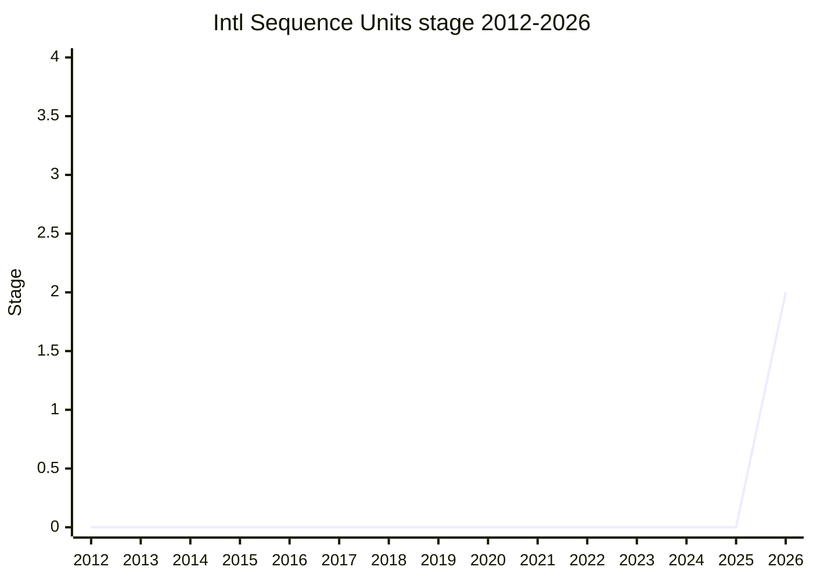

## Overview

Intl Sequence Units lets `Intl.NumberFormat` format one quantity spread across several units, such as "5 ft, 11 in", "1 m, 80 cm" or "7 lb, 4 oz". CLDR calls these "mixed units" and writes them with an `-and-` infix (`foot-and-inch`, `meter-and-centimeter`), as defined in UTS 35. Developers can already build such strings by formatting each part with its own `Intl.NumberFormat` and joining the parts with `Intl.ListFormat` (`type: "unit"`). The champion, [SFC](../people/SFC.md), argued that this approach is linguistically correct but easy to get wrong: several formatters to manage, sign handling for negative values, and the right list style to remember. A single unit-aware entry point is also needed for [Amount](amount.md) and the Intl Unit Protocol, so that code doesn't need a separate path for sequence units.

The Stage 2 design (plenary [2026-05](https://github.com/tc39/notes/blob/main/meetings/2026-05/may-20.md)) takes an `-and-` unit identifier in the constructor. `format()` receives structured input rather than a scalar, and does no arithmetic on it: no balancing and no conversion.

```js
const nf = new Intl.NumberFormat("en", { style: "unit", unit: "foot-and-inch" });

// Stage 2 design (2026-05): an object keyed by the component units
nf.format({ foot: 5, inch: 11 });   // "5 ft, 11 in" (illustrative)
nf.format({ foot: 5, inch: 13 });   // "5 ft, 13 in": out-of-range values are not balanced (#5)
nf.format({ foot: 5 });             // TypeError: every component is required (#2)
nf.format({ foot: 5.5, inch: 1 });  // error: only the smallest unit may be non-integer (#3)
nf.format({ foot: -5, inch: 1 });   // RangeError: mixed signs (#6)

// TG2 2026-08-06 / 2026-09-17: the components become an array in identifier order,
// matching Amount's array-valued .value (via the Intl Unit Protocol)
new Intl.NumberFormat("en", { style: "unit" })
  .format({ value: [10, 50], unit: "meter-and-centimeter" });
```

Only the "sanctioned" sequence unit groups are accepted, in descending order of magnitude, with any subset of each group: mile/yard/foot/inch, kilometer/meter/centimeter/millimeter, stone/pound/ounce, kilogram/gram, gallon/fluid-ounce and liter/milliliter. Time units are not part of the table; whether they should be was the proposal's main open question (#8), and at TG2 2026-10-08 [SFC](../people/SFC.md) described the proposal as not supporting them.

## Stage history

| Meeting                                                                              | Venue   | Event                                                                                                                                                                                                                                                                                                               | Stage |
| ------------------------------------------------------------------------------------ | ------- | ------------------------------------------------------------------------------------------------------------------------------------------------------------------------------------------------------------------------------------------------------------------------------------------------------------------- | ----- |
| [2018-03-16](https://github.com/tc39/ecma402/blob/main/meetings/notes-2018-03-16.md) | TG2     | UnitFormat is "folded to be a part of new "unified" Number format"; for a "list number format" such as "10 meters and 35 centimeters" the answer is ListFormat                                                                                                                                                      | 0     |
| [2020-07-09](https://github.com/tc39/ecma402/blob/main/meetings/notes-2020-07-09.md) | TG2     | First discussion of ecma402#398 "Sequence unit formatting". [SFC](../people/SFC.md) asks whether the math involved is in scope for 402; [ZB](../people/ZB.md) doubts that unit conversions are i18n data. No conclusion                                                                                             | 0     |
| [2024-08-22](https://github.com/tc39/ecma402/blob/main/meetings/notes-2024-08-22.md) | TG2     | Smart Units update: [SFC](../people/SFC.md) pulls mixed-unit formatting out of Smart Unit Preferences and proposes a value-with-unit type (the future Measure) that can hold mixed units                                                                                                                            | 0     |
| [2024-10](https://github.com/tc39/notes/blob/main/meetings/2024-10/october-10.md)    | plenary | Measure reaches Stage 1; mixed-unit representation is part of its scope                                                                                                                                                                                                                                             | 0     |
| [2025-07](https://github.com/tc39/notes/blob/main/meetings/2025-07/july-29.md)       | plenary | Measure renamed Amount; "The scope of the Measure proposal is reduced to leave out compound units and unit conversion"                                                                                                                                                                                              | 0     |
| [2026-03](https://github.com/tc39/notes/blob/main/meetings/2026-03/march-10.md)      | plenary | Amount for Stage 2 (not advanced): [WH](../people/WH.md) names "feet-and-inches or meters-and-centimeters" for person height as a sticking point                                                                                                                                                                    | 0     |
| [2026-03-19](https://github.com/tc39/ecma402/blob/main/meetings/notes-2026-03-19.md) | TG2     | [SFC](../people/SFC.md) revives #398 to answer [WH](../people/WH.md), proposing to split it into its own proposal and ask for Stage 2 directly; [EAO](../people/EAO.md): "at the very least a stage 1 proposal", after researching prior art                                                                        | 0     |
| [2026-04-16](https://github.com/tc39/ecma402/blob/main/meetings/notes-2026-04-16.md) | TG2     | Scope settled: sequence units go into `Intl.NumberFormat` (as sugar over ListFormat), not only into `Amount.prototype.toLocaleString`; no balancing in formatting                                                                                                                                                   | 0     |
| [2026-05-19](https://github.com/tc39/ecma402/blob/main/meetings/notes-2026-05-19.md) | TG2     | (Meeting of 2026-05-07.) Proposal repo presented; issues #1-#7 resolved; support for Stage 2 from [EAO](../people/EAO.md), [RGN](../people/RGN.md), [YSZ](../people/YSZ.md), on condition of integer non-smallest units and a spec table of combinable units                                                        | 0     |
| [2026-05](https://github.com/tc39/notes/blob/main/meetings/2026-05/may-20.md)        | plenary | Reached Stage 1. `Intl Sequence Units for Stage 1 or 2` ([SFC](../people/SFC.md)); support from [NRO](../people/NRO.md), [EAO](../people/EAO.md), [LCA](../people/LCA.md). "Consensus for Stage 1."                                                                                                                 | 0 → 1 |
| [2026-05](https://github.com/tc39/notes/blob/main/meetings/2026-05/may-20.md)        | plenary | Reached Stage 2 in the same slot. "Consensus for Stage 2 with the object-based design"; [EAO](../people/EAO.md) and [DLM](../people/DLM.md) volunteer as Stage 2.7 reviewers                                                                                                                                        | 1 → 2 |
| [2026-06-11](https://github.com/tc39/ecma402/blob/main/meetings/notes-2026-06-11.md) | TG2     | Time units (#8): [SFC](../people/SFC.md) wants them excluded, [RGN](../people/RGN.md) and [EAO](../people/EAO.md) want `minute-and-second` supported; no agreement                                                                                                                                                  | 2     |
| [2026-07-09](https://github.com/tc39/ecma402/blob/main/meetings/notes-2026-07-09.md) | TG2     | Conclusions: zero-valued components are shown, with no hiding option in this proposal (#11); keep the strict Stage 2 unit table despite CLDR's looser rule (#9); arcminute/arcsecond belong in a separate proposal (#13); time units go to TG1 (#8)                                                                 | 2     |
| [2026-07](https://github.com/tc39/notes/blob/main/meetings/2026-07/july-22.md)       | plenary | `Duration units in Amount and Intl Sequence Units`: [WH](../people/WH.md), [RGN](../people/RGN.md), [EAO](../people/EAO.md) lean towards including time units, [PFC](../people/PFC.md) warns against diverging from Temporal. "Continue iterating on the proposal, taking the new perspectives into consideration." | 2     |
| [2026-08-06](https://github.com/tc39/ecma402/blob/main/meetings/notes-2026-08-06.md) | TG2     | Amount #118: converging on an array-valued `.value` (`[10, 50]` with `meter-and-centimeter`) readable by the Intl Unit Protocol, mixed numeric types allowed, no separate `.values`                                                                                                                                 | 2     |
| [2026-09-17](https://github.com/tc39/ecma402/blob/main/meetings/notes-2026-09-17.md) | TG2     | Throw when `Intl.NumberFormat` uses significant-digit rounding with a sequence unit (#14); "TG2 approves switching to an array" for `format()` input (#16). A Sequence Units update is added to the next TG1 agenda                                                                                                 | 2     |



> How to read: the proposal went from nothing to Stage 2 in one plenary slot, at 2026-05 (`may-20.md`): the committee first agreed on Stage 1 for the problem space, and then on Stage 2 for the object-based design. `raw/proposals/ecma402` still lists it under Stage 1 (hence `canonical_stage: 1`), and the plenary agenda index only records the first bullet of the conclusion ("Consensus for Stage 1."), but the full conclusion also says "Consensus for Stage 2 with the object-based design." The 2026-07 plenary (`july-22.md`) was a discussion item with no stage change. Before 2026 the idea had no proposal of its own: it was a TG2 issue (ecma402#398, first discussed 2020-07-09), then part of Smart Unit Preferences and Measure (Stage 1 in 2024-10), until Amount dropped it in 2025-07. The earliest clear mention is TG2 2018-03-16. A plenary remark by [ZB](../people/ZB.md) in 2017-03 about "combining units that we may want to use list formatter for" may be an earlier hint. The TG2 notes file `notes-2026-05-19.md` is headed "2026-05-07 ECMA-402 Meeting".

## Main issues

### Is it Intl's job, and does it need its own proposal?

For years the question was whether sequence units belonged in ECMA-402 at all. When UnitFormat was folded into the unified `Intl.NumberFormat` (TG2 [2018-03-16](https://github.com/tc39/ecma402/blob/main/meetings/notes-2018-03-16.md)), the recorded answer for sequence units was ListFormat: `"list number format" (e.g. 10 meters and 35 centimeters): Introduce a list format`. At the [2020-02](https://github.com/tc39/notes/blob/main/meetings/2020-02/february-6.md) plenary, [WH](../people/WH.md) asked why the new DurationFormat was limited to time when "degrees have degrees, minutes, seconds" and distances are given as "6 feet 5 inches". [SFC](../people/SFC.md) replied: "We have a separate smart units proposal for covering things like feet and inches." When ecma402#398 was first discussed (TG2 [2020-07-09](https://github.com/tc39/ecma402/blob/main/meetings/notes-2020-07-09.md)), the doubt was whether the arithmetic between units was Intl's business:

> [SFC](../people/SFC.md): This involves doing math. Is that something that is in scope for 402? I would appreciate comments on the thread.

[ZB](../people/ZB.md) accepted calendar facts as i18n data, "But is a meter having 100 centimeters i18n information as well?" [SFC](../people/SFC.md) considered it "a high-demand use case" with the data available, but acknowledged "a concern with separation of concerns". A few months later [USA](../people/USA.md) noted, while scoping DurationFormat, that "NumberFormat doesn't yet have nice support for mixed units" (TG2 [2020-09-10](https://github.com/tc39/ecma402/blob/main/meetings/notes-2020-09-10.md)).

The topic came back with Smart Unit Preferences. At TG2 [2024-05-23](https://github.com/tc39/ecma402/blob/main/meetings/notes-2024-05-23.md) [SFC](../people/SFC.md) listed it as a possible sub-proposal: "One sub-proposal is doing formatting of mixed units, which is something that’s motivated on its own." At [2024-08-22](https://github.com/tc39/ecma402/blob/main/meetings/notes-2024-08-22.md) [EAO](../people/EAO.md) noted that feet-and-inches could not be represented for `person-height`, and [SFC](../people/SFC.md) proposed a type that wraps a value with its unit, "supporting mixed units", as the place to solve both conversion abuse and "the issue of needing a good way to pass mixed units into a formatting API in the first place". [SFC](../people/SFC.md) offered to "Put Smart Units on the shelf for a year with the understanding that it’s built on this other smaller proposal." The resulting Measure sketches converted to `"foot-and-inch"` and split the result into an array of measures (TG2 [2024-09-26](https://github.com/tc39/ecma402/blob/main/meetings/notes-2024-09-26.md)). Measure reached Stage 1 at [2024-10](https://github.com/tc39/notes/blob/main/meetings/2024-10/october-10.md), where [BAN](../people/BAN.md) described it as "an object to represent a measurement that can support mixed units". "Sequence unit formatting" was also on TG2's list of possible topics for 2025 (TG2 [2024-10-24](https://github.com/tc39/ecma402/blob/main/meetings/notes-2024-10-24.md)). When Measure became Amount at [2025-07](https://github.com/tc39/notes/blob/main/meetings/2025-07/july-29.md), [EAO](../people/EAO.md) dropped "compound units such as introducing support explicitly for foot-and-inch" from its scope and left them to Smart Units or "potentially an upcoming TG2 or Intl proposal".

That left a gap that [WH](../people/WH.md) exposed when Amount asked for Stage 2 at [2026-03](https://github.com/tc39/notes/blob/main/meetings/2026-03/march-10.md). Converting 2 meters for US `person-height` gives 79 inches, which [WH](../people/WH.md) called incorrect "from a localization point of view", and [WH](../people/WH.md) did not want to standardize a result that would later need a flag to fix:

> [WH](../people/WH.md): Well, I mentioned some of the other issues, which is the combination of rounding and tracking rounding modes that's one sticking part. The other sticking part is feet-and-inches or meters-and-centimeters for international use cases.

Nine days later [SFC](../people/SFC.md) put #398 back on the TG2 agenda ([2026-03-19](https://github.com/tc39/ecma402/blob/main/meetings/notes-2026-03-19.md)), proposing to support CLDR's `-and-` infix, split it into its own proposal, and "ask for stage 2 directly". [EAO](../people/EAO.md) agreed it was a separate, TG2-only proposal, but pushed back on the pace:

> [EAO](../people/EAO.md): I think this absolutely should be at the very least a stage 1 proposal, design space needs to be determined, don’t think we should jump to stage 2 specific solution by next meeting.

[EAO](../people/EAO.md) also asked to see CLDR's design rationale and other libraries' prior art first. At TG2 [2026-04-16](https://github.com/tc39/ecma402/blob/main/meetings/notes-2026-04-16.md) [SFC](../people/SFC.md) questioned whether the proposal was needed at all, since everything could be done with NumberFormat plus ListFormat. [EAO](../people/EAO.md) answered "It’s good sugar", and [SFC](../people/SFC.md) asked "Yes, but is it worth that sugar?" [EAO](../people/EAO.md) argued from least surprise: if Amount's unit preferences produce `foot-and-inch`, and NumberFormat supports `foot`, `inch` and `-per-`, users would expect `-and-` to work too. [RGN](../people/RGN.md) set a limit on where the logic could live:

> [RGN](../people/RGN.md): To clarify my position on the previous: I would be okay with Intl.NumberFormat instances accepting Amounts with mixed units and formatting them with ListFormat operations. I would also be comfortable with introducing an AmountFormat. I would not be okay with just Amount.prototype.toLocaleString, uniquely of all toLocaleStrings, not being represented as Intl format operations.

[EAO](../people/EAO.md) and [JMN](../people/JMN.md) agreed. [SFC](../people/SFC.md) raised a cost: a formatter constructed for `foot-and-inch` must prepare both unit formatters and a list formatter, turning NumberFormat further into "a big union of different fomatters". TG2 settled on NumberFormat as the only home. At the [2026-05](https://github.com/tc39/notes/blob/main/meetings/2026-05/may-20.md) plenary, [SFC](../people/SFC.md) cited DurationFormat as precedent: most of it could also be glued together from NumberFormat and ListFormat, yet it was judged error-prone enough to deserve a formatter. [NRO](../people/NRO.md) and [LCA](../people/LCA.md) supported Stage 1 ("It's a problem that I personally have run into frequently."). In the Amount item the same day, [WH](../people/WH.md) made Amount's safety depend on this proposal: "As long as this proposal is not released to the web before the sequence proposal gets there, that should solve that problem."

### Scalar or structured input (#1), then an array (#16)

The long-running technical question was how to pass the value. A scalar has to be expressed in one of the units. At TG2 [2026-03-19](https://github.com/tc39/ecma402/blob/main/meetings/notes-2026-03-19.md) [SFC](../people/SFC.md) explained that CLDR indexes on the largest unit (the smaller units expand the fraction: 4.25 feet becomes 4 feet 3 inches), while indexing on the smallest unit keeps the arithmetic in integers and avoids specifying floating-point rounding. [SFC](../people/SFC.md)'s example indexes on inches:

```
.format({ value: 76.3, unit: "foot-and-inch" }) // "5 feet, 4.3 inches"
```

[RGN](../people/RGN.md) asked about degree-arcminute-arcsecond, where decimal fractions can start at different components, so that the largest unit alone is ambiguous. By TG2 [2026-05-19](https://github.com/tc39/ecma402/blob/main/meetings/notes-2026-05-19.md) (meeting of 2026-05-07) [SFC](../people/SFC.md) had switched to a structure keyed by unit, because it needs no unit conversion ("we don’t have to assign meaning to the units"). [RGN](../people/RGN.md), [JMN](../people/JMN.md) and [DLM](../people/DLM.md) preferred it; for [JMN](../people/JMN.md) it fit "not assigning meaning to the units, e.g. 6 feet 5 ounces".

At the [2026-05](https://github.com/tc39/notes/blob/main/meetings/2026-05/may-20.md) plenary [SFC](../people/SFC.md) presented the scalar as the rejected alternative and invited the committee to reopen it. [JHD](../people/JHD.md) found the largest unit the obvious reading of a scalar ("if you said I am six and a half foot and inches who's going to expect your anything but six six?"). [EAO](../people/EAO.md) replied that fraction-digit options apply only to the smallest unit, so a scalar would be misread whichever unit it used. [WH](../people/WH.md) sided with integer arithmetic:

> [WH](../people/WH.md): If we decide to go with scalar input, we should pass in the smallest units otherwise we'll get constant fights with roundoff errors. If you have meters and millimeters then you'll be constantly fighting with floating point roundoff if you provide the input in meters. If you provide it in millimeters then it's just integer arithmetic which works much better.

[NRO](../people/NRO.md) asked for automatic splitting of a labelled value (`{ foot: 5.5 }`), since data is usually stored as one number. [SFC](../people/SFC.md) deferred that to Amount's unit conversion, by analogy with DurationFormat leaving balancing to `Temporal.Duration`. [SFC](../people/SFC.md) noted that a scalar would have advantages too: guaranteed normalized input, and no nested field reading once the Intl Unit Protocol wraps the value. Stage 2 was granted "with the object-based design", with [JHD](../people/JHD.md)'s support relayed as "A scalar can be added later. End of message".

The shape changed again through Amount. Amount needed a way to hold several values, and at TG2 [2026-08-06](https://github.com/tc39/ecma402/blob/main/meetings/notes-2026-08-06.md) (proposal-amount#118) [SFC](../people/SFC.md) reported that the numerics call found a non-primitive `.value` acceptable. [EAO](../people/EAO.md) recalled agreement on an array ordered as in the `-and-` identifier, and [RGN](../people/RGN.md) wanted uniformity between Amount and Intl, whether array or object. [RGN](../people/RGN.md) found mixing numeric types in the array "distasteful". [EAO](../people/EAO.md) gave a use case (BigInt for the larger integer components, an exact decimal string for the last), and [RGN](../people/RGN.md) did not object. With a polymorphic `.value` there is no need for a `.values` field, "So intl unit protocol shouldn’t go looking for it" ([EAO](../people/EAO.md)). At TG2 [2026-09-17](https://github.com/tc39/ecma402/blob/main/meetings/notes-2026-09-17.md) (issue #16) [SFC](../people/SFC.md) proposed the same array for `format()` itself; [JMN](../people/JMN.md): "It feels like a much nicer data model." Conclusion: "TG2 approves switching to an array." This departs from the object design approved at plenary and has not yet been presented there.

How exactly `format()` should read that array (issue #19: Iterable vs. array-like vs. `IsArray`) was on the agenda at TG2 [2026-10-08](https://github.com/tc39/ecma402/blob/main/meetings/notes-2026-10-08.md), but was not discussed on its merits. [EAO](../people/EAO.md) asked to skip the issue "because it's in violation of the TC39 AI policy". [SFC](../people/SFC.md) replied "My position on the AI policy is not a position of TG2, it's my personal position" and asked to discuss the content. [EAO](../people/EAO.md) declined: "If there are issues with the AI policy, we should work those out first in the appropriate channels." Conclusion: "Postpone." The input-handling question is open.

### Field reading and validation: missing, extra, out-of-range and negative values (#2, #4, #5, #6)

TG2 [2026-05-19](https://github.com/tc39/ecma402/blob/main/meetings/notes-2026-05-19.md) settled the edge cases one by one, mostly by the "not coercing things" principle ([EAO](../people/EAO.md)):

- **Missing component (#2)**: TypeError, not an inferred 0 (+1 from [RGN](../people/RGN.md) and [EAO](../people/EAO.md); one +1 is unattributed in the notes).
- **Extraneous fields (#4)**: ignored. Only the units named in the identifier are read. [SFC](../people/SFC.md) and [RGN](../people/RGN.md) noted that this differs from DurationFormat, which always reads all of its fields and displays the non-zero ones. [SFC](../people/SFC.md) highlighted the difference again at plenary.
- **Out-of-range values (#5)**: "5 feet, 20 inches" gets "no semantic meaning attached" ([SFC](../people/SFC.md)). Consistent with the no-balancing decision of [2026-04-16](https://github.com/tc39/ecma402/blob/main/meetings/notes-2026-04-16.md), where [SFC](../people/SFC.md) argued that balancing belongs in Amount's `convertTo`, just as DurationFormat leaves it to `Temporal.Duration`. At plenary [WH](../people/WH.md) confirmed that 5 foot 13 inches formats as "5 ft 13 in".
- **Negative numbers (#6)**: all components must have the same sign, otherwise RangeError, and the sign is shown once, on the largest unit. This copies DurationFormat ([SFC](../people/SFC.md): "We spent 2 meetings dissecting this behaviour a year ago."). At plenary [SFC](../people/SFC.md) said CLDR had accepted it for its own specification.

At the same meeting [EAO](../people/EAO.md) asked for the duplicated logic in the `format` and `formatToParts` spec text to be extracted into an abstract operation, "but that’s a stage 2 concern".

### Which units may be combined, and in which order (#7, #9)

The first repo draft did not check that the component units were compatible, so `foot-and-pound` was accepted. At TG2 [2026-05-19](https://github.com/tc39/ecma402/blob/main/meetings/notes-2026-05-19.md) (#7, `inch-and-foot` vs `foot-and-inch`) [EAO](../people/EAO.md) wanted any order allowed ("If someone wants inch-and-foot formatting, let them have it"). [EAO](../people/EAO.md) doubted any locale orders components other than largest-first, and a fixed order would require validating unit IDs. [RGN](../people/RGN.md) objected that the identifier is data while display order is localization:

> [RGN](../people/RGN.md): If it does exist, we’ve painted ourselves into a corner. We’re handling a localization problem as a data problem, which is inappropriate.

[SFC](../people/SFC.md) sided with [RGN](../people/RGN.md) ("My thinking: garbage in, garbage out. Only supporting the 47 sanctioned units."), [EAO](../people/EAO.md) answered "YAGNI" and suggested validating by category, and the compromise was a spec table of unit groups with a fixed descending order. [EAO](../people/EAO.md) noted that the resulting `IsWellFormedUnitIdentifier` change forbids combining `-per-` and `-and-`. At plenary [SFC](../people/SFC.md) tied the table to the principle from the March 2026 unit discussions that every unit must be individually motivated. [BSH](../people/BSH.md) asked whether the groups vary by locale; they do not ("The sanctioned sequence unit groups is not locale specific."). [SFC](../people/SFC.md) said new units, such as watt and kilowatt from Intl Energy Units, would presumably form new groups.

The open question left for Stage 2 was whether same-dimension units that are not integer multiples (meter and inch) should be allowed, as CLDR does (issue #9). At TG2 [2026-07-09](https://github.com/tc39/ecma402/blob/main/meetings/notes-2026-07-09.md) [SFC](../people/SFC.md) reported that CLDR agreed to require descending order but rejected the integer-multiple rule as "overly strict" (mile-and-meter, kilogram-and-ounce). [EAO](../people/EAO.md) and [DLM](../people/DLM.md) preferred to treat such combinations as mistakes until someone shows a real use. Conclusion: "Stick with the stricter table that was approved in the Stage 2 proposal. Can revisit in a future proposal."

### Rounding: integer intermediate units (#3) and no significant digits (#14)

`Intl.NumberFormat` digit options have to apply to some component. TG2 decided they apply only to the smallest unit, and that every larger component must be an integer, otherwise the call throws (TG2 [2026-05-19](https://github.com/tc39/ecma402/blob/main/meetings/notes-2026-05-19.md), #3). [SFC](../people/SFC.md) objected to errors that depend on the data: code tested with integers could crash in production on a binary float. [RGN](../people/RGN.md) and [EAO](../people/EAO.md) prevailed. [RGN](../people/RGN.md) drew a "Strong distinction between integer and non-integer". [EAO](../people/EAO.md) noted that the same error applies to mismatched signs, and that CLDR's text shows no locale styling a non-integer in any component but the last. `Temporal.Duration` and `Intl.DurationFormat` behave the same way. At plenary [SFC](../people/SFC.md) reported that the CLDR meeting was "okay adopting" the integer rule.

Significant digits came next (issue #14, TG2 [2026-09-17](https://github.com/tc39/ecma402/blob/main/meetings/notes-2026-09-17.md)). With non-decimal ratios between units, a significant-digit count has no clear meaning across the components. [JMN](../people/JMN.md) noted that Amount already throws in the analogous case. [EAO](../people/EAO.md)'s suggestion on the issue covered `maximumSignificantDigits` only, but [SFC](../people/SFC.md) and [RGN](../people/RGN.md) extended it to `minimumSignificantDigits` and to any `roundingPriority` except `"auto"`, because otherwise:

> [SFC](../people/SFC.md): We're being a bit more strict. A concern I have with allowing minimumSignificantDigits is that we would need to define an algorithm for how to split the significant digits between the units in the sequence unit, which seems like a brittle area we don't need to explore, so we shouldn't eagerly explore it until we have a use case.

Conclusion: "Throw an exception when the Intl.NumberFormat is configured to use significant digit rounding, which is tracked by the `[[RoundingType]]` slot." The exact order of option reads is left to the PR.

### Zero-valued components: "6 ft 0 in" (#11)

At the Stage 1 request ([2026-05](https://github.com/tc39/notes/blob/main/meetings/2026-05/may-20.md)) [WH](../people/WH.md) asked whether a height of exactly six feet displays as "6 ft 0 in" or "6 ft", and whether developers get a choice. [SFC](../people/SFC.md)'s first reaction was "it should be an option", like the existing hiding of trailing zeros on integers. At TG2 [2026-07-09](https://github.com/tc39/ecma402/blob/main/meetings/notes-2026-07-09.md) [SFC](../people/SFC.md) changed position. DurationFormat has one display toggle per field, which is only possible because it has about ten fields ("Metacomment: litigating DurationFormat is annoying."), and [SFC](../people/SFC.md) now preferred to show zero components and let developers drop a unit from the data, or hide zeros during Amount conversion. [EAO](../people/EAO.md) saw these as trailing zeros and wanted `trailingZeroDisplay` (the NumberFormat v3 option extended by [Intl Keep Trailing Zeros](intl-keep-trailing-zeros.md)) to cover them, perhaps with a new value. [SFC](../people/SFC.md) answered that that option deals with fraction digits, not whole zero components. [DLM](../people/DLM.md) agreed with [SFC](../people/SFC.md): show zeros by default, solve it later "if there’s evidence that it needs to be solved". [EAO](../people/EAO.md) accepted, noting the asymmetry: "It seems somewhat weird if "6ft 0in" is strippable but "0ft 6in" is not." Conclusion: show zero-valued fields by default; a hiding option may come later, "but not in this proposal".

### Time units (#8) and arcminute/arcsecond (#13)

The Stage 2 table leaves out time units. At TG2 [2026-06-11](https://github.com/tc39/ecma402/blob/main/meetings/notes-2026-06-11.md) [SFC](../people/SFC.md) defended this. Some combinations are unsafe (day-and-hour across time zone transitions, month-and-day across calendars), and the problem is already solved by `Temporal.Duration` with `Intl.DurationFormat`, including the digital style:

> [SFC](../people/SFC.md): By exporting the behavior here, we’re suggesting that developers can…we have the problem solved somewhere else. Durations are hard to format, and we did that work. We spent a long time working on that. We don’t want to encourage developers to format durations using sequence units.

[RGN](../people/RGN.md) and [EAO](../people/EAO.md) disagreed. The API does no balancing, the sequence is only formatted, and CLDR's `units.xml` (which Amount's conversion is built on) contains `minute-and-second` in its unit preferences. [EAO](../people/EAO.md): "We should support minute-and-second." [RGN](../people/RGN.md): "I disagree that there must be just one way to do it." With no agreement, TG2 [2026-07-09](https://github.com/tc39/ecma402/blob/main/meetings/notes-2026-07-09.md) concluded "Bring this discussion to TG1". [EAO](../people/EAO.md) saw little point in taking it to the numerics call instead, since its participants overlap almost entirely with TG2.

At the [2026-07](https://github.com/tc39/notes/blob/main/meetings/2026-07/july-22.md) plenary [SFC](../people/SFC.md) presented both positions for Amount and for Intl Sequence Units, with no recommendation. The exclusion side: duration footguns, DurationFormat was deliberately kept separate from NumberFormat, Amount already supports units Intl cannot format, and the Intl table is already a subset of CLDR. The inclusion side: CLDR alignment, ergonomics after `convertTo`, generic code, and "not a formatting hazard". [EAO](../people/EAO.md) argued that NumberFormat's sequence formatting would be "a strict subset of the functionality provided by `Intl.DurationFormat`" for time units. [WH](../people/WH.md) found the inclusion arguments convincing ("That's just arbitrary friction for users that doesn't accomplish anything."). [RGN](../people/RGN.md) called a special exclusion perverse for Amount, which accepts any well-formed unit: "That you could have bushel-and-peck but not hour-and-minute, for instance." [PFC](../people/PFC.md) took no side on Amount but set a constraint:

> [PFC](../people/PFC.md): I don't really have a strong position on whether Amount should support the duration units. I do have a strong position on not ending up with two things that make different choices about duration units.

[EAO](../people/EAO.md) replied that NumberFormat does no conversion at all ("seconds never become minutes"). The remaining conflict is between Temporal and CLDR `units.xml`, which defines a month as a twelfth of a year; [SFC](../people/SFC.md) and [PFC](../people/PFC.md) agreed to list the problematic conversions. [EAO](../people/EAO.md) raised a new direction: should an Amount with time units format through `Intl.DurationFormat`? The conclusion was only to "Continue iterating on the proposal, taking the new perspectives into consideration". The question was left unresolved.

At TG2 [2026-10-08](https://github.com/tc39/ecma402/blob/main/meetings/notes-2026-10-08.md) [SFC](../people/SFC.md) opened the Amount topic (proposal-amount#139) with "Intl Sequence Units does not support time units", adding "This only impacts Intl.NumberFormat, not Amount." Nobody disputed this for NumberFormat. [EAO](../people/EAO.md) answered that time-unit Amounts should then format through `Intl.DurationFormat` ("If we can't make it work through Intl.NumberFormat, we should make it work through Intl.DurationFormat"), while still preferring that NumberFormat support them. The notes do not say where the exclusion was settled. It may come from the Sequence Units update that TG2 2026-09-17 put on the next plenary agenda (the Editors' update at this meeting mentions TG1 approvals "last week"; those plenary notes are not yet available), or it may restate the Stage 2 unit table. Either way, the open part of the question has moved to how Amount formats time units; see [Amount](amount.md#time-and-duration-units).

Arcminute and arcsecond, used as examples throughout, are not ECMA-402 units ([EAO](../people/EAO.md) at TG2 [2026-05-19](https://github.com/tc39/ecma402/blob/main/meetings/notes-2026-05-19.md) and at plenary; the minute and second units Intl has are durations). [RGN](../people/RGN.md) argued that sequence units motivate them, citing geographic coordinates on Wikipedia (TG2 [2026-06-11](https://github.com/tc39/ecma402/blob/main/meetings/notes-2026-06-11.md)). At [2026-07-09](https://github.com/tc39/ecma402/blob/main/meetings/notes-2026-07-09.md) (#13) [EAO](../people/EAO.md) and [SFC](../people/SFC.md) agreed that new units should follow the Intl Energy Units model of a separate proposal.

## Related proposals

- [Amount](amount.md) — held mixed units while it was Measure (2024-10 to 2025-07); its `person-height` conversion to `foot-and-inch` motivated splitting this proposal out, and its array-valued `.value` (proposal-amount#118) drove the switch to array input. Time-unit support (#8) was discussed jointly; by TG2 2026-10-08 the open part is how Amount formats time units (proposal-amount#139).
- [Intl Unit Protocol](intl-unit-protocol.md) ("explore associating a unit with a number") — the `{ value, unit }` protocol through which `Intl.NumberFormat` reads Amount-like objects; TG2 agreed it reads only `.value` and `.unit`, with `.value` possibly an array for sequence units.
- [Smart Unit Preferences in Intl.NumberFormat](smart-unit-preferences.md) — locale- and usage-based unit selection (e.g. US `person-height` gives feet and inches); sequence units were once treated as part of it (2020-02, 2024).
- [Intl.DurationFormat](intl-durationformat.md) — the precedent for formatting compound values: same-sign rule, no balancing, integer-only non-smallest fields. It differs in reading all fields, per-field zero display and a digital style, and it is the current answer for time units.
- [Intl Keep Trailing Zeros](intl-keep-trailing-zeros.md) — `trailingZeroDisplay` was proposed and rejected as the way to hide zero-valued components (#11).
- `intl-energy-units` — the precedent for motivating each new unit, and the model for a separate arcminute/arcsecond proposal.

## Sources

TG2:

- https://github.com/tc39/ecma402/blob/main/meetings/notes-2018-03-16.md
- https://github.com/tc39/ecma402/blob/main/meetings/notes-2020-07-09.md
- https://github.com/tc39/ecma402/blob/main/meetings/notes-2020-09-10.md
- https://github.com/tc39/ecma402/blob/main/meetings/notes-2024-05-23.md
- https://github.com/tc39/ecma402/blob/main/meetings/notes-2024-08-22.md
- https://github.com/tc39/ecma402/blob/main/meetings/notes-2024-09-26.md
- https://github.com/tc39/ecma402/blob/main/meetings/notes-2024-10-24.md
- https://github.com/tc39/ecma402/blob/main/meetings/notes-2026-03-19.md
- https://github.com/tc39/ecma402/blob/main/meetings/notes-2026-04-16.md
- https://github.com/tc39/ecma402/blob/main/meetings/notes-2026-05-19.md
- https://github.com/tc39/ecma402/blob/main/meetings/notes-2026-06-11.md
- https://github.com/tc39/ecma402/blob/main/meetings/notes-2026-07-09.md
- https://github.com/tc39/ecma402/blob/main/meetings/notes-2026-08-06.md
- https://github.com/tc39/ecma402/blob/main/meetings/notes-2026-09-17.md
- https://github.com/tc39/ecma402/blob/main/meetings/notes-2026-10-08.md

Plenary:

- https://github.com/tc39/notes/blob/main/meetings/2017-03/mar-21.md
- https://github.com/tc39/notes/blob/main/meetings/2020-02/february-6.md
- https://github.com/tc39/notes/blob/main/meetings/2024-10/october-10.md
- https://github.com/tc39/notes/blob/main/meetings/2025-07/july-29.md
- https://github.com/tc39/notes/blob/main/meetings/2026-03/march-10.md
- https://github.com/tc39/notes/blob/main/meetings/2026-05/may-20.md
- https://github.com/tc39/notes/blob/main/meetings/2026-07/july-22.md
