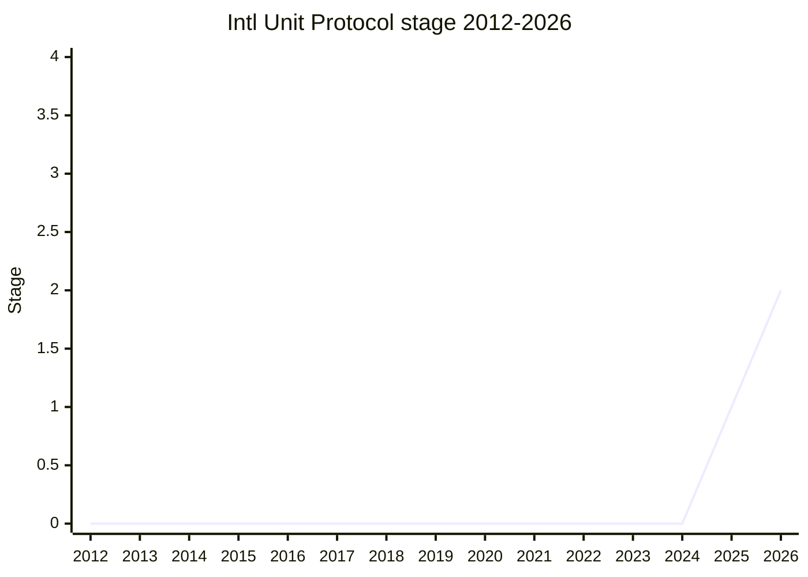

## Overview

Intl Unit Protocol lets `Intl.NumberFormat` take a number together with its unit in `format()`, rather than only the number. Today the unit (or currency) goes into the constructor and the number into `format()`, so the two are kept apart. That is awkward for message formatting: a placeholder such as a road distance has no way to carry a value paired with a unit. The champion, [SFC](../people/SFC.md), argued that "a number ought to be annotated with the quantity it is measuring". The unit is part of the data, not a formatting option, and keeping it with the data is the precondition for features such as automatic unit conversion. The canonical table lists the proposal under its Stage 1 problem statement, "explore associating a unit with a number", with [SFC](../people/SFC.md) as author and champion. The plenary approved Stage 2 in [2026-03](https://github.com/tc39/notes/blob/main/meetings/2026-03/march-11.md) with [RGN](../people/RGN.md) and [ACE](../people/ACE.md) as Stage 2.7 reviewers.

The proposal was split out of [Amount](amount.md). Plenary had asked whether Amount was more than a NumberFormat options bag, and TG3 had objected to `Intl.NumberFormat` reading Amount's internal slots. [SFC](../people/SFC.md) called the new proposal "the unit protocol piece of the amount proposal". It works without any new built-in. The protocol is an object with two public fields, `value` (anything `format()` accepts today: Number, BigInt or a decimal string, later Decimal) and `unit`. Amount will expose the same fields as getters, so an Amount can be passed straight to a formatter. In the spec, a new abstract operation `GetNumberFormatInput` reads the fields and wraps `ToIntlMathematicalValue`.

```js
// Today: the unit goes into the constructor, the number into format()
new Intl.NumberFormat("en", { style: "unit", unit: "kilometer" }).format(12.5);

// Stage 2 design (2026-03): value and unit travel together into format()
const nf = new Intl.NumberFormat("en", { style: "unit" });
nf.format({ value: 12.5, unit: "kilometer" });    // "12.5 km" (illustrative)
nf.format({ value: "12.50", unit: "kilometer" }); // a string value keeps its trailing zeros
nf.format(amount);                                 // an Amount exposes the same value/unit getters

// Currencies are units too: the `unit` field holds an ISO 4217 code (three uppercase letters)
new Intl.NumberFormat("en", { style: "currency" }).format({ value: 100, unit: "EUR" }); // illustrative; constructor rules not settled in the notes

// Conflicting units: RangeError for now; conversion once Amount supplies a non-Intl conversion API
new Intl.NumberFormat("en", { style: "unit", unit: "meter" })
  .format({ value: 1234, unit: "kilometer" }); // RangeError

// TG2 2026-08-06: sequence units take an array-valued `value` (no separate `.values`)
nf.format({ value: [10, 50], unit: "meter-and-centimeter" });
```

The proposal is deliberately coupled to Amount. [SFC](../people/SFC.md) said at the Stage 2 request that it would not move past Stage 2 until the conflicting-units question is settled, and that settling it requires Amount's conversion API. Amount reached Stage 2 in [2026-05](https://github.com/tc39/notes/blob/main/meetings/2026-05/may-20.md). Since then TG2 has worked on aligning the three related proposals (Amount, this one and [Intl Sequence Units](intl-sequence-units.md)). An Intl Unit Protocol update was put on the 2026-09 plenary agenda at TG2 [2026-09-17](https://github.com/tc39/ecma402/blob/main/meetings/notes-2026-09-17.md).

## Stage history

| Meeting                                                                              | Venue   | Event                                                                                                                                                                                                                                                                                                                                                                                              | Stage |
| ------------------------------------------------------------------------------------ | ------- | -------------------------------------------------------------------------------------------------------------------------------------------------------------------------------------------------------------------------------------------------------------------------------------------------------------------------------------------------------------------------------------------------- | ----- |
| [2024-07-18](https://github.com/tc39/ecma402/blob/main/meetings/notes-2024-07-18.md) | TG2     | During the Decimal check-in, [EAO](../people/EAO.md) asks whether TG2 should "design a protocol for input into NumberFormat and PluralRules" that carries a value plus currency, unit and fraction digits                                                                                                                                                                                          | 0     |
| [2025-02](https://github.com/tc39/notes/blob/main/meetings/2025-02/february-20.md)   | plenary | Amount continuation: [KG](../people/KG.md) proposes making NumberFormat "accept like an object that has a type and amount property" instead of adding a type; summary: "Requests to explore a protocol-based approach"                                                                                                                                                                             | 0     |
| [2025-07](https://github.com/tc39/notes/blob/main/meetings/2025-07/july-29.md)       | plenary | Amount Stage 2 request: "[KG](../people/KG.md) and [MM](../people/MM.md) expressed a strong preference to avoiding any Amount internal slot access from `Intl.NumberFormat` during formatting"                                                                                                                                                                                                     | 0     |
| [2025-09](https://github.com/tc39/notes/blob/main/meetings/2025-09/september-22.md)  | plenary | Amount update: [JMN](../people/JMN.md) reports that TG3 agreed slot reading is problematic "especially for thinking about membranes and membrane transparency and proxies"; on 09-24 [KG](../people/KG.md), [MM](../people/MM.md) and [JRL](../people/JRL.md) restate the rule (slots on `this`, public interface on arguments) while [JHD](../people/JHD.md) and [WH](../people/WH.md) dispute it | 0     |
| [2025-11](https://github.com/tc39/notes/blob/main/meetings/2025-11/november-18.md)   | plenary | Reached Stage 1. `Intl Unit Protocol` ([SFC](../people/SFC.md)), split out of Amount; support from [DLM](../people/DLM.md) and others, no objections. [JHD](../people/JHD.md) asks to settle "first classness" and conflicting units before Stage 2. Conclusion: "Stage 1 for “explore associating a unit with a number”"                                                                          | 0 → 1 |
| [2026-02-19](https://github.com/tc39/ecma402/blob/main/meetings/notes-2026-02-19.md) | TG2     | #3: conflicting units should convert once Amount has `convertTo`, starting with a RangeError; #2 draft conclusion: "Intl Unit Protocol should use object bag approach"; listed for TG1 as "Intl Unit Protocol maybe for Stage 2"                                                                                                                                                                   | 1     |
| [2026-03](https://github.com/tc39/notes/blob/main/meetings/2026-03/march-11.md)      | plenary | Reached Stage 2. `Intl Unit Protocol for Stage 2` ([SFC](../people/SFC.md)): fields renamed `number` → `value` and `currency` → `unit`; support from [KG](../people/KG.md), [JKP](../people/JKP.md) and others. [ACE](../people/ACE.md) flags a web-compat break. "Approved for Stage 2"; [RGN](../people/RGN.md) and [ACE](../people/ACE.md) are the Stage 2.7 reviewers; the name is kept        | 1 → 2 |
| [2026-03-19](https://github.com/tc39/ecma402/blob/main/meetings/notes-2026-03-19.md) | TG2     | #5 (fallback for non-protocol objects): sniff for the fields and otherwise fall back to `ToPrimitive`; two ways to test for `unit` (`in`-style presence vs. a non-`undefined` read) are written up; no conclusion                                                                                                                                                                                  | 2     |
| [2026-04-16](https://github.com/tc39/ecma402/blob/main/meetings/notes-2026-04-16.md) | TG2     | #5 continued: `unit: null` vs. `unit: undefined` for no-unit values; [SFC](../people/SFC.md): "Don’t intend to advance until Amount has advanced". The issue is left open until Amount reaches Stage 2                                                                                                                                                                                             | 2     |
| [2026-05](https://github.com/tc39/notes/blob/main/meetings/2026-05/may-20.md)        | plenary | Amount reaches Stage 2. [EAO](../people/EAO.md) lists the no-unit representation as an open Stage 2 issue tied to this proposal: `null` is "much more convenient" than `undefined` for NumberFormat's sniffing                                                                                                                                                                                     | 2     |
| [2026-08-06](https://github.com/tc39/ecma402/blob/main/meetings/notes-2026-08-06.md) | TG2     | proposal-amount#118: `value` may be an array for sequence units, with no `.values` field. #5: the protocol applies when `Get` of both `value` and `unit` returns something other than `undefined`; past that point no fallback, errors throw; a no-unit value is rejected by unit formatting                                                                                                       | 2     |



> How to read: Stage 1 came at the 2025-11 plenary (`november-18.md`, item "Intl Unit Protocol") and Stage 2 at the 2026-03 plenary (`march-11.md`, "Intl Unit Protocol for Stage 2"). **Canonical lag**: `raw/proposals/ecma402/README.md` still lists the proposal under Stage 1 as "explore associating a unit with a number" (`canonical_stage: 1`), and its Meeting Notes column has only the 2025-11 anchor. The plenary Conclusion "Approved for Stage 2" is clear, and [SFC](../people/SFC.md) confirmed it at TG2 2026-08-06 ("This proposal reached stage 2 in the 113th meeting, so since March"). Two days after Stage 1, in the Amount update ([2025-11](https://github.com/tc39/notes/blob/main/meetings/2025-11/november-20.md), `november-20.md`), [BAN](../people/BAN.md) described the protocol as "currently at Stage 0", which was out of date. The 2024-2025 rows are prehistory, recorded under Amount: the idea of a NumberFormat input protocol (TG2 2024-07-18) and the plenary pressure for a protocol instead of internal slots. The canonical table links `sffc/proposal-intl-unit-protocol`, while TG2 notes from 2026-03-19 on link `tc39/proposal-intl-unit-protocol`, so the repository seems to have moved to the tc39 organisation after Stage 2.

## Main issues

### A protocol, a built-in type, or both?

The protocol came out of the objections to Amount. At the [2025-02](https://github.com/tc39/notes/blob/main/meetings/2025-02/february-20.md) Amount continuation, [KG](../people/KG.md) was "not convinced that this warrants a new type", and [JHD](../people/JHD.md) called Amount an "Intl NumberFormat options bag factory". [DLM](../people/DLM.md) suggested an options bag as a less heavy-handed alternative. At [2025-07](https://github.com/tc39/notes/blob/main/meetings/2025-07/july-29.md) [KG](../people/KG.md) argued that if NumberFormat reads properties of an Amount, a plain object with those properties works without any Amount type ("You just pass what [SFC](../people/SFC.md) was referring to as a protocol"). The protocol idea was older. At TG2 [2024-07-18](https://github.com/tc39/ecma402/blob/main/meetings/notes-2024-07-18.md) [EAO](../people/EAO.md) asked whether to "design a protocol for input into NumberFormat and PluralRules" that would carry currency, units and fraction digits, so that Decimal would not need its own integration. At TG2 [2024-09-26](https://github.com/tc39/ecma402/blob/main/meetings/notes-2024-09-26.md) [NRO](../people/NRO.md) suggested a "symbol-based protocol" for propagating precision into Intl.

[SFC](../people/SFC.md)'s answer at the [2025-11](https://github.com/tc39/notes/blob/main/meetings/2025-11/november-18.md) Stage 1 request was to split the protocol out and keep both proposals. The protocol "does not replace the amount proposal", and TG3 had established that "the amount proposal sort of requires having a unit protocol". When [EAO](../people/EAO.md) asked for the problem statement, [SFC](../people/SFC.md) described "a method for associating a unit with an amount that is fully encapsulated within `Intl.NumberFormat` that does not involve adding primordial to the language". [JHD](../people/JHD.md) was uneasy about a protocol with no built-in that implements it:

> [JHD](../people/JHD.md): This is sort after design principle that everyone may not share, but that’s my—like, I have this discomfort in general with adding a protocol that doesn’t have an associated first class thing.

[JHD](../people/JHD.md) pointed to thenables and promises, set-likes and Sets, and Temporal property bags, and expected Amount to be "the real amountable". [NRO](../people/NRO.md) saw no protocol at all, only "just an options bag" shared by two functions. [JRL](../people/JRL.md) suggested that NumberFormat could special-case Amount and read Amount's own public interface, whatever it is. [SFC](../people/SFC.md) rejected a second protocol: "it would be better to just have a single protocol that we think solves the use case." [DLM](../people/DLM.md) supported Stage 1 and asked why the split came now. [SFC](../people/SFC.md) answered that the protocol had kept coming up at plenary as "hidden inside the amount object", and that, being a subset, it would presumably advance first. [JHD](../people/JHD.md) did not object to Stage 1, but asked that "first classness" and conflicting units be worked out offline before Stage 2.

By [2026-03](https://github.com/tc39/notes/blob/main/meetings/2026-03/march-11.md) the two proposals had a fixed relation. Amount "will have the getters listed on the previous slide", and these define what a userland Amount polyfill must expose to work with Intl. [SFC](../people/SFC.md): "Do you see it as an alternative to Amount? No." [KG](../people/KG.md), the original advocate of a protocol-only design, supported Stage 2:

> [KG](../people/KG.md): +1 for stage 2, and thank you for doing this in terms of public protocol. I know we'd previously considered reading internal fields. I think reading public properties and having Amount have those fields ends up being a good design.

### Reading public fields instead of internal slots

The first Amount spec text had `Intl.NumberFormat` brand-check Amount's internal slots. At [2025-07](https://github.com/tc39/notes/blob/main/meetings/2025-07/july-29.md) [KG](../people/KG.md) cited the membrane-transparency outcome of the Set methods discussion: "I think you should just be reading properties. Not internal slots." [MM](../people/MM.md) called slot access on a non-`this` argument "a trip wire for me". At [2025-09](https://github.com/tc39/notes/blob/main/meetings/2025-09/september-22.md) [JMN](../people/JMN.md) reported that TG3 had agreed it is problematic. At the [2025-09](https://github.com/tc39/notes/blob/main/meetings/2025-09/september-24.md) continuation [KG](../people/KG.md) said "We have said things that consume these won’t look at internal slots". [JHD](../people/JHD.md) and [WH](../people/WH.md) disagreed ("As far as I can tell, we haven't reached consensus on not using internal slots"), on the grounds that only branding guarantees Amount's invariants. [JRL](../people/JRL.md) summed up the precedent: a method may read slots on `this`, but an argument is read "via the public interface". [SFC](../people/SFC.md) repeated this TG3 feedback at the Stage 1 request, and it is the reason the protocol is defined by fields rather than by a brand check. The Amount-side history is on [Amount](amount.md#how-intl-reads-an-amount-internal-slots-vs-a-public-protocol).

### Shape and naming: fields, functions, Symbols or a string

At Stage 1 [SFC](../people/SFC.md) set out the possible shapes of the protocol: an object with named fields (the README design, best for object literals), getter-like functions (which signal that an operation is not free, as `Intl.Locale` info moved from getters to functions), Symbol-named functions like `Symbol.iterator` (tightly encapsulated, but not writable as a literal), or an annotated string. [SFC](../people/SFC.md) asked whether to design for Amount or for direct use. At TG2 [2026-02-19](https://github.com/tc39/ecma402/blob/main/meetings/notes-2026-02-19.md) (issue #2) [SFC](../people/SFC.md) preferred reading two fields. Classes can still expose them as read-only getters, and the split of value and unit in the reworked Amount fits. [EAO](../people/EAO.md) agreed. Draft conclusion: "Intl Unit Protocol should use object bag approach, seems like it’s compatible with everything else."

For Stage 2 the number field became `value`, matching Amount and showing that it takes "a number of big and/or a string. Or in the future, a decimal". The currency field was merged into `unit`. [SFC](../people/SFC.md) defined a protocol as "a well-specified means of passing data to an API" and noted that this use had not been coordinated with the First-Class Protocols champions. [NRO](../people/NRO.md) had suggested renaming the proposal to "Intl NumberFormat options bag", because some delegates were uneasy about a protocol with no built-in implementation. [JHD](../people/JHD.md) saw no conflict with first-class protocols ("This is a protocol."). [CDA](../people/CDA.md) and [CM](../people/CM.md) preferred to keep the name, and [SFC](../people/SFC.md) kept it. The protocol is also meant to be extensible: [SFC](../people/SFC.md) listed further fields for precision, rationals ("one-third of a cup") and margin of error as possible future additions.

### Conflicting units: throw, override, or convert (#3)

At Stage 1 [SFC](../people/SFC.md) hoped it was "not controversial" that a unit in both the constructor and the `format()` argument, with different values, throws. Two delegates disagreed. [JHD](../people/JHD.md) asked how to override the unit of a formatter received from elsewhere ("It’s certainly fine as a default"). [LVU](../people/LVU.md) argued that the intent is clear at both points, so the constructor unit should act as a default:

> [LVU](../people/LVU.md): I also wanted to push back little bit on the not controversial thing around conflicting declarations of units. And ask whether this really warrants an error condition, because it seems to me the author intent is clear, both at the definition point and at the format calling point.

[SFC](../people/SFC.md) replied that a design of this shape "also has been the basis for the smart units proposal": a formatter set to meters might convert a kilometre value, though probably as an opt-in. Meanwhile "throwing a range error for now gives us flexibility in the future". The speaker's summary recorded "Feedback on the behavior of conflicting units to be worked out before Stage 2".

TG2 took this up at [2026-02-19](https://github.com/tc39/ecma402/blob/main/meetings/notes-2026-02-19.md) (issue #3). The options were a RangeError, an implicit override, implicit conversion, or an `overrideUnit`-style option. [EAO](../people/EAO.md)'s position won: the argument defines what is formatted and the constructor how. So the formatter should convert, or throw where it cannot. But TG2 will not convert until ECMA-262 offers conversion. [EAO](../people/EAO.md) also suggested that this proposal might be the right place to add a `usage` constructor option, since an Amount with a unit formatted by a NumberFormat with a locale and usage is the "majority of Smart Units" ([Smart Unit Preferences](smart-unit-preferences.md)). [SFC](../people/SFC.md) agreed: "If Intl Unit Protocol advances first, start with RangeError and then add implicit convert later." [RGN](../people/RGN.md) and [JMN](../people/JMN.md) supported keeping the option open.

At the [2026-03](https://github.com/tc39/notes/blob/main/meetings/2026-03/march-11.md) Stage 2 request [SFC](../people/SFC.md) explained why conversion needs Amount. TG2 does not add features that encourage parsing localized output, as happened with time zone and calendar conversion before Temporal:

> [SFC](../people/SFC.md): Which means that in order for Intl Unit Protocol to do the conversion, we must expose a programmatic conversion API which is the Amount proposal. So procedurally, the proposal in front of you today throws the RangeError. When Amount reaches stage 2, when both amount and Intl Unit Protocol reach stage 2, we will tweak it to do the conversion. And I don't intend to advance Intl Unit Protocol beyond stage 2 until we resolve that issue.

[NRO](../people/NRO.md) disagreed with the coupling: "I did not understand why we need to block stage 2.7 on Amount". A RangeError could be relaxed after shipping, and [NRO](../people/NRO.md) saw value in the proposal without conversion. [SFC](../people/SFC.md) answered that shipping the RangeError through to Stage 4 "is not the desirable outcome". The Stage 2 summary lists "the degree to which we should block on conversion availability" as an open question. Amount reached Stage 2 in 2026-05, with `convertTo` and its ECMA-402 `locale` / `usage` extension, but the notes record no conversion change to this proposal yet. [SFC](../people/SFC.md) repeated at TG2 [2026-04-16](https://github.com/tc39/ecma402/blob/main/meetings/notes-2026-04-16.md): "Don’t intend to advance until Amount has advanced."

### Currency as a unit

The Stage 1 README passed currencies under a `currency` key. [SFC](../people/SFC.md) included currency because "currency is units like", and left open whether the field should be named `unit` or `currency`. For Stage 2 currencies moved into `unit`, and NumberFormat treats the unit as a currency only if it is three uppercase letters. This follows the earlier TG3 view ([MM](../people/MM.md), 2025-07) that units should cover the currency case. At [2026-03](https://github.com/tc39/notes/blob/main/meetings/2026-03/march-11.md) [MM](../people/MM.md) asked about crypto and derived currencies: "What is the operational consequence of being or not being recognized as a currency?" [SFC](../people/SFC.md) checked that a code outside that syntax throws a RangeError, as it does today. [EAO](../people/EAO.md) added that there is no API for testing whether a code is a valid currency other than trying NumberFormat. Support for other currencies could come later. At TG2 [2026-04-16](https://github.com/tc39/ecma402/blob/main/meetings/notes-2026-04-16.md), in the Sequence Units discussion, [RGN](../people/RGN.md) pointed out an existing collision: "“cup” is a unit of volume, and there ISO 4217 code “CUP” identifies the Cuban peso". The comparison must therefore be case-sensitive. [RGN](../people/RGN.md) said that `style: "currency"` may stay lenient, but a currency passed as a unit must be uppercase. [EAO](../people/EAO.md) took Amount having only a `unit` field as a sign that `style: "currency"` should become a kind of `style: "unit"`.

### Web compatibility: when does an object count as a protocol object? (#5)

Today `format()` calls `ToPrimitive` on any object, so objects with `valueOf` or `Symbol.toPrimitive` can be formatted. The Stage 2 spec text read `.value` from every object instead. [ACE](../people/ACE.md) caught this at [2026-03](https://github.com/tc39/notes/blob/main/meetings/2026-03/march-11.md): "But it looks like this is a breaking change." [ACE](../people/ACE.md) suggested falling back when the object does not implement `.value`, and was happy to settle it during Stage 2. [NRO](../people/NRO.md) and [JKP](../people/JKP.md) asked for the break to be fixed, and the summary lists "make sure that this is compatible with the web".

TG2 worked on the sniffing rule over three meetings:

- [2026-03-19](https://github.com/tc39/ecma402/blob/main/meetings/notes-2026-03-19.md): [EAO](../people/EAO.md) proposed applying the protocol only to objects that have a `value` (Number, BigInt or string) and a `unit`. [SFC](../people/SFC.md) wanted no validation beyond checking that the fields exist, so that any user numeric type that works today can also be a `value`. Two ways to test `unit` were written up: check the prototype chain (like `in`), or read the field and require it not to be `undefined` (`null` allowed). [EAO](../people/EAO.md) and [RGN](../people/RGN.md) mildly preferred the first. [RGN](../people/RGN.md) required a single prototype walk that returns both presence and value. That would need a new abstract operation, which [SFC](../people/SFC.md) was reluctant to add. No decision.
- [2026-04-16](https://github.com/tc39/ecma402/blob/main/meetings/notes-2026-04-16.md): [EAO](../people/EAO.md) said both fields must be present, since `value` alone is not web-safe. The question became whether a no-unit value is `unit: undefined` or `unit: null`. [RGN](../people/RGN.md): "given the special nature of undefined, if it is valid then we should have special casing for undefined and only undefined". [EAO](../people/EAO.md) preferred `null`, which also suits Amount's serialization. [SFC](../people/SFC.md) recorded the state, left the issue open, and [JMN](../people/JMN.md) agreed to file the matching Amount issue. At the [2026-05](https://github.com/tc39/notes/blob/main/meetings/2026-05/may-20.md) Amount Stage 2 request [EAO](../people/EAO.md) carried this over: `null` is "much more convenient" so that "`unit: undefined` would behave differently than unit not being defined" never arises.
- [2026-08-06](https://github.com/tc39/ecma402/blob/main/meetings/notes-2026-08-06.md): with Amount using `null` for no unit, [RGN](../people/RGN.md) concluded that plain `Get` suffices and no new operation is needed. The protocol applies when both reads return something other than `undefined`, and otherwise NumberFormat falls back to `ToPrimitive`. Once the protocol applies there is no fallback for malformed fields: "We’ve settled on the protocol, and then throw an exception." [EAO](../people/EAO.md) and [RGN](../people/RGN.md) agreed. A no-unit value is rejected when formatting units, like any unsupported unit ("If we’re doing unit formatting, then we require a unit."). Amount's `~` serialization for no unit is "Not an Intl issue at all" ([EAO](../people/EAO.md)).

### Sequence units and the shape of `value`

The Stage 2 design took only a scalar `value`. [Intl Sequence Units](intl-sequence-units.md) (Stage 1 and 2 in 2026-05) has to pass several components. At that plenary ([2026-05](https://github.com/tc39/notes/blob/main/meetings/2026-05/may-20.md)) [SFC](../people/SFC.md) noted that a scalar input would avoid reading fields, since with the Unit Protocol "you're going to have nested of nested objects". At TG2 [2026-04-16](https://github.com/tc39/ecma402/blob/main/meetings/notes-2026-04-16.md) [SFC](../people/SFC.md) had summarised that the component fields of a sequence-unit value would be read only when the unit is a sequence unit. TG2 settled the shape at [2026-08-06](https://github.com/tc39/ecma402/blob/main/meetings/notes-2026-08-06.md) under proposal-amount#118, describing it as resolving "the merge conflict between all three of these proposals". [SFC](../people/SFC.md)'s takeaway from the numerics call was that ".value returning a numeric primitive is not a good idea". `value` stays polymorphic and becomes an array in the order of the `-and-` components, e.g. `{ value: [10, 50], unit: "meter-and-centimeter" }`. [EAO](../people/EAO.md) wanted no separate field: "So intl unit protocol shouldn’t go looking for it." [EAO](../people/EAO.md)'s use case, BigInts for the integer components and an exact string for the last, means mixed numeric types are allowed. [RGN](../people/RGN.md) found that distasteful but did not object. TG2 then switched Intl Sequence Units from an object to the same array ([2026-09-17](https://github.com/tc39/ecma402/blob/main/meetings/notes-2026-09-17.md), issue #16).

### Cost: formatting data that is no longer known at construction

At both stage requests [SFC](../people/SFC.md) named the one acknowledged cost. Intl separates constructor options from `format()` arguments for two reasons: the formatter holds locale and formatting choices, and its locale data can be loaded once in the constructor and reused in a tight loop. Moving the unit into `format()` helps the first and hurts the second, because the formatter can no longer preload display names for a unit it has not seen yet. [SFC](../people/SFC.md) compared it to month names in date formatting, which are already loaded before the date is known. Keeping unit names readily available reduces the cost, "but it’s not going to be zero impact" ([2025-11](https://github.com/tc39/notes/blob/main/meetings/2025-11/november-18.md)). In 2026-03 [SFC](../people/SFC.md) added that converting or throwing whenever the constructor names a unit means no other unit data has to be loaded in that case.

## Related proposals

- [Amount](amount.md): the ECMA-262 value-with-unit type this protocol was split out of. Amount exposes `value` / `unit` getters, supplies the `convertTo` API that conflicting-unit conversion waits for, and shares the `null` no-unit decision and the array-valued `.value`.
- [Intl Sequence Units](intl-sequence-units.md): `-and-` unit identifiers in `Intl.NumberFormat`. Its components reach the formatter as an array in the protocol's `value` field (TG2 2026-08-06 / 2026-09-17).
- [Smart Unit Preferences](smart-unit-preferences.md): `usage`-based unit selection. Implicit conversion between the formatter's unit and the value's unit, and a possible `usage` option here, overlap with it.
- [Intl Keep Trailing Zeros](intl-keep-trailing-zeros.md): makes a string `value` keep its precision, so the protocol needs no precision field for now.
- [Stable Formatting](stable-formatting.md): answers the same concern that holds back implicit conversion, developers parsing localized output for non-localization purposes.
- `decimal`: the ECMA-262 Decimal proposal; a future Decimal would be another accepted `value` type.

## Sources

TG2:

- https://github.com/tc39/ecma402/blob/main/meetings/notes-2024-07-18.md
- https://github.com/tc39/ecma402/blob/main/meetings/notes-2024-09-26.md
- https://github.com/tc39/ecma402/blob/main/meetings/notes-2026-02-19.md
- https://github.com/tc39/ecma402/blob/main/meetings/notes-2026-03-19.md
- https://github.com/tc39/ecma402/blob/main/meetings/notes-2026-04-16.md
- https://github.com/tc39/ecma402/blob/main/meetings/notes-2026-08-06.md
- https://github.com/tc39/ecma402/blob/main/meetings/notes-2026-09-17.md

Plenary:

- https://github.com/tc39/notes/blob/main/meetings/2025-02/february-20.md
- https://github.com/tc39/notes/blob/main/meetings/2025-07/july-29.md
- https://github.com/tc39/notes/blob/main/meetings/2025-09/september-22.md
- https://github.com/tc39/notes/blob/main/meetings/2025-09/september-24.md
- https://github.com/tc39/notes/blob/main/meetings/2025-11/november-18.md
- https://github.com/tc39/notes/blob/main/meetings/2025-11/november-20.md
- https://github.com/tc39/notes/blob/main/meetings/2026-03/march-11.md
- https://github.com/tc39/notes/blob/main/meetings/2026-05/may-20.md
