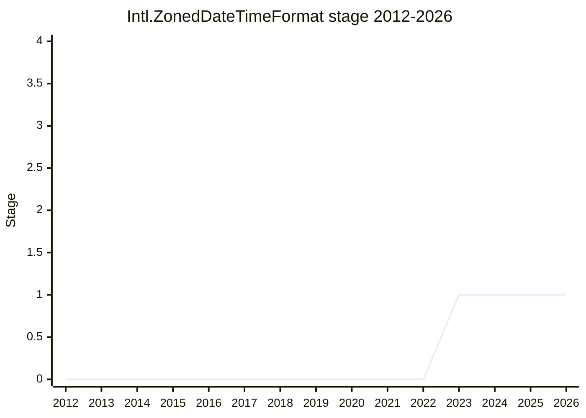

## Overview

Intl.ZonedDateTimeFormat is a proposal for a **reusable formatter object for `Temporal.ZonedDateTime`**. It exists because of the way [Temporal](temporal.md) settled the conflict between two time zones. A `ZonedDateTime` carries its own time zone, while an `Intl.DateTimeFormat` resolves a time zone (explicit or the system default) in its constructor. Temporal's [PR #2522](https://github.com/tc39/proposal-temporal/pull/2522) (plenary 2023-03) kept `ZonedDateTime.prototype.toLocaleString` working and made every `Intl.DateTimeFormat` method throw for a `ZonedDateTime`. That left no formatter object that can be created once and reused, and no way to call `formatToParts`, `formatRange` or `formatRangeToParts` on `ZonedDateTime` values. [FYT](../people/FYT.md) proposed a new constructor to fill that gap.

The Stage 1 sketch copies the shape of `Intl.DateTimeFormat`, minus the time zone. The constructor takes the usual options but throws a `RangeError` when `timeZone` is given, because the time zone comes from each `ZonedDateTime`. It has `supportedLocalesOf`, `resolvedOptions`, `format`, `formatToParts`, `formatRange` and `formatRangeToParts`. [FYT](../people/FYT.md) also floated, as optional, conversion methods between the two formatters modelled on Temporal (one taking a time zone and returning an `Intl.DateTimeFormat`, and a `DateTimeFormat` method that drops the time zone).

```js
// Shape sketched for Stage 1 (2023-05); the proposal has not settled any of this
const fmt = new Intl.ZonedDateTimeFormat("en-US", { dateStyle: "medium", timeStyle: "short" });
const start = Temporal.ZonedDateTime.from("2023-05-17T17:00[America/New_York]");
const end = Temporal.ZonedDateTime.from("2023-05-18T15:00[America/New_York]");
fmt.format(start); // formatted in the ZonedDateTime's own time zone
fmt.formatRange(start, end); // Intl.DateTimeFormat throws for ZonedDateTime since PR #2522
new Intl.ZonedDateTimeFormat("en-US", { timeZone: "Asia/Tokyo" }); // RangeError
```

The plenary granted Stage 1 for the problem, not for this constructor. The Stage 1 scope is "finding an efficient and ergonomic API for Intl formatting on Temporal.ZonedDateTime objects", and it is "Explicitly open to other approaches which might not involve another constructor". [FYT](../people/FYT.md) is the author and champion in the canonical table, and confirmed the role when requesting Stage 1 ("we have a champion, I think we identify is me"). The repository is still under FrankYFTang's account. The TG2 and plenary notes record no discussion of the proposal after 2023-05, so as far as the notes show it has stayed at Stage 1 without further work.

## Stage history

| Meeting                                                                              | Venue   | Event                                                                                                                                                                                                                                                                                                | Stage |
| ------------------------------------------------------------------------------------ | ------- | ---------------------------------------------------------------------------------------------------------------------------------------------------------------------------------------------------------------------------------------------------------------------------------------------------- | ----- |
| [2023-01](https://github.com/tc39/notes/blob/main/meetings/2023-01/jan-31.md)        | plenary | Temporal update ([PFC](../people/PFC.md)): [proposal-temporal#2479](https://github.com/tc39/proposal-temporal/pull/2479) (`ZonedDateTime` formatting ignores the object's time zone) left out of the consensus request at [FYT](../people/FYT.md)'s request; "TC39-TG2 will continue to investigate" | 0     |
| [2023-02-09](https://github.com/tc39/ecma402/blob/main/meetings/notes-2023-02-09.md) | TG2     | `Temporal issues: #2479`: [FYT](../people/FYT.md) would block the PR as it stands; [SFC](../people/SFC.md) lists seven options for `DateTimeFormat.prototype.format`, the last being "Add Intl.ZonedDateTimeFormat". No conclusion                                                                   | 0     |
| [2023-03-09](https://github.com/tc39/ecma402/blob/main/meetings/notes-2023-03-09.md) | TG2     | `ZonedDateTime / DateTimeFormat` ([JGT](../people/JGT.md)): the champions' one-bit design (throw only when the formatter's time zone was explicit). No conclusion                                                                                                                                    | 0     |
| [2023-03](https://github.com/tc39/notes/blob/main/meetings/2023-03/mar-21.md)        | plenary | Consensus on Temporal [PR #2522](https://github.com/tc39/proposal-temporal/pull/2522): `ZonedDateTime.prototype.toLocaleString` works, `ZonedDateTime` passed to `Intl.DateTimeFormat` methods throws; [PFC](../people/PFC.md): "a temporary solution"                                               | 0     |
| [2023-04-06](https://github.com/tc39/ecma402/blob/main/meetings/notes-2023-04-06.md) | TG2     | `ZonedDateTimeFormat` ([FYT](../people/FYT.md)): Stage 0 proposal presented; "Stage 1 approval from TG2"                                                                                                                                                                                             | 0     |
| [2023-05](https://github.com/tc39/notes/blob/main/meetings/2023-05/may-17.md)        | plenary | Reached Stage 1. `Intl.ZonedDateTimeFormat for Stage 1` ([FYT](../people/FYT.md)), with the scope narrowed to `ZonedDateTime` and open to solutions without a new constructor; explicit support from [PFC](../people/PFC.md), [DE](../people/DE.md) and [WH](../people/WH.md)                        | 0 → 1 |



> How to read: Stage 1 in 2023-05 (`may-17.md`), the only transition. The idea first appears as option 7 of [SFC](../people/SFC.md)'s list at TG2 2023-02-09. The 2023-01, 2023-02 and 2023-03 rows belong to Temporal's PR #2479 and PR #2522, which created the gap this proposal fills, so their Stage column shows this proposal's stage (0). At the 2023-01 plenary the conclusion on `jan-31.md` says TG2 would keep investigating #2479, and the continuation on [`feb-02.md`](https://github.com/tc39/notes/blob/main/meetings/2023-01/feb-02.md) adds that it "will be presented again in the following meeting". At the Stage 1 request [FYT](../people/FYT.md) dated the Temporal champions' decision to stop accepting `ZonedDateTime` in `Intl.DateTimeFormat` to "March 16" (no year given). No later TG2 or plenary item mentions the proposal, and `raw/proposals/ecma402/README.md` lists it under Stage 1 with only the 2023-05 meeting.

## Main issues

### Which time zone wins: the `ZonedDateTime`'s or the formatter's

The proposal grew out of a Temporal bug. [PFC](../people/PFC.md) reported at plenary [2023-01](https://github.com/tc39/notes/blob/main/meetings/2023-01/jan-31.md) that the spec "accidentally left the value in the [[TimeZone]] slot unconsidered", so a `ZonedDateTime` was always formatted in the current system time zone ([proposal-temporal#2479](https://github.com/tc39/proposal-temporal/pull/2479)). [FYT](../people/FYT.md) wanted more time to review a change that "touches very deep inside the thing", and the PR was held back for TG2.

At TG2 [2023-02-09](https://github.com/tc39/ecma402/blob/main/meetings/notes-2023-02-09.md) [JGT](../people/JGT.md) split the question in three: optionless `toLocaleString`, optionless `Intl.DateTimeFormat.prototype.format(zdt)`, and what to do when a `timeZone` option conflicts with the object's time zone. Everyone agreed that `toLocaleString` should use the object's time zone, and for a `timeZone` option there the group settled on [SFC](../people/SFC.md)'s option 3, an error whenever the option is given, even when it matches ([FYT](../people/FYT.md), [JGT](../people/JGT.md) and [PFC](../people/PFC.md) agreed). The `format` question stayed open. [FYT](../people/FYT.md) objected to the PR on consistency grounds, because an `Intl.DateTimeFormat` resolves its time zone once, in the constructor:

> [FYT](../people/FYT.md): My reading of the PR is that you construct a Intl.DTF with a specific time zone. In this particular PR, if you pass in a ZDT with a different time zone, then you get a different result. It's incoherent/inconsistent. The same DTF will result in different time zones, which violates a previous DTF design constraint.

[SFC](../people/SFC.md) listed seven options, from "Don't accept ZDT in DTF.p.format" to "Add Intl.ZonedDateTimeFormat", and raised the cost side: a time zone lookup is "not free", and the constructor exists to do it up front. [JGT](../people/JGT.md) and [USA](../people/USA.md) leaned to option 3 (use the `ZonedDateTime`'s time zone only when the formatter's was undefined), which [FYT](../people/FYT.md) rejected along with option 4 on both design and implementation grounds (memory, and the speed of `toLocaleString`). [SFC](../people/SFC.md) argued against option 2 (throw on a mismatch) because the exception would appear only in cases nobody had tested, and suggested the narrowest start:

> [SFC](../people/SFC.md): If we’re not going to be re-architecting anything, safest to start with option 1. Option 7: add Intl.ZonedDateTimeFormatter, add new class w/ this custom behavior. If we did option 1, we can move to another later.

[PFC](../people/PFC.md) did not like options 1, 5, 6 or 7. No conclusion was recorded. At [2023-03-09](https://github.com/tc39/ecma402/blob/main/meetings/notes-2023-03-09.md), without [FYT](../people/FYT.md) in the attendee list, [JGT](../people/JGT.md) presented the Temporal champions' version of option 3, which needs `Intl.DateTimeFormat` to record whether its time zone was explicit. [JGT](../people/JGT.md) explained why it throws on that state rather than on a mismatch: "We try not to have data-driven exceptions in Temporal, we try to throw based on the shapes of the inputs rather than the data in those inputs." [SFC](../people/SFC.md) called it "closest to a consensus response among Temporal champions", and [YSZ](../people/YSZ.md) said "This sounds great."

The champions then chose option 1 instead. At plenary [2023-03](https://github.com/tc39/notes/blob/main/meetings/2023-03/mar-21.md) [PFC](../people/PFC.md) presented [PR #2522](https://github.com/tc39/proposal-temporal/pull/2522) as an "alternate design" that answered [FYT](../people/FYT.md)'s concerns:

> [PFC](../people/PFC.md): This is a temporary solution to allow toLocaleString to be used, and we hope that in a follow-up proposal we will be able to find a solution that everybody's happy with, that will allow a ZonedDateTime to be used with the other methods of DateTimeFormat.

[JGT](../people/JGT.md) added that `formatToParts()`, `formatRange()` and the other methods throw too, and that a range can still be formatted after converting: "you can transform the ZonedDateTime temporal type into a different Temporal type and then you can format that range." The PR reached consensus with support from [DE](../people/DE.md) and [DLM](../people/DLM.md). Intl.ZonedDateTimeFormat became that follow-up proposal, although at its Stage 1 request [PFC](../people/PFC.md) asked that a solution inside `Intl.DateTimeFormat` also be considered (next section).

### A new constructor, or `Intl.DateTimeFormat` again

[FYT](../people/FYT.md) brought the Stage 0 proposal to TG2 [2023-04-06](https://github.com/tc39/ecma402/blob/main/meetings/notes-2023-04-06.md), naming two gaps left by PR #2522: no object to format `ZonedDateTime` values consistently, and "no way to format a range or parts of ZDT. No object, no range, no part."

> [FYT](../people/FYT.md): Therefore, the stage 0 proposal is to add a new Intl object very similar to DTF which can only handle formatting ZDT.

[SFC](../people/SFC.md) and [EAO](../people/EAO.md) found the problem worth exploring; [EAO](../people/EAO.md) was "not convinced that Int.ZonedDateTimeFormatter is the right solution". [SFC](../people/SFC.md) pointed out a naming problem: "one thig that’s a little weird is the naming, because ZDTF doesn’t actually have a time zone." The conclusion was "Stage 1 approval from TG2".

At plenary [2023-05](https://github.com/tc39/notes/blob/main/meetings/2023-05/may-17.md) [FYT](../people/FYT.md) argued that `toLocaleString` is not enough (no range formatting, nothing cached in an object) and that reusing `Intl.DateTimeFormat` for Temporal had hurt the design of that API. [DE](../people/DE.md) objected to calling the multi-type `Intl.DateTimeFormat` an oversight, since "This was an explicit conversation, as we discussed in the Temporal champion group", and preferred not to add many Temporal-specific constructors. [PFC](../people/PFC.md) agreed that a formatter object is needed but asked that Stage 1 not fix the solution in advance, and disputed that there was broad agreement on keeping `ZonedDateTime` out of `Intl.DateTimeFormat`:

> [PFC](../people/PFC.md): I know that we don’t have in TC39 a formal priority of constituencies principle. But informally, for me, with the priority of constituencies that I base my decisions on, I think that convenience for users of the API is more important than purity of the API.

[FYT](../people/FYT.md) replied that `Intl.DateTimeFormat` never formatted every Temporal type ("it handle some seven of the object out of the 12, okay?"), and that `Intl.DurationFormat` already formats durations. [PFC](../people/PFC.md) answered that calendars, time zones and durations are not date-times: "ZonedDateTime is fundamentally a date time, so it’s not inconsistent to have Intl DateTimeFormat all the date times and not other objects that don’t represent date times." [JGT](../people/JGT.md) took performance as the main purpose of a formatter object and noted that `Intl.DateTimeFormat` construction is already slow because of the ICU data it loads. The Speaker's Summary records that "[JGT](../people/JGT.md) identified performance (caching slow lookups from ICU) as the primary motivation for this proposal" and that "[DE](../people/DE.md), [JGT](../people/JGT.md) and [PFC](../people/PFC.md) who like the current design of a shared constructor, for improved ergonomics." The conclusion leaves the question open: "Explicitly open to other approaches which might not involve another constructor."

### Scope: `ZonedDateTime` only, or every Temporal type

Several delegates asked whether a separate formatter should be limited to one type. At TG2 [2023-04-06](https://github.com/tc39/ecma402/blob/main/meetings/notes-2023-04-06.md) [USA](../people/USA.md) asked:

> [USA](../people/USA.md): If we’re going to do a second DateTimeFormatter, why not do a second formatter that works for all Temporal objects instead? A new DTF (different name of course) that works on all Temporal objects, we can do away with old API choices. Big ergonomic cost to having separate formatter.

[FYT](../people/FYT.md) would prefer to take all Temporal types out of `Intl.DateTimeFormat` ("Temporal went to stage 3 too early") but replied "Yes, but I don’t want to go to Temporal and start a fight about that." [SFC](../people/SFC.md) regretted that the formatter design had reached Stage 3 "without thorough review from TG2 people" (quoted on the [Temporal](temporal.md) page) and was open to a PR that applies PR #2522's approach to the other types: rejected by `Intl.DateTimeFormat.prototype.format`, still formattable through `toLocaleString`. [USA](../people/USA.md) offered to take that to the Temporal champions. [JGT](../people/JGT.md) still thought that "using DTF for everything isn’t bad".

At plenary [2023-05](https://github.com/tc39/notes/blob/main/meetings/2023-05/may-17.md) [JGT](../people/JGT.md) suggested the scope "efficient and ergonomic formatting of temporal objects", saying this followed the view of [SFC](../people/SFC.md), who was absent. [DE](../people/DE.md) objected:

> [DE](../people/DE.md): In particular, I would be opposed to reopening the question of how we format other Temporal objects. That proposal is at Stage 3 and has several implementations in progress. I think we have a good solution. I would like to restrict the scope to how do we format ZonedDateTime objects, enabling caching as well as the formatRange thing that Frank mentioned.

[DE](../people/DE.md) and [JGT](../people/JGT.md) agreed that late changes to Temporal should come from implementation findings such as performance, not from design preferences ([DE](../people/DE.md): "something like splitting out the constructors is purely a design disagreement, and we settled these design disagreements when we went to Stage 3, modulo bugs that we found in the course of implementation."). [FYT](../people/FYT.md) had not asked for the wider scope ("I made it very clear, this particular proposal is only for ZonedDateTime."). An unattributed speaker suggested that anyone wanting the wider question could bring a separate Stage 0 proposal. The conclusion fixed the scope: "Revisiting the way other Temporal types are constructed is explicitly out of scope." [DE](../people/DE.md) repeated the point later the same day in the Temporal update, calling Temporal "a very stable API".

### Conversion methods between the two formatters

[FYT](../people/FYT.md)'s sketch mirrors Temporal's conversion methods: a `ZonedDateTimeFormat` method that takes a time zone and returns an `Intl.DateTimeFormat`, and a `DateTimeFormat` method that returns a `ZonedDateTimeFormat` without the time zone. At TG2 [2023-04-06](https://github.com/tc39/ecma402/blob/main/meetings/notes-2023-04-06.md) [USA](../people/USA.md) noted that there is "precedent in Temporal but not Intl for converting one formatter to another" and that passing `.resolvedOptions()` into the other constructor would do the same job. At plenary [2023-05](https://github.com/tc39/notes/blob/main/meetings/2023-05/may-17.md) [DE](../people/DE.md) was unclear on the use cases, and [JGT](../people/JGT.md) opposed them:

> [JGT](../people/JGT.md): I think it’s a bad idea to teach users that the localization APIs are the places you go to manipulate different Temporal objects like to change time zones or do other things.

[FYT](../people/FYT.md) presented these methods as optional and open to discussion. They were not settled at Stage 1.

## Related proposals

- [Temporal](temporal.md) — the source of the gap: PR #2522 made `Intl.DateTimeFormat` reject `ZonedDateTime`, and the Stage 1 scope excludes revisiting how the other Temporal types are formatted.
- [Intl.DurationFormat](intl-durationformat.md) — the other Intl formatter for a Temporal type (`Temporal.Duration`), cited by [FYT](../people/FYT.md) as precedent for formatters outside `Intl.DateTimeFormat`.

## Sources

TG2:

- https://github.com/tc39/ecma402/blob/main/meetings/notes-2023-02-09.md
- https://github.com/tc39/ecma402/blob/main/meetings/notes-2023-03-09.md
- https://github.com/tc39/ecma402/blob/main/meetings/notes-2023-04-06.md

Plenary:

- https://github.com/tc39/notes/blob/main/meetings/2023-01/jan-31.md
- https://github.com/tc39/notes/blob/main/meetings/2023-01/feb-02.md
- https://github.com/tc39/notes/blob/main/meetings/2023-03/mar-21.md
- https://github.com/tc39/notes/blob/main/meetings/2023-05/may-17.md
