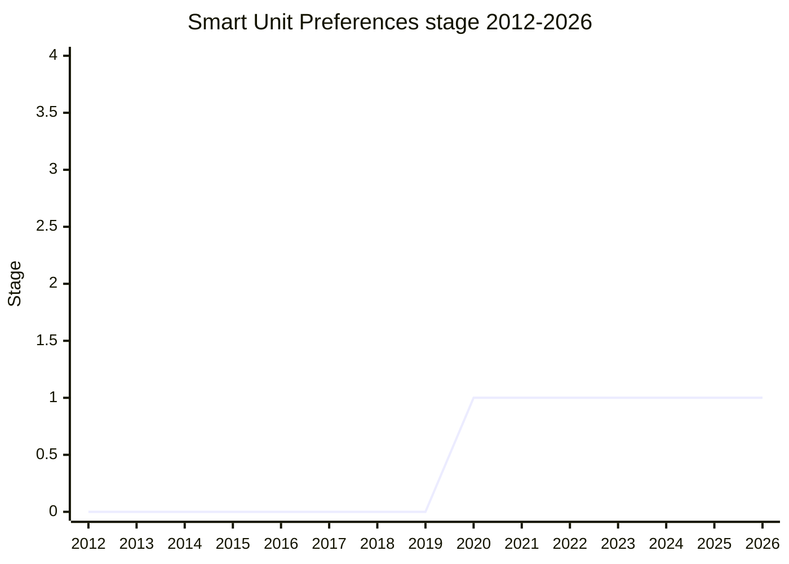

## Overview

Smart Unit Preferences ("Smart Units") adds a `usage` option to `Intl.NumberFormat`. With it, the formatter chooses the unit, scale and precision that a locale customarily uses for a kind of quantity, and converts the input value to match. The data is CLDR's unit preferences in `supplemental/units.xml`. They are keyed by region and by a usage such as `person-height`, `road` or `rainfall`. Each entry can have `geq` thresholds, so the unit depends on the size of the value: in the US, road distances are given in feet up to about half a mile and in miles beyond that. Entries also carry rounding increments. The same file has the conversion factors, about 8 kB of data ([SFC](../people/SFC.md) at TG2 [2024-05-23](https://github.com/tc39/ecma402/blob/main/meetings/notes-2024-05-23.md)). The motivating example is person height. Most regions give it in centimeters, some in meters and centimeters, and the US, the UK and some Commonwealth countries such as Canada in feet and inches, even where the metric system is otherwise the norm.

```js
// Shape presented in 2020-06 and again in 2024-06 / 2024-10 (illustrative output)
new Intl.NumberFormat("en-US", { style: "unit", unit: "meter", usage: "person-height" })
  .format(1.8); // "5 ft, 11 in": converted, rounded and split into mixed units
```

The canonical champion is Younies Mahmoud ([YMD](../people/YMD.md)). [YMD](../people/YMD.md) presented the Stage 1 request at the [2020-06](https://github.com/tc39/notes/blob/main/meetings/2020-06/june-4.md) plenary from the repository `younies/proposal-intl-number-format-usage`, later `tc39/proposal-smart-unit-preferences`, and thanked "my colleague Hugo" ([HUG](../people/HUG.md)). [YMD](../people/YMD.md) also championed a separate `Units Conversion` proposal, which reached Stage 1 in 2022-03. In 2024 [BAN](../people/BAN.md) (Igalia) revived Smart Units and presented it at TG2 (2024-05-23, 2024-08-22) and at plenary (2024-06, 2024-10, from the fork `ben-allen/proposal-smart-unit-preferences`). The notes never call [BAN](../people/BAN.md) a champion, so [BAN](../people/BAN.md) is not listed in `champions`.

The proposal has stayed at Stage 1 since 2020-06. The notes show no plenary or TG2 item for it after the 2024-10 update. Instead, its parts moved into other proposals:

- **Mixed units** ("5 ft, 11 in") went to Measure and then to [Intl Sequence Units](intl-sequence-units.md) (Stage 2, 2026-05).
- **Unit conversion** went to [Amount](amount.md). Its `convertTo()` is ECMA-262, and its `locale` / `usage` options are an ECMA-402 extension (Amount reached Stage 2 in 2026-05).
- **Passing a value together with its unit** to `Intl.NumberFormat` became the [Intl Unit Protocol](intl-unit-protocol.md).

At TG2 [2026-02-19](https://github.com/tc39/ecma402/blob/main/meetings/notes-2026-02-19.md) [EAO](../people/EAO.md) observed that an Amount with a unit, formatted by a NumberFormat that takes a locale and a usage, would be "majority of Smart Units". The canonical table still lists the proposal at Stage 1 under [YMD](../people/YMD.md). The notes record no withdrawal.

## Stage history

| Meeting                                                                              | Venue   | Event                                                                                                                                                                                                                                                                                                                                 | Stage |
| ------------------------------------------------------------------------------------ | ------- | ------------------------------------------------------------------------------------------------------------------------------------------------------------------------------------------------------------------------------------------------------------------------------------------------------------------------------------- | ----- |
| [2020-02](https://github.com/tc39/notes/blob/main/meetings/2020-02/february-6.md)    | plenary | First mention, during DurationFormat's Stage 1 request. [SFC](../people/SFC.md): "We have a separate smart units proposal for covering things like feet and inches."                                                                                                                                                                  | 0     |
| [2020-06](https://github.com/tc39/notes/blob/main/meetings/2020-06/june-4.md)        | plenary | Reached Stage 1. `Smart Unit Preferences in Intl.NumberFormat for Stage 1` ([YMD](../people/YMD.md)). [WH](../people/WH.md) asks how many usages exist and how users override them; [RRD](../people/RRD.md) and [MPC](../people/MPC.md) raise fingerprinting. Conclusion: "Stage 1"                                                   | 0 → 1 |
| [2020-06-11](https://github.com/tc39/ecma402/blob/main/meetings/notes-2020-06-11.md) | TG2     | First TG2 discussion, a week after plenary. [ZB](../people/ZB.md) prefers building blocks (expose the preferred unit) over an end-to-end API, and asks for a better name than "smart"; [SFC](../people/SFC.md) asks [YMD](../people/YMD.md) and [HUG](../people/HUG.md) to research how JS libraries solve the problem. No conclusion | 1     |
| [2021-01](https://github.com/tc39/notes/blob/main/meetings/2021-01/jan-26.md)        | plenary | Intl Locale Info reaches Stage 2 "without the unit info part". [SFC](../people/SFC.md): `unitInfo` should be part of the unit preferences proposal. In the 2021-01 status update (`jan-25.md`), Smart Units is "blocked on discussions involving scope"                                                                               | 1     |
| [2022-03-17](https://github.com/tc39/ecma402/blob/main/meetings/notes-2022-03-17.md) | TG2     | [YMD](../people/YMD.md)'s separate `Units Conversion Proposal`. Conclusion: "Approved for Stage 1". [SFC](../people/SFC.md) says the black-box Smart Units "didn’t manage to make progress" for lack of user preferences                                                                                                              | 1     |
| [2022-03](https://github.com/tc39/notes/blob/main/meetings/2022-03/mar-30.md)        | plenary | `Units Conversion` ([YMD](../people/YMD.md)) reaches Stage 1 as its own proposal, over [WH](../people/WH.md), [YSV](../people/YSV.md) and [CM](../people/CM.md) skepticism. Conclusion: "Stage 1 - should have clear problem statement"                                                                                               | 1     |
| [2024-05-23](https://github.com/tc39/ecma402/blob/main/meetings/notes-2024-05-23.md) | TG2     | [BAN](../people/BAN.md) revives Smart Units. [SFC](../people/SFC.md) argues for a "black box", [EAO](../people/EAO.md) for unit conversion outside ECMA-402; "we don’t have a TG2 recommendation for building blocks vs black box approach"                                                                                           | 1     |
| [2024-06](https://github.com/tc39/notes/blob/main/meetings/2024-06/june-12.md)       | plenary | `Smart units progress update` ([BAN](../people/BAN.md)): one new `usage` option; three questions (mixed units, the `en-US` problem, conversion inside ECMA-402). [EAO](../people/EAO.md) wants a non-Intl conversion API "from the get-go"                                                                                            | 1     |
| [2024-08-22](https://github.com/tc39/ecma402/blob/main/meetings/notes-2024-08-22.md) | TG2     | `Smart Units Update` ([BAN](../people/BAN.md)). [SFC](../people/SFC.md) proposes a value-with-unit type, the future Measure, as the base, and offers to "Put Smart Units on the shelf for a year"                                                                                                                                     | 1     |
| [2024-10](https://github.com/tc39/notes/blob/main/meetings/2024-10/october-10.md)    | plenary | `Smart Units stage 1 update` ([BAN](../people/BAN.md)): candidate list of usages; [WH](../people/WH.md) asks about `person` vs `person-height`. In the next item, Measure reaches Stage 1 as the conversion and mixed-unit layer                                                                                                      | 1     |
| [2025-07](https://github.com/tc39/notes/blob/main/meetings/2025-07/july-29.md)       | plenary | Measure, renamed Amount, drops compound units and unit conversion. [EAO](../people/EAO.md): "we would prefer to leave these to be part of the smart units proposal that has been around for a while"                                                                                                                                  | 1     |
| [2026-02-19](https://github.com/tc39/ecma402/blob/main/meetings/notes-2026-02-19.md) | TG2     | Amount PR #81 brings conversion back. `convertTo` goes in ECMA-262, with `locale` / `usage` options as an ECMA-402 override. [EAO](../people/EAO.md): NumberFormat with a locale and usage over an Amount would be "majority of Smart Units"                                                                                          | 1     |
| [2026-05](https://github.com/tc39/notes/blob/main/meetings/2026-05/may-20.md)        | plenary | Amount reaches Stage 2. Its `convertTo` supports "localized conversions" by `locale` and usage                                                                                                                                                                                                                                        | 1     |



> How to read: the only stage transition is Stage 1 at the 2020-06 plenary (`june-4.md`). The 2024-06 (`june-12.md`) and 2024-10 (`october-10.md`) slots were updates without a stage request, and they match the three plenary anchors in the canonical Meeting Notes column. The plenary vote came before any TG2 discussion: TG2 first discussed the proposal on 2020-06-11, and [ZB](../people/ZB.md) was "concerned that this was presented to TC39 before it was presented here". The earliest mention is [SFC](../people/SFC.md)'s remark in 2020-02. The `Units Conversion` proposal that [YMD](../people/YMD.md) took to Stage 1 in 2022-03 (`mar-30.md`, repository `younies/unit-conversion-proposal`) is a separate proposal. It appears in none of the `raw/proposals/ecma402` tables, active or inactive. The notes show no further activity on it after the TG2 status of [2022-04-21](https://github.com/tc39/ecma402/blob/main/meetings/notes-2022-04-21.md) ("needs to answer some questions raised by TG1"). The Amount rows are included because Amount now carries the usage-based conversion.

## Main issues

### Black box or building blocks?

From the first TG2 discussion ([2020-06-11](https://github.com/tc39/ecma402/blob/main/meetings/notes-2020-06-11.md)), the central question was whether ECMA-402 should offer the whole pipeline or only its pieces. The pipeline has three steps: pick the unit for a locale, usage and value; convert; then format. [ZB](../people/ZB.md) asked for building blocks: "The API I’m suggesting is a building block". [ZB](../people/ZB.md) proposed an API that returns the preferred unit (for example meters for person height), with the conversion left to the developer. [ZB](../people/ZB.md) cited RelativeTimeFormat, where calculations were left to Moment.js and other libraries, and warned of feature creep from override options. [ZB](../people/ZB.md) also noted there was no end-to-end prior art, and that the issue (ecma402#277) showed no user demand: [SFC](../people/SFC.md) had filed it, and the last comment called it "a good candidate to user lib". [ZB](../people/ZB.md) found the name a poor fit as well:

> [ZB](../people/ZB.md): I understand. I agree with the proposal in the principle of Internationalization, but I think “smart” things tend to age poorly in Computer Science.

[MCM](../people/MCM.md) wanted users and use cases established before choosing between a high-level and a low-level API. [RCA](../people/RCA.md), speaking as an end user, knew of no library that does both conversion and formatting. [SFC](../people/SFC.md) defended the end-to-end design, because the thresholds need a lot of locale data, and asked [YMD](../people/YMD.md) and [HUG](../people/HUG.md) to research how this is solved in JS. The scope question kept the proposal at Stage 1. In the 2021-01 status update ([`jan-25.md`](https://github.com/tc39/notes/blob/main/meetings/2021-01/jan-25.md)) [SFC](../people/SFC.md) called it "blocked on discussions involving scope". At [2021-04](https://github.com/tc39/notes/blob/main/meetings/2021-04/apr-19.md) [SFC](../people/SFC.md) asked: "Are we doing too much by trying to both convert the units and display the unit?"

[YMD](../people/YMD.md)'s 2022 `Units Conversion` proposal tried the other direction: plain conversion between units and from simple to mixed units, plus a locale-aware conversion that returns an array. At TG2 [2022-03-17](https://github.com/tc39/ecma402/blob/main/meetings/notes-2022-03-17.md) [FYT](../people/FYT.md) said only "one tiny part" needs a locale, namely which unit a usage takes. [EAO](../people/EAO.md) called it "three different APIs cobbled together rather than one comprehensive API". [SFC](../people/SFC.md) answered that unit selection depends on the value, so the parts are "not as simple as a sum of parts". [USA](../people/USA.md) noted that splitting would mean going from Intl to ECMA-262 and back. At the [2022-03](https://github.com/tc39/notes/blob/main/meetings/2022-03/mar-30.md) plenary [WH](../people/WH.md) questioned why "shoe size conversions" belong in ECMAScript. [SYG](../people/SYG.md) asked whether the argument amounted to "because it's in ICU". [CM](../people/CM.md) objected to the committee spending time on i18n details at all. [JSC](../people/JSC.md) suggested splitting off "getting the unit system preferred by Locale". [YSV](../people/YSV.md) granted Stage 1 reluctantly:

> [YSV](../people/YSV.md): I feel uncomfortable giving stage 1 because there is effectively no problem statement.

When [BAN](../people/BAN.md) revived Smart Units at TG2 [2024-05-23](https://github.com/tc39/ecma402/blob/main/meetings/notes-2024-05-23.md), [SFC](../people/SFC.md) laid out the same two directions and took the black-box side. The unit preference data includes size thresholds and rounding rules and needs a lot of glue code:

> [SFC](../people/SFC.md): My position is that it seems intuitive that we should give the building blocks, but it’s better to give the black box.

[EAO](../people/EAO.md) replied that the two need not be opposed, and that with only the black box "it’s going to get abused". [SFC](../people/SFC.md) concluded "It’s safe to say that we don’t have a TG2 recommendation for building blocks vs black box approach", which would be needed by Stage 2. At the [2024-06](https://github.com/tc39/notes/blob/main/meetings/2024-06/june-12.md) plenary [JGT](../people/JGT.md) suggested platform plumbing for libraries instead: "instead of shipping a 50k unit conversion library, you could ship a 2k unit conversion library". [SFC](../people/SFC.md) mentioned an `Intl.getUnitConversionFactor` but worried it "opens a can of worms". [BAN](../people/BAN.md)'s summary recorded that "It is unsettled whether or not it should have a minimal version and did not do the conversions but applies the plumbing for doing the conversions." The answer was a third route: building blocks outside Intl, in Measure and later Amount (next section).

### Unit conversion inside Intl, and moving it out to Measure / Amount

The 2024 revival made the risk of misuse the main objection. At TG2 [2024-05-23](https://github.com/tc39/ecma402/blob/main/meetings/notes-2024-05-23.md) [EAO](../people/EAO.md) held that unit conversion belongs in ECMA-262. [EAO](../people/EAO.md) also argued that a unit is part of the value being formatted, not a formatting option, so NumberFormat could accept a "measured unit" compound. This echoed [EAO](../people/EAO.md)'s TG2 idea of [2024-03-28](https://github.com/tc39/ecma402/blob/main/meetings/notes-2024-03-28.md) for wrapper types such as `UnitNumber`. [SFC](../people/SFC.md)'s view was that Intl's conversions are localized approximations, not scientific ones: the CDC's six feet of COVID distancing should become 2 meters in Germany, not 1.83. The principle, [SFC](../people/SFC.md) said, is that functionality inside an Intl API that is useful outside Intl should also be offered outside Intl. For the formatted result, [SFC](../people/SFC.md) suggested richer formatted values or Stable Formatting's null locale as a machine-readable form. [HJS](../people/HJS.md) questioned the premise that a conversion API would have to be scientifically exact. [EAO](../people/EAO.md)'s reply:

> [EAO](../people/EAO.md): If we ever provide an API that does unit conversion and provides output, that will be a unit conversion API for the web platform, even if that’s not how it’s intended.

At the [2024-06](https://github.com/tc39/notes/blob/main/meetings/2024-06/june-12.md) plenary [BAN](../people/BAN.md) proposed to keep conversion inside NumberFormat and make it "as useless as possible as a generalized unit converter": no free choice of precision, and CLDR data that changes from year to year. [EAO](../people/EAO.md) insisted that "there needs to be an API that is not an internationalization API" as part of the proposal "from the get-go", because "If you provide a tool that does unit conversion it’s used for unit conversion." [SFC](../people/SFC.md) agreed that developers would misuse it, as they use `Intl.DateTimeFormat` for time zone conversion, and pointed to CLDR's rounding rules to limit the damage. [DLM](../people/DLM.md) raised unit pricing (price per 100 g or per pound) as a case where people would be "tempted to parse the output".

At TG2 [2024-08-22](https://github.com/tc39/ecma402/blob/main/meetings/notes-2024-08-22.md) [EAO](../people/EAO.md) offered to co-champion a unit conversion proposal for ECMA-262 and said it should land in parallel with the Intl API. [EAO](../people/EAO.md) also noted that the target unit for `person-height` (feet and inches) could not be represented at all. [SFC](../people/SFC.md) then changed position. A value-with-unit type would answer [EAO](../people/EAO.md)'s misuse concern, MessageFormat's need for an upgraded input type, and the question of how to pass mixed units:

> [SFC](../people/SFC.md): One of the purposes of this was figuring out the direction to take this proposal. I’ve been pushing for a time the idea that we should keep it as a black box, but given the concerns raised by [EAO](../people/EAO.md) about abuse, and the concern about MF needing an upgraded type, and given the issue of needing a good way to pass mixed units into a formatting API in the first place, I’m coming around to having a type that wraps together a value with the associated units might be a good way to go forward, and that’s the proposal we should explore first, supporting regular units and mixed ones, and what we could use for MessageFormat as well.

("MF" here is MessageFormat.) [SFC](../people/SFC.md) offered to "Put Smart Units on the shelf for a year with the understanding that it’s built on this other smaller proposal." At TG2 [2024-09-26](https://github.com/tc39/ecma402/blob/main/meetings/notes-2024-09-26.md) [SFC](../people/SFC.md) called the Measure design "a new version of the smart units proposal". The sketch had `new Measure(100, "centimeter").localeConvert("en-US", "person-height")`, returning an array of measures for mixed units, after which "Smart units would be easy to implement on top of this". At the [2024-10](https://github.com/tc39/notes/blob/main/meetings/2024-10/october-10.md) plenary [BAN](../people/BAN.md) presented Smart Units and Measure back to back, saying Measure is needed "to do those mixed unit representations".

The handoff did not go straight through. In [2025-02](https://github.com/tc39/notes/blob/main/meetings/2025-02/february-19.md) [EAO](../people/EAO.md) pointed out that nobody had ever argued whether conversion should exist at all: "for the smart unit preferences that was introduced some years ago, they are also—there was no discussion about whether unit conversions ought to be supported at all". At [2025-07](https://github.com/tc39/notes/blob/main/meetings/2025-07/july-29.md) Amount dropped conversion and compound units and handed them back to Smart Units. At [2025-11](https://github.com/tc39/notes/blob/main/meetings/2025-11/november-20.md) [BAN](../people/BAN.md) brought conversion back into Amount, describing Measure as "initially split off of this smart units proposal". TG2 [2026-02-19](https://github.com/tc39/ecma402/blob/main/meetings/notes-2026-02-19.md) then settled the division. `convertTo` goes in ECMA-262 with a narrow normative reference to `units.xml`. Its `locale` and usage options are an ECMA-402 override ([RGN](../people/RGN.md): "It’s a 402 override, in that 262 wouldn’t even read locale property"). In the Intl Unit Protocol item that followed, [EAO](../people/EAO.md) wondered whether that proposal should add `usage` as an `Intl.NumberFormat` constructor option:

> [EAO](../people/EAO.md): Amount with set unit, format with Intl.NumberFormat instance saying formatting with this locale and this usage, it’s majority of Smart Units.

The [2026-03](https://github.com/tc39/notes/blob/main/meetings/2026-03/march-10.md) and [2026-05](https://github.com/tc39/notes/blob/main/meetings/2026-05/may-20.md) Amount slots present locale/usage conversion "as in the old smart unit proposal" ([BAN](../people/BAN.md), 2026-03). At the [2025-11](https://github.com/tc39/notes/blob/main/meetings/2025-11/november-18.md) Intl Unit Protocol Stage 1 item [SFC](../people/SFC.md) raised implicit conversion, when an Amount's unit differs from the formatter's, as an idea "that also has been the basis for the smart units proposal". [SFC](../people/SFC.md) preferred to throw a RangeError for now and keep the option open.

### User preferences, fingerprinting and the `en-US` problem

Smart Units works from the locale's region alone. The question raised at the [2020-06](https://github.com/tc39/notes/blob/main/meetings/2020-06/june-4.md) Stage 1 request was how users would override that. [WH](../people/WH.md) asked how someone in the US who prefers meters would do it. [SFC](../people/SFC.md) pointed to the separate user preferences work (then Stage 0): "we’re hoping to piggyback on the UTS-35 unicode locale identifiers in order to be a vehicle to specify user-specific overrides". At TG2 [2020-02-27](https://github.com/tc39/ecma402/blob/main/meetings/notes-2020-02-27.md) [SFC](../people/SFC.md) had already named the existing keys: "You can either use the `-rg-` extension or the `-ms-` extension." Finer-grained unit preferences were being considered for UTS 35. [RRD](../people/RRD.md) and [MPC](../people/MPC.md) asked whether probing many units could fingerprint users. [SFC](../people/SFC.md) and [DE](../people/DE.md) answered that the CLDR data depends only on the browser version, so the proposal adds no new vector, and that any risk belongs to the user preferences proposal. [WH](../people/WH.md) saw the two as tied:

> [WH](../people/WH.md): The only reason that the user preferences proposal would exist is because of this proposal. So this proposal has user preferences as a consequence.

[WH](../people/WH.md) was also uneasy about preferences as fine-grained as "baby heights". [SFC](../people/SFC.md) replied that UTS 35 only lets a user pick imperial or metric, and that finer granularity is up to Unicode. [SFC](../people/SFC.md) said it would be "perfectly reasonable" for the committee to keep unit preferences from Stage 2 until user preferences advanced. That is roughly what happened. At TG2 [2022-03-17](https://github.com/tc39/ecma402/blob/main/meetings/notes-2022-03-17.md) [SFC](../people/SFC.md) said:

> [SFC](../people/SFC.md): [YMD](../people/YMD.md) already made such a black-boxed proposal previously, which is still in Stage 1; however, we didn’t manage to make progress on it due to the lack of user preferences.

[MCM](../people/MCM.md) pushed back that user preferences could be added later. [FYT](../people/FYT.md) wanted any preference to be an explicit input. In TG2's user-preferences discussions [SFC](../people/SFC.md) noted that some people want Celsius but miles (TG2 [2022-11-03](https://github.com/tc39/ecma402/blob/main/meetings/notes-2022-11-03.md)), which makes coarse privacy-preserving buckets hard, and that measurement units "are not a monolith". [SFC](../people/SFC.md) also said "There is currently no way for us to find user’s unit preferences on the web which means unit formatting is blocked on that" (TG2 [2023-03-09](https://github.com/tc39/ecma402/blob/main/meetings/notes-2023-03-09.md)).

The 2024 revival recast this as the `en-US` problem. Many people use an `en-US` browser outside the US and would get US customary units. [BAN](../people/BAN.md) cited 70% of Mozilla users in Indonesia ([2024-06](https://github.com/tc39/notes/blob/main/meetings/2024-06/june-12.md)) and later 60% of Indonesian users (TG2 [2024-08-22](https://github.com/tc39/ecma402/blob/main/meetings/notes-2024-08-22.md)), and floated a permission prompt. [SFC](../people/SFC.md) reported an informal poll of Finnish JavaScript developers at the Helsinki community event. About 70% found the proposal useful, and about 40% would still use it knowing the `en-US` limitation. [SFC](../people/SFC.md) held that it is still motivated:

> [SFC](../people/SFC.md): The short version; I think this proposal is still motivated and hopefully move forward and if anyone raises concerns, I think this proposal is fundamentally flawed because of this en-US issue, my response; I think it’s motivated enough and I do hope to solve the en-US issue in the future, once this lands.

[SFC](../people/SFC.md) suggested a locale extension such as `en-US` "with world units" as a small fix. [HJS](../people/HJS.md) took an action item at TG2 2024-08-22 and presented a Mozilla explainer at TG2 [2025-05-08](https://github.com/mozilla/explainers/blob/main/standard-measures-en-us.md) ([notes](https://github.com/tc39/ecma402/blob/main/meetings/notes-2025-05-08.md)). It gives `en-US` users outside the US "standard measures" through a separate identifier, but its web compatibility is untested. The question is unresolved.

### Which usages, and how fine-grained?

CLDR defines a growing list of usages. At the [2020-06](https://github.com/tc39/notes/blob/main/meetings/2020-06/june-4.md) plenary [WH](../people/WH.md) asked "How many usages are we talking about? Tens? Tens of thousands?" [SFC](../people/SFC.md) put it at "on the order of 10 to 20" and proposed choosing the ones most important to the web platform, as the original unit list was chosen. At TG2 2020-06-11 [MCM](../people/MCM.md) asked whether it was 5 or 500 values, and [YMD](../people/YMD.md) said "about 10 in CLDR right now". At the [2024-06](https://github.com/tc39/notes/blob/main/meetings/2024-06/june-12.md) plenary [MF](../people/MF.md) asked who the target user is and how they would know what granularity to use. [DE](../people/DE.md) suggested MDN, with the list of supported units. [MAG](../people/MAG.md) found `units.xml` maintained "in a pretty spotty, like, ad hoc fashion" and asked how a CLDR addition would reach browsers. [SFC](../people/SFC.md) described the metric used to pick NumberFormat's original 45 units: the units some locale prefers for common quantities, an approach TG2 had already used in [2019-07-11](https://github.com/tc39/ecma402/blob/main/meetings/notes-2019-07-11.md) ("We are adding them based on CLDR unit preferences"). [SFC](../people/SFC.md) proposed doing the same for usages. [BAN](../people/BAN.md) wanted to stay away from scientific usages, but named blood glucose as a possible exception.

At [2024-10](https://github.com/tc39/notes/blob/main/meetings/2024-10/october-10.md) [BAN](../people/BAN.md) brought a candidate list, erring "on the side of including too many" and asking which to cut. The list covered person height, road distance (with value-dependent units and precision, the Scandinavian mile included), speeds such as wind in meters per second, person weight, mass, temperature, volume, and land and floor area. [BAN](../people/BAN.md) ranked the body measurements highest. Clothing sizes had already been ruled out in 2024-06 as unreliable. [WH](../people/WH.md) asked what `person` measures as opposed to `person-height`. [SFC](../people/SFC.md) explained that a more specific usage is a subtag of a general one. [WH](../people/WH.md) also asked how the line is chosen when several units apply, which was left open. The usage list now matters elsewhere too. At TG2 [2026-03-19](https://github.com/tc39/ecma402/blob/main/meetings/notes-2026-03-19.md) (ecma402#1047) [SFC](../people/SFC.md) treated the supported usages as the criterion for accepting new units. [SFC](../people/SFC.md) expected usages to be exposed eventually, through Amount:

> [SFC](../people/SFC.md): In a world where we do expose these to users, my expectation is that we expose all usages that are subsets, because it’s extremely low-cost to do so

### Measurement system: taken over from Intl Locale Info, never picked up

[Intl Locale Info](intl-locale-info.md) originally exposed a locale's measurement system, using UTS 35's three groups (metric, US, UK). At TG2 [2020-12-04](https://github.com/tc39/ecma402/blob/main/meetings/notes-2020-12-04.md) [JSW](../people/JSW.md) asked whether places mix systems unit by unit. [USA](../people/USA.md) said "This is way more common in the global south imo", and the Smart Units repository was linked in the notes. At the [2021-01](https://github.com/tc39/notes/blob/main/meetings/2021-01/jan-26.md) Stage 2 request [MF](../people/MF.md) objected to the coarse `unitInfo` getter: "The simplified API seems to make it very easy to do the incorrect thing and that worries me." [SFC](../people/SFC.md) pointed to Smart Units as the better home:

> [SFC](../people/SFC.md): We discussed this in the 402 meeting in December and I also generally agree with the sentiment that unitInfo should be part of the unit preferences proposal. I have a slight preference for not including it.

Locale Info went to Stage 2 without `unitInfo`. The notes show no later attempt within Smart Units to expose a measurement system. [EAO](../people/EAO.md)'s position at TG2 2024-05-23 was close to it: "What could belong is 402 is getting information for which measurement system is used in this locale for which object."

### Mixed units

The preferred unit for a usage is often a mixed unit: feet and inches for person height in the US, meters and centimeters in parts of Europe. Mixed units were in scope from the start. In 2020-02 [SFC](../people/SFC.md) answered [WH](../people/WH.md)'s "6 feet 5 inches" example with Smart Units. [YMD](../people/YMD.md)'s 2022 Units Conversion design returned mixed results as arrays. [BAN](../people/BAN.md) listed them as question 1 at 2024-06 ("This requires supporting mixed units"). At TG2 2024-05-23 [SFC](../people/SFC.md) listed mixed-unit formatting as a possible sub-proposal "motivated on its own". At 2024-08-22 [SFC](../people/SFC.md) moved it out of Smart Units into Measure. When Amount dropped it in 2025-07, it became its own proposal, [Intl Sequence Units](intl-sequence-units.md). That proposal has no conversion and no balancing, so `person-height` conversion to `foot-and-inch` depends on Amount's `convertTo` (see that page).

## Related proposals

- [Amount](amount.md) — formerly Measure, split off from Smart Units in 2024 to hold unit conversion and mixed units; its `convertTo()` with ECMA-402 `locale` / usage options now carries the core of Smart Units.
- [Intl Sequence Units](intl-sequence-units.md) — mixed-unit formatting ("5 ft, 11 in"), once part of Smart Units, then Measure, now a Stage 2 proposal of its own.
- [Intl Unit Protocol](intl-unit-protocol.md) — how `Intl.NumberFormat` reads a value with its unit; a usage option on NumberFormat over an Amount would be "majority of Smart Units" ([EAO](../people/EAO.md), TG2 2026-02-19).
- [Intl Locale Info](intl-locale-info.md) — dropped its measurement-system `unitInfo` at Stage 2 (2021-01) in favour of this proposal.
- [Stable Formatting](stable-formatting.md) — cited by [SFC](../people/SFC.md) (TG2 2024-05-23) as a way to limit the use of Intl output for non-i18n purposes such as unit conversion.
- [Intl.DurationFormat](intl-durationformat.md) — its Stage 1 debate (2020-02) is where Smart Units was first mentioned, as the home for feet and inches.
- `intl-numberformat-v3` / Unified NumberFormat — the existing unit formatting that this proposal extends; its unit list was chosen from CLDR unit preferences.
- `intl-energy-units` — new units motivated by usages; the 2026 discussion of criteria for accepting units (ecma402#1047) rests on CLDR usages.
- `Units Conversion` ([YMD](../people/YMD.md), Stage 1 2022-03, repository `younies/unit-conversion-proposal`) — the building-block counterpart to this proposal; not in the canonical tables.

## Sources

TG2:

- https://github.com/tc39/ecma402/blob/main/meetings/notes-2019-07-11.md
- https://github.com/tc39/ecma402/blob/main/meetings/notes-2020-02-27.md
- https://github.com/tc39/ecma402/blob/main/meetings/notes-2020-06-11.md
- https://github.com/tc39/ecma402/blob/main/meetings/notes-2020-12-04.md
- https://github.com/tc39/ecma402/blob/main/meetings/notes-2022-03-17.md
- https://github.com/tc39/ecma402/blob/main/meetings/notes-2022-04-21.md
- https://github.com/tc39/ecma402/blob/main/meetings/notes-2022-11-03.md
- https://github.com/tc39/ecma402/blob/main/meetings/notes-2023-03-09.md
- https://github.com/tc39/ecma402/blob/main/meetings/notes-2024-03-28.md
- https://github.com/tc39/ecma402/blob/main/meetings/notes-2024-05-23.md
- https://github.com/tc39/ecma402/blob/main/meetings/notes-2024-08-22.md
- https://github.com/tc39/ecma402/blob/main/meetings/notes-2024-09-26.md
- https://github.com/tc39/ecma402/blob/main/meetings/notes-2025-05-08.md
- https://github.com/tc39/ecma402/blob/main/meetings/notes-2026-02-19.md
- https://github.com/tc39/ecma402/blob/main/meetings/notes-2026-03-19.md

Plenary:

- https://github.com/tc39/notes/blob/main/meetings/2020-02/february-6.md
- https://github.com/tc39/notes/blob/main/meetings/2020-06/june-4.md
- https://github.com/tc39/notes/blob/main/meetings/2021-01/jan-25.md
- https://github.com/tc39/notes/blob/main/meetings/2021-01/jan-26.md
- https://github.com/tc39/notes/blob/main/meetings/2021-04/apr-19.md
- https://github.com/tc39/notes/blob/main/meetings/2022-03/mar-30.md
- https://github.com/tc39/notes/blob/main/meetings/2024-06/june-12.md
- https://github.com/tc39/notes/blob/main/meetings/2024-10/october-10.md
- https://github.com/tc39/notes/blob/main/meetings/2025-02/february-19.md
- https://github.com/tc39/notes/blob/main/meetings/2025-07/july-29.md
- https://github.com/tc39/notes/blob/main/meetings/2025-11/november-18.md
- https://github.com/tc39/notes/blob/main/meetings/2025-11/november-20.md
- https://github.com/tc39/notes/blob/main/meetings/2026-03/march-10.md
- https://github.com/tc39/notes/blob/main/meetings/2026-05/may-20.md
