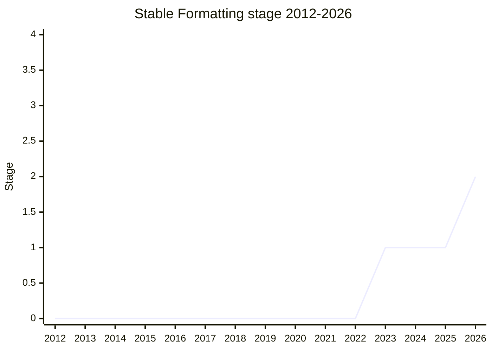

## Overview

Stable Formatting gives the Intl APIs one **locale whose output ECMA-402 itself defines and promises not to change**. Every other locale's output is implementation-defined and changes with each CLDR/ICU update. Developers still use Intl for things it was never meant to do, such as getting ISO 8601 dates by formatting in Swedish (`sv`), or SI prefixes from `en` compact notation. Their code then breaks when locale data changes, and in turn TG2 and CLDR find it hard to change `en-US` output (the CLDR narrow no-break space change that broke sites, discussed at TG2 in 2023-06, is the standard example). The proposal gives those uses a supported alternative, and it also gives Intl-based code a fixed output to test against. It adds no new classes: the stable behaviour is reached through the existing constructors with the BCP 47 code `zxx` ("no linguistic content"), which is also exposed as the constant `Intl.STABLE` since the Stage 2 spec text.

```js
new Intl.NumberFormat(Intl.STABLE, { notation: "compact" }).format(1e9); // SI prefix G, not en's "1B"
new Intl.NumberFormat("zxx", { style: "currency", currency: "EUR" }).format(12.5); // value, space, ISO code ("12.5 EUR")
new Intl.DateTimeFormat(Intl.STABLE).format(date); // Temporal-like ISO 8601 output, 24-hour, no month names
new Intl.PluralRules(Intl.STABLE).select(1); // always "other"
```

The behaviour is specified per API. DateTimeFormat matches Temporal's ISO 8601 strings. The numeric part of NumberFormat output satisfies the `StrNumericLiteral` grammar, currency and unit identifiers follow the number, and compact notation uses SI prefixes; short unit identifiers come from a table derived from SI, ISO 8601, ISO 80000 and EN 12435. ListFormat joins items with ", " (or a space), PluralRules always selects `"other"`, and `Array.prototype.toLocaleString` behaves like `toString`. DurationFormat composes the stable NumberFormat and ListFormat output (colons for digital units). RelativeTimeFormat emits signed ISO 8601-2 duration strings, and `Intl.Locale` reports `"iso8601"` as its calendar. The APIs that _consume_ localized text, `Intl.Collator`, `Intl.Segmenter` and `String.prototype.toLocale{Lower,Upper}Case`, are left out, because their locale-independent behaviour (CLDR root collation, UAX #29 segmentation) is not truly stable. Access to that root behaviour was spun off in 2026-05 as a separate Stage 1 proposal, Default Behaviours for some Intl APIs (`intl-default-behaviours`), keyed on `"und"`.

[EAO](../people/EAO.md) is the sole champion. The proposal started in TG2 in 2023-09 as "Define the behavior and properties of the “und” root locale" (`eemeli/proposal-intl-root-locale`). TG2 renamed it Stable Formatting before it reached Stage 1 at the 2023-09 plenary. For its first year and a half the question was whether to solve the problem inside Intl with one well-defined locale, or by adding purpose-built non-Intl APIs. TG2 and plenary backed the locale approach in 2025-02. Stage 2 followed in 2026-05, once spec text existed, `null` had been dropped as an alias, and the text-consuming APIs had been removed.

## Stage history

| Meeting                                                                              | Venue   | Event                                                                                                                                                                                                                                                                                                                                                                                                                                                                                                   | Stage |
| ------------------------------------------------------------------------------------ | ------- | ------------------------------------------------------------------------------------------------------------------------------------------------------------------------------------------------------------------------------------------------------------------------------------------------------------------------------------------------------------------------------------------------------------------------------------------------------------------------------------------------------- | ----- |
| [2023-06-01](https://github.com/tc39/ecma402/blob/main/meetings/notes-2023-06-01.md) | TG2     | "How to prevent misuse of localized strings?" after the NNBSP breakage (homedepot.com). [SFC](../people/SFC.md): if developers "_must_ write this code, choose “und” as the locale"; [EAO](../people/EAO.md): "we could introduce a new locale that users could rely on for more stability"                                                                                                                                                                                                             | 0     |
| [2023-09-07](https://github.com/tc39/ecma402/blob/main/meetings/notes-2023-09-07.md) | TG2     | [EAO](../people/EAO.md) presents "Define the behavior and properties of the “und” root locale" (`und` or `zxx`, with `null` as an alias). Renamed "Stable Formatting" at [SFC](../people/SFC.md)'s suggestion; [ZB](../people/ZB.md) and [FYT](../people/FYT.md) doubt it belongs in Intl. [SFC](../people/SFC.md): "I think you’re good to move forward to stage 1"                                                                                                                                    | 0     |
| [2023-09](https://github.com/tc39/notes/blob/main/meetings/2023-09/september-27.md)  | plenary | Reached Stage 1. `Stable Formatting for Stage 1` ([EAO](../people/EAO.md)). "The proposal advances to Stage 1". [MF](../people/MF.md) and [KG](../people/KG.md) object to string parsing as a motivation, but do not block                                                                                                                                                                                                                                                                              | 0 → 1 |
| [2024-02-22](https://github.com/tc39/ecma402/blob/main/meetings/notes-2024-02-22.md) | TG2     | [Issue #17](https://github.com/tc39/proposal-stable-formatting/issues/17) "Choose between general and specific solutions": interest in exploring the null-locale direction further                                                                                                                                                                                                                                                                                                                      | 1     |
| [2024-08-22](https://github.com/tc39/ecma402/blob/main/meetings/notes-2024-08-22.md) | TG2     | [ecma402#885](https://github.com/tc39/ecma402/issues/885) (`Intl.DateTimeFormat` does not support `"und"`): `und` vs. `zxx` debated, "No conclusion reached"; [EAO](../people/EAO.md) plans a Stage 1 update proposing a null/`zxx` locale                                                                                                                                                                                                                                                              | 1     |
| [2024-12-19](https://github.com/tc39/ecma402/blob/main/meetings/notes-2024-12-19.md) | TG2     | #885 again ("Should "und" behave like "root" or undefined?"), with no conclusion; [EAO](../people/EAO.md) plans to bring Stable Formatting to TG2 and then to the February plenary                                                                                                                                                                                                                                                                                                                      | 1     |
| [2025-02-06](https://github.com/tc39/ecma402/blob/main/meetings/notes-2025-02-06.md) | TG2     | [PR #18](https://github.com/tc39/proposal-stable-formatting/pull/18) "Select null locale as proposed solution & add Intl API specifics": [SFC](../people/SFC.md) "I like solution #2"; per-API sketch reviewed                                                                                                                                                                                                                                                                                          | 1     |
| [2025-02](https://github.com/tc39/notes/blob/main/meetings/2025-02/february-19.md)   | plenary | `Stable Formatting update`: support for the `zxx` direction. "Stable Formatting [PR #18](https://github.com/tc39/proposal-stable-formatting/pull/18) can be merged."; "The alias for ‘zxx’ will need further consideration"; root-locale access for Collator/Segmenter/case mapping to be separated from stability                                                                                                                                                                                      | 1     |
| [2026-05-19](https://github.com/tc39/ecma402/blob/main/meetings/notes-2026-05-19.md) | TG2     | (Meeting of 2026-05-07.) Four spec PRs: `Intl.STABLE` instead of `null` ([#21](https://github.com/tc39/proposal-stable-formatting/pull/21)), `Intl.Locale` ([#22](https://github.com/tc39/proposal-stable-formatting/pull/22)), DurationFormat ([#23](https://github.com/tc39/proposal-stable-formatting/pull/23)), `und` behaviour ([#24](https://github.com/tc39/proposal-stable-formatting/pull/24)). [RGN](../people/RGN.md): "Enthusiastic approval." for Stage 2; the `und` part to be "spun off" | 1     |
| [2026-05](https://github.com/tc39/notes/blob/main/meetings/2026-05/may-20.md)        | plenary | Reached Stage 2. `Stable Formatting for Stage 2` ([EAO](../people/EAO.md)); support from [SFC](../people/SFC.md) and [RGN](../people/RGN.md). "The proposal was approved for Stage 2." Stage 2.7 reviewers: [RGN](../people/RGN.md), [DLM](../people/DLM.md). Open: the `microsecond` / `mile-scandinavian` short unit identifiers                                                                                                                                                                      | 1 → 2 |
| [2026-05](https://github.com/tc39/notes/blob/main/meetings/2026-05/may-20.md)        | plenary | The spin-off `Default Behaviours for some Intl APIs for Stage 1` (root locale via `"und"` for Collator/Segmenter/case mapping; `zxx` falls back to `und` there) is approved for Stage 1                                                                                                                                                                                                                                                                                                                 | 2     |



> How to read: Stage 1 came in 2023-09 (`september-27.md`), and Stage 2 in 2026-05 (`may-20.md`). The 2025-02 plenary (`february-19.md`) was an update that settled the direction; no stage changed there. **Canonical lag**: `raw/proposals/ecma402/README.md` still lists Stable Formatting under Stage 1, although its own link for 2026-05 points to the "Stable Formatting for Stage 2" section. This page follows the plenary conclusion (`current_stage: 2`) and records `canonical_stage: 1` until the table catches up. The TG2 notes file `notes-2026-05-19.md` is headed "2026-05-07 ECMA-402 Meeting", so that call came before the plenary. The idea predates the proposal: after the 2023 NNBSP breakage, TG2 discussed a "stable" locale in 2023-06.

## Main issues

### A general locale, or purpose-built non-Intl APIs?

The first question was whether the fix belonged in Intl at all. At TG2 [2023-09-07](https://github.com/tc39/ecma402/blob/main/meetings/notes-2023-09-07.md), [ZB](../people/ZB.md) argued that the problem shows up in Intl but the solution "may, and I suspect should, live outside of Intl", and wrote in chat:

> [ZB](../people/ZB.md): (in chat) yeah, I think I struggle with the motivation being intl. I think the problem is in intl, because we do not have an API that addresses the need, but the solution may, and I suspect should, live outside of Intl. and the problem of what is the locale we should use here is caused by the fact tht this is not locale related. bending backwards to come up with a non-locale-locale to supply this is imho leaking that we're trying to use a hammer

[FYT](../people/FYT.md) saw the root cause as missing ECMA-262 functionality (`toString` methods that take no options) and warned: "I think this proposal will increase our API misusage." [SFC](../people/SFC.md) proposed the problem-oriented name "Stable Formatting", with no "Intl" in it, so that where the solution lives stayed an open Stage 1 question. [FYT](../people/FYT.md) accepted the name ("Stable Formatting is fine. We don’t have formatter in 262.").

At the Stage 1 plenary ([2023-09](https://github.com/tc39/notes/blob/main/meetings/2023-09/september-27.md)) [EAO](../people/EAO.md) presented both directions: solution 1 matches each misuse with a purpose-built API outside Intl (Temporal for dates, for instance), and solution 2 adds one well-defined locale. [USA](../people/USA.md) preferred the second, by analogy with Temporal's `UTC` time zone and `iso8601` calendar. The pushback came from [MF](../people/MF.md) and [KG](../people/KG.md), and it was about motivation rather than mechanism:

> [MF](../people/MF.md): So I understand that there is a problem that inspired this research. But I am quite uncomfortable with the solution. It seems to be further encouraging the exact kinds of things that caused this problem although in a way that would avoid it.

[KG](../people/KG.md) would expose independently motivated formats (ISO dates, specific algorithms), but not "anything arbitrary that is stable so I can parse it". Neither blocked. The Stage 1 summary records the position: "We do not consider any use case where this stable output is later processed into its components by a machine to be valid."

TG2 took the question up again at [2024-02-22](https://github.com/tc39/ecma402/blob/main/meetings/notes-2024-02-22.md) ([issue #17](https://github.com/tc39/proposal-stable-formatting/issues/17)). [SFC](../people/SFC.md) still liked the null locale. Changing one line from `sv` to `null` in someone else's code is an easier sell than a rewrite to Temporal, and engines that do not ship Intl data (XS was the example) could offer Intl through that locale alone. [HJS](../people/HJS.md) (written `HSI` in the notes) pointed out that the root collation and untailored UAX #29 segmentation have no request string at all today. [EAO](../people/EAO.md) concluded that "there is interest in exploring a little but further what a null locale could look like". The direction was settled in 2025-02. At TG2 [2025-02-06](https://github.com/tc39/ecma402/blob/main/meetings/notes-2025-02-06.md) [SFC](../people/SFC.md) said "I like solution #2", and [EAO](../people/EAO.md) noted that [ZB](../people/ZB.md) still had concerns ("I’m interpreting the silence as tacit agreement"). At the [2025-02](https://github.com/tc39/notes/blob/main/meetings/2025-02/february-19.md) plenary [EAO](../people/EAO.md) asked explicitly for the null-locale direction, and [RGN](../people/RGN.md) supported it: "I support approach Number 2 of the null locale/pseudo-locale type representation". The conclusion let [PR #18](https://github.com/tc39/proposal-stable-formatting/pull/18) be merged. [KG](../people/KG.md) remained uneasy that many per-API choices are arbitrary ("I do feel a little weird about declaring particular things to be canonical"), and [EAO](../people/EAO.md) conceded that "Many of these are effectively arbitrary".

### The trigger: `null`, `"und"`, `"zxx"`, or `Intl.STABLE`

In [EAO](../people/EAO.md)'s first draft (TG2 [2023-09-07](https://github.com/tc39/ecma402/blob/main/meetings/notes-2023-09-07.md)) the locale was `"und"`, with `"zxx"` as an alternative and `null` as an alias. `"und"` already means something in Java and CLDR (the root locale), so [EAO](../people/EAO.md) and [JGT](../people/JGT.md) preferred `"zxx"`, and [RGN](../people/RGN.md) found it fine. [SFC](../people/SFC.md) liked the split: `und` as the root fallback, "which isn’t guaranteed to be stable", and `zxx` as the stable locale. `null` stayed in the proposal until the [2025-02](https://github.com/tc39/notes/blob/main/meetings/2025-02/february-19.md) plenary. There [JGT](../people/JGT.md) objected that `undefined` is the usual placeholder argument:

> [JGT](../people/JGT.md): For me at least, it is a little weird that undefined and null have very different behavior, and maybe that makes sense to the folks in this room, because we’re really familiar with those differences. But I would worry that less experienced engineers get tripped up with that.

[NRO](../people/NRO.md) reported that Igalia was split, and suggested a well-known value such as `Intl.StableFormat` instead. [KG](../people/KG.md) wanted a non-locale string like `"stable"` kept open, translated to something else at the API boundary. [EAO](../people/EAO.md) opposed long strings, because a string would invite subtags (needed for `-u-co-emoji` collation), and ICU4X had warned that non-locale-shaped identifiers would hurt its locale optimisations. The conclusion: "The alias for ‘zxx’ will need further consideration".

The Stage 2 spec resolved this with [PR #21](https://github.com/tc39/proposal-stable-formatting/pull/21) (TG2 [2026-05-19](https://github.com/tc39/ecma402/blob/main/meetings/notes-2026-05-19.md)): `null` is dropped, and `Intl.STABLE` is a constant whose value is the string `"zxx"`. [SFC](../people/SFC.md) asked whether a symbol would be better, since "CLDR hasn’t really given us permission to use this with that semantics". [HJS](../people/HJS.md) wanted a value inside BCP 47 space that can flow through to ICU4X, and [EAO](../people/EAO.md) pointed out that the constant makes it easy to change the code later. [SFC](../people/SFC.md) asked for clearance from CLDR (Mark Davis) before the plenary. At the [2026-05](https://github.com/tc39/notes/blob/main/meetings/2026-05/may-20.md) plenary [SFC](../people/SFC.md) said "the confirmation about zxx being safe for us to use in this context" was still pending, and called both the returned string and the name `Intl.STABLE` "bike sheds that we need to resolve", while endorsing the shape.

### What `"und"` means: root locale or host default (ecma402#885)

A parallel debate concerned `"und"` itself. In current browsers `"und"` is not an available locale, so it falls back to the host default and behaves like `undefined`. At TG2 [2024-08-22](https://github.com/tc39/ecma402/blob/main/meetings/notes-2024-08-22.md) ([ecma402#885](https://github.com/tc39/ecma402/issues/885), `Intl.DateTimeFormat` does not support `"und"`) [SFC](../people/SFC.md) listed three possible meanings: CLDR root formatting, ISO 8601, or the user locale. [HJS](../people/HJS.md) called falling back to the user locale "the worst of the options", while [RGN](../people/RGN.md) asked "Is it horrible behaviour?". [RGN](../people/RGN.md) also noted that UTS 35's use of `und` for the root locale departs from BCP 47, and that `zxx` "hasn’t been homesteaded in this way". [SFC](../people/SFC.md) closed with "No conclusion reached, but this has been clarifying". At [2024-12-19](https://github.com/tc39/ecma402/blob/main/meetings/notes-2024-12-19.md), under the retitled issue "Should "und" behave like "root" or undefined?", [HJS](../people/HJS.md) argued from developer intent:

> [HJS](../people/HJS.md): But if someone writes the literal "und" in an Intl.Collator constructor, I think they meant, "use the root collation". They may have tested it in en-US and thought it worked.

[USA](../people/USA.md) saw a use for `"und"` in stable formatting. [ZB](../people/ZB.md) (written `ZBI` in the notes) separated four concepts: undefined language, host locale, last-resort fallback locale, and a "non-locale locale". At [2025-02-06](https://github.com/tc39/ecma402/blob/main/meetings/notes-2025-02-06.md), during [RGN](../people/RGN.md)'s `toLocale{Lower,Upper}Case` PR (ecma402 PR #956), [EAO](../people/EAO.md) summarised the earlier consensus: `"und"` falls back, "However, "zxx" would be really appropriate here as a way to trigger root locale behavior." At the 2025-02 plenary [SFC](../people/SFC.md) called `undefined` ≈ `"und"` the web reality, and [RGN](../people/RGN.md) disagreed: an implementation could start shipping `"und"` at any time, so `"und"` is "not guaranteed to have the behavior". The spin-off Default Behaviours proposal ([2026-05](https://github.com/tc39/notes/blob/main/meetings/2026-05/may-20.md)) gives `"und"` the root meaning for Collator and Segmenter. [SFC](../people/SFC.md) backed its motivation but not the identifier, since changing what `"und"` does may not be web-compatible:

> [SFC](../people/SFC.md): Yeah. It's had that behavior for 14 years.

### Stable vs. locale-independent: Collator, Segmenter and case mapping

The APIs that consume text split the committee over what "stable" means. [EAO](../people/EAO.md)'s 2025-02 sketch gave `zxx` the CLDR root collation, UAX #29 segmentation and Unicode Default Case Conversion. [EAO](../people/EAO.md) acknowledged that these are "the stablest possible thing" but not fully stable. [RGN](../people/RGN.md) (Agoric, which needs deterministic JavaScript) wanted real determinism instead:

> [RGN](../people/RGN.md): I also appreciate that you drew a distinction between locale-independent versus stable. And I have a strong preference for the latter. It’s not clear to me that we get a lot of the benefits from this proposal if the behavior is locale-independent but can change over time, because then we’re right back at not having reliable consumption of the output.

For collation, that meant code-point order. For segmentation, it meant a snapshot of one UAX #29 revision "for all time", which [SFC](../people/SFC.md) called "difficult to implement". At TG2 [2025-02-06](https://github.com/tc39/ecma402/blob/main/meetings/notes-2025-02-06.md) [RGN](../people/RGN.md) had already stated that root behaviour "is _not_ guaranteed to be stable" and that "giving up stability is a one-way door". The plenary summary records that "further discussion will be required" on how those APIs can reach the root locale, as distinct from stable behaviour.

The dispute came back with [PR #24](https://github.com/tc39/proposal-stable-formatting/pull/24) at TG2 [2026-05-19](https://github.com/tc39/ecma402/blob/main/meetings/notes-2026-05-19.md), which offered `"und"` root behaviour for these APIs. [SFC](../people/SFC.md) worried that `Intl.STABLE` on a Collator would look stable without being so. [RGN](../people/RGN.md) raised a use case, JavaScript running identically on all nodes of a blockchain. [HJS](../people/HJS.md) rejected a never-changing collator:

> [HJS](../people/HJS.md): I don’t find the blockchain use case compelling. If you want deterministic but also culturally relevant sort order, that does not exist, unless in a frozen snapshot of a specific collator implementation. We’re not going to do that in the web platform.

The outcome satisfied both readings. `zxx` keeps a strictly stable meaning and defines no behaviour for these four APIs, while root access moved to the separate `"und"` proposal ("Yes, it should be spun off", [SFC](../people/SFC.md); [RGN](../people/RGN.md) also approved). At the Stage 2 plenary [MAH](../people/MAH.md) asked what `zxx` does on a Segmenter today. For now it falls back to the system locale. Default Behaviours proposes that `zxx` fall back to `und` there.

### Who defines the data: ECMA-402 or CLDR?

[DE](../people/DE.md) asked at both plenary slots ([2023-09](https://github.com/tc39/notes/blob/main/meetings/2023-09/september-27.md), [2025-02](https://github.com/tc39/notes/blob/main/meetings/2025-02/february-19.md)) for the behaviour to come from the Unicode Consortium with its stability guarantees, "unless they tell us that they don’t want to be responsible for that". [PFC](../people/PFC.md) added a testing argument (2025-02): if `zxx` output were special-cased in the spec rather than supplied as locale data, "there wouldn’t be much point in using that for testing because it would be testing a separate codepath in implementations". [EAO](../people/EAO.md)'s position has been to define the behaviour normatively in ECMA-402, so that CLDR changes cannot alter it, and to implement it through the same data pathways, either as CLDR `zxx` data or as an overlay. [YSZ](../people/YSZ.md) had warned at the first TG2 discussion that even `en` differs across platforms (AppleICU uses “mo” for months), so the behaviour must be specified precisely, not as "current CLDR root". [HJS](../people/HJS.md)'s 2026 argument for staying inside BCP 47 (so ICU4X can carry `zxx` end-to-end) comes from the same concern. The question of who owns the data is still open at Stage 2, together with CLDR's sign-off on `zxx`.

### Per-API output choices

Most per-API choices were sketched at TG2 [2025-02-06](https://github.com/tc39/ecma402/blob/main/meetings/notes-2025-02-06.md) and at the 2025-02 plenary. Several changed with the Stage 2 spec text.

- **NumberFormat compact and units.** The SI-prefix gap first came up at TG2 [2023-12-14](https://github.com/tc39/ecma402/blob/main/meetings/notes-2023-12-14.md) (ecma402#730, compact bytes). There [EAO](../people/EAO.md) wanted "a proper solution for SI prefix formatting" and suggested it "could even be done with a special locale code! like "null"." [RGN](../people/RGN.md) wanted the numeric part pinned down more tightly than `StrNumericLiteral`, and [SFC](../people/SFC.md) answered that the options decide it. The Stage 2 short-unit table drew the most plenary comments ([2026-05](https://github.com/tc39/notes/blob/main/meetings/2026-05/may-20.md)). [EAO](../people/EAO.md) proposed `mil` for `mile-scandinavian`, and [WH](../people/WH.md) objected: "“mil” is a very commonly used unit in the US. It means one one-thousandth of an inch." For the micro sign, [WH](../people/WH.md) noted that µ (U+00B5) and μ (U+03BC) are both candidates, [CPC](../people/CPC.md) favoured the Greek letter (the micro sign being legacy), [SFC](../people/SFC.md) noted that CLDR uses it, and [RGN](../people/RGN.md) said a Mac key chord should not decide it. Both identifiers were left for Stage 2. [SFC](../people/SFC.md) suggested NIST Handbook 44, which CLDR uses for its root abbreviations, as a source.
- **DisplayNames.** At TG2 [2025-02-06](https://github.com/tc39/ecma402/blob/main/meetings/notes-2025-02-06.md) [RGN](../people/RGN.md) and [FYT](../people/FYT.md) did not mind leaving a "hole", [SFC](../people/SFC.md) preferred echoing the code back (for screenshot testing), and [USA](../people/USA.md) preferred doing nothing yet. [RGN](../people/RGN.md) insisted that `zxx` must end locale matching, so that `DisplayNames(["zxx", "ru"])` never yields Russian. The Stage 2 text uses the existing fallback behaviour. [RGN](../people/RGN.md) would also limit special handling to a bare `zxx` with no subtags, because at least one platform already gives `zxx`-plus-subtag its own meaning.
- **DurationFormat: ISO 8601 "P" strings or composed units ([PR #23](https://github.com/tc39/proposal-stable-formatting/pull/23)).** At TG2 [2025-02-06](https://github.com/tc39/ecma402/blob/main/meetings/notes-2025-02-06.md) the first sketch used SI unit abbreviations; [SFC](../people/SFC.md) asked about ISO 8601 durations, [RGN](../people/RGN.md) and [USA](../people/USA.md) favoured them, and [SFC](../people/SFC.md) then noted that they look nothing like any real locale's output. The 2025-02 plenary sketch used ISO 8601-2 "P" strings. While writing the spec, [EAO](../people/EAO.md) realised that DurationFormat is defined on top of NumberFormat and ListFormat, so stable output falls out of those two, and "P" strings are already available from `Temporal.Duration.prototype.toString`. At TG2 [2026-05-19](https://github.com/tc39/ecma402/blob/main/meetings/notes-2026-05-19.md) [DLM](../people/DLM.md) agreed, [PFC](../people/PFC.md) found it fine if stable formatting aims at human-readable text, and [SFC](../people/SFC.md) leaned towards it. [RGN](../people/RGN.md) at first held "The “P” strings should be emitted", then came round once reminded that DurationFormat returns list-format parts. At plenary [CPC](../people/CPC.md) still called composed output "going to be a footgun" for serialisation, but accepted [EAO](../people/EAO.md)'s point about Temporal.
- **RelativeTimeFormat.** It keeps signed ISO 8601-2 durations. ISO 8601 has no duration unit for quarters, and the notes record [EAO](../people/EAO.md) saying "So I left the P letter out of the output." [SFC](../people/SFC.md) would rather use signed unit formatting ("-1 day") to stay consistent with DurationFormat. [EAO](../people/EAO.md) asked for an issue, and noted at plenary that this "should be possible to consider within stage two".
- **`Intl.Locale` and `iso8601` ([PR #22](https://github.com/tc39/proposal-stable-formatting/pull/22)).** `zxx` reports `"iso8601"`, not `"gregory"`, as its calendar. [PFC](../people/PFC.md) recalled that `iso8601` was not meant for formatting, and [SFC](../people/SFC.md) raised the machine- versus human-calendar invariants. [RGN](../people/RGN.md) was "Strongly in favour". This is separate from the `en-u-ca-iso8601` question (ecma402#1036, TG2 [2025-12-04](https://github.com/tc39/ecma402/blob/main/meetings/notes-2025-12-04.md), [2026-01-08](https://github.com/tc39/ecma402/blob/main/meetings/notes-2026-01-08.md)). There TG2 asked CLDR to keep the human-readable ISO-like format. [EAO](../people/EAO.md) distinguished the two: stable formatting means "strictly following a prescribed iso8601 format", which is meant for machines, while the calendar is for humans.

### Shifting motivation: misuse, testing, determinism

The use cases grew over time. The original case, developers parsing `en` output, came from the NNBSP breakage (TG2 [2023-06-01](https://github.com/tc39/ecma402/blob/main/meetings/notes-2023-06-01.md)). Later examples followed: Firefox's ICU 74 roll-back, after an ICU fallback bug changed a date format that the web uses to generate ISO 8601 dates (TG2 [2023-11-16](https://github.com/tc39/ecma402/blob/main/meetings/notes-2023-11-16.md)), and [EAO](../people/EAO.md)'s concern that unit conversion in Measure/Amount would be abused the same way ([2024-12](https://github.com/tc39/notes/blob/main/meetings/2024-12/december-05.md) plenary). [LCA](../people/LCA.md) raised snapshot testing at the Stage 1 plenary. [PFC](../people/PFC.md)'s Test262 guidelines for locale-sensitive tests (TG2 [2024-10-24](https://github.com/tc39/ecma402/blob/main/meetings/notes-2024-10-24.md), where [EAO](../people/EAO.md) offered `zxx` as an invariant target) made testing a core goal. [SFC](../people/SFC.md) named three use cases at the 2025-02 plenary: stability, screenshot testing, and access to root collation/segmentation. [SFC](../people/SFC.md) also cautioned that pseudo-localization serves testing better. At the Stage 2 plenary [SFC](../people/SFC.md) supported advancement but argued that Temporal and Amount had removed the original reason:

> [SFC](../people/SFC.md): So I did just want to note that I think I like the shape of this proposal. But I'm not really sure if this is the motivation for it anymore. I think the motivation of the proposal has shifted.

[SFC](../people/SFC.md) asked for the README's motivation to be updated and agreed by the group. [EAO](../people/EAO.md) suggested a README PR, to be brought to plenary if necessary. The Stage 2 summary lists "Intl abuses, and for Intl testing" as the motivation.

## Related proposals

- `intl-default-behaviours` (Default Behaviours for some Intl APIs, Stage 1 in 2026-05, [EAO](../people/EAO.md)) is the spin-off that makes `"und"` the root locale for `Intl.Collator`, `Intl.Segmenter` and `toLocale{Lower,Upper}Case`, the APIs left out of `zxx`.
- `proposal-temporal` provides ISO 8601 strings for dates and durations. It is a precedent for fully specified "null" values (`UTC`, `iso8601`), and the reference for stable DateTimeFormat output.
- [Intl.DurationFormat](intl-durationformat.md): its composition from NumberFormat and ListFormat decided the stable duration output (PR #23).
- `proposal-amount` (formerly Measure) was cited in 2026-05 as removing the unit-conversion and parsing motivation. Its champions used the same concern about Intl misuse to argue for a first-class value type.
- `intl-numberformat-v3`: the same 2023 NNBSP-era discussion of web compatibility and changes to `en-US` output.

## Sources

TG2:

- https://github.com/tc39/ecma402/blob/main/meetings/notes-2023-06-01.md
- https://github.com/tc39/ecma402/blob/main/meetings/notes-2023-09-07.md
- https://github.com/tc39/ecma402/blob/main/meetings/notes-2023-11-16.md
- https://github.com/tc39/ecma402/blob/main/meetings/notes-2023-12-14.md
- https://github.com/tc39/ecma402/blob/main/meetings/notes-2024-02-22.md
- https://github.com/tc39/ecma402/blob/main/meetings/notes-2024-08-22.md
- https://github.com/tc39/ecma402/blob/main/meetings/notes-2024-10-24.md
- https://github.com/tc39/ecma402/blob/main/meetings/notes-2024-12-19.md
- https://github.com/tc39/ecma402/blob/main/meetings/notes-2025-02-06.md
- https://github.com/tc39/ecma402/blob/main/meetings/notes-2025-12-04.md
- https://github.com/tc39/ecma402/blob/main/meetings/notes-2026-01-08.md
- https://github.com/tc39/ecma402/blob/main/meetings/notes-2026-05-19.md

Plenary:

- https://github.com/tc39/notes/blob/main/meetings/2023-09/september-27.md
- https://github.com/tc39/notes/blob/main/meetings/2024-12/december-05.md
- https://github.com/tc39/notes/blob/main/meetings/2025-02/february-19.md
- https://github.com/tc39/notes/blob/main/meetings/2026-05/may-20.md
