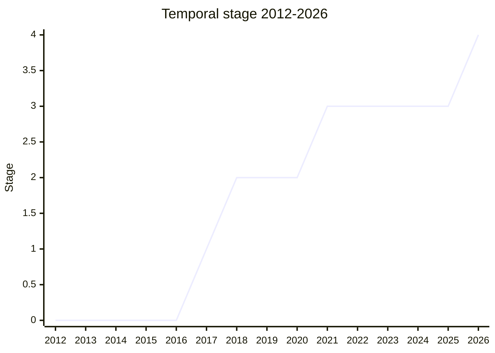

## Overview

Temporal is the **ECMA-262** proposal for a modern date-time API that replaces `Date`. It adds immutable types for exact time (`Temporal.Instant`), wall-clock values without a time zone (`Temporal.PlainDate`, `PlainTime`, `PlainDateTime`, `PlainYearMonth`, `PlainMonthDay`), exact time with a time zone (`Temporal.ZonedDateTime`), and `Temporal.Duration`. Anything that depends on the current environment is in `Temporal.Now`. The design and the plenary history are mostly ECMA-262 matters. Temporal also has a large ECMA-402 part, which is what this wiki tracks. That part covers first-class support for every CLDR calendar (with `iso8601` as the default), IANA time zones and their identifiers, and `toLocaleString` on every type, which goes through `Intl.DateTimeFormat` (and `Intl.DurationFormat` for durations). At Stage 4 [PFC](../people/PFC.md) counted 12,000 lines of spec text for ECMA-262 and said: "In ECMA 402, we are adding 1,600 lines." That text is the ECMA-402 Temporal PR, [ecma402#1044](https://github.com/tc39/ecma402/pull/1044), which also carries [Intl Era/Month Code](intl-era-month-code.md).

```js
// The ISO 8601 calendar is the default; other CLDR calendars are opt-in string identifiers
const date = Temporal.PlainDate.from("2026-03-11");
date.withCalendar("japanese").eraYear; // 8 (Reiwa 8)

// toLocaleString goes through Intl.DateTimeFormat
date.toLocaleString("en-US", { dateStyle: "long" }); // "March 11, 2026"

// A ZonedDateTime formats in its own time zone; Intl.DateTimeFormat methods reject it (PR #2522)
const zdt = Temporal.ZonedDateTime.from("2026-03-11T10:00[Asia/Tokyo]");
zdt.toLocaleString("en-US"); // a Tokyo wall-clock time, whatever the system time zone
new Intl.DateTimeFormat("en-US").format(zdt); // throws TypeError

// Durations format through Intl.DurationFormat
Temporal.Duration.from({ hours: 1, minutes: 46 }).toLocaleString("en"); // "1 hr, 46 min"
```

The canonical table lists nine champions: Philipp Dunkel ([PDL](../people/PDL.md)), Maggie Johnson-Pint ([MPT](../people/MPT.md), "Maggie Pint" in delegates.txt), Matt Johnson-Pint ([MAJ](../people/MAJ.md), "Matt Johnson"), Brian Terlson ([BT](../people/BT.md)), [SFC](../people/SFC.md), [USA](../people/USA.md), [PFC](../people/PFC.md), [JWS](../people/JWS.md) and [JGT](../people/JGT.md). [MPT](../people/MPT.md) presented the proposal for Stage 1 and 2. [PFC](../people/PFC.md) (Igalia, working in partnership with Bloomberg) presented many plenary slots from 2020 onward, including the Stage 3 and Stage 4 requests. [USA](../people/USA.md) took the string format to the IETF, and [SFC](../people/SFC.md) represented the Intl side in the champions group. [RGN](../people/RGN.md) is also listed in `champions`: at the Stage 4 plenary [PFC](../people/PFC.md) said "[RGN](../people/RGN.md) is a proposal champion" when asking for the ECMA-402 editors' sign-off. [RGN](../people/RGN.md) had also co-championed the Time Zone Canonicalization proposal with [JGT](../people/JGT.md) before it was merged into Temporal. TG2 never owned Temporal. Its ECMA-402 part was designed mostly in the Temporal champions' meetings and reached TG2 as implementer feedback, which TG2 delegates later saw as a process gap (see below). [FYT](../people/FYT.md) (V8), [YSZ](../people/YSZ.md) (JavaScriptCore), [DLM](../people/DLM.md) and [ABL](../people/ABL.md) (SpiderMonkey) brought most of that feedback.

## Stage history

| Meeting                                                                              | Venue   | Event                                                                                                                                                                                                                                                                                                                                                               | Stage |
| ------------------------------------------------------------------------------------ | ------- | ------------------------------------------------------------------------------------------------------------------------------------------------------------------------------------------------------------------------------------------------------------------------------------------------------------------------------------------------------------------- | ----- |
| [2017-03](https://github.com/tc39/notes/blob/main/meetings/2017-03/mar-23.md)        | plenary | Reached Stage 1. `Date Proposal - NodaTime as a built-in Module for stage 1` ([MPT](../people/MPT.md)). "Stage 1 acceptance"                                                                                                                                                                                                                                        | 0 → 1 |
| [2018-07](https://github.com/tc39/notes/blob/main/meetings/2018-07/july-26.md)       | plenary | `Temporal Proposal update` ([MPT](../people/MPT.md)). [SFC](../people/SFC.md): "Where is toLocaleString?"; [MPT](../people/MPT.md): Intl support "would have to be a separate proposal". "Not advancing yet due to deadline"                                                                                                                                        | 1     |
| [2018-09-20](https://github.com/tc39/ecma402/blob/main/meetings/notes-2018-09-20.md) | TG2     | `Intl support for Temporal` ([ecma402#254](https://github.com/tc39/ecma402/issues/254)); asked whether anything is needed before Stage 2, [DE](../people/DE.md): "IMO no, we just need to work this out by Stage 3"                                                                                                                                                 | 1     |
| [2018-09](https://github.com/tc39/notes/blob/main/meetings/2018-09/sept-27.md)       | plenary | Reached Stage 2. `Temporal for Stage 2` ([MPT](../people/MPT.md)): `valueOf` and `Now` cut; [TST](../people/TST.md) notes the lack of `Intl.DateTimeFormat` integration but does not block. "Stage 2 acceptance"                                                                                                                                                    | 1 → 2 |
| [2019-06-13](https://github.com/tc39/ecma402/blob/main/meetings/notes-2019-06-13.md) | TG2     | `Intl support for Temporal` ([proposal-temporal#129](https://github.com/tc39/proposal-temporal/issues/129)): TG2 goes with retrofitting `Intl.DateTimeFormat` to accept Temporal types instead of a new constructor                                                                                                                                                 | 2     |
| [2019-12-12](https://github.com/tc39/ecma402/blob/main/meetings/notes-2019-12-12.md) | TG2     | [SFC](../people/SFC.md) reports agreement on first-class calendar support in Temporal; `Default Calendar` options ([proposal-temporal#292](https://github.com/tc39/proposal-temporal/issues/292))                                                                                                                                                                   | 2     |
| [2020-06](https://github.com/tc39/notes/blob/main/meetings/2020-06/june-2.md)        | plenary | `Temporal Update` ([PFC](../people/PFC.md)): the default calendar is put to the committee; [TAB](../people/TAB.md): "I believe the Gregorian calendar is the right default here"                                                                                                                                                                                    | 2     |
| [2021-03](https://github.com/tc39/notes/blob/main/meetings/2021-03/mar-10.md)        | plenary | Reached Stage 3 (requested by [PFC](../people/PFC.md) on `mar-9.md`), "pending" five conditions, among them "implementations should not ship unflagged before IETF resolution on syntax"; [PFC](../people/PFC.md) lists the month-code format (shared with ICU4X) and rounding-mode names (shared with NumberFormat v3) as being standardised in parallel elsewhere | 2 → 3 |
| [2021-12-02](https://github.com/tc39/ecma402/blob/main/meetings/notes-2021-12-02.md) | TG2     | [FYT](../people/FYT.md), implementing in V8: the `Intl.DateTimeFormat` internal slots load several patterns instead of one (memory, performance); "Implementers could directly raise concerns to the champions of the proposal and any further discussion can take place here"                                                                                      | 3     |
| [2022-02-10](https://github.com/tc39/ecma402/blob/main/meetings/notes-2022-02-10.md) | TG2     | `Temporal Presentation` ([PFC](../people/PFC.md)): localized calendar and time zone names discussed; TG2 agrees that property-bag `calendar` / `timeZone` in `toLocaleString` options should work ([proposal-temporal#2005](https://github.com/tc39/proposal-temporal/issues/2005))                                                                                 | 3     |
| [2022-05-19](https://github.com/tc39/ecma402/blob/main/meetings/notes-2022-05-19.md) | TG2     | TG2 will track the ECMA-402 part of Temporal (and the calendar spec) in its proposal table; Intl.DurationFormat to be decoupled from Temporal ("Decouple the two proposals")                                                                                                                                                                                        | 3     |
| [2022-08-04](https://github.com/tc39/ecma402/blob/main/meetings/notes-2022-08-04.md) | TG2     | Observable changes to `Intl.DateTimeFormat` found by [FYT](../people/FYT.md) ([proposal-temporal#2363](https://github.com/tc39/proposal-temporal/issues/2363), [#1932](https://github.com/tc39/proposal-temporal/issues/1932)): "[USA](../people/USA.md) to attempt to revert behavior changes here"                                                                | 3     |
| [2023-02-09](https://github.com/tc39/ecma402/blob/main/meetings/notes-2023-02-09.md) | TG2     | Which time zone `Intl.DateTimeFormat` uses for a `ZonedDateTime` ([proposal-temporal#2479](https://github.com/tc39/proposal-temporal/pull/2479)); [FYT](../people/FYT.md) would block the PR as it stands; seven options listed                                                                                                                                     | 3     |
| [2023-03](https://github.com/tc39/notes/blob/main/meetings/2023-03/mar-21.md)        | plenary | Consensus on [PR #2522](https://github.com/tc39/proposal-temporal/pull/2522): `ZonedDateTime.prototype.toLocaleString` works, and passing a `ZonedDateTime` to `Intl.DateTimeFormat` methods throws                                                                                                                                                                 | 3     |
| [2023-04-06](https://github.com/tc39/ecma402/blob/main/meetings/notes-2023-04-06.md) | TG2     | `ZonedDateTimeFormat` ([FYT](../people/FYT.md)): "Stage 1 approval from TG2"; [SFC](../people/SFC.md) regrets that Temporal's formatters reached Stage 3 "without thorough review from TG2 people"                                                                                                                                                                  | 3     |
| [2023-05](https://github.com/tc39/notes/blob/main/meetings/2023-05/may-17.md)        | plenary | `Intl.ZonedDateTimeFormat` reaches Stage 1 ("Revisiting the way other Temporal types are constructed is explicitly out of scope"); Time Zone Canonicalization ([JGT](../people/JGT.md)) reaches Stage 2                                                                                                                                                             | 3     |
| [2023-07](https://github.com/tc39/notes/blob/main/meetings/2023-07/july-12.md)       | plenary | Time Zone Canonicalization reaches Stage 3 and is to be merged into Temporal as a normative PR; Temporal limits offset time zones to minute precision ([PR #2607](https://github.com/tc39/proposal-temporal/pull/2607)); "we can consider the normative work on the proposal to be done"                                                                            | 3     |
| [2023-09](https://github.com/tc39/notes/blob/main/meetings/2023-09/september-26.md)  | plenary | [ecma402#788](https://github.com/tc39/ecma402/pull/788) (offset time zones such as `+01:00` in ECMA-402, [USA](../people/USA.md)) reaches consensus ahead of Temporal                                                                                                                                                                                               | 3     |
| [2024-06](https://github.com/tc39/notes/blob/main/meetings/2024-06/june-11.md)       | plenary | [ecma402#877](https://github.com/tc39/ecma402/pull/877) (time zone ID requirements, [JGT](../people/JGT.md)) approved, aligning ECMA-402 with CLDR's handling of TZDB links                                                                                                                                                                                         | 3     |
| [2024-06](https://github.com/tc39/notes/blob/main/meetings/2024-06/june-12.md)       | plenary | `Temporal Stage 3 update and scope reduction`: removal of `Temporal.Calendar`, `Temporal.TimeZone`, user calendars and time zones, and the calendar-taking `Now.plainDate` / `Now.plainDateTime` / `Now.zonedDateTime` / `Instant.prototype.toZonedDateTime`, among about 20 items; RFC 9557 (the string format) has been published                                 | 3     |
| [2025-03-06](https://github.com/tc39/ecma402/blob/main/meetings/notes-2025-03-06.md) | TG2     | [DLM](../people/DLM.md) (Firefox, about to ship): "We have disagreements on ICU4X and ICU4C, which block us"; "What do implementers need in order to ship Temporal?" ([proposal-intl-era-monthcode#21](https://github.com/tc39/proposal-intl-era-monthcode/issues/21)) revives Intl Era/Month Code                                                                  | 3     |
| [2025-04](https://github.com/tc39/notes/blob/main/meetings/2025-04/april-14.md)      | plenary | "Firefox 139 will ship Temporal." Conclusion: "Temporal is at Stage 3 and ready to ship"                                                                                                                                                                                                                                                                            | 3     |
| [2026-01-08](https://github.com/tc39/ecma402/blob/main/meetings/notes-2026-01-08.md) | TG2     | `iso8601 as DateTimeFormat calendar` ([ecma402#1036](https://github.com/tc39/ecma402/issues/1036)): TG2 will ask CLDR to keep `-` and `:` separators and the `h23` hour cycle for `u-ca-iso8601`                                                                                                                                                                    | 3     |
| [2026-01](https://github.com/tc39/notes/blob/main/meetings/2026-01/january-20.md)    | plenary | V8 has unflagged Temporal; consensus on [PR #3246](https://github.com/tc39/proposal-temporal/pull/3246) (the `toLocaleString` methods of the Plain types no longer depend on the system time zone) and PR #3253                                                                                                                                                     | 3     |
| [2026-02-19](https://github.com/tc39/ecma402/blob/main/meetings/notes-2026-02-19.md) | TG2     | `Normative: Temporal stage 4 #1044` reviewed; [PFC](../people/PFC.md) will add Intl Era/Month Code to the same PR; DurationFormat text moves to ECMA-262 with `Temporal.Duration`                                                                                                                                                                                   | 3     |
| [2026-03](https://github.com/tc39/notes/blob/main/meetings/2026-03/march-11.md)      | plenary | Reached Stage 4. `Temporal for Stage 4` ([PFC](../people/PFC.md)): two engines at about 100% of test262, shipping unflagged in Firefox and V8-based browsers. "Temporal advances to stage 4." No separate specification document and no separate TG "At this time"                                                                                                  | 3 → 4 |
| [2026-04-16](https://github.com/tc39/ecma402/blob/main/meetings/notes-2026-04-16.md) | TG2     | [USA](../people/USA.md): "In position to cut new version of official spec, Era Monthcode and Temporal not in cut."                                                                                                                                                                                                                                                  | 4     |
| [2026-05](https://github.com/tc39/notes/blob/main/meetings/2026-05/may-19.md)        | plenary | `Temporal progress update`: the spec PRs [ecma262#3759](https://github.com/tc39/ecma262/pull/3759) and [ecma402#1044](https://github.com/tc39/ecma402/pull/1044) await editor review and "are currently the source of truth for Temporal"; two fixes (a rare time zone case found by Firefox fuzzing, and a duration-rounding case) reach consensus                 | 4     |



> How to read: Stage 1 in 2017-03 (`mar-23.md`), Stage 2 in 2018-09 (`sept-27.md`), Stage 3 in 2021-03 (requested on `mar-9.md`, granted on `mar-10.md`; Temporal went from 2 to 3 before Stage 2.7 existed) and Stage 4 in 2026-03 (`march-11.md`, the day after Intl Era/Month Code). The five years at Stage 3 included the IETF work on the string format (RFC 9557, reported as published at the 2024-06 plenary), the 2024 scope reduction and dozens of normative fixes; most of the update slots between 2021 and 2026 are left out of the table. At the Stage 4 plenary [SFC](../people/SFC.md) recalled July 2018 as the meeting "where a Temporal reached stage two"; the 2018-07 slot ended "Not advancing yet due to deadline", and Stage 2 came in 2018-09. Time Zone Canonicalization (Stage 1 2023-03, Stage 2 2023-05, Stage 3 2023-07) and `Intl.ZonedDateTimeFormat` (Stage 1 2023-05) are separate proposals; their rows are listed here because they changed Temporal's ECMA-402 behaviour, and the Stage column shows Temporal's stage. **Publication**: `raw/proposals/finished-proposals.md` gives an Expected Publication Year of 2027. The editors confirmed that Temporal missed the ES2026 cut (TG2 2026-04-16; at the meeting headed 2026-05-07, file `notes-2026-05-19.md`, [RGN](../people/RGN.md): "Not going to make the cut. So the 402 aspects won’t get in, either."; [PFC](../people/PFC.md): "The cutoff was at the start of March meeting."), which points to ES2027 (ECMA-402 14th edition). In the current raw snapshot ecma402#1044 is not merged into the spec source, so the edition is the canonical expectation, not yet a fact.

## Main issues

### Intl support: built into Temporal or a separate proposal?

The question of Intl support came up before Stage 2. At plenary [2018-07](https://github.com/tc39/notes/blob/main/meetings/2018-07/july-26.md), which [SFC](../people/SFC.md) later recalled as a first TC39 meeting:

> [SFC](../people/SFC.md):I was wondering how this interops with Intl.DateTimeFormat, etc. I would like to see any APIs that generate DateStrings to be Intl first. Where is toLocaleString?
>
> [MPT](../people/MPT.md): Sort of by definition this would have to be a separate proposal.

[SFC](../people/SFC.md) asked that, if the Intl part were split off, the two proposals "land at the same time", and [MPT](../people/MPT.md) replied that the process offered no way to guarantee that. At the Stage 2 request ([2018-09](https://github.com/tc39/notes/blob/main/meetings/2018-09/sept-27.md)) [TST](../people/TST.md) repeated the concern ("I was concerned with that and the lack of integration. There's been no update on that. While I'm fine with this going to Stage 2 without this."), and [DE](../people/DE.md) answered from TG2: "There's some spec editing, but I'm pretty confident that this will work out." TG2 had put `Intl support for Temporal` ([ecma402#254](https://github.com/tc39/ecma402/issues/254)) on its agenda from [2018-08-16](https://github.com/tc39/ecma402/blob/main/meetings/notes-2018-08-16.md). In the end the Intl part was not split off. At [2019-06-13](https://github.com/tc39/ecma402/blob/main/meetings/notes-2019-06-13.md) TG2 decided how it would be built:

> [DE](../people/DE.md): I think we should have the working assumption that Temporal is a global object and update Intl.DateTimeFormat accordingly.

[SFC](../people/SFC.md) asked whether everyone was "happy with the path of retrofitting Intl.DateTimeFormat to support Temporal types", and an attendee recorded as "[MM](../people/MM.md) (?)" saw no reason for a new constructor. [FYT](../people/FYT.md) pointed out that `Intl.DateTimeFormat` "is built for Date. When you have a temporal type, you don't have all the fields". [SFC](../people/SFC.md)'s table in proposal-temporal#129 mapped which fields each type can show. Ms2ger's preliminary spec PR (proposal-temporal#140) then needed TG2 reviewers; [SFC](../people/SFC.md) called it a "blocker on stage advancement for temporal" at [2019-07-11](https://github.com/tc39/ecma402/blob/main/meetings/notes-2019-07-11.md). Temporal therefore changed `Intl.DateTimeFormat` from inside an ECMA-262 proposal, and most of the later Intl disputes came from that choice.

### Calendars: first-class support and the default calendar

Temporal makes the calendar part of the data model. A date is stored as ISO year, month and day, and the calendar computes `year`, `month`, `monthCode`, `era` and so on. [SFC](../people/SFC.md) and other Intl delegates pushed for this. At TG2 [2019-12-12](https://github.com/tc39/ecma402/blob/main/meetings/notes-2019-12-12.md) [SFC](../people/SFC.md) reported that the champions had spent about 10 hours on calendar support, and opened the question of the default calendar ([proposal-temporal#292](https://github.com/tc39/proposal-temporal/issues/292)) with "We want people to do Intl correctly by default." [CLA](../people/CLA.md) and [RCA](../people/RCA.md) favoured options 2 and 3 of the issue and rejected option 4 ([LHO](../people/LHO.md) preferred option 2), while [SFC](../people/SFC.md) reported that [PDL](../people/PDL.md) preferred option 1 or 4 and would not consider 2 or 3 "unless there is overwhelming sentiment from the i18n side". At [2020-01-09](https://github.com/tc39/ecma402/blob/main/meetings/notes-2020-01-09.md) ([ecma402#395](https://github.com/tc39/ecma402/issues/395), a list of supported calendars) [SFC](../people/SFC.md) argued that "We shouldn’t have a situation where calendar is supported for formatting but not temporal math", while [SRL](../people/SRL.md) did not see "why ECMA402 needs to have a list of calendar". [SFC](../people/SFC.md) closed with "We can kick the can down the road." A closed list of calendars came only with Intl Era/Month Code (TG2 2025-12-04, approved 2026-01).

The same question returned in formatting. At [2020-04-23](https://github.com/tc39/ecma402/blob/main/meetings/notes-2020-04-23.md), where [PFC](../people/PFC.md) pitched Temporal to TG2, the question was which calendar wins in `toLocaleString`: the Temporal object's or the formatter's ([proposal-temporal#262](https://github.com/tc39/proposal-temporal/issues/262)). [PFC](../people/PFC.md) (and [PDL](../people/PDL.md), per [SFC](../people/SFC.md)'s relay of [PDL](../people/PDL.md)'s issue comment) sided with `Intl.DateTimeFormat`, [USA](../people/USA.md) noted that this gives the same result as `Date.prototype.toLocaleString`, and [SFC](../people/SFC.md) accepted the opposite only with a condition: "I’d be happy with that, as long as the default calendar on Temporal is set to the regional preferences instead of ISO." At plenary [2020-06](https://github.com/tc39/notes/blob/main/meetings/2020-06/june-2.md) [TAB](../people/TAB.md) held that "I believe the Gregorian calendar is the right default here", and [SFC](../people/SFC.md) asked for more review of the options. The final design uses `iso8601` as the default. Methods that create dates from the clock came in pairs, an `ISO`-suffixed form and a form that requires a calendar (`Now.plainDateISO()` / `Now.plainDate(calendar)`). The 2024 scope reduction removed the calendar-taking half. [SFC](../people/SFC.md) later explained at TG2 [2023-04-06](https://github.com/tc39/ecma402/blob/main/meetings/notes-2023-04-06.md) why the ISO default does not conflict with formatting:

> [SFC](../people/SFC.md): Regarding calendars vs time zones, this was thoroughly discussed among Temporal champions and it is not a problem for Calendars because Calendars in DTF are always in human calendars, but calendars in Temporal are usually ISO-8601, which is losslessly converted to the human calendar upon formatting.

Temporal specifies only the ISO calendar; everything else was implementation-defined. At the Stage 3 request ([2021-03](https://github.com/tc39/notes/blob/main/meetings/2021-03/mar-9.md)) [PFC](../people/PFC.md) flagged the month-code format, "currently shared between temporal and ICU4X", as something that might change if external groups decided otherwise. [USA](../people/USA.md) started to describe calendars more precisely in an Intl refactor ([proposal-temporal#1928](https://github.com/tc39/proposal-temporal/pull/1928), TG2 [2022-02-10](https://github.com/tc39/ecma402/blob/main/meetings/notes-2022-02-10.md)), noting that there is "no canonical documentation on how most of these calendars operate". [LAF](../people/LAF.md) asked about the five Islamic calendars in Unicode and the missing Julian calendar. [FYT](../people/FYT.md) then raised the gap at [2022-05-19](https://github.com/tc39/ecma402/blob/main/meetings/notes-2022-05-19.md) and [2022-06-16](https://github.com/tc39/ecma402/blob/main/meetings/notes-2022-06-16.md) ("I see a gap that needs to be filled in Temporal - Era is missing"). That became [Intl Era/Month Code](intl-era-month-code.md), which defines era codes, month codes, epoch years, the closed calendar list and the `islamic` fallback. That proposal's page covers the details. When Firefox was preparing to ship, [DLM](../people/DLM.md) reported at [2025-03-06](https://github.com/tc39/ecma402/blob/main/meetings/notes-2025-03-06.md) that ICU4X and ICU4C disagreed on non-ISO dates and that Firefox might ship only the unproblematic calendars at first. That report revived the stalled proposal. At Stage 4 [SFC](../people/SFC.md) summed up the Intl view: "I'm very happy that this committee was receptive to the idea of supporting non-Gregorian calendars in Temporal."

The ISO calendar also reached `Intl.DateTimeFormat`: the List returned by ECMA-402's `AvailableCalendars` "must include" `"iso8601"`. [PFC](../people/PFC.md) (as `PCO`) asked at [2025-12-04](https://github.com/tc39/ecma402/blob/main/meetings/notes-2025-12-04.md) what formatting with it should produce ([ecma402#1036](https://github.com/tc39/ecma402/issues/1036)). [FYT](../people/FYT.md) wanted to send such users to Temporal, while [EAO](../people/EAO.md) and [HJS](../people/HJS.md) wanted a human-readable form with year-month-day order, and [RGN](../people/RGN.md) did not think "it would be valid to defer to Temporal on this". At [2026-01-08](https://github.com/tc39/ecma402/blob/main/meetings/notes-2026-01-08.md) the conclusion was: "TG2 will recommend to CLDR to keep - and : as the date and time separators in all locales when using u-ca-iso8601, and to default to the h23 hour cycle unless another hour cycle is explicitly requested." Whether to write this into ECMA-402 was left open.

### Formatting Temporal objects with `Intl.DateTimeFormat`

Retrofitting `Intl.DateTimeFormat` meant one formatter object had to handle a `Date` and the Temporal types, each with a different set of fields. Temporal's spec does this by storing extra patterns in internal slots. [FYT](../people/FYT.md), implementing Temporal in V8, raised this at TG2 [2021-12-02](https://github.com/tc39/ecma402/blob/main/meetings/notes-2021-12-02.md) as a memory and performance risk, and [ZB](../people/ZB.md) agreed:

> [ZB](../people/ZB.md): I imagine that right now trying to implement temporal will architecturally impact memory usage in all browsers. And that's unacceptable for a new feature, in my opinion.

The conclusion was procedural: "Implementers could directly raise concerns to the champions of the proposal and any further discussion can take place here." The slots stayed, and other proposals were later measured against them. For [eraDisplay](intl-eradisplay.md) TG2 concluded at [2022-04-21](https://github.com/tc39/ecma402/blob/main/meetings/notes-2022-04-21.md): "Use internal slots. Try to make the mechanism consistent with Temporal once one or the other proposal is merged." At [2022-08-04](https://github.com/tc39/ecma402/blob/main/meetings/notes-2022-08-04.md) [FYT](../people/FYT.md) found that Temporal had changed the observable order of option reads in the `Intl.DateTimeFormat` constructor, breaking test262 ([proposal-temporal#2363](https://github.com/tc39/proposal-temporal/issues/2363)), and the error type thrown by `formatRange` ([#1932](https://github.com/tc39/proposal-temporal/issues/1932)). The conclusions asked [USA](../people/USA.md) to revert the first change and, for the second, to either revert it or come back with "the motivation for that change so an explicit decision can be made". [KG](../people/KG.md) noted that changing an error type has not been a web-compat problem in practice.

The hardest case was `ZonedDateTime`, the first formattable object that carries its own time zone. [PFC](../people/PFC.md) found that the spec always ignored that time zone ([proposal-temporal#2479](https://github.com/tc39/proposal-temporal/pull/2479)). At plenary [2023-01](https://github.com/tc39/notes/blob/main/meetings/2023-01/jan-31.md) the fix was deferred ("will be presented again in the following meeting"), and [FYT](../people/FYT.md) felt "it should be discussed here in TG2 first". At TG2 [2023-02-09](https://github.com/tc39/ecma402/blob/main/meetings/notes-2023-02-09.md) [JGT](../people/JGT.md) split the problem into three questions: optionless `toLocaleString`, optionless `format`, and a conflicting `timeZone` option. [FYT](../people/FYT.md) opposed the PR as it stood on consistency grounds, since `Intl.DateTimeFormat` resolves its time zone in the constructor. [SFC](../people/SFC.md) listed seven options, from "Don't accept ZDT in DTF.p.format" to "Add Intl.ZonedDateTimeFormat". The group agreed that `toLocaleString` should use the object's own time zone and should throw if a `timeZone` option is given. At [2023-03-09](https://github.com/tc39/ecma402/blob/main/meetings/notes-2023-03-09.md) [JGT](../people/JGT.md) presented what [SFC](../people/SFC.md) called "closest to a consensus response among Temporal champions": a one-bit change recording whether the formatter's time zone was explicit. [YSZ](../people/YSZ.md): "This sounds great." The Temporal champions then concluded, as [FYT](../people/FYT.md) reported at the next TG2 call, that `Intl.DateTimeFormat` would not take a `ZonedDateTime` at all. Plenary [2023-03](https://github.com/tc39/notes/blob/main/meetings/2023-03/mar-21.md) adopted [PR #2522](https://github.com/tc39/proposal-temporal/pull/2522): `ZonedDateTime.prototype.toLocaleString` works, and every `Intl.DateTimeFormat` method throws for a `ZonedDateTime`. [PFC](../people/PFC.md) called it "a temporary solution to allow toLocaleString to be used". A range of `ZonedDateTime`s cannot be formatted directly, and [JGT](../people/JGT.md) pointed to converting to another type as a workaround.

To fill the gap [FYT](../people/FYT.md) proposed `Intl.ZonedDateTimeFormat` (TG2 Stage 1 approval [2023-04-06](https://github.com/tc39/ecma402/blob/main/meetings/notes-2023-04-06.md), plenary Stage 1 [2023-05](https://github.com/tc39/notes/blob/main/meetings/2023-05/may-17.md), still Stage 1 in the canonical table). The TG2 discussion turned into a review of how Temporal had been designed:

> [SFC](../people/SFC.md): In terms of having separate objects, one regret I have with Temporal is that we didn’t have a thorough discussion of the whole mosaic of exactly how we make formatters for Temporal objects. We had a discussion with a small group of Temporal champions where we made the proposal, but didn’t have a full discussion with this group. This got to stage 3 without thorough review from TG2 people, which is one regret I have.

[USA](../people/USA.md) suggested one new formatter for all Temporal types, and [FYT](../people/FYT.md) said "Temporal went to stage 3 too early". The plenary kept the scope narrow: "Revisiting the way other Temporal types are constructed is explicitly out of scope", with [DE](../people/DE.md) and [JGT](../people/JGT.md) expecting late changes to be "strongly implementation-driven". `Intl.DateTimeFormat` therefore formats Plain types and `Instant` but not `ZonedDateTime`. A later formatting fix came at plenary [2026-01](https://github.com/tc39/notes/blob/main/meetings/2026-01/january-20.md) ([PR #3246](https://github.com/tc39/proposal-temporal/pull/3246)). [PFC](../people/PFC.md) explained that the Plain types' `toLocaleString` had been converting through the system time zone, so it could skip an hour on a DST day or a whole day in a time zone that changed sides of the date line: "The surprise is that they are subject to the system's time zone, which is kind of surprising, because Plain types, their whole thing is not being subject to time zones."

Two related questions were deferred. At [2022-02-10](https://github.com/tc39/ecma402/blob/main/meetings/notes-2022-02-10.md) TG2 agreed with [JGT](../people/JGT.md) that property-bag forms of `calendar` and `timeZone` should be accepted in `toLocaleString` options ([proposal-temporal#2005](https://github.com/tc39/proposal-temporal/issues/2005)). Whether all Intl APIs should accept Temporal's richer forms of `calendar` and `timeZone` ([ecma402#741](https://github.com/tc39/ecma402/issues/741)) was put off at [2023-01-12](https://github.com/tc39/ecma402/blob/main/meetings/notes-2023-01-12.md): "revisit it after Temporal lands at Stage 4".

### Time zones: offset zones, identifiers and canonicalization

Temporal brought IANA time zone identifiers to the surface of the language (in `toString()`, `toJSON()` and `timeZoneId`), so ECMA-402's loosely specified handling of them became visible. TG2 took up three time zone questions while Temporal was at Stage 3:

- **Offset time zones.** [RGN](../people/RGN.md) asked at [2022-12-08](https://github.com/tc39/ecma402/blob/main/meetings/notes-2022-12-08.md) for ECMA-402 to accept numeric offsets such as `+01:00` ([ecma402#683](https://github.com/tc39/ecma402/issues/683)), which ECMA-262 would accept after Temporal. [FYT](../people/FYT.md) worried at [2023-06-01](https://github.com/tc39/ecma402/blob/main/meetings/notes-2023-06-01.md) about the jump from fewer than 600 zones to an almost unlimited set, and [SBE](../people/SBE.md) asked about iCalendar's second-precision offsets. Temporal then limited offset zones to minutes ([PR #2607](https://github.com/tc39/proposal-temporal/pull/2607), plenary [2023-07](https://github.com/tc39/notes/blob/main/meetings/2023-07/july-12.md)). TG2 "Tentatively approved, pending updated spec text" at [2023-09-07](https://github.com/tc39/ecma402/blob/main/meetings/notes-2023-09-07.md), and [ecma402#788](https://github.com/tc39/ecma402/pull/788) reached consensus at plenary [2023-09](https://github.com/tc39/notes/blob/main/meetings/2023-09/september-26.md).
- **Canonicalization.** [JGT](../people/JGT.md) brought the divergence to TG2 at [2023-03-09](https://github.com/tc39/ecma402/blob/main/meetings/notes-2023-03-09.md) ([proposal-temporal#2516](https://github.com/tc39/proposal-temporal/pull/2516)): Firefox follows TZDB, while V8 and WebKit follow ICU/CLDR, so `Europe/Kiev` and `Europe/Kyiv` differ by engine. [JGT](../people/JGT.md): "Main concern is that once Temporal is released, changing canonicalization behavior could be much more disruptive than it is now." [SFC](../people/SFC.md) wanted the scheme defined in UTS 35 rather than invented ("We should not in ECMA-402 invent canonicalization schemes"), and [RGN](../people/RGN.md) and [JGT](../people/JGT.md) countered that following IANA links is not a new scheme ([RGN](../people/RGN.md): "It is inaccurate to call this as a new canonicalization scheme"). TG2's conclusion was "OK to entertain a proposal in this space". The resulting Time Zone Canonicalization proposal ([JGT](../people/JGT.md) with [RGN](../people/RGN.md)) reached Stage 3 at [2023-07](https://github.com/tc39/notes/blob/main/meetings/2023-07/july-12.md) and was merged into Temporal: IDs given by the user are no longer replaced by canonical ones, and equality canonicalizes both sides. Changing the canonical IDs themselves before Temporal was rejected at TG2 [2024-01-18](https://github.com/tc39/ecma402/blob/main/meetings/notes-2024-01-18.md): "Do not make any changes right now. Wait for Temporal and make a change then." [JGT](../people/JGT.md)'s [ecma402#877](https://github.com/tc39/ecma402/pull/877) (TG2 approval [2024-04-25](https://github.com/tc39/ecma402/blob/main/meetings/notes-2024-04-25.md), plenary [2024-06](https://github.com/tc39/notes/blob/main/meetings/2024-06/june-11.md)) adopted CLDR's rule of ignoring TZDB links across country codes, with a recommended two-year wait before a renamed city's ID becomes primary. (The plenary conclusion prints the PR number as "#787".) [YSZ](../people/YSZ.md) reported at [2026-06-11](https://github.com/tc39/ecma402/blob/main/meetings/notes-2026-06-11.md) that JavaScriptCore had completed time zone canonicalization as part of its Temporal work.
- **Unknown system time zones.** [JGT](../people/JGT.md) proposed `Etc/Unknown` (ICU's identifier) for an OS time zone that the engine does not recognise ([proposal-canonical-tz#25](https://github.com/tc39/proposal-canonical-tz/pull/25), TG2 [2023-06-01](https://github.com/tc39/ecma402/blob/main/meetings/notes-2023-06-01.md) and [2023-06-29](https://github.com/tc39/ecma402/blob/main/meetings/notes-2023-06-29.md)). [YSZ](../people/YSZ.md) (as `YSK`) objected that the ID is not in IANA and breaks other tools, preferring the current fallback to UTC, and [SFC](../people/SFC.md) suggested falling back to the current offset. No TG2 conclusion is recorded.

The identifier questions continued after Stage 4. At [2026-10-08](https://github.com/tc39/ecma402/blob/main/meetings/notes-2026-10-08.md) [JGT](../people/JGT.md) raised [ecma402#1103](https://github.com/tc39/ecma402/issues/1103): TZDB made legacy IDs such as `EST5EDT` primary zones again, so `Intl.supportedValuesOf("timeZone")` would list them in time zone pickers.

### Localized names for calendars and time zones

At the Temporal presentation to TG2 ([2022-02-10](https://github.com/tc39/ecma402/blob/main/meetings/notes-2022-02-10.md)) [USA](../people/USA.md) asked whether calendars and time zones should get localized names through `toLocaleString`. Calendar names looked easy. Time zone names did not, because the name depends on the instant ("Pacific Standard Time" vs. "Pacific Daylight Time") and some zones switch metazones. [SFC](../people/SFC.md) noted that CLDR's "exemplar city" names were not shipped for lack of a compelling use case, and [JGT](../people/JGT.md) concluded: "So it sounds like time zone names need a lot of work on the ECMA-402 side before we could add it to Temporal." [PFC](../people/PFC.md) suggested an issue in the Temporal v2 repository. `Temporal.Calendar.prototype.toLocaleString` ([proposal-temporal#2367](https://github.com/tc39/proposal-temporal/issues/2367)) was postponed at [2022-08-04](https://github.com/tc39/ecma402/blob/main/meetings/notes-2022-08-04.md). At [2023-01-12](https://github.com/tc39/ecma402/blob/main/meetings/notes-2023-01-12.md) ([temporal-v2#25](https://github.com/js-temporal/proposal-temporal-v2/issues/25)) [USA](../people/USA.md) was "Strongly in support", and [FYT](../people/FYT.md) (as `FYC`) wanted it outside the "very thick" current proposal. The 2024 scope reduction then removed `Temporal.Calendar` itself. The related request to enumerate a calendar's eras ([ecma402#598](https://github.com/tc39/ecma402/issues/598)) was left for "a bigger proposal about calendar display names or datetime picker components" (2022-02-10).

### Durations and `Intl.DurationFormat`

`Temporal.Duration` was the main motivation for [Intl.DurationFormat](intl-durationformat.md). At [2020-01-09](https://github.com/tc39/ecma402/blob/main/meetings/notes-2020-01-09.md), on the question of where `Temporal.Duration.prototype.toLocaleString` should go, [DE](../people/DE.md) replied "Let’s do DurationFormat!". At [2020-01-30](https://github.com/tc39/ecma402/blob/main/meetings/notes-2020-01-30.md) [SFC](../people/SFC.md) set the division of labour: "I think we should try to make the math all on the Temporal side, and Intl.DurationFormat should optionally filter fields and display them, but no math." Temporal's signed durations, its plural unit names (TG2 [2021-04-08](https://github.com/tc39/ecma402/blob/main/meetings/notes-2021-04-08.md) recommended that Temporal reconsider them) and its duration limits all fed back into DurationFormat. DurationFormat had borrowed Temporal's string-parsing AOs, so at [2022-05-19](https://github.com/tc39/ecma402/blob/main/meetings/notes-2022-05-19.md) TG2 agreed to "Decouple the two proposals", which let DurationFormat reach Stage 4 in 2024 without depending on Temporal. Those decisions are on the DurationFormat page. When the ECMA-402 Temporal PR was reviewed at [2026-02-19](https://github.com/tc39/ecma402/blob/main/meetings/notes-2026-02-19.md), [SFC](../people/SFC.md) asked why it deleted DurationFormat text, and [PFC](../people/PFC.md) replied: "Many of these things are moving into 262 with Temporal.Duration." In 2026 `Temporal.Duration` came up in the debate on time units in [Amount](amount.md): at [2026-06-11](https://github.com/tc39/ecma402/blob/main/meetings/notes-2026-06-11.md) [SFC](../people/SFC.md) argued that durations belong to DurationFormat and Temporal.Duration ([RGN](../people/RGN.md) disagreed that there must be only one way), and at [2026-10-08](https://github.com/tc39/ecma402/blob/main/meetings/notes-2026-10-08.md) [SFC](../people/SFC.md) took an action to file an issue about converting an Amount to a `Temporal.Duration`.

### TG2 oversight of Temporal's ECMA-402 part

TG2 repeatedly asked how a Stage 3 ECMA-262 proposal should be reviewed when it changes so much of ECMA-402. At [2022-05-19](https://github.com/tc39/ecma402/blob/main/meetings/notes-2022-05-19.md) [FYT](../people/FYT.md) asked that the issues in Temporal's Intl chapter "be tracked here", and [SFC](../people/SFC.md) observed: "Temporal proposal is about the size of entire 402 (or bigger)." TG2 agreed to track the ECMA-402 section and the calendar spec as rows in its proposal table, while [SFC](../people/SFC.md) held that "material discussions should happen in the Temporal champions meeting". After [FYT](../people/FYT.md)'s findings at [2022-08-04](https://github.com/tc39/ecma402/blob/main/meetings/notes-2022-08-04.md) the complaint sharpened:

> [FYT](../people/FYT.md): I'm worried that Temporal is making changes without putting them up for discussion in TC39-TG2. It's likely that we would agree with the change, but it should have been more explicit.

[USA](../people/USA.md) called it "a process oversight": "But Temporal is special, because it's primarily a 262 proposal that makes a lot of changes to 402." [SFC](../people/SFC.md) said champions had presented to TG2 several times and encouraged implementers to open issues. The same feeling came back in [SFC](../people/SFC.md)'s 2023-04-06 regret and in [FYT](../people/FYT.md)'s remark during Time Zone Canonicalization's Stage 3 review ([2023-06-29](https://github.com/tc39/ecma402/blob/main/meetings/notes-2023-06-29.md)): "I’m unhappy that Temporal went to stage 3, I spent months on implementation and when it changes I have to work to catch up." TG2 also used the experience to argue for moving pieces out of the proposal early. At [2022-10-06](https://github.com/tc39/ecma402/blob/main/meetings/notes-2022-10-06.md) [PFC](../people/PFC.md) supported landing Temporal-motivated ECMA-402 changes separately ("It does have value to peel things off the large proposal"), as was being done with the default time zone in ECMA-262. [FYT](../people/FYT.md) preferred to wait for Temporal and avoid duplicate work. That PR ([ecma402#715](https://github.com/tc39/ecma402/pull/715), `fractionalSecondDigits` up to 9) stalled, but the offset time zone and time zone ID changes were approved for ECMA-402 ahead of Temporal (previous section). At plenary [2023-07](https://github.com/tc39/notes/blob/main/meetings/2023-07/july-13.md) [SFC](../people/SFC.md) named "Intl Segmenter, Intl DurationFormat, and Temporal" as proposals with implementer-reported problems at Stage 3 (see [Intl.DurationFormat](intl-durationformat.md)), while [PFC](../people/PFC.md) argued at Stage 4 that the long Stage 3 "has been beneficial in a number of ways".

### The 2024 scope reduction and its Intl side

At plenary [2024-06](https://github.com/tc39/notes/blob/main/meetings/2024-06/june-12.md) [JGT](../people/JGT.md) reported strong feedback "from Google, from Apple, from Mozilla" that Temporal was too big. The committee removed about 20 items, which the conclusion lists. Two removals touch the Intl side. First, `Temporal.Calendar`, `Temporal.TimeZone` and user-defined calendars and time zones were removed, leaving only built-in calendars and time zones named by string identifiers; the time zone transition lookup moved to `ZonedDateTime`. Second, the calendar-taking constructors (`Now.plainDate`, `Now.plainDateTime`, `Now.zonedDateTime`, `Instant.prototype.toZonedDateTime`) were removed, leaving only the ISO-suffixed ones. [SFC](../people/SFC.md) stressed that the built-in non-ISO calendars remain supported, "the most important thing from my perspective coming from Intl":

> [SFC](../people/SFC.md): I used some use cases for custom calendars in preparation for this slide. And basically all cases that I found like were better served by working with CLDR, and then you have the calculation, and you have formatting and you have the support S and other ecosystems.

[DE](../people/DE.md) added that "custom calendar and custom API should be used for Intl" and that the removed design was "at the wrong level conceptually". [JHD](../people/JHD.md) wanted reified Calendar and TimeZone objects to avoid a "stringly-typed" API, and [SBE](../people/SBE.md) asked for user time zones to return based on the iCalendar data model; both points were recorded for future proposals. With the closed set of built-in calendars, defining what each calendar does became more pressing, and that work went into [Intl Era/Month Code](intl-era-month-code.md) in 2025.

### The ECMA-402 Temporal PR (ecma402#1044) and the edition

The Stage 4 criteria require a spec PR to each standard. [PFC](../people/PFC.md) opened [ecma402#1044](https://github.com/tc39/ecma402/pull/1044), and at TG2 [2026-02-19](https://github.com/tc39/ecma402/blob/main/meetings/notes-2026-02-19.md) said Intl Era/Month Code would be added to it, "since it makes sense to merge them together". Shared operations such as `GetOption` and the ASCII case helpers move to ECMA-262. [SFC](../people/SFC.md) suggested landing the operations that move in standalone PRs, [RGN](../people/RGN.md) agreed that this "Allows for comprehensible sequencing", and [PFC](../people/PFC.md) named "262/402 editor time/attention" as the main bottleneck. At Stage 4 ([2026-03](https://github.com/tc39/notes/blob/main/meetings/2026-03/march-11.md)) [PFC](../people/PFC.md) said the ECMA-402 editors had reviewed the PR ("I know that usual and Ben have reviewed it"; the transcript's "usual" is presumably [USA](../people/USA.md), and Ben is [BAN](../people/BAN.md)) and asked [RGN](../people/RGN.md) for an official sign-off. The ECMA-262 editors ([MF](../people/MF.md)) proposed publishing Temporal as a separate document with its own TG, citing concerns about their ability to maintain it and the model of ECMA-402 and TG2 ("Similarly, with Intl and TG2, ..."). [JHD](../people/JHD.md) and [CDA](../people/CDA.md) pushed back, and [SFC](../people/SFC.md) noted that interest in Temporal is proportionally higher in TG2 than in TG1. The conclusion keeps Temporal in ECMA-262 "At this time", with a follow-up within a year. Temporal missed the ES2026 cut (TG2 2026-04-16 and 2026-05-07; see the chart note). At plenary [2026-05](https://github.com/tc39/notes/blob/main/meetings/2026-05/may-19.md) the two PRs were declared "the source of truth for Temporal" until merged, and at TG2 [2026-07-09](https://github.com/tc39/ecma402/blob/main/meetings/notes-2026-07-09.md) [YSZ](../people/YSZ.md), reporting that JavaScriptCore had started enabling Temporal, said "#1044 is half done". The canonical Expected Publication Year is 2027.

### Plenary issues outside this wiki's focus

Most of Temporal's plenary history concerns ECMA-262 and is only summarised here. The topics were how to isolate nondeterminism (`Now`, debated with [MM](../people/MM.md) and [DD](../people/DD.md) at Stage 2), subclassing and `@@species` and calendar-blind `compare()` ([SYG](../people/SYG.md), [JHD](../people/JHD.md), [KG](../people/KG.md) at Stage 3), and the ISO 8601 / RFC 3339 extensions with `[time zone]` and `[u-ca=calendar]` annotations, standardised at the IETF as RFC 9557. Further topics were removing unbounded integer arithmetic and capping `Duration` fields (2023), implementation size (2024), and whether Temporal should be a separate document (2026). The plenary-focused [tc39-llm-wiki](https://github.com/Jxck/tc39-llm-wiki) covers them in more depth.

## Related proposals

- [Intl Era/Month Code](intl-era-month-code.md) — specifies the non-ISO calendars that Temporal left implementation-defined (era and month codes, epoch years, the closed calendar list, the `islamic` fallback); Stage 4 the day before Temporal, and its text rides on ecma402#1044.
- [Intl.DurationFormat](intl-durationformat.md) — formats `Temporal.Duration`; coupled through borrowed AOs and then decoupled in 2022, and its Temporal-related text moves to ECMA-262 with #1044.
- [eraDisplay option for Intl.DateTimeFormat](intl-eradisplay.md) — decoupled from Temporal before Stage 2; follows Temporal's per-type pattern slots, and its proposed "numeric" year style matches Temporal's arithmetic `year`.
- [Stable Formatting](stable-formatting.md) — uses Temporal's ISO 8601 strings as the reference for stable date output; the `iso8601` DateTimeFormat calendar debate (ecma402#1036) touched the same ground.
- [Intl Locale Info](intl-locale-info.md) — `getWeekInfo()` follows Temporal's 1-7 weekday numbering; `minimalDays` was questioned because Temporal uses only ISO week numbers.
- [Amount](amount.md) and [Intl Sequence Units](intl-sequence-units.md) — time units there are weighed against `Temporal.Duration` and DurationFormat (2026).
- `intl-zoneddatetimeformat` — `Intl.ZonedDateTimeFormat` ([FYT](../people/FYT.md)), Stage 1 since 2023-05, for configurable formatting of `ZonedDateTime` after PR #2522.
- `proposal-canonical-tz` — Time Zone Canonicalization ([JGT](../people/JGT.md), [RGN](../people/RGN.md)), Stage 3 in 2023-07 and merged into Temporal.

## Sources

TG2:

- https://github.com/tc39/ecma402/blob/main/meetings/notes-2018-08-16.md
- https://github.com/tc39/ecma402/blob/main/meetings/notes-2018-09-20.md
- https://github.com/tc39/ecma402/blob/main/meetings/notes-2019-06-13.md
- https://github.com/tc39/ecma402/blob/main/meetings/notes-2019-07-11.md
- https://github.com/tc39/ecma402/blob/main/meetings/notes-2019-12-12.md
- https://github.com/tc39/ecma402/blob/main/meetings/notes-2020-01-09.md
- https://github.com/tc39/ecma402/blob/main/meetings/notes-2020-01-30.md
- https://github.com/tc39/ecma402/blob/main/meetings/notes-2020-04-23.md
- https://github.com/tc39/ecma402/blob/main/meetings/notes-2021-04-08.md
- https://github.com/tc39/ecma402/blob/main/meetings/notes-2021-12-02.md
- https://github.com/tc39/ecma402/blob/main/meetings/notes-2022-02-10.md
- https://github.com/tc39/ecma402/blob/main/meetings/notes-2022-04-21.md
- https://github.com/tc39/ecma402/blob/main/meetings/notes-2022-05-19.md
- https://github.com/tc39/ecma402/blob/main/meetings/notes-2022-06-16.md
- https://github.com/tc39/ecma402/blob/main/meetings/notes-2022-08-04.md
- https://github.com/tc39/ecma402/blob/main/meetings/notes-2022-10-06.md
- https://github.com/tc39/ecma402/blob/main/meetings/notes-2022-12-08.md
- https://github.com/tc39/ecma402/blob/main/meetings/notes-2023-01-12.md
- https://github.com/tc39/ecma402/blob/main/meetings/notes-2023-02-09.md
- https://github.com/tc39/ecma402/blob/main/meetings/notes-2023-03-09.md
- https://github.com/tc39/ecma402/blob/main/meetings/notes-2023-04-06.md
- https://github.com/tc39/ecma402/blob/main/meetings/notes-2023-06-01.md
- https://github.com/tc39/ecma402/blob/main/meetings/notes-2023-06-29.md
- https://github.com/tc39/ecma402/blob/main/meetings/notes-2023-09-07.md
- https://github.com/tc39/ecma402/blob/main/meetings/notes-2024-01-18.md
- https://github.com/tc39/ecma402/blob/main/meetings/notes-2024-04-25.md
- https://github.com/tc39/ecma402/blob/main/meetings/notes-2025-03-06.md
- https://github.com/tc39/ecma402/blob/main/meetings/notes-2025-12-04.md
- https://github.com/tc39/ecma402/blob/main/meetings/notes-2026-01-08.md
- https://github.com/tc39/ecma402/blob/main/meetings/notes-2026-02-19.md
- https://github.com/tc39/ecma402/blob/main/meetings/notes-2026-04-16.md
- https://github.com/tc39/ecma402/blob/main/meetings/notes-2026-05-19.md
- https://github.com/tc39/ecma402/blob/main/meetings/notes-2026-06-11.md
- https://github.com/tc39/ecma402/blob/main/meetings/notes-2026-07-09.md
- https://github.com/tc39/ecma402/blob/main/meetings/notes-2026-10-08.md

Plenary:

- https://github.com/tc39/notes/blob/main/meetings/2017-03/mar-23.md
- https://github.com/tc39/notes/blob/main/meetings/2018-07/july-26.md
- https://github.com/tc39/notes/blob/main/meetings/2018-09/sept-27.md
- https://github.com/tc39/notes/blob/main/meetings/2020-06/june-2.md
- https://github.com/tc39/notes/blob/main/meetings/2021-03/mar-9.md
- https://github.com/tc39/notes/blob/main/meetings/2021-03/mar-10.md
- https://github.com/tc39/notes/blob/main/meetings/2023-01/jan-31.md
- https://github.com/tc39/notes/blob/main/meetings/2023-03/mar-21.md
- https://github.com/tc39/notes/blob/main/meetings/2023-03/mar-23.md
- https://github.com/tc39/notes/blob/main/meetings/2023-05/may-17.md
- https://github.com/tc39/notes/blob/main/meetings/2023-07/july-12.md
- https://github.com/tc39/notes/blob/main/meetings/2023-09/september-26.md
- https://github.com/tc39/notes/blob/main/meetings/2024-06/june-11.md
- https://github.com/tc39/notes/blob/main/meetings/2024-06/june-12.md
- https://github.com/tc39/notes/blob/main/meetings/2025-04/april-14.md
- https://github.com/tc39/notes/blob/main/meetings/2025-11/november-18.md
- https://github.com/tc39/notes/blob/main/meetings/2026-01/january-20.md
- https://github.com/tc39/notes/blob/main/meetings/2026-03/march-11.md
- https://github.com/tc39/notes/blob/main/meetings/2026-05/may-19.md
